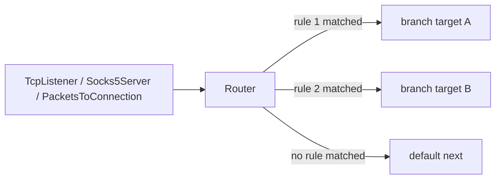

<!--
Documentation version: 159
Sync note: Any change to this file must also be applied to WaterWall/tunnels/Router/description.md and WaterWall-Docs/i18n/fa/docusaurus-plugin-content-docs/current/02-noderefs/Router.mdx, and all files must keep the same documentation version.
-->

# Router

`Router` is WaterWall's rule-based branch selector for connection-oriented
traffic. It sits in the middle of a chain, evaluates ordered rules, and sends
each TCP or UDP connection to one selected branch. The first matching rule wins;
if none matches, the connection follows `next`. Some rules use information already
available when the connection arrives. Others inspect the first application bytes
before choosing a branch.

Use it when one inbound path should split into several outbound paths by source
IP, inbound port, destination IP, destination domain, network type, detected
protocol, HTTP upgrade flag, or authenticated username/password.



## Mental Model

Think of `Router` as an early selector when it can be, and a deferred branch
selector when it must inspect bytes:

- With no root `sniffing`, Router evaluates the leading metadata-only rules
  during `Init`. It skips nonmatches and initializes the first matching branch,
  even if later rules need payload inspection. If every rule is metadata-only
  and none matches, it uses the default `next` immediately.
- Reaching the first rule containing `protocol` or `attributes` stops this
  initial scan. Router does not skip it to reach a later metadata match. A rule
  combining metadata and those conditions still waits for payload.
- Explicit root `sniffing` preserves payload-based classification so domain
  observation or rewriting happens before branch Init. Deferred lines buffer
  upstream bytes while deciding.
- A metadata-evaluation error closes the line; it does not select a later rule
  or fall through to the default route.
- After a deferred rule wins, it initializes the selected branch and replays the
  buffered bytes to that branch.
- The decision is made once per connection. Later payloads go directly through
  the same selected branch.
- Downstream traffic from the selected branch returns through `Router` to the
  previous node.

If no rule matches, the connection uses the node's top-level `next`. That `next`
is the default route.

At `Init`, Router clears stale observed-protocol bits while preserving separate
one-shot route-control metadata and the resolver-generated DNS marker. This lets
a protocol tunnel carry an already
negotiated destination through Router to its designated outbound adapter without
making that metadata available to `protocol` rules.

:::warning
A payload-dependent decision needs the client side to send first. For a
server-first flow or DNS transport that needs establishment before writing,
place its matching metadata rule before any `protocol` or `attributes` rule and
leave root `sniffing` off. Later payload rules do not delay the early match;
an earlier payload rule or explicit root sniffing does.
:::

## Typical Placement

Route a normal TCP listener:

```text
TcpListener -> Router
                 |-- target: tls_path
                 |-- target: ssh_path
                 `-- next: default_path
```

Route after a proxy server that already parsed destination metadata:

```text
TcpListener -> Socks5Server -> Router -> TcpConnector
```

Route connection lines created from packet traffic:

```text
TunDevice -> PacketsToConnection -> Router -> TcpUdpConnector
```

`Router` is a layer-4 tunnel. It routes WaterWall lines, not raw packets by
itself. For raw packet chains, first use a packet/connection bridge such as
`PacketsToConnection` when you need connection-style routing.

A destination may be an IP address or a hostname supplied by the previous node.
Matching a hostname with `destination-domain` needs no DNS lookup. To match an
unresolved hostname against IP or GeoIP rules, first resolve it to an IP; an
existing IP needs no lookup. See [DNS resolution before routing](#dns-behaviour).

## Complete Example

### Route a local SOCKS proxy through selected outbound paths

This complete node configuration accepts local SOCKS5 CONNECT requests. It rejects
port 25, sends `*.example.org` through an upstream HTTP proxy, and connects directly
to other destinations. The SOCKS node supplies the destination; the rules do not
need payload sniffing or an authenticated username.

```text
TcpListener -> Socks5Server -> Router
                                 |-- destination port 25 -> BlackHole(active)
                                 |-- *.example.org -> HttpProxyClient -> TcpConnector(proxy)
                                 `-- default -> TcpConnector(requested destination)
```
```json
{
  "name": "local-socks-routing",
  "nodes": [
    {
      "name": "entry",
      "type": "TcpListener",
      "settings": {
        "address": "127.0.0.1",
        "port": 1080
      },
      "next": "socks"
    },
    {
      "name": "socks",
      "type": "Socks5Server",
      "settings": {
        "no-auth": true,
        "connect": true,
        "udp": false
      },
      "next": "route"
    },
    {
      "name": "route",
      "type": "Router",
      "settings": {
        "rules": [
          {
            "destination-port": 25,
            "target": "reject"
          },
          {
            "destination-domain": [
              "*.example.org"
            ],
            "target": "via-proxy"
          }
        ]
      },
      "next": "direct"
    },
    {
      "name": "reject",
      "type": "BlackHole",
      "settings": {
        "mode": "active"
      }
    },
    {
      "name": "via-proxy",
      "type": "HttpProxyClient",
      "settings": {
        "target-address": "dest_context->address",
        "port": "dest_context->port"
      },
      "next": "proxy-socket"
    },
    {
      "name": "proxy-socket",
      "type": "TcpConnector",
      "settings": {
        "address": "192.0.2.20",
        "port": 3128
      }
    },
    {
      "name": "direct",
      "type": "TcpConnector",
      "settings": {
        "address": "dest_context->address",
        "port": "dest_context->port"
      }
    }
  ]
}
```
Save this object as a node config file and list it in `core.json.configs`.
Replace `192.0.2.20:3128` with your HTTP proxy endpoint. The proxy must allow
CONNECT to the requested destination; add its credentials to `HttpProxyClient`
when required. The proxy socket's address identifies that proxy, while
`HttpProxyClient` captures the application's requested destination first.

Use a SOCKS client that sends the hostname (for example, curl's
`--socks5-hostname`) to exercise the domain rule. If the application resolves the
name locally and sends only an IP address, this metadata-only example cannot
match `*.example.org`. Rule order matters: the port-25 rejection wins first.
The no-auth listener is bound to loopback.

## Required Fields

Top-level fields:

| Field | Type | Description |
| --- | --- | --- |
| `name` | string | User-chosen node name. Must be unique inside the config file. |
| `type` | string | Must be exactly `"Router"`. |
| `next` | string | Required. This is the default route used when no rule matches. |

`settings` may be omitted or empty. A `Router` with no rules sends every
connection to `next`; if `sniffing` is enabled and domain sniffing is allowed for
the line, it may still sniff the first payload to populate `dest_ctx.domain`
before forwarding.

## Settings

| Setting | Type | Default | Description |
| --- | --- | --- | --- |
| `rules` | array | unset | Ordered list of routing rules. Missing means all traffic uses `next`. An empty array is invalid. |
| `sniffing` | array | unset | Domain-sniffing modes. Supported values: `"http1"`, `"http2"`, `"http"`, `"tls"`, `"quic"`, `"http3"`. |
| `sniff-even-if-domain-is-already-provided` | boolean | `false` | When `false`, Router skips Host/:authority/SNI domain sniffing for destinations that already have `dest_ctx.domain`. If `true`, sniffing may replace an existing destination domain. Use carefully. |
| `dns-behaviour` | object | Resolution disabled | Optional [DNS resolution before routing](#dns-behaviour). Needed when a destination is an unresolved hostname and rules require its IP. |
| `geoip-db-path` | string | unset | Required only if a rule uses `geoip:<cc>` in `source-ips` or `destination-ip`. |
| `geosite-db-path` | string | unset | Required only if a rule uses `geosite:<list>` in `destination-domain`. |

`"http"` is an alias for HTTP/1 Host plus cleartext HTTP/2 authority sniffing.
It does not include HTTP/3; use `"http3"` as well when you want QUIC/HTTP/3 SNI.

## Rule Basics

A rule is a `target` plus at least one condition.

```json
{
  "destination-port": [
    80,
    443
  ],
  "network": "tcp",
  "target": "web_path"
}
```

Matching rules:

| Scope | Logic |
| --- | --- |
| Values inside one condition | OR. `destination-port: [80, 443]` matches either port. |
| Conditions inside one rule | AND. Every configured condition must match. |
| Rules inside `rules` | First match wins, in JSON order. Later rules are skipped. |
| No matching rule | The connection goes to top-level `next`. |

Unknown fields inside a rule are ignored with a warning. A rule with only
`target` and no conditions is invalid.

## Condition Reference

| Condition | Accepts | Matches |
| --- | --- | --- |
| `source-ips` | string or array | Client/source IP. Supports IP, CIDR, and `geoip:<cc>`. |
| `source-port` | integer or array | Inbound/local listener port stored in `src_ctx.port`. |
| `source-port-range` | two-integer array | Inclusive inbound/local listener port range. |
| `destination-ip` | string or array | Destination IP. Supports IP, CIDR, and `geoip:<cc>`. Domain-only destinations do not match. |
| `destination-port` | integer or array | Destination port stored in `dest_ctx.port`. |
| `destination-port-range` | two-integer array | Inclusive destination port range. |
| `destination-domain` | string or array | Destination domain, including sniffed HTTP Host/:authority or TLS/QUIC SNI when root `sniffing` is enabled and domain sniffing is allowed for the line. Supports exact, wildcard, `*`, and `geosite:<list>`. |
| `network` | string or array | Destination transport flags: `tcp`, `udp`, `icmp`, `packet`. Comma-combined strings like `"tcp,udp"` are accepted. |
| `resolver-dns` | boolean | Resolver-generated logical DNS traffic (`true`) or lines without that marker (`false`); available at Init without sniffing. |
| `protocol` | string or array | Protocol detected from first payload: `http1`, `tls`, `bittorrent`. |
| `attributes` | non-empty array | Sniffed boolean attributes. Currently supports `http_upgrade_present`. |
| `username` | string or array | Exact case-sensitive match against authenticated credential markers on the line. |
| `password` | string or array | Exact case-sensitive match against authenticated credential markers on the line. |

Port values must be integers in `0..65535`. A port range must contain exactly
two integers and the first value must be less than or equal to the second.

## Source Conditions

### `source-ips`

`source-ips` matches the line source address:

```json
{
  "source-ips": [
    "10.0.0.0/8",
    "192.0.2.10",
    "geoip:ir"
  ],
  "target": "local_or_iran_path"
}
```

Supported values:

- IPv4 or IPv6 address
- IPv4 or IPv6 CIDR
- `geoip:<ISO-3166-alpha-2>`, such as `geoip:ir` or `geoip:us`

Bare IPs are treated as host routes: `/32` for IPv4 and `/128` for IPv6.

### `source-port` and `source-port-range`

In current listener behavior, `source-port` is the local/inbound port the peer
connected to, not the peer's random ephemeral port.

This is useful with multiport listeners:

```json
{
  "source-port": [
    80,
    443
  ],
  "target": "web_path"
}
```

Exact ports and a range can be combined in one rule. They are OR-combined:

```json
{
  "source-port": 443,
  "source-port-range": [
    10000,
    10100
  ],
  "target": "selected_inbound_ports"
}
```

## Destination Conditions

### `destination-ip`

`destination-ip` matches `dest_ctx` when the destination is already an IP:

```json
{
  "destination-ip": [
    "198.51.100.0/24",
    "geoip:us"
  ],
  "target": "us_path"
}
```

If the destination is still domain-only, this condition does not match because
there is no IP to compare. Enable [DNS resolution before routing](#dns-behaviour)
if you need domain destinations resolved before IP/GeoIP routing.

### `destination-port` and `destination-port-range`

`destination-port` matches the target service port:

```json
{
  "destination-port": [
    80,
    443
  ],
  "target": "web_path"
}
```

Ranges are inclusive:

```json
{
  "destination-port-range": [
    1000,
    2000
  ],
  "target": "range_path"
}
```

### `destination-domain`

`destination-domain` matches `dest_ctx.domain`.

```json
{
  "destination-domain": [
    "example.com",
    "*.example.org",
    "geosite:cn"
  ],
  "target": "domain_path"
}
```

Supported patterns:

| Pattern | Meaning |
| --- | --- |
| `example.com` | Exact match, case-insensitive. |
| `*.example.com` | Matches subdomains like `www.example.com`, but not `example.com` itself. |
| `*` | Matches any non-empty domain. |
| `geosite:cn` | Matches a named GeoSite list loaded from `geosite-db-path`. |

For IP-only destinations, enable root `sniffing` so Router can read HTTP
Host/:authority or TLS/QUIC SNI and store the observed value in `dest_ctx.domain`
for `destination-domain` matching while preserving the IP endpoint.

## Network And Metadata Conditions {#network-and-protocol-conditions}

### `network`

`network` matches destination transport flags:

```json
{
  "network": "tcp,udp",
  "target": "tcp_or_udp_path"
}
```

Supported values:

- `tcp`
- `udp`
- `icmp`
- `packet`

You can use one string, an array of strings, or comma-combined strings. Values
inside the field are OR-combined.

### `resolver-dns`

`resolver-dns` matches the origin marker on UDP and TCP DNS lines created by a
`DomainResolver` in `direct` or `chain` mode, including the internal resolver
created by `dns-behaviour` on Router or another node. Use `true` for those lines
and `false` for lines without the marker. Only JSON booleans are accepted.

This condition reads existing metadata; it neither inspects DNS payload nor
enables sniffing. It does not identify arbitrary client DNS, TUN traffic, or
traffic merely because it uses port 53. It is separate from `network` and the
sniffed `protocol` condition.

Place the DNS rule before payload-dependent rules when DNS must route at Init.
For example, this Router fragment sends resolver traffic to `dns_vless`, while
other traffic can continue to the later TLS rule or the default route:

```json
{
  "name": "router",
  "type": "Router",
  "settings": {
    "rules": [
      { "resolver-dns": true, "target": "dns_vless" },
      { "protocol": "tls", "target": "tls_application" }
    ]
  },
  "next": "application_out"
}
```

Define `dns_vless`, `tls_application` and `application_out` as the corresponding
outbound branches. Set the explicit resolver's `mode` to `chain`, its `next` to
`router`, and its `servers` to numeric DNS endpoints. Omit `dns-next` to send both
application lines and separate DNS lines to this Router. An explicit
`dns-next: "router"` is equivalent; another entry name overrides only DNS egress.
The DNS branch must carry UDP and TCP fallback. Use a secure wrapper if this branch needs encryption; plain VLESS
does not encrypt traffic.

With no root `sniffing`, the leading DNS rule commits during Init, even though
the later `protocol: "tls"` rule needs payload. A non-DNS line fails the first
rule and waits at the TLS rule. Moving the TLS rule above the DNS rule makes DNS
wait too: Router never skips an earlier payload-dependent rule to reach a later
metadata match. A rule combining `resolver-dns` with `protocol` or `attributes`
also needs payload. Explicit root `sniffing` still defers classification so its
domain observation/rewrite can run; omit it on this Router when DNS needs early
establishment.

Router preserves the marker when clearing detected protocols at Init. Whole
context copies retain it for the same logical DNS flow; full endpoint replacement
or context reset clears it. The original application and an independently
created outer VPN carrier are unmarked. VlessClient retains the logical DNS
target while its separate UDP-over-TCP carrier uses its own unmarked context.

Router matching is optional. An explicit resolver can point `dns-next` directly
to VlessClient or another suitable branch; see the DomainResolver chain example.

## Payload Conditions

### `protocol`

`protocol` matches application protocol detected from the first upstream
payload:

```json
{
  "protocol": [
    "tls",
    "bittorrent"
  ],
  "target": "special_protocol_path"
}
```

Supported values:

| Value | Detection |
| --- | --- |
| `http1` | HTTP/1 request method prefix such as `GET `, `POST `, or `CONNECT `. |
| `tls` | TLS ClientHello record. |
| `bittorrent` | BitTorrent handshake prefix. |

`protocol` does not require root `sniffing`. If any rule uses `protocol`, Router
automatically runs the requested protocol detectors before classification.

Unknown values are fatal configuration errors. `http`, `http2`, `quic`, and
`http3` are root `settings.sniffing` modes/aliases only; they are not
`protocol` values.

## Attributes

`attributes` matches boolean facts sniffed from the first payload.

Currently supported:

| Attribute | Meaning |
| --- | --- |
| `http_upgrade_present` | The first HTTP/1 request contains an `Upgrade:` header. |

Example:

```json
{
  "attributes": [
    "http_upgrade_present"
  ],
  "target": "websocket_path"
}
```

This attribute requires root `sniffing` to include `"http1"`:

```json
{
  "sniffing": [
    "http1"
  ],
  "rules": [
    {
      "attributes": [
        "http_upgrade_present"
      ],
      "target": "websocket_path"
    }
  ]
}
```

If `http1` sniffing is not enabled, the rule will never match and Router logs a
warning at startup. Unknown attribute names are fatal configuration errors.

## Authenticated Identity

`username` and `password` match credential markers already attached to the line
by upstream authentication-capable tunnels.

```json
{
  "username": [
    "alice",
    "bob"
  ],
  "target": "premium_path"
}
```

```json
{
  "password": "customer-secret",
  "target": "customer_path"
}
```

Matching is exact and case-sensitive. If the line has no authenticated username
or password, the corresponding condition does not match. When one rule contains
both `username` and `password`, they must match the same credential marker;
stacked authentication layers do not mix a username from one layer with a
password from another.

Examples of tunnels that can populate authenticated credentials include
`Socks5Server`, `TrojanServer`, and `VlessServer`. The exact meaning of
username/password depends on the protocol that authenticated the line.

## Domain Sniffing

Root-level `sniffing` lets Router extract a domain from the first payload:

Some upstream tunnels may already provide `dest_ctx.domain` before Router sees
the line, for example:

```text
... -> Socks5Server -> Router -> ...
... -> TrojanServer / VlessServer -> Router -> ...
```

That depends on what the client requested. A SOCKS, Trojan, or VLESS client may
send a domain name, but it may also send a literal IP address. The client might
already know the IP, have resolved the name locally, use DoH/DoT or another DNS
path before connecting, or be forwarding traffic that was IP-only from the
start. In those cases Router may see no destination domain in `dest_ctx.domain`,
and `sniffing` can be useful to determine the destination domain from Host/:authority/SNI.

```json
{
  "sniffing": [
    "http",
    "tls",
    "http3"
  ]
}
```

Supported modes:

| Value | Reads |
| --- | --- |
| `http1` | HTTP/1 `Host` header. |
| `http2` | Cleartext HTTP/2 prior-knowledge `:authority`, falling back to `host`. |
| `http` | Alias for `http1` plus `http2`. |
| `tls` | TLS ClientHello SNI. |
| `quic` | QUIC Initial TLS ClientHello SNI. |
| `http3` | Alias for `quic`. |

Values are parsed case-insensitively. Missing or empty `sniffing` disables
domain sniffing.

`http` intentionally does not include HTTP/3. Use both values when you want all
HTTP versions:

```json
{
  "sniffing": [
    "http",
    "http3"
  ]
}
```

HTTP/2 sniffing is domain sniffing only: Router detects cleartext HTTP/2
prior-knowledge requests on TCP destination contexts and reads `:authority`
from the first completed request HEADERS, falling back to that request's `host`.
Later request streams cannot replace the first request's domain, including when
several requests arrive in one payload. h2c upgrade requests are still handled
through HTTP/1 Host sniffing.

TLS protocol detection and SNI sniffing accept a ClientHello split across TLS
records, including a split inside the handshake header or hostname. Fragmented
handshakes use at most 8192 bytes of reassembly storage; incomplete input still
uses the sniff-window cutoff below. Complete single-record ClientHellos retain
their existing direct parsing path.

HTTP/2 sniffing is available when WaterWall is built with
`router_enable_http2_sniffing=ON` (default `ON`). QUIC/HTTP3 sniffing is
available when built with `router_enable_quic_sniffing=ON` (default `ON`).
Because `http` expands to `http1` plus `http2`, it also requires the HTTP/2
build option. The `http`, `http2`, `quic`, and `http3` names apply only to root
`settings.sniffing`; they do not change `rules[].protocol`.

This is mainly for transparent or IP-backed flows where the original destination
is an IP, but you still want domain routing:

```json
{
  "sniffing": [
    "tls"
  ],
  "rules": [
    {
      "destination-domain": "*.example.org",
      "target": "example_path"
    }
  ]
}
```

By default, Router does not even run Host/:authority/SNI domain sniffing for a
line that already has `dest_ctx.domain`. That default protects destinations
chosen by a previous tunnel or by the config from being replaced by
client-supplied Host/:authority/SNI. Protocol detection and attribute sniffing
are separate and may still run because they do not replace `dest_ctx.domain`.

Set `sniff-even-if-domain-is-already-provided: true` only when you deliberately
trust the application-layer Host/:authority/SNI more than the existing
destination domain.

When Host/:authority/SNI is found and Router is allowed to store it, Router writes
it to `dest_ctx.domain` through the observed-domain path. The IP address, port,
transport flags, optional protocol flags, and address type are preserved.

| Destination shape | Result |
| --- | --- |
| Concrete IP with no existing domain | Domain stored, `domain_resolved = true`; upstream connectors keep using the original IP and do **not** resolve the sniffed name. |
| Wildcard/any IP (`0.0.0.0`, `::`) with no existing domain | Domain stored, but not treated as resolved because there is no concrete endpoint IP. |
| Existing domain, default setting | Host/:authority/SNI domain sniffing is skipped; `dest_ctx.domain` is not overwritten. |
| Domain-only, with `sniff-even-if-domain-is-already-provided: true` | Sniffed domain replaces `dest_ctx.domain`, `domain_resolved = false`; an upstream connector will DNS-resolve and connect to the **new** name. |

## First-Payload Buffering

Router buffers the first upstream bytes until classification is possible.

Detectors can ask for more bytes when the payload is a partial HTTP request,
HTTP/2 preface/HEADERS sequence, TLS ClientHello, or BitTorrent handshake. The
sniff window is bounded by the shared protocol-sniff limit:

```text
8192 bytes
```

If the needed information is not found by then, the detector treats it as
missing and Router continues classification with the facts it has.

Practical consequences:

- Rules that use `protocol`, `destination-domain` with `sniffing`, or
  `http_upgrade_present` can delay branch selection until enough bytes arrive.
- Non-matching protocols usually decide quickly because their first bytes do not
  look like the requested protocol.
- After a route is selected, later payloads are not reclassified.

Branch initialization and initial replay preserve FIFO order: input received
reentrantly during those callbacks waits behind the already accepted first bytes.
For stream input, that additional input shares one ordinary buffer with a 2 MiB
logical-byte limit; exceeding it closes the line. The limit does not reject a
previously accepted complete first delivery merely because it exceeds the sniff
window. UDP input retains each datagram separately, including empty datagrams,
and uses a separate byte view for sniffing. Its pending FIFO is limited to 2 MiB
of payload, 4 MiB of buffer capacity charge, and 1,024 datagrams. Exceeding any
limit closes the line. Replay preserves every datagram's contents and boundaries,
including input received during branch initialization or replay. Once startup
replay finishes, later payloads pass through without a Router output queue.

## GeoIP

`geoip:<cc>` works in `source-ips` and `destination-ip`.

```json
{
  "settings": {
    "geoip-db-path": "/var/lib/waterwall/GeoLite2-Country.mmdb",
    "rules": [
      {
        "source-ips": "geoip:ir",
        "target": "iran_path"
      },
      {
        "destination-ip": [
          "geoip:us",
          "geoip:de"
        ],
        "target": "western_path"
      }
    ]
  },
  "next": "default_path"
}
```

Notes:

- `geoip-db-path` is required only when at least one parsed rule uses
  `geoip:<cc>`.
- The database must be a MaxMind country database.
- Country codes are two-letter ISO-3166 codes and are parsed case-insensitively.
- If an IP is not found in the database, the GeoIP condition does not match.
- A domain-only destination must be resolved before `destination-ip: geoip:...`
  can match.

## GeoSite

`geosite:<list>` works in `destination-domain`.

```json
{
  "settings": {
    "geosite-db-path": "/var/lib/waterwall/geosite_generated.json",
    "sniffing": [
      "http",
      "tls",
      "http3"
    ],
    "rules": [
      {
        "destination-domain": [
          "geosite:cn",
          "geosite:category-ads-all"
        ],
        "target": "special_domain_path"
      }
    ]
  },
  "next": "default_path"
}
```

`geosite-db-path` is required only when a parsed rule uses a `geosite:` token.
Router loads and validates the JSON database at startup.

Supported GeoSite entry types:

| GeoSite type | Match behavior |
| --- | --- |
| `full` | Exact domain. |
| `domain` / `root_domain` | Root domain and subdomains. |
| `plain` / `keyword` | Case-insensitive substring. |
| `regex` / `regexp` | STC `cregex` pattern, matched case-insensitively. |

The generator for WaterWall-style GeoSite JSON lives in:

```text
tunnels/Router/geosite_ww_style_generator/do_the_job.py
```

Router compiles only the lists referenced by your rules, then releases the raw
JSON representation.

## DNS resolution before routing {#dns-behaviour}

Resolving a destination means looking up a hostname, such as `example.com`, to
obtain an IP address. Router only needs this when it receives an unresolved
hostname and must make a decision using the destination IP.

A connection can already arrive with an IP address. For example, an application
may resolve the hostname itself before opening a SOCKS connection, or an earlier
`DomainResolver` may have resolved it. Enabling Router's DNS policy does not
repeat that lookup.

| Destination when the connection reaches Router | With resolution enabled |
| --- | --- |
| An IP address, such as `192.0.2.10:443` | Route using that IP; no DNS lookup. |
| An unresolved hostname, such as `example.com:443` | Resolve the hostname, select an IP, then evaluate the rules. The port remains 443. |
| A hostname with an already-resolved IP | Keep the existing IP and hostname; no new lookup. |
| No destination yet | Continue with the other available metadata; there is no hostname to resolve. |

Choose whether to resolve based on your rules:

- `destination-domain` and GeoSite rules compare a known hostname directly. They
  do not need its IP address and do not perform DNS themselves.
- `destination-ip` and destination GeoIP rules need an IP address. They cannot
  match a domain-only destination until it has been resolved.
- Source IP, port, network and authenticated-user rules do not require
  destination DNS.

DNS resolution does not recover a hostname from an IP address. If only an IP is
available, use IP rules, or use [domain sniffing](#domain-sniffing) when the
application protocol exposes a hostname. Sniffing reads application traffic;
resolution asks DNS for an address. They are separate operations.

### Configure resolution

Use `settings.dns-behaviour` for lookups performed by this Router. `resolve: true`
means **resolve an unresolved hostname when needed**, not “look up every
connection.” The `mode` chooses the path for DNS traffic; `strategy` chooses an
address from the results.

| Field | Default | Meaning |
| --- | --- | --- |
| `resolve` | Required in the object | `true` enables resolution when needed; `false` disables this Router's lookups. |
| `mode` | `native` | `native`, `direct`, or `chain`, as explained below. |
| `strategy` | `core-settings` | Use the core address preference, or choose `accept-dns-returned-order`, `prefer-ipv4`, `prefer-ipv6`, `only-ipv4`, or `only-ipv6`. This does not choose the DNS transport. |
| `servers` | Unset | Required for `direct` and `chain`; not allowed for `native`. Accepts 1–32 numeric IP, IP:port or [IPv6]:port endpoints. The default port is 53. |
| `dns-next` | This Router's rules in `chain` mode | Optional separate DNS-entry node name; only allowed for `chain`. Omit it to use this Router's existing branches. |

The examples below are individual Router nodes. Their named `next` and `target`
branches must exist in the same node configuration. Replace documentation IPs
with your own endpoints.

### Resolution disabled

By default Router does not perform DNS. Domain rules still work when a hostname
is supplied, and IP rules still work when an IP is supplied. A later connector
or remote proxy can resolve a hostname, but that happens after this Router's
decision and cannot help its destination IP or GeoIP rules.

This example routes a known hostname without resolving it at Router:

```json
{
  "name": "router",
  "type": "Router",
  "settings": {
    "dns-behaviour": { "resolve": false },
    "rules": [
      { "destination-domain": "*.example.org", "target": "vpn-client" }
    ]
  },
  "next": "direct-out"
}
```

When `resolve` is `false`, it must be the only field in `dns-behaviour`.

### Native mode

Use `native` to resolve through the DNS configuration in `core.json`. The shared
worker resolver uses native sockets; these DNS queries do not pass through
Router's rules or its VPN branch. Without an explicit core server list, the
resolver uses the system's DNS configuration. This mode adds no DNS encryption.

Here, an unresolved hostname is resolved before the destination subnet is tested:

```json
{
  "name": "router",
  "type": "Router",
  "settings": {
    "dns-behaviour": {
      "resolve": true,
      "mode": "native",
      "strategy": "prefer-ipv4"
    },
    "rules": [
      { "destination-ip": "192.0.2.0/24", "target": "direct-out" }
    ]
  },
  "next": "vpn-client"
}
```

Configure native DNS servers in `core.json`, not in this policy's `servers`
field. Sending the application through `vpn-client` does not also send native
DNS through it.

### Direct mode

Use `direct` to choose explicit DNS servers and reach them through a private
WaterWall TCP/UDP connector. Router creates that connector internally. The DNS
traffic goes directly to those servers, without following Router's rules or
`next`, and this mode adds no encryption.

```json
{
  "name": "router",
  "type": "Router",
  "settings": {
    "dns-behaviour": {
      "resolve": true,
      "mode": "direct",
      "servers": ["203.0.113.53:53"],
      "strategy": "prefer-ipv4"
    },
    "rules": [
      { "destination-ip": "192.0.2.0/24", "target": "direct-out" }
    ]
  },
  "next": "vpn-client"
}
```

In this example only the application's route is selected by the rules. DNS
always uses the private connector to `203.0.113.53:53`. No `dns-next` is needed
or allowed in direct mode.

### Chain mode: use the existing VPN path

Use `chain` when DNS should follow a WaterWall path such as
`VlessClient -> TlsClient -> TcpConnector`. With no `dns-next`, Router sends its
generated DNS connections through its own rules, using the configured DNS-server
IP and port as their destination. The application connection waits for the DNS
result, then goes through the rules with its resolved destination. These are
separate connections: the application's destination is never the DNS server.

For Iran split routing, put the DNS rule first so DNS always uses the VPN, then
send application destinations in Iran directly:

```json
{
  "name": "router",
  "type": "Router",
  "settings": {
    "dns-behaviour": {
      "resolve": true,
      "mode": "chain",
      "servers": ["203.0.113.53:53"],
      "strategy": "prefer-ipv4"
    },
    "geoip-db-path": "/var/lib/waterwall/GeoLite2-Country.mmdb",
    "rules": [
      { "resolver-dns": true, "target": "vpn-client" },
      { "destination-ip": "geoip:ir", "target": "direct-out" }
    ]
  },
  "next": "vpn-client"
}
```

Here `vpn-client` is a VLESS client with a TLS transport, and `direct-out` is a
`TcpUdpConnector`. The DNS server must be reachable through the remote VPN
endpoint. See the [complete Router-owned protected-DNS configuration](./DomainResolver.mdx#router-owned-protected-dns)
for the listener, SOCKS server and outbound nodes.

The `resolver-dns` rule matches DNS generated by WaterWall's resolver; it does
not identify every client packet sent to port 53. Keep it before any rule that
needs payload inspection and leave root `sniffing` unset on this Router so DNS
can be routed immediately. The VPN path must support both UDP queries and TCP
fallback. Encryption comes from the chosen transport, such as TLS, not from
`chain` mode or plain VLESS alone.

To give DNS its own path, set `dns-next` to a separate branch entry. That branch
must not already belong to another node. Do not set it to this Router's name or
to an already-bound VPN branch; omit it to reuse the routing shown above. Use a
numeric VPN-server endpoint, or an independent way to resolve that endpoint,
so opening the DNS path does not depend on the same DNS path already being open.

### Lookup timing and failures

Router resolves before evaluating its rules and before its own domain sniffing.
The original hostname remains available for domain matching after resolution.
A hostname discovered later by sniffing does not trigger another lookup by this
Router. An earlier explicit `DomainResolver` can perform the lookup instead;
Router then uses the already-resolved destination.

A failed lookup closes the application connection. It does not try another DNS
mode or send the unresolved connection to Router's default `next`.

This policy controls only lookups performed by this Router. It does not configure
application DNS, the operating system, or lookups performed by other nodes. See
[DomainResolver](./DomainResolver.mdx) for shared DNS options, caching and
connection reuse.

The policy must be a nonempty object with the fields listed above. Unknown
fields and numeric strategies are rejected. Strategy names use the canonical
lowercase strings listed above.

## Target Branches

Each rule `target` is a node name in the same config.

At chain construction time, Router folds target nodes into its own chain so that:

- target nodes get per-line state slots
- downstream traffic from target branches returns through Router
- lifecycle callbacks remain composable

Target rules:

- A target must exist.
- A target cannot be the Router itself.
- A target branch must not already be bound to an incompatible previous node.
- Sharing a chain does not make a node inside another configured branch a valid
  target. Router accepts its own default branch and explicitly bound targets,
  including their private inserted helpers.
- Several rules may reference the same target.

Use a `Bridge` target when the branch you want to reach lives in a separate
part of the config:

```text
TcpListener -> Router
               |-- target: bridge_to_special_path
               `-- next: direct_path
```

## Direction And Lifecycle Behavior

Source-backed behavior:

| Callback | Behavior |
| --- | --- |
| upstream `Init` | Initializes Router line state and clears observed-protocol bits, preserving route-control metadata and resolver DNS origin. Without root sniffing, selects the first match in the leading metadata-only rule prefix; reaching a payload rule defers selection. |
| first upstream `Payload` | If routing needs payload inspection, buffers and sniffs bytes, evaluates rules, initializes the selected branch and replays buffered bytes. Otherwise forwards to the branch selected during Init. |
| later upstream `Payload` | Goes directly to the selected target or default `next`. |
| upstream `Pause` / `Resume` | Forwarded to the selected branch, including duplicates; ignored before selection. They do not gate payload replay. |
| upstream `Finish` | Destroys Router line state and finishes the selected target/default branch if one exists. |
| downstream `Payload` / `Pause` / `Resume` / `Est` | Forwarded back to the previous node. |
| downstream `Finish` | Destroys Router line state before forwarding finish to the previous node. |

Router clears only observed-protocol bits in `dest_ctx.optional_flags` on upstream
`Init`, so protocol observations do not leak into a later Router on the same line.
Separate one-shot route-control metadata remains available to its intended
adapter and does not count as a `protocol` match.

Pause/Resume are advisory in both directions. Router keeps no consumer-pause state
and does not wait for Resume to finish branch startup or deliver ready input.

After branch Init returns and initial replay settles, Router destroys and zeros
its line state and permanently bypasses itself when the selected branch entry is
its actual `next` link. This covers the default route and a rule that selects the
same entry. A different target keeps Router active to dispatch future upstream
callbacks to that branch. Bypass does not change the selected destination or
remove downstream nodes from the chain.

## Recipes

### Route By Domain With A Default Fallback

```json
{
  "name": "router",
  "type": "Router",
  "settings": {
    "sniffing": [
      "http",
      "tls",
      "http3"
    ],
    "rules": [
      {
        "destination-domain": [
          "*.example.com",
          "api.vendor.test"
        ],
        "target": "domain_path"
      }
    ]
  },
  "next": "default_path"
}
```

### Route GeoIP Clients

```json
{
  "name": "router",
  "type": "Router",
  "settings": {
    "geoip-db-path": "/var/lib/waterwall/GeoLite2-Country.mmdb",
    "rules": [
      {
        "source-ips": [
          "geoip:ir",
          "10.0.0.0/8"
        ],
        "target": "regional_path"
      }
    ]
  },
  "next": "default_path"
}
```

### Split WebSocket Upgrades

```json
{
  "name": "router",
  "type": "Router",
  "settings": {
    "sniffing": [
      "http1"
    ],
    "rules": [
      {
        "attributes": [
          "http_upgrade_present"
        ],
        "target": "websocket_path"
      }
    ]
  },
  "next": "plain_http_path"
}
```

### Match Several Conditions Together

```json
{
  "name": "router",
  "type": "Router",
  "settings": {
    "rules": [
      {
        "network": "tcp",
        "destination-port": 443,
        "protocol": "tls",
        "target": "tls_443_path"
      }
    ]
  },
  "next": "default_path"
}
```

This rule matches only when the line is TCP, the destination port is `443`, and
the first payload is detected as TLS. If any condition fails, Router tries the
next rule.

### Route Authenticated Users

```json
{
  "name": "router",
  "type": "Router",
  "settings": {
    "rules": [
      {
        "username": [
          "alice",
          "bob"
        ],
        "target": "premium_path"
      },
      {
        "username": "guest",
        "target": "limited_path"
      }
    ]
  },
  "next": "anonymous_path"
}
```

Place Router after the tunnel that authenticates and stores credentials on the
line.

## Common Mistakes

### Expecting rule order to be priority-free

Rules are not all evaluated and scored. The first fully matching rule wins.
Put the most specific rules first and broad catch-all rules later.

### Using a match-all rule

A rule with only `target` is invalid. Use top-level `next` as the default route.
If you want an explicit broad rule before the default, use a real condition such
as `"destination-domain": "*"` for domain-only routing.

### Expecting `destination-domain` to work on IP-only traffic without sniffing

For IP-only flows, `dest_ctx.domain` is empty unless a previous node provided it
or Router sniffed it from HTTP Host/:authority or TLS/QUIC SNI. Enable root
`sniffing` for this case.

### Expecting `protocol` to need root `sniffing`

`protocol` detection is separate from Host/:authority/SNI domain sniffing. If a rule uses
`protocol`, Router runs the needed protocol detectors automatically.

### Confusing `source-port` with the client's ephemeral port

For common listeners, `source-port` is the local/inbound port the peer connected
to. Use it for multiport listener routing.

### Routing server-first protocols

With no root `sniffing`, a matching rule in the leading metadata-only prefix
initializes its branch during `Init`, even if later rules inspect payload.
Place the server-first rule in that prefix. An earlier `protocol`/`attributes`
rule, or explicit root `sniffing`, still waits for upstream bytes and cannot
establish that path before the client sends.

## Node Metadata

Router does not prepend protocol headers and does not need left padding.

Source-backed metadata:

| Property | Value |
| --- | --- |
| node flags | `kNodeFlagSupportsSplice` |
| `can_have_prev` | `true` |
| `can_have_next` | `true` |
| `layer_group` | `kNodeLayer4` |
| `layer_group_prev_node` | `kNodeLayer4` |
| `layer_group_next_node` | `kNodeLayer4` |
| `required_padding_left` | `0` bytes |
