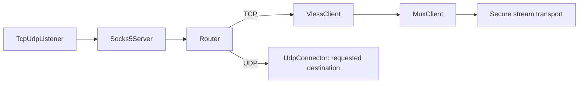

# Proxy Examples

A proxy lets an application choose its destination for each connection. These
examples start with a local SOCKS5 or HTTP proxy and show how to connect directly
or carry requests to a remote WaterWall server.

In paired examples, **Client** is the machine running the local proxy and
**Server** is the remote exit. The client can be your computer or a gateway used
by local applications. Each tab contains a complete `config.json` for that role.

## Choose an example

| Example | What it teaches | Application traffic |
| --- | --- | --- |
| [Local SOCKS5 and HTTP proxies](./local-proxies.mdx) | Start with a local proxy and connect to the requested destinations. | SOCKS5 TCP/UDP; HTTP proxy TCP |
| [SOCKS5 routing with Mux](./socks-mux.mdx) | Put a Router after SOCKS5, send TCP through VLESS + Mux + TLS, and keep UDP on a direct branch. | TCP through the remote server; UDP exits locally |
| [VLESS, VMess, and Trojan over TLS](./protocol-proxies.mdx) | Choose a proxy protocol, credentials, and a verified TLS transport. | TCP |
| [Proxy over QUIC](./quic.mdx) | Carry VLESS + Mux through WaterWall's encrypted QUIC stream over UDP. | TCP |
| [Proxy over KCP](./kcp.mdx) | Carry VLESS + Mux + TLS through KCP's reliable stream over UDP. | TCP |
| [VMess over WebSocket and TLS](./websocket.mdx) | Add WebSocket framing between VMess and TLS. | TCP |

Use one example at a time: several use the same local SOCKS port `1080` and
remote port `443`. For fixed destination forwarding and reverse connections,
see [Tunnel Examples](../tunnels/overview.mdx).

## Keep the layers in order

Each node has a separate job:

| Layer | Job |
| --- | --- |
| `Socks5Server` / `HttpProxyServer` | Read the application's proxy request and record its requested destination. |
| `Router` | Choose an outbound branch, for example TCP through the remote server and UDP directly. |
| `VlessClient` / `VmessClient` / `TrojanClient` | Encode the requested destination and protocol credentials for the remote peer. |
| `MuxClient` / `MuxServer` | Share transport connections among independent byte streams. |
| TLS, QUIC, KCP, WebSocket | Provide the selected security, framing, or delivery behavior. |
| TCP/UDP connectors and listeners | Open or accept the actual network connections. |

For a proxy over Mux, encode the destination **inside each Mux child**:

```text
Client: proxy request -> VlessClient -> MuxClient -> secure transport
Server: secure transport -> MuxServer -> VlessServer -> requested destination
```

Mux does not encode a destination by itself. The client transport connector
targets the WaterWall server; the server's final connector uses
`dest_context->address` and `dest_context->port` to reach the destination
decoded by the proxy protocol. These are two different addresses.

WaterWall's Mux framing requires a matching WaterWall peer. A standard VLESS,
VMess, or Trojan client cannot speak the Mux layouts merely by enabling its own
unrelated multiplexing option. Start with the [plain protocol examples](./protocol-proxies.mdx)
when configuring another implementation, and match its supported protocol and
transport options.

### SOCKS UDP needs its own decision

`Socks5Server` can emit TCP streams and UDP datagrams. When both are enabled,
place `Router` after SOCKS5 and before the Mux branch:



UDP datagrams can be lost or reordered. Mux carries ordered byte streams and
does not preserve raw UDP message boundaries, so connecting raw SOCKS UDP
straight to Mux is not a substitute for a UDP transport. The
[routing example](./socks-mux.mdx) keeps UDP direct; it leaves from the client
machine and does not pass through the remote server or its encrypted transport.

To carry application UDP through a stream instead, use an explicit protocol
that encodes datagrams and a matching decoder. For example, WaterWall's
[VLESS UDP mode](../../noderefs/VlessClient) supplies that framing; a fixed-target
UDP tunnel can use [UdpOverTcpClient](../../noderefs/UdpOverTcpClient) and
[UdpOverTcpServer](../../noderefs/UdpOverTcpServer). Those require their own
matching topology. The TCP-only QUIC/KCP examples here do not enable SOCKS UDP
simply because their outer transport uses UDP.

## Prepare the configuration

1. [Install WaterWall](../../getting-started/installation) on each participating
   host with the nodes used by the chosen example.
2. Save the selected configuration as `config.json`. In paired examples, put
   the Client and Server files on their respective machines.
3. Replace the deployment values below, then save `core.json` beside each
   `config.json`.

| Example value | Replace with |
| --- | --- |
| `198.51.100.20` | The remote WaterWall server's reachable address. |
| `tunnel.example.com` | A DNS name covered by the server's TLS certificate. |
| `/etc/waterwall/fullchain.pem` | The server's certificate chain PEM file. |
| `/etc/waterwall/privkey.pem` | Its matching private key PEM file. |
| `11111111-2222-4333-8444-555555555555` | A fresh matching VLESS/VMess UUID on both peers. |
| Example passwords | Fresh credentials shared only with the intended clients. |

Generate a UUID for VLESS or VMess:

```bash
python3 -c "import uuid; print(uuid.uuid4())"
```

For a Trojan password, one option is:

```bash
openssl rand -hex 24
```

Keep client certificate verification enabled. The server address determines
where to connect; SNI determines which certificate name to verify. For QUIC,
also follow the page's trust-store instructions. Keep both machines' clocks
accurate, particularly for VMess authentication.

The unauthenticated local SOCKS/HTTP entry points bind to `127.0.0.1`. To serve
other machines, configure authentication and access rules before changing that
bind address; see [Socks5Server](../../noderefs/Socks5Server) and
[HttpProxyServer](../../noderefs/HttpProxyServer).

## Create `core.json`

This common startup file works on either side. The node configurations in this
section use ordinary JSON with literal example values; there is no variable
substitution step.

```json title="core.json"
{
  "log": {
    "path": "log/",
    "core": { "loglevel": "INFO", "console": true },
    "network": { "loglevel": "INFO", "console": true }
  },
  "dns": {
    "domain-strategy": "prefer-ipv4"
  },
  "misc": {
    "workers": 2,
    "ram-profile": "server",
    "mtu": 1400
  },
  "configs": ["config.json"]
}
```

Two workers are a starting point for these examples. Mux connection counts are
per worker, so increasing the worker count also increases those transport pools.
See [Core Settings](../../getting-started/tutorial-part1) for tuning.

## Start and test

For paired setups, start the server first, then the client. From each directory
containing `core.json`, `config.json`, and the executable, run:

```bash
./Waterwall --config:core.json
```

Use your installed executable's filename if it differs. Relative paths resolve
from the process working directory. Open the **TCP or UDP** listener port named
by the selected example; the same port number with the wrong transport does not
reach that listener.

For a local SOCKS5 TCP frontend, make a request to a destination you control:

```bash
curl --socks5-hostname 127.0.0.1:1080 https://your-origin.example/
```

Replace `your-origin.example` with the real destination. `--socks5-hostname`
passes the destination hostname to the proxy. This checks TCP; testing SOCKS UDP
requires a client that supports `UDP ASSOCIATE`. The local-proxy page also shows
HTTP proxy requests.

If a connection fails, compare both selected configurations, credentials,
certificate/SNI, listener transport and port, and final destination reachability.
Choose QUIC, KCP, or TCP/TLS based on measurements on your path; none is fastest
on every network.
