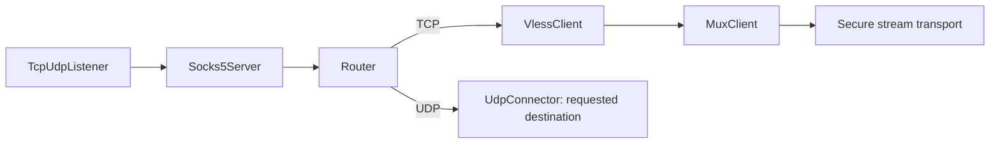

# Proxy Examples

A proxy lets an application choose its destination for each connection. These
examples start with a local SOCKS5 or HTTP proxy and show how to connect directly
or carry requests to a remote WaterWall server.

In paired examples, **Client** is the machine running the local proxy and
**Server** is the remote exit. The client can be your computer or a gateway used
by local applications. Each tab contains a complete `config.json` for that role.

## Choose an example

| Example | What it teaches | Where application traffic exits |
| --- | --- | --- |
| [Local SOCKS5 and HTTP proxies](./local-proxies.mdx) | Connect directly to the requested destinations. | Local machine (SOCKS5 TCP and UDP, HTTP proxy TCP) |
| [SOCKS5 routing with Mux](./socks-mux.mdx) | Use a Router to choose the exit by protocol. | TCP from the remote server, UDP from the client |
| [VLESS, VMess, and Trojan over TLS](./protocol-proxies.mdx) | Choose a proxy protocol, credentials, and a verified TLS transport. | TCP and UDP from the remote server |
| [Proxy over QUIC](./quic.mdx) | Carry VLESS + Mux through WaterWall's encrypted QUIC stream over UDP. | TCP and UDP from the remote server |
| [Proxy over KCP](./kcp.mdx) | Carry VLESS + Mux + TLS through KCP's reliable stream over UDP. | TCP and UDP from the remote server |
| [VMess over WebSocket and TLS](./websocket.mdx) | Add WebSocket framing between VMess and TLS. | TCP and UDP from the remote server |
| [SOCKS5 proxy over RTMPS](./rtmp.mdx) | Carry VLESS through verified RTMPS, optionally sharing the carrier with Mux. | TCP and UDP from the remote server |

Use one example at a time: several use the same local SOCKS port `1080` and
remote port `443`. For fixed destination forwarding and reverse connections,
see [Tunnel Examples](../tunnels/overview.mdx).

## Prepare the configuration

1. [Install WaterWall](../../getting-started/installation) on each participating
   host with the nodes used by the chosen example.
2. Save the selected configuration as `config.json`. In paired examples, put
   the Client and Server files on their respective machines.
3. Replace the deployment values below, then save `core.json` beside each
   `config.json`.

| Example value | Replace with |
| --- | --- |
| `198.51.100.20` | The remote WaterWall server's reachable address. |
| `tunnel.example.com` | A DNS name covered by the server's TLS certificate. |
| `/etc/waterwall/fullchain.pem` | The server's certificate chain PEM file. |
| `/etc/waterwall/privkey.pem` | Its matching private key PEM file. |
| `11111111-2222-4333-8444-555555555555` | A fresh matching VLESS/VMess UUID on both peers. |
| Example passwords | Fresh credentials shared only with the intended clients. |

Generate a UUID for VLESS or VMess:

```bash
python3 -c "import uuid; print(uuid.uuid4())"
```

For a Trojan password, one option is:

```bash
openssl rand -hex 24
```

Keep client certificate verification enabled. The server address determines
where to connect; SNI determines which certificate name to verify. For QUIC,
also follow the page's trust-store instructions. Keep both machines' clocks
accurate, particularly for VMess authentication.

The unauthenticated local SOCKS/HTTP entry points bind to `127.0.0.1`. To serve
other machines, configure authentication and access rules before changing that
bind address; see [Socks5Server](../../noderefs/Socks5Server) and
[HttpProxyServer](../../noderefs/HttpProxyServer).

## Create `core.json`

This common startup file works on either side. The node configurations in this
section use ordinary JSON with literal example values; there is no variable
substitution step.

```json title="core.json"
{
  "log": {
    "path": "log/",
    "core": { "loglevel": "INFO", "console": true },
    "network": { "loglevel": "INFO", "console": true }
  },
  "dns": {
    "domain-strategy": "prefer-ipv4"
  },
  "misc": {
    "workers": 2,
    "ram-profile": "server",
    "mtu": 1400
  },
  "configs": ["config.json"]
}
```

Two workers are a starting point for these examples. Mux connection counts are
per worker, so increasing the worker count also increases those transport pools.
See [Core Settings](../../getting-started/tutorial-part1) for tuning.

## Start and test

For paired setups, start the server first, then the client. From each directory
containing `core.json`, `config.json`, and the executable, run:

```bash
./Waterwall --config:core.json
```

Use your installed executable's filename if it differs. Relative paths resolve
from the process working directory. Open the **TCP or UDP** listener port named
by the selected example; the same port number with the wrong transport does not
reach that listener.

For a local SOCKS5 TCP frontend, make a request to a destination you control:

```bash
curl --noproxy '' --socks5-hostname 127.0.0.1:1080 https://your-origin.example/
```

Replace `your-origin.example` with the real destination. `--socks5-hostname`
passes the destination hostname to the proxy. This checks SOCKS5 TCP `CONNECT`.
For HTTP proxy requests, see the [local proxy example](./local-proxies.mdx).

If a connection fails, compare both selected configurations, credentials,
certificate/SNI, listener transport and port, and final destination reachability.
Choose QUIC, KCP, or TCP/TLS based on measurements on your path; none is fastest
on every network.

### Check SOCKS5 UDP

Run this one-shot Python 3 echo service on **the machine where UDP should exit**.
For the remote proxy recipes, use the server. For the local proxy or the
Router/Mux split, use the client. The service listens on loopback, so port
`19090` can stay closed to the network.

```bash
python3 - <<'PY'
import socket

with socket.socket(socket.AF_INET, socket.SOCK_DGRAM) as echo:
    echo.bind(("127.0.0.1", 19090))
    print("Waiting for one UDP datagram", flush=True)
    payload, peer = echo.recvfrom(65535)
    echo.sendto(payload, peer)
PY
```

Then run this on **the client** with WaterWall running. It uses the examples'
unauthenticated IPv4 SOCKS5 listener. The TCP connection stays open while the
client sends a datagram to the relay address and port returned by `UDP ASSOCIATE`.
The destination inside that datagram, `127.0.0.1:19090`, refers to loopback on
the exit machine.

```bash
python3 - <<'PY'
import socket
import struct

proxy = ("127.0.0.1", 1080)
with socket.create_connection(proxy, timeout=5) as control, control.makefile("rb") as replies:
    control.sendall(bytes.fromhex("05 01 00"))  # SOCKS5, one method, no authentication
    if replies.read(2) != bytes.fromhex("05 00"):
        raise SystemExit("SOCKS5 refused unauthenticated access")
    control.sendall(bytes.fromhex("05 03 00 01 00 00 00 00 00 00"))  # UDP ASSOCIATE
    reply = replies.read(10)
    if len(reply) != 10 or reply[:4] != bytes.fromhex("05 00 00 01"):
        raise SystemExit("Expected a successful IPv4 relay reply")
    relay = (socket.inet_ntoa(reply[4:8]), int.from_bytes(reply[8:10], "big"))

    # SOCKS UDP header: reserved, fragment number 0, IPv4 address type, target.
    target = socket.inet_aton("127.0.0.1") + struct.pack("!H", 19090)
    packet = bytes.fromhex("00 00 00 01") + target + b"WaterWall UDP echo"
    with socket.socket(socket.AF_INET, socket.SOCK_DGRAM) as udp:
        udp.settimeout(5)
        udp.connect(relay)
        udp.send(packet)
        if udp.recv(65535) != packet:
            raise SystemExit("Unexpected UDP echo source or payload")
    print("SOCKS5 UDP echo received")
PY
```

The client prints `SOCKS5 UDP echo received` when the datagram makes the round
trip. On separate machines, starting the echo service only on the expected exit
also checks which machine sent the UDP request.

## Keep the layers in order

Each node has a separate job:

| Layer | Job |
| --- | --- |
| `Socks5Server` / `HttpProxyServer` | Read the application's proxy request and record its requested destination. |
| `Router` | Choose an outbound branch, for example TCP through the remote server and UDP directly. |
| `VlessClient` / `VmessClient` / `TrojanClient` | Encode the requested destination and protocol credentials for the remote peer. |
| `MuxClient` / `MuxServer` | Share transport connections among independent byte streams. |
| TLS, QUIC, KCP, WebSocket, RTMP | Provide the selected security, framing, or delivery behavior. |
| TCP/UDP connectors and listeners | Open or accept the actual network connections. |

For a proxy over Mux, encode the destination **inside each Mux child**:

```text
Client: proxy request -> VlessClient -> MuxClient -> secure transport
Server: secure transport -> MuxServer -> VlessServer -> requested destination
```

Mux does not encode a destination by itself. The client transport connector
targets the WaterWall server; the server's final connector uses
`dest_context->address` and `dest_context->port` to reach the destination
decoded by the proxy protocol. These are two different addresses.

WaterWall's Mux framing requires a matching WaterWall peer. A standard VLESS,
VMess, or Trojan client cannot speak the Mux layouts merely by enabling its own
unrelated multiplexing option. Start with the [plain protocol examples](./protocol-proxies.mdx)
when configuring another implementation, and match its supported protocol and
transport options.

### SOCKS UDP needs its own decision

For a **remote UDP exit**, the proxy client takes the requested protocol from
`dest_context->protocol`. VLESS, VMess, or Trojan frames each UDP datagram before
passing it to the stream transport. On the server, the matching protocol node
recovers the datagram and `TcpUdpConnector` sends it to the requested UDP
destination. This also works with Mux between the protocol and transport nodes,
as in the [QUIC](./quic.mdx) and [KCP](./kcp.mdx) examples.

For a **local UDP exit with remote TCP**, the [routing example](./socks-mux.mdx)
places `Router` after SOCKS5. Only its TCP branch enters VLESS and Mux:



Mux expects ordered byte streams. Feeding it raw SOCKS datagrams loses their
boundaries. For a fixed-target UDP tunnel, [UdpOverTcpClient](../../noderefs/UdpOverTcpClient)
and [UdpOverTcpServer](../../noderefs/UdpOverTcpServer) provide paired datagram framing.
