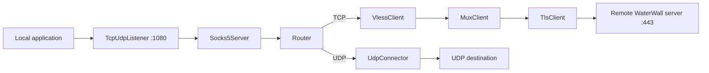

import Tabs from '@theme/Tabs';
import TabItem from '@theme/TabItem';

# SOCKS5 with Router and Mux

This example gives local applications a SOCKS5 proxy. TCP requests leave through
a remote WaterWall server over **VLESS → Mux → TLS**. UDP requests leave directly
from the client machine.

Put **Router after Socks5Server, before the TCP branch's MuxClient**. SOCKS5 has
both TCP streams and direct UDP datagrams. Direct UDP can be lost or reordered;
Mux requires a reliable, ordered stream transport and is not a raw UDP
encapsulation. A Router selects the appropriate path before either kind of
traffic enters Mux.



VLESS comes **before Mux on the client**, and **after Mux on the server**.
Each Mux child contains its own VLESS request, including the requested
destination. Mux itself does not transmit that proxy destination metadata.

```text
Client TCP: Socks5Server -> Router -> VlessClient -> MuxClient -> TlsClient -> TcpConnector
Server:     TcpListener -> TlsServer -> MuxServer -> VlessServer -> TcpConnector
Client UDP: Socks5Server -> Router -> UdpConnector -> Requested destination
```

:::note Where UDP exits
The UDP branch in this example bypasses the remote server, Mux, and TLS. The
UDP destination sees the client machine's public egress IP; the TCP destination
sees the remote server's public egress IP. Choose this split only when direct
UDP is appropriate for your application. It does not make UDP reliable or
provide transport encryption for it.
:::

## Before starting

Use the [common setup](./overview.mdx) on both machines and save the appropriate
tab as each machine's `config.json`. Replace these example values:

| Value | Meaning |
| --- | --- |
| `198.51.100.20` | Remote WaterWall server address. |
| `443` | Matching server TCP listener and client transport port. |
| `tunnel.example.com` | DNS name covered by the server's trusted TLS certificate. |
| `/etc/waterwall/fullchain.pem` and `/etc/waterwall/privkey.pem` | Certificate chain and key on the server. |
| `11111111-2222-4333-8444-555555555555` | Replace with your own UUID, matching on both sides. |

Keep `verify: true`. The connector reaches the server IP, while TLS validates
the certificate for `tunnel.example.com`. The local SOCKS listener remains
unauthenticated on loopback; only applications on the client machine can use it.

## Complete configurations

<Tabs groupId="proxy-side" defaultValue="client">
<TabItem value="client" label="Client">

```json title="config.json"
{
  "name": "socks-router-mux-client",
  "nodes": [
    {
      "name": "local-listener",
      "type": "TcpUdpListener",
      "settings": {
        "address": "127.0.0.1",
        "port": 1080,
        "nodelay": true
      },
      "next": "socks"
    },
    {
      "name": "socks",
      "type": "Socks5Server",
      "settings": {
        "no-auth": true,
        "connect": true,
        "udp": true,
        "ipv4": "127.0.0.1"
      },
      "next": "route"
    },
    {
      "name": "route",
      "type": "Router",
      "settings": {
        "rules": [
          {
            "network": "udp",
            "target": "direct-udp"
          }
        ]
      },
      "next": "vless"
    },
    {
      "name": "direct-udp",
      "type": "UdpConnector",
      "settings": {
        "address": "dest_context->address",
        "port": "dest_context->port"
      }
    },
    {
      "name": "vless",
      "type": "VlessClient",
      "settings": {
        "uuid": "11111111-2222-4333-8444-555555555555",
        "address": "dest_context->address",
        "port": "dest_context->port",
        "protocol": "tcp",
        "dns-behaviour": {"resolve": false}
      },
      "next": "mux"
    },
    {
      "name": "mux",
      "type": "MuxClient",
      "settings": {
        "mode": "fixed-connections-count",
        "per-worker-connections-count": 2
      },
      "next": "tls"
    },
    {
      "name": "tls",
      "type": "TlsClient",
      "settings": {
        "sni": "tunnel.example.com",
        "verify": true
      },
      "next": "remote-server"
    },
    {
      "name": "remote-server",
      "type": "TcpConnector",
      "settings": {
        "address": "198.51.100.20",
        "port": 443,
        "nodelay": true
      }
    }
  ]
}
```

The Router's `network: "udp"` rule uses metadata already provided by SOCKS5.
Its default `next` handles TCP; no payload sniffing is necessary.

</TabItem>
<TabItem value="server" label="Server">

```json title="config.json"
{
  "name": "socks-router-mux-server",
  "nodes": [
    {
      "name": "public-listener",
      "type": "TcpListener",
      "settings": {
        "address": "0.0.0.0",
        "port": 443,
        "nodelay": true
      },
      "next": "tls"
    },
    {
      "name": "tls",
      "type": "TlsServer",
      "settings": {
        "cert-file": "/etc/waterwall/fullchain.pem",
        "key-file": "/etc/waterwall/privkey.pem"
      },
      "next": "mux"
    },
    {
      "name": "mux",
      "type": "MuxServer",
      "settings": {},
      "next": "vless"
    },
    {
      "name": "vless",
      "type": "VlessServer",
      "settings": {
        "uuid": "11111111-2222-4333-8444-555555555555",
        "connect": true,
        "udp": false
      },
      "next": "destination"
    },
    {
      "name": "destination",
      "type": "TcpConnector",
      "settings": {
        "address": "dest_context->address",
        "port": "dest_context->port",
        "nodelay": true
      }
    }
  ]
}
```

The server unwraps TLS and Mux before VLESS reads each child's UUID and
destination. The final connector opens that requested TCP destination.
This endpoint expects WaterWall Mux framing inside TLS, so a standard
VLESS-over-TLS client cannot connect to it directly.

</TabItem>
</Tabs>

## Run and use

Start the server first, then the client, using the
[common startup commands](./overview.mdx). Allow inbound TCP `443` on the
server and outbound TCP to it from the client. The client's direct UDP branch
also needs outbound UDP access.

Point your application at SOCKS5 `127.0.0.1:1080`. For a TCP check:

```bash
curl --noproxy "" --proxy socks5h://127.0.0.1:1080 https://example.com/
```

The hostname in this request travels inside VLESS and is resolved at the remote
exit. The UDP branch resolves any UDP destination domains on the client side.
To exercise UDP, use an application with SOCKS5 `UDP ASSOCIATE` support; curl's
command above tests TCP only. Keep the UDP association's TCP control connection
open and use the dynamic relay address/port returned by SOCKS5.

## Mux tuning and transport choices

`per-worker-connections-count: 2` shares TCP requests across two parent
connections per worker as the pool is used. With the common setup's two workers,
the setting allows four parent transport connections across the process. It is
not a limit of four application requests. A lost TCP segment can delay other
children sharing that parent; more parents can reduce sharing but also create
more TLS connections. See [MuxClient](../../noderefs/MuxClient) and
[MuxServer](../../noderefs/MuxServer) for the available modes and limits.

If UDP must also exit remotely, use a protocol that **encodes datagram
boundaries before the stream transport**, such as VLESS UDP. That is different
from feeding raw SOCKS UDP directly into Mux: VLESS creates a stream carrier and
frames the datagrams. See [VlessClient UDP behavior](../../noderefs/VlessClient)
and the matching [VlessServer](../../noderefs/VlessServer) outbound requirements.
The [protocol examples](./protocol-proxies.mdx) introduce the TCP versions of
VLESS, VMess, and Trojan without Mux.

For a UDP-based inter-server transport with reliable stream delivery, see
[QUIC](./quic.mdx) and [KCP](./kcp.mdx). Keep the SOCKS Router split when
you want this same direct-UDP policy, and replace the paired transport nodes on
both ends together.
