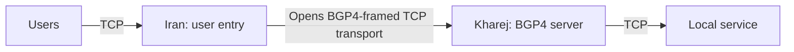

import Tabs from '@theme/Tabs';
import TabItem from '@theme/TabItem';

# Direct tunnel over BGP4

Users connect to Iran over TCP; Iran opens a TCP transport to Kharej through
`Bgp4Client`, and Kharej uses `Bgp4Server` to recover each stream for its local
TCP service. The service in these examples listens on `127.0.0.1:80` in Kharej.
Change `final_port` for your application.



Start with the [common setup](./overview.mdx) and use `mtu: 1500` in each
server's `core.json`. Iran must be able to reach Kharej's TCP transport port
directly. Unlike [QUIC](./direct-quic.mdx) and [KCP](./direct-kcp.mdx), these
examples use `TcpListener` and `TcpConnector` for the inter-server transport,
with TCP at both application ends as well. Application bytes reach the final
service unchanged, including any application TLS they already contain.

For a transport initiated from Kharej to Iran, use the
[Reverse BGP4 example](./reverse-bgp4.mdx).

WaterWall's paired BGP4 nodes add and remove **BGP-like stream framing**. They
do not perform BGP routing, peering or route exchange, and provide **no
encryption or peer authentication**. No certificate or password is needed;
both nodes use `settings: {}`. The current implementation ignores `password`,
so adding it does not secure the transport. See [Bgp4Client](../../noderefs/Bgp4Client)
and [Bgp4Server](../../noderefs/Bgp4Server) for the framing details. For an
encrypted TCP transport, see [Direct TLS](./direct-tls.mdx).

## Set the addresses

| Setting | Where | What to enter |
| --- | --- | --- |
| `ip_server_kharej` | Iran | Kharej's reachable IP; replace `198.51.100.20`. |
| `user_port` | Iran | Public TCP user entry port; default `443`. |
| `transport_port` | Both | Matching Kharej TCP listener and Iran connection port; default `7443`. |
| `final_port` | Kharej | Local TCP destination service port; default `80`. |

To limit access to the destination service through this transport, restrict
Kharej's TCP transport port to Iran's public egress IP using a firewall or the
[TcpListener whitelist](../../noderefs/TcpListener).

## Choose the transport

**With Mux is recommended** for this direct tunnel. It shares transport
connections across user streams, reducing the number of separate TCP connections
needed. Choose the server location inside the selected tab, and use the same
Mux choice on both servers. **Without Mux** remains available for a separate
transport connection per user stream.

With Mux, Iran's `MuxClient` opens logical streams over shared BGP4-framed TCP
connections. Kharej removes the BGP4 framing before `MuxServer` recreates each
user stream for the local service. Applications need no BGP or Mux support.

`mux_connections_per_worker: 2` sets the parent transport pool per worker.
More workers multiply these pools. Streams sharing one parent also share its
ordered TCP delivery, so packet loss can delay them together. See
[MuxClient](../../noderefs/MuxClient) for tuning.

<Tabs groupId="direct-mux" defaultValue="mux">
<TabItem value="plain" label="Without Mux">

The direct transport chains are:

```text
Iran:   TcpListener -> Bgp4Client -> TcpConnector
Kharej: TcpListener -> Bgp4Server -> TcpConnector
```

<Tabs groupId="tunnel-location" defaultValue="iran">
<TabItem value="iran" label="Iran">

Save as `config_iran.json` on the Iran server.

```json title="config_iran.json"
{
  "name": "iran-direct-bgp4",
  "variables": {
    "ip_server_kharej": "198.51.100.20",
    "user_port": 443,
    "transport_port": 7443
  },
  "nodes": [
    {
      "name": "users_inbound",
      "type": "TcpListener",
      "settings": {
        "address": "0.0.0.0",
        "port": $user_port$,
        "nodelay": true
      },
      "next": "bgp4_client"
    },
    {
      "name": "bgp4_client",
      "type": "Bgp4Client",
      "settings": {},
      "next": "tcp_to_kharej"
    },
    {
      "name": "tcp_to_kharej",
      "type": "TcpConnector",
      "settings": {
        "address": $ip_server_kharej$,
        "port": $transport_port$,
        "nodelay": true
      }
    }
  ]
}
```

</TabItem>
<TabItem value="kharej" label="Kharej">

Save as `config_kharej.json` on the Kharej server.

```json title="config_kharej.json"
{
  "name": "kharej-direct-bgp4",
  "variables": {
    "transport_port": 7443,
    "final_port": 80
  },
  "nodes": [
    {
      "name": "transport_inbound",
      "type": "TcpListener",
      "settings": {
        "address": "0.0.0.0",
        "port": $transport_port$,
        "nodelay": true
      },
      "next": "bgp4_server"
    },
    {
      "name": "bgp4_server",
      "type": "Bgp4Server",
      "settings": {},
      "next": "outbound_to_local_service"
    },
    {
      "name": "outbound_to_local_service",
      "type": "TcpConnector",
      "settings": {
        "address": "127.0.0.1",
        "port": $final_port$,
        "nodelay": true
      }
    }
  ]
}
```

</TabItem>
</Tabs>

</TabItem>
<TabItem value="mux" label="With Mux (recommended)">

The direct transport chains are:

```text
Iran:   TcpListener -> MuxClient -> Bgp4Client -> TcpConnector
Kharej: TcpListener -> Bgp4Server -> MuxServer -> TcpConnector
```

<Tabs groupId="tunnel-location" defaultValue="iran">
<TabItem value="iran" label="Iran">

Save as `config_iran.json` on the Iran server.

```json title="config_iran.json"
{
  "name": "iran-direct-bgp4-mux",
  "variables": {
    "ip_server_kharej": "198.51.100.20",
    "user_port": 443,
    "transport_port": 7443,
    "mux_connections_per_worker": 2
  },
  "nodes": [
    {
      "name": "users_inbound",
      "type": "TcpListener",
      "settings": {
        "address": "0.0.0.0",
        "port": $user_port$,
        "nodelay": true
      },
      "next": "mux_client"
    },
    {
      "name": "mux_client",
      "type": "MuxClient",
      "settings": {
        "mode": "fixed-connections-count",
        "per-worker-connections-count": $mux_connections_per_worker$
      },
      "next": "bgp4_client"
    },
    {
      "name": "bgp4_client",
      "type": "Bgp4Client",
      "settings": {},
      "next": "tcp_to_kharej"
    },
    {
      "name": "tcp_to_kharej",
      "type": "TcpConnector",
      "settings": {
        "address": $ip_server_kharej$,
        "port": $transport_port$,
        "nodelay": true
      }
    }
  ]
}
```

</TabItem>
<TabItem value="kharej" label="Kharej">

Save as `config_kharej.json` on the Kharej server.

```json title="config_kharej.json"
{
  "name": "kharej-direct-bgp4-mux",
  "variables": {
    "transport_port": 7443,
    "final_port": 80
  },
  "nodes": [
    {
      "name": "transport_inbound",
      "type": "TcpListener",
      "settings": {
        "address": "0.0.0.0",
        "port": $transport_port$,
        "nodelay": true
      },
      "next": "bgp4_server"
    },
    {
      "name": "bgp4_server",
      "type": "Bgp4Server",
      "settings": {},
      "next": "mux_server"
    },
    {
      "name": "mux_server",
      "type": "MuxServer",
      "settings": {},
      "next": "outbound_to_local_service"
    },
    {
      "name": "outbound_to_local_service",
      "type": "TcpConnector",
      "settings": {
        "address": "127.0.0.1",
        "port": $final_port$,
        "nodelay": true
      }
    }
  ]
}
```

</TabItem>
</Tabs>

</TabItem>
</Tabs>

## Run and check

Start the local TCP service in Kharej, then start WaterWall on Kharej followed
by Iran using the [common startup commands](./overview.mdx#start-the-tunnel).
Allow inbound TCP on Iran's `user_port`, inbound TCP on Kharej's
`transport_port`, and outbound TCP from Iran to Kharej's transport port.

Connect a normal application client to Iran's TCP user port. For the example
HTTP service on Kharej port `80`, a simple check is:

```bash
curl http://192.0.2.10:443/
```

Replace the Iran address before running it. If your destination is Xray or
another protocol, use that service's client instead. The user port number does
not change the application protocol.

If the connection fails, check Kharej's reachable IP, TCP transport port and
firewall rules, then the selected Mux mode and destination service. Both sides
must pair `Bgp4Client` with `Bgp4Server` and use the same Mux choice.
