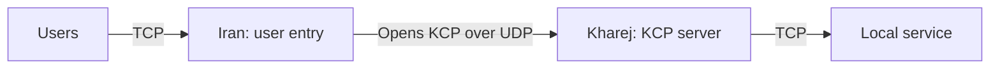

import Tabs from '@theme/Tabs';
import TabItem from '@theme/TabItem';

# Direct tunnel over KCP

Users connect to Iran over TCP; Iran carries their streams to Kharej using KCP
over UDP, and Kharej forwards each stream to its local TCP service. The service
in these examples listens on `127.0.0.1:80` in Kharej. Change `final_port` for
your application.



Start with the [common setup](./overview.mdx) and use `mtu: 1500` in each
server's `core.json`. Iran must be able to reach Kharej's UDP transport port
directly. Application bytes reach the final service unchanged, including any
application TLS they already contain. Applications need no KCP support.

For a KCP transport initiated from Kharej to Iran, use the
[Reverse KCP example](./reverse-kcp.mdx).

KCP provides a reliable, ordered stream over UDP, but **no encryption or peer
authentication**. These configurations require no certificate. For an encrypted
UDP transport, see [Direct QUIC](./direct-quic.mdx). You can also add TLS over
KCP using the placement described below.

## Set the addresses

| Setting | Where | What to enter |
| --- | --- | --- |
| `ip_server_kharej` | Iran | Kharej's reachable IP; replace `198.51.100.20`. |
| `user_port` | Iran | Public TCP user entry port; default `443`. |
| `transport_port` | Both | Matching Kharej UDP listener and Iran connection port; default `4000`. |
| `final_port` | Kharej | Local TCP destination service port; default `80`. |

To limit access to the destination service through the KCP transport, restrict
Kharej's UDP transport port to Iran's public egress IP using a firewall or the
[UdpListener whitelist](../../noderefs/UdpListener).

## Choose the transport

**With Mux is recommended** for this direct tunnel. It shares KCP sessions across
user streams, reducing the number of separate transport sessions needed. Choose
the server location inside the selected tab, and use the same Mux choice on both
servers. **Without Mux** remains available for a separate KCP session per user
stream.

With Mux, Iran's `MuxClient` opens logical streams over shared KCP sessions.
Kharej reconstructs the KCP stream before `MuxServer` recreates each user stream
for the local service. Applications still use TCP at both ends; UDP is used only
between the WaterWall servers.

`mux_connections_per_worker: 2` sets the parent transport pool per worker.
More workers multiply these pools. Streams sharing one parent also share its
ordered delivery, so packet loss can delay them together. See
[MuxClient](../../noderefs/MuxClient) for tuning.

<Tabs groupId="direct-mux" defaultValue="mux">
<TabItem value="plain" label="Without Mux">

The direct transport chains are:

```text
Iran:   TcpListener -> KcpClient -> UdpConnector
Kharej: UdpListener -> KcpServer -> TcpConnector
```

<Tabs groupId="tunnel-location" defaultValue="iran">
<TabItem value="iran" label="Iran">

Save as `config_iran.json` on the Iran server.

```json title="config_iran.json"
{
  "name": "iran-direct-kcp",
  "variables": {
    "ip_server_kharej": "198.51.100.20",
    "user_port": 443,
    "transport_port": 4000
  },
  "nodes": [
    {
      "name": "users_inbound",
      "type": "TcpListener",
      "settings": {
        "address": "0.0.0.0",
        "port": $user_port$,
        "nodelay": true
      },
      "next": "kcp_client"
    },
    {
      "name": "kcp_client",
      "type": "KcpClient",
      "settings": {
        "send-mtu": 1400,
        "fec": false,
        "kcp-no-congestion-control": false
      },
      "next": "udp_to_kharej"
    },
    {
      "name": "udp_to_kharej",
      "type": "UdpConnector",
      "settings": {
        "address": $ip_server_kharej$,
        "port": $transport_port$
      }
    }
  ]
}
```

</TabItem>
<TabItem value="kharej" label="Kharej">

Save as `config_kharej.json` on the Kharej server.

```json title="config_kharej.json"
{
  "name": "kharej-direct-kcp",
  "variables": {
    "transport_port": 4000,
    "final_port": 80
  },
  "nodes": [
    {
      "name": "transport_inbound",
      "type": "UdpListener",
      "settings": {
        "address": "0.0.0.0",
        "port": $transport_port$
      },
      "next": "kcp_server"
    },
    {
      "name": "kcp_server",
      "type": "KcpServer",
      "settings": {
        "send-mtu": 1400,
        "fec": false,
        "kcp-no-congestion-control": false
      },
      "next": "outbound_to_local_service"
    },
    {
      "name": "outbound_to_local_service",
      "type": "TcpConnector",
      "settings": {
        "address": "127.0.0.1",
        "port": $final_port$,
        "nodelay": true
      }
    }
  ]
}
```

</TabItem>
</Tabs>

</TabItem>
<TabItem value="mux" label="With Mux (recommended)">

The direct transport chains are:

```text
Iran:   TcpListener -> MuxClient -> KcpClient -> UdpConnector
Kharej: UdpListener -> KcpServer -> MuxServer -> TcpConnector
```

<Tabs groupId="tunnel-location" defaultValue="iran">
<TabItem value="iran" label="Iran">

Save as `config_iran.json` on the Iran server.

```json title="config_iran.json"
{
  "name": "iran-direct-kcp-mux",
  "variables": {
    "ip_server_kharej": "198.51.100.20",
    "user_port": 443,
    "transport_port": 4000,
    "mux_connections_per_worker": 2
  },
  "nodes": [
    {
      "name": "users_inbound",
      "type": "TcpListener",
      "settings": {
        "address": "0.0.0.0",
        "port": $user_port$,
        "nodelay": true
      },
      "next": "mux_client"
    },
    {
      "name": "mux_client",
      "type": "MuxClient",
      "settings": {
        "mode": "fixed-connections-count",
        "per-worker-connections-count": $mux_connections_per_worker$
      },
      "next": "kcp_client"
    },
    {
      "name": "kcp_client",
      "type": "KcpClient",
      "settings": {
        "send-mtu": 1400,
        "fec": false,
        "kcp-no-congestion-control": false
      },
      "next": "udp_to_kharej"
    },
    {
      "name": "udp_to_kharej",
      "type": "UdpConnector",
      "settings": {
        "address": $ip_server_kharej$,
        "port": $transport_port$
      }
    }
  ]
}
```

</TabItem>
<TabItem value="kharej" label="Kharej">

Save as `config_kharej.json` on the Kharej server.

```json title="config_kharej.json"
{
  "name": "kharej-direct-kcp-mux",
  "variables": {
    "transport_port": 4000,
    "final_port": 80
  },
  "nodes": [
    {
      "name": "transport_inbound",
      "type": "UdpListener",
      "settings": {
        "address": "0.0.0.0",
        "port": $transport_port$
      },
      "next": "kcp_server"
    },
    {
      "name": "kcp_server",
      "type": "KcpServer",
      "settings": {
        "send-mtu": 1400,
        "fec": false,
        "kcp-no-congestion-control": false
      },
      "next": "mux_server"
    },
    {
      "name": "mux_server",
      "type": "MuxServer",
      "settings": {},
      "next": "outbound_to_local_service"
    },
    {
      "name": "outbound_to_local_service",
      "type": "TcpConnector",
      "settings": {
        "address": "127.0.0.1",
        "port": $final_port$,
        "nodelay": true
      }
    }
  ]
}
```

</TabItem>
</Tabs>

</TabItem>
</Tabs>

## Packet size and optional FEC

The explicit `send-mtu: 1400` on both KCP nodes is separate from the common
`core.json` setting `mtu: 1500`. It is KCP's IPv4-based outgoing packet budget,
including fixed allowances for IPv4, UDP and WaterWall's session envelope. It
does not set the application payload size or discover the path MTU. Smaller
paths, IPv6 or additional outer tunnels may require a lower budget. See
[KcpClient](../../noderefs/KcpClient) for the exact overhead formula.

Both configurations enable KCP congestion control with
`kcp-no-congestion-control: false`. Start with these settings and measure your
actual path before changing windows, retransmission timings or congestion
control. KCP over UDP is not guaranteed to outperform a TCP transport.

For a lossy path, you can try forward error correction (FEC). Replace the
`KcpClient` and `KcpServer` settings objects on **both servers** with:

```json title="KcpClient.settings and KcpServer.settings — optional FEC"
{
  "send-mtu": 1400,
  "fec": true,
  "fec-data-shards": 10,
  "fec-parity-shards": 3,
  "kcp-no-congestion-control": false
}
```

The FEC mode and shard counts must match on both ends. A full block adds three
parity shards for ten data shards: about 30% extra parity traffic plus framing.
FEC can help recover lost packets, but adds bandwidth use and cannot guarantee
recovery from sustained or bursty loss. See [KcpServer](../../noderefs/KcpServer)
for further settings.

## Optional TLS over KCP

To encrypt the KCP stream, add verified TLS inside KCP's reconstructed stream.
With Mux, the node order becomes:

```text
Iran:   TcpListener -> MuxClient -> TlsClient -> KcpClient -> UdpConnector
Kharej: UdpListener -> KcpServer -> TlsServer -> MuxServer -> TcpConnector
```

Without Mux, omit only `MuxClient` and `MuxServer` from those chains. Keep TLS
before `KcpClient` on Iran and after `KcpServer` on Kharej: TLS requires stream
bytes, while the outer UDP nodes carry complete KCP datagrams. Use the verified
certificate setup from [Direct TLS](./direct-tls.mdx), the node references for
[TlsClient](../../noderefs/TlsClient) and [TlsServer](../../noderefs/TlsServer),
and the complete TLS/KCP chain in the [KCP proxy example](../proxies/kcp.mdx).

## Run and check

Start the local TCP service in Kharej, then start WaterWall on Kharej followed
by Iran using the [common startup commands](./overview.mdx#start-the-tunnel).
Allow inbound TCP on Iran's `user_port`, inbound UDP on Kharej's
`transport_port`, and outbound UDP from Iran to Kharej's transport port.

Connect a normal application client to Iran's TCP user port. For the example
HTTP service on Kharej port `80`, a simple check is:

```bash
curl http://192.0.2.10:443/
```

Replace the Iran address before running it. If your destination is Xray or
another protocol, use that service's client instead. The user port number does
not change the application protocol.

If the connection fails, check Kharej's reachable IP, UDP transport port and
firewall rules, then the selected Mux mode, matching FEC settings and destination
service. A working TCP connection to Kharej does not confirm UDP reachability.
