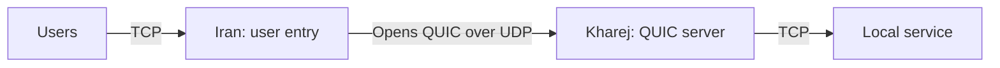

import Tabs from '@theme/Tabs';
import TabItem from '@theme/TabItem';

# Direct tunnel over QUIC

Users connect to Iran over TCP; Iran carries their streams to Kharej over
encrypted QUIC/UDP. Kharej forwards each stream to its local TCP service. The
service in these examples listens on `127.0.0.1:80` in Kharej. Change
`final_port` for your application.



Start with the [common setup](./overview.mdx) and use `mtu: 1500` in each
server's `core.json`. Iran must reach Kharej's UDP transport port directly.
For other direct transports, see [Direct KCP](./direct-kcp.mdx),
[Direct TLS](./direct-tls.mdx) and [Direct Reality](./direct-reality.mdx).
If the transport connection must originate from Kharej instead, see the
[Reverse QUIC example](./reverse-quic.mdx).

## Set the addresses and certificate

| Setting | Where | What to enter |
| --- | --- | --- |
| `ip_server_kharej` | Iran | Kharej's reachable IP; replace `198.51.100.20`. |
| `user_port` | Iran | Public TCP user entry port; default `443`. |
| `transport_port` | Both | Matching Kharej UDP listener and Iran connection port; default `4433`. |
| `domain_to_handshake_quic` | Iran | The DNS name covered by Kharej's certificate; replace `tunnel.example.com`. |
| `certificate_path` / `key_path` | Kharej | Existing certificate chain and private key PEM paths. |
| `final_port` | Kharej | Local TCP destination service port; default `80`. |

Install a certificate on Kharej that Iran trusts. The QUIC client keeps
`verify: true` and verifies the certificate against `domain_to_handshake_quic`.
The UDP connector independently uses `ip_server_kharej` to reach Kharej. For a
private CA, add `ca-file` to `QuicClient.settings` pointing to its trusted PEM
bundle; this replaces the bundled trust roots.

QUIC includes TLS 1.3, so these chains need no separate TLS nodes. It protects
the **inter-server transport**; user traffic reaches the final service
unchanged, including any application TLS it already contains. This setup
authenticates Kharej to Iran. To limit access to Kharej's transport port,
restrict it to Iran's public egress IP using a firewall or the
[UdpListener whitelist](../../noderefs/UdpListener).

## Choose the transport

**With Mux is recommended** for this direct tunnel. It shares QUIC transport
connections across user streams, reducing the number of separate QUIC
handshakes needed. Choose the server location inside the selected tab, and use
the same Mux choice on both servers. **Without Mux** remains available for a
separate QUIC connection per user stream.

Each WaterWall QUIC connection exposes one reliable application stream.
With Mux, Iran's `MuxClient` combines user streams before `QuicClient`; Kharej's
`QuicServer` restores the reliable stream before `MuxServer` separates them.
Mux belongs on this application side of QUIC, where delivery is ordered and
reliable. User streams sharing one parent also share its ordered stream and
loss recovery.

`mux_connections_per_worker: 2` sets the parent transport pool per worker.
More workers multiply these pools. See [MuxClient](../../noderefs/MuxClient)
for tuning.

<Tabs groupId="direct-mux" defaultValue="mux">
<TabItem value="plain" label="Without Mux">

The direct transport chains are:

```text
Iran:   TcpListener -> QuicClient -> UdpConnector
Kharej: UdpListener -> QuicServer -> TcpConnector
```

<Tabs groupId="tunnel-location" defaultValue="iran">
<TabItem value="iran" label="Iran">

Save as `config_iran.json` on the Iran server.

```json title="config_iran.json"
{
  "name": "iran-direct-quic",
  "variables": {
    "ip_server_kharej": "198.51.100.20",
    "user_port": 443,
    "transport_port": 4433,
    "domain_to_handshake_quic": "tunnel.example.com"
  },
  "nodes": [
    {
      "name": "users_inbound",
      "type": "TcpListener",
      "settings": {
        "address": "0.0.0.0",
        "port": $user_port$,
        "nodelay": true
      },
      "next": "quic_client"
    },
    {
      "name": "quic_client",
      "type": "QuicClient",
      "settings": {
        "sni": $domain_to_handshake_quic$,
        "verify": true,
        "protocol": "h3",
        "carrier-mode": "datagram",
        "max-packet-size": 1350
      },
      "next": "udp_to_kharej"
    },
    {
      "name": "udp_to_kharej",
      "type": "UdpConnector",
      "settings": {
        "address": $ip_server_kharej$,
        "port": $transport_port$
      }
    }
  ]
}
```

</TabItem>
<TabItem value="kharej" label="Kharej">

Save as `config_kharej.json` on the Kharej server.

```json title="config_kharej.json"
{
  "name": "kharej-direct-quic",
  "variables": {
    "transport_port": 4433,
    "certificate_path": "/etc/waterwall/fullchain.pem",
    "key_path": "/etc/waterwall/privkey.pem",
    "final_port": 80
  },
  "nodes": [
    {
      "name": "transport_inbound",
      "type": "UdpListener",
      "settings": {
        "address": "0.0.0.0",
        "port": $transport_port$
      },
      "next": "quic_server"
    },
    {
      "name": "quic_server",
      "type": "QuicServer",
      "settings": {
        "cert-file": $certificate_path$,
        "key-file": $key_path$,
        "protocol": "h3",
        "carrier-mode": "datagram",
        "max-packet-size": 1350
      },
      "next": "outbound_to_local_service"
    },
    {
      "name": "outbound_to_local_service",
      "type": "TcpConnector",
      "settings": {
        "address": "127.0.0.1",
        "port": $final_port$,
        "nodelay": true
      }
    }
  ]
}
```

</TabItem>
</Tabs>

</TabItem>
<TabItem value="mux" label="With Mux (recommended)">

The direct transport chains are:

```text
Iran:   TcpListener -> MuxClient -> QuicClient -> UdpConnector
Kharej: UdpListener -> QuicServer -> MuxServer -> TcpConnector
```

<Tabs groupId="tunnel-location" defaultValue="iran">
<TabItem value="iran" label="Iran">

Save as `config_iran.json` on the Iran server.

```json title="config_iran.json"
{
  "name": "iran-direct-quic-mux",
  "variables": {
    "ip_server_kharej": "198.51.100.20",
    "user_port": 443,
    "transport_port": 4433,
    "domain_to_handshake_quic": "tunnel.example.com",
    "mux_connections_per_worker": 2
  },
  "nodes": [
    {
      "name": "users_inbound",
      "type": "TcpListener",
      "settings": {
        "address": "0.0.0.0",
        "port": $user_port$,
        "nodelay": true
      },
      "next": "mux_client"
    },
    {
      "name": "mux_client",
      "type": "MuxClient",
      "settings": {
        "mode": "fixed-connections-count",
        "per-worker-connections-count": $mux_connections_per_worker$
      },
      "next": "quic_client"
    },
    {
      "name": "quic_client",
      "type": "QuicClient",
      "settings": {
        "sni": $domain_to_handshake_quic$,
        "verify": true,
        "protocol": "h3",
        "carrier-mode": "datagram",
        "max-packet-size": 1350
      },
      "next": "udp_to_kharej"
    },
    {
      "name": "udp_to_kharej",
      "type": "UdpConnector",
      "settings": {
        "address": $ip_server_kharej$,
        "port": $transport_port$
      }
    }
  ]
}
```

</TabItem>
<TabItem value="kharej" label="Kharej">

Save as `config_kharej.json` on the Kharej server.

```json title="config_kharej.json"
{
  "name": "kharej-direct-quic-mux",
  "variables": {
    "transport_port": 4433,
    "certificate_path": "/etc/waterwall/fullchain.pem",
    "key_path": "/etc/waterwall/privkey.pem",
    "final_port": 80
  },
  "nodes": [
    {
      "name": "transport_inbound",
      "type": "UdpListener",
      "settings": {
        "address": "0.0.0.0",
        "port": $transport_port$
      },
      "next": "quic_server"
    },
    {
      "name": "quic_server",
      "type": "QuicServer",
      "settings": {
        "cert-file": $certificate_path$,
        "key-file": $key_path$,
        "protocol": "h3",
        "carrier-mode": "datagram",
        "max-packet-size": 1350
      },
      "next": "mux_server"
    },
    {
      "name": "mux_server",
      "type": "MuxServer",
      "settings": {},
      "next": "outbound_to_local_service"
    },
    {
      "name": "outbound_to_local_service",
      "type": "TcpConnector",
      "settings": {
        "address": "127.0.0.1",
        "port": $final_port$,
        "nodelay": true
      }
    }
  ]
}
```

</TabItem>
</Tabs>

</TabItem>
</Tabs>

## QUIC settings

Both peers use `carrier-mode: "datagram"` because the transport adapters are
UDP. Their `protocol` values must match. Here `h3` is the ALPN identifier for
WaterWall's raw reliable stream; it does not make this an HTTP/3 endpoint.

`max-packet-size: 1350` limits emitted QUIC datagrams before UDP and IP headers.
Keep the packet size within the full path's MTU, including any outer tunnel.
See [QuicClient](../../noderefs/QuicClient) and
[QuicServer](../../noderefs/QuicServer) for certificate, timeout and packet-size
settings.

## Run and check

Start the local TCP service in Kharej, then start WaterWall on Kharej followed
by Iran using the [common startup commands](./overview.mdx#start-the-tunnel).
Allow inbound **TCP** on Iran's `user_port`, inbound **UDP 4433** on Kharej
(or your chosen `transport_port`), and outbound UDP from Iran to that port.

Connect a normal application client to Iran's TCP user port. For the example
HTTP service on Kharej port `80`, a simple check is:

```bash
curl http://192.0.2.10:443/
```

Replace the address before running it. If your destination is Xray or another
protocol, use that service's client instead. The user port number does not
change the application protocol.

If the connection fails, check UDP reachability to Kharej's transport port, the
selected Mux mode on both sides, and the local destination service. For QUIC
handshake errors, check the certificate chain, key path, SNI, and matching
`protocol` and `carrier-mode` settings.
