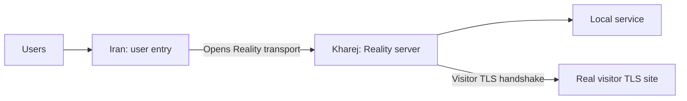

import Tabs from '@theme/Tabs';
import TabItem from '@theme/TabItem';

# Direct tunnel over Reality

Users connect to Iran; Iran opens the Reality connections to Kharej, which
forwards accepted user streams to its local service. The service in these
examples listens on `127.0.0.1:80` in Kharej. Change `final_port` for your
application.



Start with the [common setup](./overview.mdx) and use `mtu: 1500` in each
server's `core.json`. Iran must be able to initiate TCP connections to Kharej.
For the opposite connection direction, use [Reverse Reality](./reverse-reality.mdx).
For a transport using your own certificate, see [Direct TLS](./direct-tls.mdx).

## Set the addresses and Reality password

| Setting | Where | What to enter |
| --- | --- | --- |
| `ip_server_kharej` | Iran | Kharej's reachable IP; replace `198.51.100.20`. |
| `user_port` | Iran | Public user entry port; default `443`. |
| `transport_port` | Both | Matching Kharej listener and Iran connection ports; default `443`. |
| `visitor_domain` | Iran | A name on the real visitor TLS site's certificate; replace `visitor.example.com`. |
| `visitor_ip` | Kharej | That visitor site's reachable IP; replace `203.0.113.30`. |
| `password` | Both | The same fresh shared password, at most 32 UTF-8 bytes. |
| `final_port` | Kharej | Local destination service port; default `80`. |

Generate a password once and put its value in both configurations:

```bash
openssl rand -hex 16
```

The 32 hexadecimal characters fit the Reality password limit. Replace
`REPLACE_WITH_SHARED_PASSWORD` on both servers. Keep `algorithm` and
`kdf-iterations` identical; these examples use the same default salt.

Kharej's `dest-visitor` connector must reach the real visitor TLS site on port
`443`. Its certificate must validate for Iran's `visitor_domain`, because
`verify` remains `true`. Replace both visitor placeholders with a real matching
hostname and IP. `visitor_ip` must not point back at Kharej's WaterWall listener.
The domain is sent by Iran as `RealityClient.settings.sni`; Kharej needs no
duplicate domain setting, local certificate, or private key for this transport.

Reality protects the inter-server transport; user traffic reaches the final
service unchanged. See [RealityClient](../../noderefs/RealityClient)
and [RealityServer](../../noderefs/RealityServer) for the visitor handshake.

## Choose the transport

**With Mux is recommended** for this direct tunnel. It shares transport
connections across user streams, reducing the number of separate TCP and
Reality handshakes needed. Choose the server location inside the selected tab,
and use the same Mux choice on both servers. **Without Mux** remains available
for a separate transport connection per user stream.

With Mux, Iran's `MuxClient` combines user streams before `RealityClient`;
Kharej's `MuxServer` separates them after `RealityServer` and opens a local
service connection for each stream. User applications and the final service
continue to speak their normal protocol.

`mux_connections_per_worker: 2` sets the parent transport pool **per worker**
on Iran. More workers multiply this pool; it is not a global connection count.
See [MuxClient](../../noderefs/MuxClient) for tuning.

<Tabs groupId="direct-mux" defaultValue="mux">
<TabItem value="plain" label="Without Mux">

The transport chains are:

```text
Iran:   TcpListener -> RealityClient -> TcpConnector (Kharej)
Kharej: TcpListener -> RealityServer -> TcpConnector (local service)
                         |
                         +-> TcpConnector (visitor TLS site)
```

<Tabs groupId="tunnel-location" defaultValue="iran">
<TabItem value="iran" label="Iran">

Save as `config_iran.json` on the Iran server.

```json title="config_iran.json"
{
  "name": "iran-direct-reality",
  "variables": {
    "ip_server_kharej": "198.51.100.20",
    "user_port": 443,
    "transport_port": 443,
    "visitor_domain": "visitor.example.com",
    "password": "REPLACE_WITH_SHARED_PASSWORD"
  },
  "nodes": [
    {
      "name": "users_inbound",
      "type": "TcpListener",
      "settings": {
        "address": "0.0.0.0",
        "port": $user_port$,
        "nodelay": true
      },
      "next": "reality-client"
    },
    {
      "name": "reality-client",
      "type": "RealityClient",
      "settings": {
        "sni": $visitor_domain$,
        "verify": true,
        "password": $password$,
        "algorithm": "chacha20-poly1305",
        "kdf-iterations": 12000
      },
      "next": "tcp_to_kharej"
    },
    {
      "name": "tcp_to_kharej",
      "type": "TcpConnector",
      "settings": {
        "address": $ip_server_kharej$,
        "port": $transport_port$,
        "nodelay": true
      }
    }
  ]
}
```

</TabItem>
<TabItem value="kharej" label="Kharej">

Save as `config_kharej.json` on the Kharej server.

```json title="config_kharej.json"
{
  "name": "kharej-direct-reality",
  "variables": {
    "transport_port": 443,
    "visitor_ip": "203.0.113.30",
    "password": "REPLACE_WITH_SHARED_PASSWORD",
    "final_port": 80
  },
  "nodes": [
    {
      "name": "transport_inbound",
      "type": "TcpListener",
      "settings": {
        "address": "0.0.0.0",
        "port": $transport_port$,
        "nodelay": true
      },
      "next": "reality-server"
    },
    {
      "name": "reality-server",
      "type": "RealityServer",
      "settings": {
        "destination": "dest-visitor",
        "password": $password$,
        "algorithm": "chacha20-poly1305",
        "kdf-iterations": 12000,
        "sniffing-attempts": 8
      },
      "next": "outbound_to_local_service"
    },
    {
      "name": "dest-visitor",
      "type": "TcpConnector",
      "settings": {
        "address": $visitor_ip$,
        "port": 443,
        "nodelay": true
      }
    },
    {
      "name": "outbound_to_local_service",
      "type": "TcpConnector",
      "settings": {
        "address": "127.0.0.1",
        "port": $final_port$,
        "nodelay": true
      }
    }
  ]
}
```

</TabItem>
</Tabs>

</TabItem>
<TabItem value="mux" label="With Mux (recommended)">

The transport chains are:

```text
Iran:   TcpListener -> MuxClient -> RealityClient -> TcpConnector (Kharej)
Kharej: TcpListener -> RealityServer -> MuxServer -> TcpConnector (local service)
                         |
                         +-> TcpConnector (visitor TLS site)
```

<Tabs groupId="tunnel-location" defaultValue="iran">
<TabItem value="iran" label="Iran">

Save as `config_iran.json` on the Iran server.

```json title="config_iran.json"
{
  "name": "iran-direct-reality-mux",
  "variables": {
    "ip_server_kharej": "198.51.100.20",
    "user_port": 443,
    "transport_port": 443,
    "visitor_domain": "visitor.example.com",
    "password": "REPLACE_WITH_SHARED_PASSWORD",
    "mux_connections_per_worker": 2
  },
  "nodes": [
    {
      "name": "users_inbound",
      "type": "TcpListener",
      "settings": {
        "address": "0.0.0.0",
        "port": $user_port$,
        "nodelay": true
      },
      "next": "mux_client"
    },
    {
      "name": "mux_client",
      "type": "MuxClient",
      "settings": {
        "mode": "fixed-connections-count",
        "per-worker-connections-count": $mux_connections_per_worker$
      },
      "next": "reality-client"
    },
    {
      "name": "reality-client",
      "type": "RealityClient",
      "settings": {
        "sni": $visitor_domain$,
        "verify": true,
        "password": $password$,
        "algorithm": "chacha20-poly1305",
        "kdf-iterations": 12000
      },
      "next": "tcp_to_kharej"
    },
    {
      "name": "tcp_to_kharej",
      "type": "TcpConnector",
      "settings": {
        "address": $ip_server_kharej$,
        "port": $transport_port$,
        "nodelay": true
      }
    }
  ]
}
```

</TabItem>
<TabItem value="kharej" label="Kharej">

Save as `config_kharej.json` on the Kharej server.

```json title="config_kharej.json"
{
  "name": "kharej-direct-reality-mux",
  "variables": {
    "transport_port": 443,
    "visitor_ip": "203.0.113.30",
    "password": "REPLACE_WITH_SHARED_PASSWORD",
    "final_port": 80
  },
  "nodes": [
    {
      "name": "transport_inbound",
      "type": "TcpListener",
      "settings": {
        "address": "0.0.0.0",
        "port": $transport_port$,
        "nodelay": true
      },
      "next": "reality-server"
    },
    {
      "name": "reality-server",
      "type": "RealityServer",
      "settings": {
        "destination": "dest-visitor",
        "password": $password$,
        "algorithm": "chacha20-poly1305",
        "kdf-iterations": 12000,
        "sniffing-attempts": 8
      },
      "next": "mux_server"
    },
    {
      "name": "dest-visitor",
      "type": "TcpConnector",
      "settings": {
        "address": $visitor_ip$,
        "port": 443,
        "nodelay": true
      }
    },
    {
      "name": "mux_server",
      "type": "MuxServer",
      "settings": {},
      "next": "outbound_to_local_service"
    },
    {
      "name": "outbound_to_local_service",
      "type": "TcpConnector",
      "settings": {
        "address": "127.0.0.1",
        "port": $final_port$,
        "nodelay": true
      }
    }
  ]
}
```

</TabItem>
</Tabs>

</TabItem>
</Tabs>

## Run and check

Start the local service in Kharej, then start WaterWall on Kharej and Iran using
the [common startup commands](./overview.mdx#start-the-tunnel). Allow inbound
TCP on Iran's `user_port`, outbound TCP from Iran to Kharej's `transport_port`,
and inbound TCP on Kharej's matching port. Kharej also needs outbound TCP access
to the visitor TLS site on port `443`.

Connect a normal application client to Iran's user port. For the example HTTP
service on Kharej port `80`, a simple check is:

```bash
curl http://192.0.2.10:443/
```

Replace the address before running it. If your destination is Xray or another
protocol, use that service's client instead. The user port number does not
change the application protocol.

If the connection fails, check the paired transport ports, the selected Mux
mode on both sides, and the destination service first. For Reality handshake
errors, check visitor reachability, its certificate/SNI, and the shared
password and algorithm settings.
