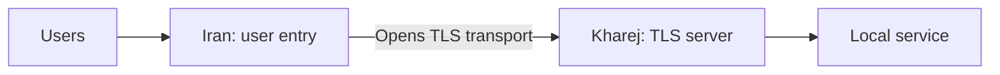

import Tabs from '@theme/Tabs';
import TabItem from '@theme/TabItem';

# Direct tunnel over TLS

Users connect to Iran; Iran opens the TLS transport to Kharej, which forwards
each user stream to its local service. The service in these examples listens
on `127.0.0.1:80` in Kharej. Change `final_port` for your application.



Start with the [common setup](./overview.mdx) and use `mtu: 1500` in each
server's `core.json`. Unlike [Reverse TLS](./reverse-tls.mdx), this example
requires Iran to reach Kharej's transport port directly. For a Reality transport
instead, see [Direct Reality](./direct-reality.mdx).

## Set the addresses and certificate

| Setting | Where | What to enter |
| --- | --- | --- |
| `ip_server_kharej` | Iran | Kharej's reachable IP; replace `198.51.100.20`. |
| `user_port` | Iran | Public user entry port; default `443`. |
| `transport_port` | Both | Matching Kharej listener and Iran connection port; default `443`. |
| `domain_to_handshake_tls` | Iran | The DNS name covered by Kharej's certificate; replace `tunnel.example.com`. |
| `certificate_path` / `key_path` | Kharej | Existing certificate chain and private key PEM paths. |
| `final_port` | Kharej | Local destination service port; default `80`. |

Install a certificate on Kharej that Iran trusts. The TLS client keeps
`verify: true`, and verifies the certificate against `domain_to_handshake_tls`.
The TCP connector independently uses `ip_server_kharej` to reach Kharej.

The TLS wrapper protects the **inter-server transport**. User traffic reaches
the final service unchanged, including any application TLS it already contains.
See [TlsServer](../../noderefs/TlsServer) and
[TlsClient](../../noderefs/TlsClient) for certificate options.

This TLS configuration authenticates Kharej to Iran; it does not authenticate
clients connecting to Kharej's transport port. To limit that port to Iran,
restrict it to Iran's public egress IP using a firewall or the
[TcpListener whitelist](../../noderefs/TcpListener).

## Choose the transport

**With Mux is recommended** for this direct tunnel. It shares transport
connections across user streams, reducing the number of separate TCP and TLS
connections needed. Choose the server location inside the selected tab, and use
the same Mux choice on both servers. **Without Mux** remains available for a
direct connection per user stream.

With Mux, Iran's `MuxClient` opens logical streams over shared TLS connections.
Kharej decrypts TLS before `MuxServer` recreates each stream for the local
service. User applications and the final service continue to speak their normal
protocol.

`mux_connections_per_worker: 2` sets the parent transport pool per worker.
More workers multiply these pools. See [MuxClient](../../noderefs/MuxClient)
for tuning.

<Tabs groupId="direct-mux" defaultValue="mux">
<TabItem value="plain" label="Without Mux">

The direct transport chains are:

```text
Iran:   TcpListener -> TlsClient -> TcpConnector
Kharej: TcpListener -> TlsServer -> TcpConnector
```

<Tabs groupId="tunnel-location" defaultValue="iran">
<TabItem value="iran" label="Iran">

Save as `config_iran.json` on the Iran server.

```json title="config_iran.json"
{
  "name": "iran-direct-tls",
  "variables": {
    "ip_server_kharej": "198.51.100.20",
    "user_port": 443,
    "transport_port": 443,
    "domain_to_handshake_tls": "tunnel.example.com"
  },
  "nodes": [
    {
      "name": "users_inbound",
      "type": "TcpListener",
      "settings": {
        "address": "0.0.0.0",
        "port": $user_port$,
        "nodelay": true
      },
      "next": "tls_client"
    },
    {
      "name": "tls_client",
      "type": "TlsClient",
      "settings": {
        "sni": $domain_to_handshake_tls$,
        "verify": true
      },
      "next": "tcp_to_kharej"
    },
    {
      "name": "tcp_to_kharej",
      "type": "TcpConnector",
      "settings": {
        "address": $ip_server_kharej$,
        "port": $transport_port$,
        "nodelay": true
      }
    }
  ]
}
```

</TabItem>
<TabItem value="kharej" label="Kharej">

Save as `config_kharej.json` on the Kharej server.

```json title="config_kharej.json"
{
  "name": "kharej-direct-tls",
  "variables": {
    "transport_port": 443,
    "certificate_path": "/etc/waterwall/fullchain.pem",
    "key_path": "/etc/waterwall/privkey.pem",
    "final_port": 80
  },
  "nodes": [
    {
      "name": "transport_inbound",
      "type": "TcpListener",
      "settings": {
        "address": "0.0.0.0",
        "port": $transport_port$,
        "nodelay": true
      },
      "next": "tls_server"
    },
    {
      "name": "tls_server",
      "type": "TlsServer",
      "settings": {
        "cert-file": $certificate_path$,
        "key-file": $key_path$,
        "min-version": "TLSv1.2",
        "max-version": "TLSv1.3",
        "ciphers": "HIGH:!aNULL:!MD5",
        "session-cache": "none",
        "session-tickets": true,
        "verbose": false
      },
      "next": "outbound_to_local_service"
    },
    {
      "name": "outbound_to_local_service",
      "type": "TcpConnector",
      "settings": {
        "address": "127.0.0.1",
        "port": $final_port$,
        "nodelay": true
      }
    }
  ]
}
```

</TabItem>
</Tabs>

</TabItem>
<TabItem value="mux" label="With Mux (recommended)">

The direct transport chains are:

```text
Iran:   TcpListener -> MuxClient -> TlsClient -> TcpConnector
Kharej: TcpListener -> TlsServer -> MuxServer -> TcpConnector
```

<Tabs groupId="tunnel-location" defaultValue="iran">
<TabItem value="iran" label="Iran">

Save as `config_iran.json` on the Iran server.

```json title="config_iran.json"
{
  "name": "iran-direct-tls-mux",
  "variables": {
    "ip_server_kharej": "198.51.100.20",
    "user_port": 443,
    "transport_port": 443,
    "domain_to_handshake_tls": "tunnel.example.com",
    "mux_connections_per_worker": 2
  },
  "nodes": [
    {
      "name": "users_inbound",
      "type": "TcpListener",
      "settings": {
        "address": "0.0.0.0",
        "port": $user_port$,
        "nodelay": true
      },
      "next": "mux_client"
    },
    {
      "name": "mux_client",
      "type": "MuxClient",
      "settings": {
        "mode": "fixed-connections-count",
        "per-worker-connections-count": $mux_connections_per_worker$
      },
      "next": "tls_client"
    },
    {
      "name": "tls_client",
      "type": "TlsClient",
      "settings": {
        "sni": $domain_to_handshake_tls$,
        "verify": true
      },
      "next": "tcp_to_kharej"
    },
    {
      "name": "tcp_to_kharej",
      "type": "TcpConnector",
      "settings": {
        "address": $ip_server_kharej$,
        "port": $transport_port$,
        "nodelay": true
      }
    }
  ]
}
```

</TabItem>
<TabItem value="kharej" label="Kharej">

Save as `config_kharej.json` on the Kharej server.

```json title="config_kharej.json"
{
  "name": "kharej-direct-tls-mux",
  "variables": {
    "transport_port": 443,
    "certificate_path": "/etc/waterwall/fullchain.pem",
    "key_path": "/etc/waterwall/privkey.pem",
    "final_port": 80
  },
  "nodes": [
    {
      "name": "transport_inbound",
      "type": "TcpListener",
      "settings": {
        "address": "0.0.0.0",
        "port": $transport_port$,
        "nodelay": true
      },
      "next": "tls_server"
    },
    {
      "name": "tls_server",
      "type": "TlsServer",
      "settings": {
        "cert-file": $certificate_path$,
        "key-file": $key_path$,
        "min-version": "TLSv1.2",
        "max-version": "TLSv1.3",
        "ciphers": "HIGH:!aNULL:!MD5",
        "session-cache": "none",
        "session-tickets": true,
        "verbose": false
      },
      "next": "mux_server"
    },
    {
      "name": "mux_server",
      "type": "MuxServer",
      "settings": {},
      "next": "outbound_to_local_service"
    },
    {
      "name": "outbound_to_local_service",
      "type": "TcpConnector",
      "settings": {
        "address": "127.0.0.1",
        "port": $final_port$,
        "nodelay": true
      }
    }
  ]
}
```

</TabItem>
</Tabs>

</TabItem>
</Tabs>

## Run and check

Start the local service in Kharej, then start WaterWall on Kharej followed by
Iran using the [common startup commands](./overview.mdx#start-the-tunnel).
Allow inbound TCP on Iran's `user_port` and Kharej's `transport_port`, and
outbound TCP from Iran to Kharej's transport port.

Connect a normal application client to Iran's user port. For the example HTTP
service on Kharej port `80`, a simple check is:

```bash
curl http://192.0.2.10:443/
```

Replace the address before running it. If your destination is Xray or another
protocol, use that service's client instead. The user port number does not
change the application protocol.

If the connection fails, check Kharej's reachable IP and transport port, the
selected Mux mode on both sides, and the destination service first. For TLS
handshake errors, check the certificate chain, key path, and SNI.
