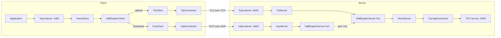

import Tabs from '@theme/Tabs';
import TabItem from '@theme/TabItem';

# HalfDuplex with separate TLS and KCP paths

Use different transports for the two directions of one application connection.
This example sends upload data through **TLS over TCP** and download data through
**KCP over UDP**. The server joins the two paths into one VLESS connection and
forwards it to an ordinary TCP service. The application needs no HalfDuplex,
VLESS, TLS or KCP support.

The client corresponds to the Iran side of the other tunnel examples; the server
corresponds to Kharej. These configurations start with loopback addresses so you
can run both processes on one machine, then [move them to two hosts](#use-two-hosts).
Complete files are also available in
[`tunnels/HalfDuplexClient/examples/tls-kcp`](https://github.com/radkesvat/WaterWall/tree/main/tunnels/HalfDuplexClient/examples/tls-kcp).

## Complete topology



The arrows show configured paths and connection setup. Both transport connections
are opened by the client. Application response bytes travel back through the
KCP branch; KCP still exchanges acknowledgements and control packets in both
directions. This is not a unidirectional network requirement.

The server has the two chains:

```text
TcpListener -> TlsServer -> HalfDuplexServer (hs1) -> VlessServer -> TcpUdpConnector
UdpListener -> KcpServer -> HalfDuplexServer (hs2, pair: hs1)
```

`HalfDuplexClient` selects `tls-client` for upload and `udp-client` for download.
`hs2` names `hs1` as its pairing primary. Only `hs1` has an application-facing
`next`; the VLESS session is reconstructed there regardless of which transport
supplies each half. Keep `VlessClient` before the client split and `VlessServer`
after the server join so both halves belong to the same VLESS session.

Both server ingress nodes must live in **one WaterWall process and configuration**.
`pair` names a local node; it does not connect to a server in another process.

## Files and ports

Create separate `client` and `server` directories, or use the supplied example
directories. Each contains its own `core.json` and `config.json`.

| Endpoint | Default | Purpose |
| --- | --- | --- |
| Client TCP entry | `127.0.0.1:1080` | Application connects here. |
| Server TLS listener | `127.0.0.1:8443` TCP | Upload transport. |
| Server KCP listener | `127.0.0.1:4000` UDP | Download transport. |
| Destination service | `127.0.0.1:9000` TCP, on the server | Requested by `VlessClient`. |

The client entry is a plain TCP forwarding port. For the HTTP check below, send
an ordinary HTTP request to it.

This local demonstration uses a self-signed TLS certificate and explicitly sets
`TlsClient.verify` to `false`. TLS covers only the TLS branch: KCP and VLESS do
not add encryption to the UDP branch. For deployment, use a trusted certificate
with verification enabled, and choose an encrypted UDP transport such as
[QUIC](./direct-quic.mdx) when that branch also needs transport encryption.

## Client and server configurations

These are complete strict JSON files; they use no variable substitution.
The sample VLESS UUID matches on both sides. Replace it on both sides for your
deployment.

<Tabs groupId="halfduplex-location" defaultValue="client">
<TabItem value="client" label="Client">

Save as `client/config.json`.

```json title="client/config.json"
{
  "name": "halfduplex-tls-kcp-client",
  "nodes": [
    {
      "name": "application",
      "type": "TcpListener",
      "next": "vless-client",
      "settings": {
        "address": "127.0.0.1",
        "port": 1080,
        "nodelay": true
      }
    },
    {
      "name": "vless-client",
      "type": "VlessClient",
      "next": "split",
      "settings": {
        "uuid": "5783a3e7-e373-51cd-8642-c83782b807c5",
        "address": "127.0.0.1",
        "port": 9000,
        "protocol": "tcp"
      }
    },
    {
      "name": "split",
      "type": "HalfDuplexClient",
      "settings": {
        "upload": "tls-client",
        "download": "udp-client"
      }
    },
    {
      "name": "tls-client",
      "type": "TlsClient",
      "next": "tcp-out",
      "settings": {
        "sni": "halfduplex.example.test",
        "verify": false,
        "alpns": [
          "http/1.1"
        ]
      }
    },
    {
      "name": "tcp-out",
      "type": "TcpConnector",
      "settings": {
        "address": "127.0.0.1",
        "port": 8443,
        "nodelay": true,
        "fastopen": false
      }
    },
    {
      "name": "udp-client",
      "type": "KcpClient",
      "next": "udp-out",
      "settings": {
        "send-mtu": 1400,
        "fec": false,
        "kcp-no-congestion-control": false
      }
    },
    {
      "name": "udp-out",
      "type": "UdpConnector",
      "settings": {
        "address": "127.0.0.1",
        "port": 4000,
        "balance-mode": "packet"
      }
    }
  ]
}
```

</TabItem>
<TabItem value="server" label="Server">

Save as `server/config.json`. Both server chains are in this one file.

```json title="server/config.json"
{
  "name": "halfduplex-tls-kcp-server",
  "nodes": [
    {
      "name": "udp-in",
      "type": "UdpListener",
      "next": "udp-server",
      "settings": {
        "address": "127.0.0.1",
        "port": 4000
      }
    },
    {
      "name": "udp-server",
      "type": "KcpServer",
      "next": "hs2",
      "settings": {
        "send-mtu": 1400,
        "fec": false,
        "kcp-no-congestion-control": false
      }
    },
    {
      "name": "hs2",
      "type": "HalfDuplexServer",
      "settings": {
        "pair": "hs1"
      }
    },
    {
      "name": "tcp-in",
      "type": "TcpListener",
      "next": "tls-server",
      "settings": {
        "address": "127.0.0.1",
        "port": 8443,
        "nodelay": true
      }
    },
    {
      "name": "tls-server",
      "type": "TlsServer",
      "next": "hs1",
      "settings": {
        "cert-file": "server.crt",
        "key-file": "server.key",
        "sni": "halfduplex.example.test"
      }
    },
    {
      "name": "hs1",
      "type": "HalfDuplexServer",
      "next": "vless-server"
    },
    {
      "name": "vless-server",
      "type": "VlessServer",
      "next": "backend",
      "settings": {
        "uuid": "5783a3e7-e373-51cd-8642-c83782b807c5",
        "connect": true,
        "udp": true
      }
    },
    {
      "name": "backend",
      "type": "TcpUdpConnector",
      "settings": {
        "address": "dest_context->address",
        "port": "dest_context->port",
        "nodelay": true,
        "fastopen": false
      }
    }
  ]
}
```

</TabItem>
</Tabs>

Save the following as `core.json` in **both** directories:

```json title="client/core.json and server/core.json"
{
  "log": {
    "path": "log/",
    "internal": {
      "loglevel": "INFO",
      "file": "internal.log",
      "console": true
    },
    "core": {
      "loglevel": "INFO",
      "file": "core.log",
      "console": true
    },
    "network": {
      "loglevel": "INFO",
      "file": "network.log",
      "console": true
    },
    "dns": {
      "loglevel": "INFO",
      "file": "dns.log",
      "console": true
    }
  },
  "configs": [
    "config.json"
  ],
  "misc": {
    "workers": 2,
    "ram-profile": "client",
    "mtu": 1500,
    "try-enabling-bbr": false
  }
}
```

The KCP settings match on both sides: a `1400`-byte send budget, FEC disabled,
and congestion control enabled. Keep those settings aligned when changing them;
see [Direct KCP](./direct-kcp.mdx#packet-size-and-optional-fec).

## Run the local example

Use a WaterWall build containing HalfDuplex, VLESS, TLS, KCP and the TCP/UDP
adapters. The certificate command needs OpenSSL; the simple HTTP check needs
Python 3 and curl.

From the directory containing `client` and `server`, create the local server
certificate:

```bash
openssl req -x509 -newkey rsa:2048 -nodes -sha256 -days 30 \
  -subj '/CN=halfduplex.example.test' \
  -addext 'subjectAltName=DNS:halfduplex.example.test' \
  -keyout server/server.key -out server/server.crt
```

Start a destination HTTP service in one terminal:

```bash
python3 -m http.server 9000 --bind 127.0.0.1
```

Start the server in another terminal, using the absolute path to your built
WaterWall executable:

```bash
cd /path/to/tls-kcp/server
/absolute/path/to/Waterwall --config:core.json
```

Then start the client in another terminal:

```bash
cd /path/to/tls-kcp/client
/absolute/path/to/Waterwall --config:core.json
```

Finally, send an HTTP request through the local TCP entry:

```bash
curl --fail http://127.0.0.1:1080/
```

The request reaches the service through TLS/TCP. The directory listing returns
through KCP/UDP. Keep both WaterWall processes and the service running while
trying further requests. Stop them with Ctrl+C when finished.

## Swap upload and download

Change only the `split` node's settings in `client/config.json`:

```json title="split.settings"
{
  "upload": "udp-client",
  "download": "tls-client"
}
```

Restart the client. Upload now uses KCP/UDP and download uses TLS/TCP. The server
configuration stays valid: the HalfDuplex intro identifies each connection's
role, so `hs1` and `hs2` have no fixed upload/download role.

The client must supply both path names and omit `next`. A secondary server must
supply `pair` and omit `next`; its primary supplies `next` and omits `pair`.

## Use two hosts

To move this example to separate client/Iran and server/Kharej hosts:

1. Set the client `tcp-out.settings.address` and `udp-out.settings.address` to
   the server's reachable address.
2. Bind server `tcp-in` and `udp-in` to the server interface or `0.0.0.0`, and
   permit the selected TCP `8443` and UDP `4000` transport ports.
3. Install the server's certificate and key, set both `tls-client.settings.sni`
   and `tls-server.settings.sni` to its certificate name, and enable the client's
   `verify: true` with a trusted certificate chain.
4. Set `vless-client.settings.address` and `port` to the destination service as
   reached **from the server**. `127.0.0.1:9000` still means the server's own
   local service.
5. Choose the client entry's bind address and port for your applications, and
   replace the sample UUID on both VLESS nodes.

Both transport paths must reach members of the same server pairing group. A
reachable TCP listener alone does not establish that the UDP path works.

## Try another UDP transport

The split and join are independent of KCP. Replace `KcpClient` and `KcpServer`
with `QuicClient` and `QuicServer`, using the datagram-mode settings and certificate
setup from [Direct QUIC](./direct-quic.mdx). Keep the `udp-client` and `udp-server`
node names, their UDP adapters, and the HalfDuplex settings. QUIC adds an encrypted
UDP transport; `HalfDuplexClient` can still assign either direction to it.

See [HalfDuplexClient](../../noderefs/HalfDuplexClient) and
[HalfDuplexServer](../../noderefs/HalfDuplexServer) for all configuration and pairing
rules.
