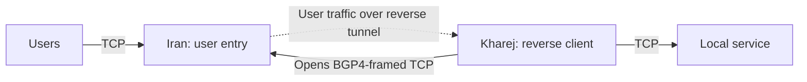

import Tabs from '@theme/Tabs';
import TabItem from '@theme/TabItem';

# Reverse tunnel over BGP4

Users connect to Iran over TCP; Kharej opens the reverse TCP connections to Iran
and forwards accepted user streams to its local TCP service. The service in these
examples listens on `127.0.0.1:80` in Kharej. Change `final_port` for your
application.



Start with the [common setup](./overview.mdx) and use `mtu: 1500` in each
server's `core.json`. This tunnel uses **TCP throughout**, including both
inter-server adapters: `TcpConnector` on Kharej and `TcpListener` on Iran.
Applications need no BGP support. Application bytes reach the final service
unchanged, including any application TLS they already contain.

`Bgp4Client` and `Bgp4Server` add **BGP-like framing** to application streams.
They do not implement BGP routing, peering or route exchange, and they provide
**no encryption or peer authentication**. No certificate, domain or BGP router
configuration is needed. Both BGP4 nodes use `settings: {}`; the optional
`password` field is ignored by the current implementation. See
[Bgp4Client](../../noderefs/Bgp4Client) and
[Bgp4Server](../../noderefs/Bgp4Server) for details. For an encrypted reverse
transport, see [Reverse TLS](./reverse-tls.mdx).

For BGP4-framed TCP connections initiated from Iran to Kharej, use the
[direct BGP4 tunnel](./direct-bgp4.mdx).

## Set the addresses

| Setting | Where | What to enter |
| --- | --- | --- |
| `ip_server_iran` | Kharej | Iran's reachable IP; replace `192.0.2.10`. |
| `ip_server_kharej` | Iran | Kharej's public egress IP/CIDR as seen by Iran; replace `198.51.100.20/32`. |
| `user_port` | Iran | Public TCP user entry port; default `443`. |
| `transport_port` | Both | Matching Iran TCP listener and Kharej connection port; default `7443`. |
| `final_port` | Kharej | Local TCP destination service port; default `80`. |

Iran accepts users on TCP `user_port` and reverse connections on a separate TCP
`transport_port`. Keep these ports distinct in this configuration. The
[TcpListener whitelist](../../noderefs/TcpListener) on the reverse transport
allows connections only from Kharej's configured egress address. Use `/32` for a
single IPv4 address, and update it if Kharej reaches Iran through NAT. The user
listener remains available to normal clients, including users connecting from
Kharej's egress IP on `user_port`. IP filtering does not provide cryptographic
peer authentication.

## Choose the transport

**With Mux is recommended** for this reverse tunnel. It shares BGP4-framed TCP
connections across reverse streams, reducing the number of separate transport
connections needed. Choose the server location inside the selected tab, and use
the same Mux choice on both servers. **Without Mux** remains available for a
separate TCP connection per reverse stream.

With Mux, Kharej's `ReverseClient` opens logical reverse streams through
`MuxClient`. Iran removes the BGP4 framing before `MuxServer` recreates those
streams for `ReverseServer`. User applications and the final service continue
to speak their normal protocol.

`min_held_connections: 8` keeps eight spare reverse streams **per worker**.
Without Mux, each spare has its own BGP4-framed TCP connection. With Mux,
`mux_connections_per_worker: 2` sets the parent transport pool per worker;
it is separate from the spare-stream count. More workers multiply these pools.
Streams sharing one parent also share TCP's ordered delivery, so packet loss
can delay them together. See [MuxClient](../../noderefs/MuxClient) for tuning.

Keep `ReverseServer -> Bridge` and `Bridge -> ReverseClient` directly adjacent.
The Mux nodes in these examples sit on the outbound reverse-link transport.
See [ReverseClient](../../noderefs/ReverseClient),
[ReverseServer](../../noderefs/ReverseServer) and [Bridge](../../noderefs/Bridge)
for the reverse topology.

<Tabs groupId="reverse-mux" defaultValue="mux">
<TabItem value="plain" label="Without Mux">

The reverse transport chains are:

```text
Kharej: Bridge -> ReverseClient -> Bgp4Client -> TcpConnector
Iran:   TcpListener -> Bgp4Server -> ReverseServer -> Bridge
```

<Tabs groupId="tunnel-location" defaultValue="iran">
<TabItem value="iran" label="Iran">

Save as `config_iran.json` on the Iran server.

```json title="config_iran.json"
{
  "name": "iran-reverse-bgp4",
  "variables": {
    "ip_server_kharej": "198.51.100.20/32",
    "user_port": 443,
    "transport_port": 7443
  },
  "nodes": [
    {
      "name": "users_inbound",
      "type": "TcpListener",
      "settings": {
        "address": "0.0.0.0",
        "port": $user_port$,
        "nodelay": true
      },
      "next": "bridge_user_side"
    },
    {
      "name": "bridge_user_side",
      "type": "Bridge",
      "settings": {
        "pair": "bridge_reverse_side"
      }
    },
    {
      "name": "bridge_reverse_side",
      "type": "Bridge",
      "settings": {
        "pair": "bridge_user_side"
      }
    },
    {
      "name": "reverse_server",
      "type": "ReverseServer",
      "settings": {},
      "next": "bridge_reverse_side"
    },
    {
      "name": "bgp4_server",
      "type": "Bgp4Server",
      "settings": {},
      "next": "reverse_server"
    },
    {
      "name": "reverse_transport_inbound",
      "type": "TcpListener",
      "settings": {
        "address": "0.0.0.0",
        "port": $transport_port$,
        "nodelay": true,
        "whitelist": [
          $ip_server_kharej$
        ]
      },
      "next": "bgp4_server"
    }
  ]
}
```

</TabItem>
<TabItem value="kharej" label="Kharej">

Save as `config_kharej.json` on the Kharej server.

```json title="config_kharej.json"
{
  "name": "kharej-reverse-bgp4",
  "variables": {
    "ip_server_iran": "192.0.2.10",
    "transport_port": 7443,
    "final_port": 80,
    "min_held_connections": 8
  },
  "nodes": [
    {
      "name": "outbound_to_local_service",
      "type": "TcpConnector",
      "settings": {
        "address": "127.0.0.1",
        "port": $final_port$,
        "nodelay": true
      }
    },
    {
      "name": "bridge_local_side",
      "type": "Bridge",
      "settings": {
        "pair": "bridge_reverse_client_side"
      },
      "next": "outbound_to_local_service"
    },
    {
      "name": "bridge_reverse_client_side",
      "type": "Bridge",
      "settings": {
        "pair": "bridge_local_side"
      },
      "next": "reverse_client"
    },
    {
      "name": "reverse_client",
      "type": "ReverseClient",
      "settings": {
        "minimum-unused": $min_held_connections$
      },
      "next": "bgp4_client"
    },
    {
      "name": "bgp4_client",
      "type": "Bgp4Client",
      "settings": {},
      "next": "tcp_to_iran"
    },
    {
      "name": "tcp_to_iran",
      "type": "TcpConnector",
      "settings": {
        "address": $ip_server_iran$,
        "port": $transport_port$,
        "nodelay": true
      }
    }
  ]
}
```

</TabItem>
</Tabs>

</TabItem>
<TabItem value="mux" label="With Mux (recommended)">

The reverse transport chains are:

```text
Kharej: Bridge -> ReverseClient -> MuxClient -> Bgp4Client -> TcpConnector
Iran:   TcpListener -> Bgp4Server -> MuxServer -> ReverseServer -> Bridge
```

<Tabs groupId="tunnel-location" defaultValue="iran">
<TabItem value="iran" label="Iran">

Save as `config_iran.json` on the Iran server.

```json title="config_iran.json"
{
  "name": "iran-reverse-bgp4-mux",
  "variables": {
    "ip_server_kharej": "198.51.100.20/32",
    "user_port": 443,
    "transport_port": 7443
  },
  "nodes": [
    {
      "name": "users_inbound",
      "type": "TcpListener",
      "settings": {
        "address": "0.0.0.0",
        "port": $user_port$,
        "nodelay": true
      },
      "next": "bridge_user_side"
    },
    {
      "name": "bridge_user_side",
      "type": "Bridge",
      "settings": {
        "pair": "bridge_reverse_side"
      }
    },
    {
      "name": "bridge_reverse_side",
      "type": "Bridge",
      "settings": {
        "pair": "bridge_user_side"
      }
    },
    {
      "name": "reverse_server",
      "type": "ReverseServer",
      "settings": {},
      "next": "bridge_reverse_side"
    },
    {
      "name": "bgp4_server",
      "type": "Bgp4Server",
      "settings": {},
      "next": "mux_server"
    },
    {
      "name": "reverse_transport_inbound",
      "type": "TcpListener",
      "settings": {
        "address": "0.0.0.0",
        "port": $transport_port$,
        "nodelay": true,
        "whitelist": [
          $ip_server_kharej$
        ]
      },
      "next": "bgp4_server"
    },
    {
      "name": "mux_server",
      "type": "MuxServer",
      "settings": {},
      "next": "reverse_server"
    }
  ]
}
```

</TabItem>
<TabItem value="kharej" label="Kharej">

Save as `config_kharej.json` on the Kharej server.

```json title="config_kharej.json"
{
  "name": "kharej-reverse-bgp4-mux",
  "variables": {
    "ip_server_iran": "192.0.2.10",
    "transport_port": 7443,
    "final_port": 80,
    "min_held_connections": 8,
    "mux_connections_per_worker": 2
  },
  "nodes": [
    {
      "name": "outbound_to_local_service",
      "type": "TcpConnector",
      "settings": {
        "address": "127.0.0.1",
        "port": $final_port$,
        "nodelay": true
      }
    },
    {
      "name": "bridge_local_side",
      "type": "Bridge",
      "settings": {
        "pair": "bridge_reverse_client_side"
      },
      "next": "outbound_to_local_service"
    },
    {
      "name": "bridge_reverse_client_side",
      "type": "Bridge",
      "settings": {
        "pair": "bridge_local_side"
      },
      "next": "reverse_client"
    },
    {
      "name": "reverse_client",
      "type": "ReverseClient",
      "settings": {
        "minimum-unused": $min_held_connections$
      },
      "next": "mux_client"
    },
    {
      "name": "bgp4_client",
      "type": "Bgp4Client",
      "settings": {},
      "next": "tcp_to_iran"
    },
    {
      "name": "tcp_to_iran",
      "type": "TcpConnector",
      "settings": {
        "address": $ip_server_iran$,
        "port": $transport_port$,
        "nodelay": true
      }
    },
    {
      "name": "mux_client",
      "type": "MuxClient",
      "settings": {
        "mode": "fixed-connections-count",
        "per-worker-connections-count": $mux_connections_per_worker$
      },
      "next": "bgp4_client"
    }
  ]
}
```

</TabItem>
</Tabs>

</TabItem>
</Tabs>

## Run and check

Start the local TCP service in Kharej, then start WaterWall on Iran followed
by Kharej using the [common startup commands](./overview.mdx#start-the-tunnel).
Allow inbound TCP on Iran's `user_port`, inbound TCP on Iran's `transport_port`
from Kharej, and outbound TCP from Kharej to Iran's transport port.

Connect a normal application client to Iran's TCP user port. For the example
HTTP service on Kharej port `80`, a simple check is:

```bash
curl http://192.0.2.10:443/
```

Replace the Iran address before running it. If your destination is Xray or
another protocol, use that service's client instead. Port `443` here accepts
the application's protocol; it does not automatically add TLS.

If the connection fails, check the Iran address, Kharej egress whitelist,
transport port and TCP firewall rules, then the selected Mux mode and destination
service. Connect clients to `user_port`; `transport_port` expects the reverse
BGP4 transport. A working TCP connection to Iran's user port does not confirm
that the reverse connections from Kharej are ready.
