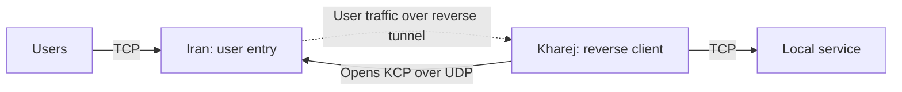

import Tabs from '@theme/Tabs';
import TabItem from '@theme/TabItem';

# Reverse tunnel over KCP

Users connect to Iran over TCP; Kharej opens the reverse KCP sessions to Iran
over UDP and forwards accepted user streams to its local TCP service. The service
in these examples listens on `127.0.0.1:80` in Kharej. Change `final_port` for
your application.



Start with the [common setup](./overview.mdx) and use `mtu: 1500` in each
server's `core.json`. Kharej must be able to reach Iran's UDP transport port.
Applications still use TCP at both ends and need no KCP support. Application
bytes reach the final service unchanged, including any application TLS they
already contain.

KCP provides a reliable, ordered stream over UDP, but **no encryption or peer
authentication**. These configurations require no certificate. For an encrypted
reverse UDP transport, see [Reverse QUIC](./reverse-quic.mdx). You can also add
verified TLS over KCP using the placement described below.

For KCP sessions initiated from Iran to Kharej, use the
[direct KCP tunnel](./direct-kcp.mdx).

## Set the addresses

| Setting | Where | What to enter |
| --- | --- | --- |
| `ip_server_iran` | Kharej | Iran's reachable IP; replace `192.0.2.10`. |
| `ip_server_kharej` | Iran | Kharej's public egress IP/CIDR as seen by Iran; replace `198.51.100.20/32`. |
| `user_port` | Iran | Public TCP user entry port; default `443`. |
| `transport_port` | Both | Matching Iran UDP listener and Kharej connection port; default `4000`. |
| `final_port` | Kharej | Local TCP destination service port; default `80`. |

Iran accepts users on TCP `user_port` and reverse transport traffic on UDP
`transport_port`. Its [UdpListener whitelist](../../noderefs/UdpListener)
allows reverse traffic only from Kharej's configured egress address. Use `/32`
for a single IPv4 address, and update it if Kharej reaches Iran through NAT.
The whitelist applies to the UDP transport listener; the TCP user listener
remains available to normal clients. IP filtering does not provide cryptographic
peer authentication.

## Choose the transport

**With Mux is recommended** for this reverse tunnel. It shares KCP sessions
across reverse streams, reducing the number of separate transport sessions
needed. Choose the server location inside the selected tab, and use the same
Mux choice on both servers. **Without Mux** remains available for a separate
KCP session per reverse stream.

With Mux, Kharej's `ReverseClient` opens logical reverse streams through
`MuxClient`. Iran reconstructs the KCP stream before `MuxServer` recreates
those streams for `ReverseServer`. User applications and the final service
continue to speak their normal protocol.

`min_held_connections: 8` keeps eight spare reverse streams **per worker**.
Without Mux, each spare has its own KCP session. With Mux,
`mux_connections_per_worker: 2` sets the parent transport pool per worker;
it is separate from the spare-stream count. More workers multiply these pools.
Streams sharing one parent also share its ordered delivery, so packet loss can
delay them together. See [MuxClient](../../noderefs/MuxClient) for tuning.

Keep `ReverseServer -> Bridge` and `Bridge -> ReverseClient` directly adjacent.
The Mux nodes in these examples sit on the outbound reverse-link transport.
See [ReverseClient](../../noderefs/ReverseClient),
[ReverseServer](../../noderefs/ReverseServer) and [Bridge](../../noderefs/Bridge)
for the reverse topology.

<Tabs groupId="reverse-mux" defaultValue="mux">
<TabItem value="plain" label="Without Mux">

The reverse transport chains are:

```text
Kharej: Bridge -> ReverseClient -> KcpClient -> UdpConnector
Iran:   UdpListener -> KcpServer -> ReverseServer -> Bridge
```

<Tabs groupId="tunnel-location" defaultValue="iran">
<TabItem value="iran" label="Iran">

Save as `config_iran.json` on the Iran server.

```json title="config_iran.json"
{
  "name": "iran-reverse-kcp",
  "variables": {
    "ip_server_kharej": "198.51.100.20/32",
    "user_port": 443,
    "transport_port": 4000
  },
  "nodes": [
    {
      "name": "users_inbound",
      "type": "TcpListener",
      "settings": {
        "address": "0.0.0.0",
        "port": $user_port$,
        "nodelay": true
      },
      "next": "bridge_user_side"
    },
    {
      "name": "bridge_user_side",
      "type": "Bridge",
      "settings": {
        "pair": "bridge_reverse_side"
      }
    },
    {
      "name": "bridge_reverse_side",
      "type": "Bridge",
      "settings": {
        "pair": "bridge_user_side"
      }
    },
    {
      "name": "reverse_server",
      "type": "ReverseServer",
      "settings": {},
      "next": "bridge_reverse_side"
    },
    {
      "name": "kcp_server",
      "type": "KcpServer",
      "settings": {
        "send-mtu": 1400,
        "fec": false,
        "kcp-no-congestion-control": false
      },
      "next": "reverse_server"
    },
    {
      "name": "reverse_transport_inbound",
      "type": "UdpListener",
      "settings": {
        "address": "0.0.0.0",
        "port": $transport_port$,
        "whitelist": [
          $ip_server_kharej$
        ]
      },
      "next": "kcp_server"
    }
  ]
}
```

</TabItem>
<TabItem value="kharej" label="Kharej">

Save as `config_kharej.json` on the Kharej server.

```json title="config_kharej.json"
{
  "name": "kharej-reverse-kcp",
  "variables": {
    "ip_server_iran": "192.0.2.10",
    "transport_port": 4000,
    "final_port": 80,
    "min_held_connections": 8
  },
  "nodes": [
    {
      "name": "outbound_to_local_service",
      "type": "TcpConnector",
      "settings": {
        "address": "127.0.0.1",
        "port": $final_port$,
        "nodelay": true
      }
    },
    {
      "name": "bridge_local_side",
      "type": "Bridge",
      "settings": {
        "pair": "bridge_reverse_client_side"
      },
      "next": "outbound_to_local_service"
    },
    {
      "name": "bridge_reverse_client_side",
      "type": "Bridge",
      "settings": {
        "pair": "bridge_local_side"
      },
      "next": "reverse_client"
    },
    {
      "name": "reverse_client",
      "type": "ReverseClient",
      "settings": {
        "minimum-unused": $min_held_connections$
      },
      "next": "kcp_client"
    },
    {
      "name": "kcp_client",
      "type": "KcpClient",
      "settings": {
        "send-mtu": 1400,
        "fec": false,
        "kcp-no-congestion-control": false
      },
      "next": "udp_to_iran"
    },
    {
      "name": "udp_to_iran",
      "type": "UdpConnector",
      "settings": {
        "address": $ip_server_iran$,
        "port": $transport_port$
      }
    }
  ]
}
```

</TabItem>
</Tabs>

</TabItem>
<TabItem value="mux" label="With Mux (recommended)">

The reverse transport chains are:

```text
Kharej: Bridge -> ReverseClient -> MuxClient -> KcpClient -> UdpConnector
Iran:   UdpListener -> KcpServer -> MuxServer -> ReverseServer -> Bridge
```

<Tabs groupId="tunnel-location" defaultValue="iran">
<TabItem value="iran" label="Iran">

Save as `config_iran.json` on the Iran server.

```json title="config_iran.json"
{
  "name": "iran-reverse-kcp-mux",
  "variables": {
    "ip_server_kharej": "198.51.100.20/32",
    "user_port": 443,
    "transport_port": 4000
  },
  "nodes": [
    {
      "name": "users_inbound",
      "type": "TcpListener",
      "settings": {
        "address": "0.0.0.0",
        "port": $user_port$,
        "nodelay": true
      },
      "next": "bridge_user_side"
    },
    {
      "name": "bridge_user_side",
      "type": "Bridge",
      "settings": {
        "pair": "bridge_reverse_side"
      }
    },
    {
      "name": "bridge_reverse_side",
      "type": "Bridge",
      "settings": {
        "pair": "bridge_user_side"
      }
    },
    {
      "name": "reverse_server",
      "type": "ReverseServer",
      "settings": {},
      "next": "bridge_reverse_side"
    },
    {
      "name": "kcp_server",
      "type": "KcpServer",
      "settings": {
        "send-mtu": 1400,
        "fec": false,
        "kcp-no-congestion-control": false
      },
      "next": "mux_server"
    },
    {
      "name": "reverse_transport_inbound",
      "type": "UdpListener",
      "settings": {
        "address": "0.0.0.0",
        "port": $transport_port$,
        "whitelist": [
          $ip_server_kharej$
        ]
      },
      "next": "kcp_server"
    },
    {
      "name": "mux_server",
      "type": "MuxServer",
      "settings": {},
      "next": "reverse_server"
    }
  ]
}
```

</TabItem>
<TabItem value="kharej" label="Kharej">

Save as `config_kharej.json` on the Kharej server.

```json title="config_kharej.json"
{
  "name": "kharej-reverse-kcp-mux",
  "variables": {
    "ip_server_iran": "192.0.2.10",
    "transport_port": 4000,
    "final_port": 80,
    "min_held_connections": 8,
    "mux_connections_per_worker": 2
  },
  "nodes": [
    {
      "name": "outbound_to_local_service",
      "type": "TcpConnector",
      "settings": {
        "address": "127.0.0.1",
        "port": $final_port$,
        "nodelay": true
      }
    },
    {
      "name": "bridge_local_side",
      "type": "Bridge",
      "settings": {
        "pair": "bridge_reverse_client_side"
      },
      "next": "outbound_to_local_service"
    },
    {
      "name": "bridge_reverse_client_side",
      "type": "Bridge",
      "settings": {
        "pair": "bridge_local_side"
      },
      "next": "reverse_client"
    },
    {
      "name": "reverse_client",
      "type": "ReverseClient",
      "settings": {
        "minimum-unused": $min_held_connections$
      },
      "next": "mux_client"
    },
    {
      "name": "kcp_client",
      "type": "KcpClient",
      "settings": {
        "send-mtu": 1400,
        "fec": false,
        "kcp-no-congestion-control": false
      },
      "next": "udp_to_iran"
    },
    {
      "name": "udp_to_iran",
      "type": "UdpConnector",
      "settings": {
        "address": $ip_server_iran$,
        "port": $transport_port$
      }
    },
    {
      "name": "mux_client",
      "type": "MuxClient",
      "settings": {
        "mode": "fixed-connections-count",
        "per-worker-connections-count": $mux_connections_per_worker$
      },
      "next": "kcp_client"
    }
  ]
}
```

</TabItem>
</Tabs>

</TabItem>
</Tabs>

## Packet size and optional FEC

Both KCP peers use `send-mtu: 1400`, disable FEC and enable KCP congestion
control with `kcp-no-congestion-control: false`. The sending budget is separate
from the common `core.json` setting `mtu: 1500`. It includes fixed allowances for
IPv4, UDP and WaterWall's session envelope; it does not discover the path MTU.
Smaller paths, IPv6 or additional outer tunnels may require a lower budget.
See [KcpClient](../../noderefs/KcpClient) and
[KcpServer](../../noderefs/KcpServer) for the exact limits and settings.

For optional FEC, use the [matching settings on both KCP peers](./direct-kcp.mdx#packet-size-and-optional-fec).
FEC mode and shard counts must match. It adds bandwidth overhead and cannot
guarantee recovery from sustained or bursty loss. Measure your actual path
before changing congestion control, windows or retransmission settings; KCP over
UDP is not guaranteed to outperform a TCP transport.

## Optional TLS over KCP

To encrypt the reverse transport, add verified TLS inside KCP's reconstructed
stream. With Mux, the reverse transport chains become:

```text
Kharej: Bridge -> ReverseClient -> MuxClient -> TlsClient -> KcpClient -> UdpConnector
Iran:   UdpListener -> KcpServer -> TlsServer -> MuxServer -> ReverseServer -> Bridge
```

Without Mux, omit only `MuxClient` and `MuxServer` from those chains. Install
the certificate and private key for `TlsServer` on Iran; configure Kharej's
`TlsClient` with `verify: true` and the hostname covered by that certificate.
Follow the certificate setup in [Reverse TLS](./reverse-tls.mdx#set-the-addresses-and-certificate)
and the node references for [TlsClient](../../noderefs/TlsClient) and
[TlsServer](../../noderefs/TlsServer).

Keep TLS before `KcpClient` on Kharej and after `KcpServer` on Iran: TLS requires
stream bytes, while the outer UDP nodes carry complete KCP datagrams. Keep both
Reverse/Bridge adjacency requirements intact.

## Run and check

Start the local TCP service in Kharej, then start WaterWall on Iran followed
by Kharej using the [common startup commands](./overview.mdx#start-the-tunnel).
Allow inbound TCP on Iran's `user_port`, inbound UDP on Iran's `transport_port`
from Kharej, and outbound UDP from Kharej to Iran's transport port.

Connect a normal application client to Iran's TCP user port. For the example
HTTP service on Kharej port `80`, a simple check is:

```bash
curl http://192.0.2.10:443/
```

Replace the Iran address before running it. If your destination is Xray or
another protocol, use that service's client instead. The user port number does
not change the application protocol.

If the connection fails, check the Iran address, Kharej egress whitelist, UDP
transport port and firewall rules, then the selected Mux mode, matching FEC
settings and destination service. A working TCP connection to Iran's user port
does not confirm that Kharej can reach the UDP reverse transport.
