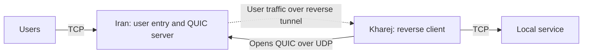

import Tabs from '@theme/Tabs';
import TabItem from '@theme/TabItem';

# Reverse tunnel over QUIC

Users connect to Iran over TCP; Kharej opens the reverse connections to Iran
over encrypted QUIC/UDP. Iran carries accepted user streams over those links,
and Kharej forwards them to its local TCP service. The service in these examples
listens on `127.0.0.1:80` in Kharej. Change `final_port` for your application.



Start with the [common setup](./overview.mdx) and use `mtu: 1500` in each
server's `core.json`. Kharej must reach Iran's UDP transport port directly.
For a QUIC connection initiated from Iran to Kharej, use
[Direct QUIC](./direct-quic.mdx). For another reverse transport over UDP,
see [Reverse KCP](./reverse-kcp.mdx).

## Set the addresses and certificate

| Setting | Where | What to enter |
| --- | --- | --- |
| `ip_server_iran` | Kharej | Iran's reachable IP; replace `192.0.2.10`. |
| `ip_server_kharej` | Iran | Kharej's public egress IP/CIDR; replace `198.51.100.20/32`. |
| `user_port` | Iran | Public TCP user entry port; default `443`. |
| `transport_port` | Both | Matching Iran UDP listener and Kharej connection port; default `4433`. |
| `certificate_path` / `key_path` | Iran | Existing certificate chain and private key PEM paths. |
| `domain_to_handshake_quic` | Kharej | The DNS name covered by Iran's certificate; replace `tunnel.example.com`. |
| `final_port` | Kharej | Local TCP destination service port; default `80`. |

Install a certificate on Iran that Kharej trusts. The QUIC client keeps
`verify: true` and verifies the certificate against `domain_to_handshake_quic`.
The UDP connector independently uses `ip_server_iran` to reach Iran. For a
private CA, add `ca-file` to `QuicClient.settings` pointing to its trusted PEM
bundle; this replaces the bundled trust roots. See
[QuicServer](../../noderefs/QuicServer) and
[QuicClient](../../noderefs/QuicClient) for certificate options.

QUIC includes TLS 1.3, so these chains need no separate TLS nodes. It protects
the **inter-server reverse transport**; user traffic reaches the final service
unchanged, including any application TLS it already contains. This setup
authenticates Iran to Kharej. Iran's UDP listener also restricts reverse peers
to the configured Kharej egress address.

## TCP user entry and UDP reverse transport

Iran has a public `TcpListener` for users and a separate `UdpListener` for
reverse links. `user_port` and `transport_port` are independent: the defaults
are TCP `443` and UDP `4433`. There are no competing TCP listeners to classify
users and reverse peers.

Set `ip_server_kharej` to Kharej's public **egress IP as seen by Iran**, with
`/32` for a single IPv4 address. The
[UdpListener whitelist](../../noderefs/UdpListener) filters only the UDP reverse
transport. A user connecting over TCP from Kharej's egress IP still enters the
normal user path. If Kharej uses NAT, allow its actual public source address.

## Choose the transport

**With Mux is recommended** for this reverse tunnel. It shares QUIC transport
connections across reverse streams, reducing the number of separate QUIC
handshakes needed. Choose the server location inside the selected tab, and use
the same Mux choice on both servers. **Without Mux** remains available for a
separate QUIC connection per reverse stream.

Each WaterWall QUIC connection exposes one reliable application stream.
With Mux, Kharej's `ReverseClient` opens logical reverse streams through
`MuxClient` before `QuicClient`; Iran's `QuicServer` restores the reliable stream
before `MuxServer` separates it for `ReverseServer`. Mux belongs on this
application side of QUIC, where delivery is ordered and reliable. Reverse
streams sharing one parent also share its ordered stream and loss recovery.
User applications and the final service continue to speak their normal protocol.

`min_held_connections: 8` keeps eight spare reverse streams **per worker**.
Without Mux, each spare has its own QUIC transport connection. With Mux,
`mux_connections_per_worker: 2` sets the parent transport pool per worker;
it is separate from the spare-stream count. More workers multiply these pools.
See [MuxClient](../../noderefs/MuxClient) for tuning.

Keep `ReverseServer -> Bridge` and `Bridge -> ReverseClient` directly adjacent.
The Mux nodes in these examples sit on the outbound reverse-link transport.

<Tabs groupId="reverse-mux" defaultValue="mux">
<TabItem value="plain" label="Without Mux">

The reverse transport chains are:

```text
Kharej: Bridge -> ReverseClient -> QuicClient -> UdpConnector
Iran:   UdpListener -> QuicServer -> ReverseServer -> Bridge
```

<Tabs groupId="tunnel-location" defaultValue="iran">
<TabItem value="iran" label="Iran">

Save as `config_iran.json` on the Iran server.

```json title="config_iran.json"
{
  "name": "iran-reverse-quic",
  "variables": {
    "certificate_path": "/etc/waterwall/fullchain.pem",
    "key_path": "/etc/waterwall/privkey.pem",
    "ip_server_kharej": "198.51.100.20/32",
    "user_port": 443,
    "transport_port": 4433
  },
  "nodes": [
    {
      "name": "users_inbound",
      "type": "TcpListener",
      "settings": {
        "address": "0.0.0.0",
        "port": $user_port$,
        "nodelay": true
      },
      "next": "bridge_user_side"
    },
    {
      "name": "bridge_user_side",
      "type": "Bridge",
      "settings": {
        "pair": "bridge_reverse_side"
      }
    },
    {
      "name": "bridge_reverse_side",
      "type": "Bridge",
      "settings": {
        "pair": "bridge_user_side"
      }
    },
    {
      "name": "reverse_server",
      "type": "ReverseServer",
      "settings": {},
      "next": "bridge_reverse_side"
    },
    {
      "name": "quic_server",
      "type": "QuicServer",
      "settings": {
        "cert-file": $certificate_path$,
        "key-file": $key_path$,
        "protocol": "h3",
        "carrier-mode": "datagram",
        "max-packet-size": 1350
      },
      "next": "reverse_server"
    },
    {
      "name": "reverse_transport_inbound",
      "type": "UdpListener",
      "settings": {
        "address": "0.0.0.0",
        "port": $transport_port$,
        "whitelist": [
          $ip_server_kharej$
        ]
      },
      "next": "quic_server"
    }
  ]
}
```

</TabItem>
<TabItem value="kharej" label="Kharej">

Save as `config_kharej.json` on the Kharej server.

```json title="config_kharej.json"
{
  "name": "kharej-reverse-quic",
  "variables": {
    "ip_server_iran": "192.0.2.10",
    "transport_port": 4433,
    "domain_to_handshake_quic": "tunnel.example.com",
    "final_port": 80,
    "min_held_connections": 8
  },
  "nodes": [
    {
      "name": "outbound_to_local_service",
      "type": "TcpConnector",
      "settings": {
        "address": "127.0.0.1",
        "port": $final_port$,
        "nodelay": true
      }
    },
    {
      "name": "bridge_local_side",
      "type": "Bridge",
      "settings": {
        "pair": "bridge_reverse_client_side"
      },
      "next": "outbound_to_local_service"
    },
    {
      "name": "bridge_reverse_client_side",
      "type": "Bridge",
      "settings": {
        "pair": "bridge_local_side"
      },
      "next": "reverse_client"
    },
    {
      "name": "reverse_client",
      "type": "ReverseClient",
      "settings": {
        "minimum-unused": $min_held_connections$
      },
      "next": "quic_client"
    },
    {
      "name": "quic_client",
      "type": "QuicClient",
      "settings": {
        "sni": $domain_to_handshake_quic$,
        "verify": true,
        "protocol": "h3",
        "carrier-mode": "datagram",
        "max-packet-size": 1350
      },
      "next": "udp_to_iran"
    },
    {
      "name": "udp_to_iran",
      "type": "UdpConnector",
      "settings": {
        "address": $ip_server_iran$,
        "port": $transport_port$
      }
    }
  ]
}
```

</TabItem>
</Tabs>

</TabItem>
<TabItem value="mux" label="With Mux (recommended)">

The reverse transport chains are:

```text
Kharej: Bridge -> ReverseClient -> MuxClient -> QuicClient -> UdpConnector
Iran:   UdpListener -> QuicServer -> MuxServer -> ReverseServer -> Bridge
```

<Tabs groupId="tunnel-location" defaultValue="iran">
<TabItem value="iran" label="Iran">

Save as `config_iran.json` on the Iran server.

```json title="config_iran.json"
{
  "name": "iran-reverse-quic-mux",
  "variables": {
    "certificate_path": "/etc/waterwall/fullchain.pem",
    "key_path": "/etc/waterwall/privkey.pem",
    "ip_server_kharej": "198.51.100.20/32",
    "user_port": 443,
    "transport_port": 4433
  },
  "nodes": [
    {
      "name": "users_inbound",
      "type": "TcpListener",
      "settings": {
        "address": "0.0.0.0",
        "port": $user_port$,
        "nodelay": true
      },
      "next": "bridge_user_side"
    },
    {
      "name": "bridge_user_side",
      "type": "Bridge",
      "settings": {
        "pair": "bridge_reverse_side"
      }
    },
    {
      "name": "bridge_reverse_side",
      "type": "Bridge",
      "settings": {
        "pair": "bridge_user_side"
      }
    },
    {
      "name": "reverse_server",
      "type": "ReverseServer",
      "settings": {},
      "next": "bridge_reverse_side"
    },
    {
      "name": "quic_server",
      "type": "QuicServer",
      "settings": {
        "cert-file": $certificate_path$,
        "key-file": $key_path$,
        "protocol": "h3",
        "carrier-mode": "datagram",
        "max-packet-size": 1350
      },
      "next": "mux_server"
    },
    {
      "name": "reverse_transport_inbound",
      "type": "UdpListener",
      "settings": {
        "address": "0.0.0.0",
        "port": $transport_port$,
        "whitelist": [
          $ip_server_kharej$
        ]
      },
      "next": "quic_server"
    },
    {
      "name": "mux_server",
      "type": "MuxServer",
      "settings": {},
      "next": "reverse_server"
    }
  ]
}
```

</TabItem>
<TabItem value="kharej" label="Kharej">

Save as `config_kharej.json` on the Kharej server.

```json title="config_kharej.json"
{
  "name": "kharej-reverse-quic-mux",
  "variables": {
    "ip_server_iran": "192.0.2.10",
    "transport_port": 4433,
    "domain_to_handshake_quic": "tunnel.example.com",
    "final_port": 80,
    "min_held_connections": 8,
    "mux_connections_per_worker": 2
  },
  "nodes": [
    {
      "name": "outbound_to_local_service",
      "type": "TcpConnector",
      "settings": {
        "address": "127.0.0.1",
        "port": $final_port$,
        "nodelay": true
      }
    },
    {
      "name": "bridge_local_side",
      "type": "Bridge",
      "settings": {
        "pair": "bridge_reverse_client_side"
      },
      "next": "outbound_to_local_service"
    },
    {
      "name": "bridge_reverse_client_side",
      "type": "Bridge",
      "settings": {
        "pair": "bridge_local_side"
      },
      "next": "reverse_client"
    },
    {
      "name": "reverse_client",
      "type": "ReverseClient",
      "settings": {
        "minimum-unused": $min_held_connections$
      },
      "next": "mux_client"
    },
    {
      "name": "quic_client",
      "type": "QuicClient",
      "settings": {
        "sni": $domain_to_handshake_quic$,
        "verify": true,
        "protocol": "h3",
        "carrier-mode": "datagram",
        "max-packet-size": 1350
      },
      "next": "udp_to_iran"
    },
    {
      "name": "udp_to_iran",
      "type": "UdpConnector",
      "settings": {
        "address": $ip_server_iran$,
        "port": $transport_port$
      }
    },
    {
      "name": "mux_client",
      "type": "MuxClient",
      "settings": {
        "mode": "fixed-connections-count",
        "per-worker-connections-count": $mux_connections_per_worker$
      },
      "next": "quic_client"
    }
  ]
}
```

</TabItem>
</Tabs>

</TabItem>
</Tabs>

## Run and check

Start the local TCP service in Kharej, then start WaterWall on Iran and Kharej
using the [common startup commands](./overview.mdx#start-the-tunnel). Allow
inbound UDP on Iran's `transport_port`, outbound UDP from Kharej to that port,
and inbound TCP on Iran's `user_port`. Kharej needs no inbound transport listener.

Connect a normal TCP application client to Iran's user port. For the example
HTTP service on Kharej port `80`, a simple check is:

```bash
curl http://192.0.2.10:443/
```

Replace the address before running it. If your destination is Xray or another
protocol, use that service's client instead. The user port number does not
change the application protocol; this command sends plain HTTP over the TCP
user entry, while QUIC protects the reverse transport between servers.

If the connection fails, check the Kharej egress whitelist, UDP reachability,
the paired transport ports, the selected Mux mode on both sides, and the
destination service first. For QUIC handshake errors, check the certificate
chain, key path, SNI, and matching `protocol` and `carrier-mode` settings.
`protocol: "h3"` selects ALPN for WaterWall's raw QUIC stream; this is a TCP
forward and does not expose an HTTP/3 service to users.
