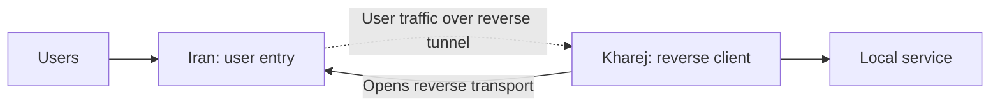

import Tabs from '@theme/Tabs';
import TabItem from '@theme/TabItem';

# Reverse tunnel over Reality

Users connect to Iran; Kharej opens the reverse connections to Iran and forwards
accepted user streams to its local service. The service in these examples listens
on `127.0.0.1:80` in Kharej. Change `final_port` for your application.



Start with the [common setup](./overview.mdx) and use `mtu: 1500` in each
server's `core.json`.

For a Reality connection initiated from Iran to Kharej, use the
[direct Reality tunnel](./direct-reality.mdx).

## Set the addresses and Reality password

| Setting | Where | What to enter |
| --- | --- | --- |
| `ip_server_iran` | Kharej | Iran's reachable IP; replace `192.0.2.10`. |
| `ip_server_kharej` | Iran | Kharej's public egress IP/CIDR; replace `198.51.100.20/32`. |
| `user_and_server_kharej_port` / `connect_to_iran_port` | Iran / Kharej | Matching Iran listener and reverse connection ports; both default to `443`. |
| `ip_behind_domain_white` | Iran | A reachable real visitor TLS site's IP; replace `203.0.113.30`. |
| `domain_to_handshake_reality` | Kharej | A name on that visitor site's certificate; replace `visitor.example.com`. |
| `password` | Both | The same fresh shared password, at most 32 UTF-8 bytes. |
| `final_port` | Kharej | Local destination service port; default `80`. |

Generate a password once and put its value in both configurations:

```bash
openssl rand -hex 16
```

The 32 hexadecimal characters fit the Reality password limit. Replace
`REPLACE_WITH_SHARED_PASSWORD` on both servers. Keep `algorithm` and
`kdf-iterations` identical; these examples use the same default salt.

Iran's `dest-visitor` connector must reach the real visitor TLS site on port
`443`. Its certificate must validate for Kharej's
`domain_to_handshake_reality`, because `verify` remains `true`. This connector
must not point back at Iran's WaterWall listener. Iran needs no local certificate
or private key for the Reality transport.

Reality protects the inter-server transport; user traffic reaches the final
service unchanged. See [RealityClient](../../noderefs/RealityClient)
and [RealityServer](../../noderefs/RealityServer) for the visitor handshake.

## Shared port and source IP

Iran uses two `TcpListener` nodes on the same address and port. The
[whitelisted listener takes priority](../../noderefs/TcpListener)
over the unrestricted user listener. Set `ip_server_kharej` to Kharej's public
**egress IP as seen by Iran**, with `/32` for a single IPv4 address.
Connections from that address enter the reverse transport; other connections
enter `bridge_user_side`.

A user connecting from Kharej's own egress IP will also enter the reverse
transport path. Test the public user entry from a different source address. If
you need separate ports instead, give `users_inbound` its own port, keep the
whitelist on `reverse_transport_inbound`, and set Kharej's
`connect_to_iran_port` to the reverse transport port.

## Choose the transport

**With Mux is recommended** for this reverse tunnel. It shares transport
connections across reverse streams, reducing the number of separate TCP and
Reality handshakes needed. Choose the server location inside the selected tab,
and use the same Mux choice on both servers. **Without Mux** remains available
for a direct connection per reverse stream.

With Mux, `ReverseClient` opens logical reverse streams through `MuxClient`;
several streams share each TLS or Reality connection. Iran decodes Mux before
`ReverseServer`. User applications and the final service continue to speak their
normal protocol.

`min_held_connections: 8` keeps eight spare reverse streams **per worker**.
Without Mux, each spare has its own transport connection. With Mux,
`mux_connections_per_worker: 2` sets the parent transport pool per worker;
it is separate from the spare-stream count. More workers multiply these pools.
See [MuxClient](../../noderefs/MuxClient) for tuning.

Keep `ReverseServer -> Bridge` and `Bridge -> ReverseClient` directly adjacent.
The Mux nodes in these examples sit on the outbound reverse-link transport.

<Tabs groupId="reverse-mux" defaultValue="mux">
<TabItem value="plain" label="Without Mux">

The reverse transport chains are:

```text
Kharej: Bridge -> ReverseClient -> RealityClient -> TcpConnector
Iran:   TcpListener -> RealityServer -> ReverseServer -> Bridge
```

<Tabs groupId="tunnel-location" defaultValue="iran">
<TabItem value="iran" label="Iran">

Save as `config_iran.json` on the Iran server.

```json title="config_iran.json"
{
  "name": "iran-reverse-reality",
  "variables": {
    "ip_behind_domain_white": "203.0.113.30",
    "ip_server_kharej": "198.51.100.20/32",
    "user_and_server_kharej_port": 443,
    "password": "REPLACE_WITH_SHARED_PASSWORD"
  },
  "nodes": [
    {
      "name": "users_inbound",
      "type": "TcpListener",
      "settings": {
        "address": "0.0.0.0",
        "port": $user_and_server_kharej_port$,
        "nodelay": true
      },
      "next": "bridge_user_side"
    },
    {
      "name": "bridge_user_side",
      "type": "Bridge",
      "settings": {
        "pair": "bridge_reverse_side"
      }
    },
    {
      "name": "bridge_reverse_side",
      "type": "Bridge",
      "settings": {
        "pair": "bridge_user_side"
      }
    },
    {
      "name": "reverse_server",
      "type": "ReverseServer",
      "settings": {},
      "next": "bridge_reverse_side"
    },
    {
      "name": "reality-server",
      "type": "RealityServer",
      "settings": {
        "destination": "dest-visitor",
        "password": $password$,
        "algorithm": "chacha20-poly1305",
        "kdf-iterations": 12000,
        "sniffing-attempts": 8
      },
      "next": "reverse_server"
    },
    {
      "name": "dest-visitor",
      "type": "TcpConnector",
      "settings": {
        "address": $ip_behind_domain_white$,
        "port": 443,
        "nodelay": true
      }
    },
    {
      "name": "reverse_transport_inbound",
      "type": "TcpListener",
      "settings": {
        "address": "0.0.0.0",
        "port": $user_and_server_kharej_port$,
        "nodelay": true,
        "whitelist": [
          $ip_server_kharej$
        ]
      },
      "next": "reality-server"
    }
  ]
}
```

</TabItem>
<TabItem value="kharej" label="Kharej">

Save as `config_kharej.json` on the Kharej server.

```json title="config_kharej.json"
{
  "name": "kharej-reverse-reality",
  "variables": {
    "ip_server_iran": "192.0.2.10",
    "connect_to_iran_port": 443,
    "domain_to_handshake_reality": "visitor.example.com",
    "password": "REPLACE_WITH_SHARED_PASSWORD",
    "final_port": 80,
    "min_held_connections": 8
  },
  "nodes": [
    {
      "name": "outbound_to_local_service",
      "type": "TcpConnector",
      "settings": {
        "address": "127.0.0.1",
        "port": $final_port$,
        "nodelay": true
      }
    },
    {
      "name": "bridge_local_side",
      "type": "Bridge",
      "settings": {
        "pair": "bridge_reverse_client_side"
      },
      "next": "outbound_to_local_service"
    },
    {
      "name": "bridge_reverse_client_side",
      "type": "Bridge",
      "settings": {
        "pair": "bridge_local_side"
      },
      "next": "reverse_client"
    },
    {
      "name": "reverse_client",
      "type": "ReverseClient",
      "settings": {
        "minimum-unused": $min_held_connections$
      },
      "next": "reality-client"
    },
    {
      "name": "reality-client",
      "type": "RealityClient",
      "settings": {
        "sni": $domain_to_handshake_reality$,
        "verify": true,
        "password": $password$,
        "algorithm": "chacha20-poly1305",
        "kdf-iterations": 12000
      },
      "next": "tcp_to_iran"
    },
    {
      "name": "tcp_to_iran",
      "type": "TcpConnector",
      "settings": {
        "address": $ip_server_iran$,
        "port": $connect_to_iran_port$,
        "nodelay": true
      }
    }
  ]
}
```

</TabItem>
</Tabs>

</TabItem>
<TabItem value="mux" label="With Mux (recommended)">

The reverse transport chains are:

```text
Kharej: Bridge -> ReverseClient -> MuxClient -> RealityClient -> TcpConnector
Iran:   TcpListener -> RealityServer -> MuxServer -> ReverseServer -> Bridge
```

<Tabs groupId="tunnel-location" defaultValue="iran">
<TabItem value="iran" label="Iran">

Save as `config_iran.json` on the Iran server.

```json title="config_iran.json"
{
  "name": "iran-reverse-reality-mux",
  "variables": {
    "ip_behind_domain_white": "203.0.113.30",
    "ip_server_kharej": "198.51.100.20/32",
    "user_and_server_kharej_port": 443,
    "password": "REPLACE_WITH_SHARED_PASSWORD"
  },
  "nodes": [
    {
      "name": "users_inbound",
      "type": "TcpListener",
      "settings": {
        "address": "0.0.0.0",
        "port": $user_and_server_kharej_port$,
        "nodelay": true
      },
      "next": "bridge_user_side"
    },
    {
      "name": "bridge_user_side",
      "type": "Bridge",
      "settings": {
        "pair": "bridge_reverse_side"
      }
    },
    {
      "name": "bridge_reverse_side",
      "type": "Bridge",
      "settings": {
        "pair": "bridge_user_side"
      }
    },
    {
      "name": "reverse_server",
      "type": "ReverseServer",
      "settings": {},
      "next": "bridge_reverse_side"
    },
    {
      "name": "reality-server",
      "type": "RealityServer",
      "settings": {
        "destination": "dest-visitor",
        "password": $password$,
        "algorithm": "chacha20-poly1305",
        "kdf-iterations": 12000,
        "sniffing-attempts": 8
      },
      "next": "mux_server"
    },
    {
      "name": "dest-visitor",
      "type": "TcpConnector",
      "settings": {
        "address": $ip_behind_domain_white$,
        "port": 443,
        "nodelay": true
      }
    },
    {
      "name": "reverse_transport_inbound",
      "type": "TcpListener",
      "settings": {
        "address": "0.0.0.0",
        "port": $user_and_server_kharej_port$,
        "nodelay": true,
        "whitelist": [
          $ip_server_kharej$
        ]
      },
      "next": "reality-server"
    },
    {
      "name": "mux_server",
      "type": "MuxServer",
      "settings": {},
      "next": "reverse_server"
    }
  ]
}
```

</TabItem>
<TabItem value="kharej" label="Kharej">

Save as `config_kharej.json` on the Kharej server.

```json title="config_kharej.json"
{
  "name": "kharej-reverse-reality-mux",
  "variables": {
    "ip_server_iran": "192.0.2.10",
    "connect_to_iran_port": 443,
    "domain_to_handshake_reality": "visitor.example.com",
    "password": "REPLACE_WITH_SHARED_PASSWORD",
    "final_port": 80,
    "min_held_connections": 8,
    "mux_connections_per_worker": 2
  },
  "nodes": [
    {
      "name": "outbound_to_local_service",
      "type": "TcpConnector",
      "settings": {
        "address": "127.0.0.1",
        "port": $final_port$,
        "nodelay": true
      }
    },
    {
      "name": "bridge_local_side",
      "type": "Bridge",
      "settings": {
        "pair": "bridge_reverse_client_side"
      },
      "next": "outbound_to_local_service"
    },
    {
      "name": "bridge_reverse_client_side",
      "type": "Bridge",
      "settings": {
        "pair": "bridge_local_side"
      },
      "next": "reverse_client"
    },
    {
      "name": "reverse_client",
      "type": "ReverseClient",
      "settings": {
        "minimum-unused": $min_held_connections$
      },
      "next": "mux_client"
    },
    {
      "name": "reality-client",
      "type": "RealityClient",
      "settings": {
        "sni": $domain_to_handshake_reality$,
        "verify": true,
        "password": $password$,
        "algorithm": "chacha20-poly1305",
        "kdf-iterations": 12000
      },
      "next": "tcp_to_iran"
    },
    {
      "name": "tcp_to_iran",
      "type": "TcpConnector",
      "settings": {
        "address": $ip_server_iran$,
        "port": $connect_to_iran_port$,
        "nodelay": true
      }
    },
    {
      "name": "mux_client",
      "type": "MuxClient",
      "settings": {
        "mode": "fixed-connections-count",
        "per-worker-connections-count": $mux_connections_per_worker$
      },
      "next": "reality-client"
    }
  ]
}
```

</TabItem>
</Tabs>

</TabItem>
</Tabs>

## Run and check

Start the local service in Kharej, then start WaterWall on Iran and Kharej using
the [common startup commands](./overview.mdx#start-the-tunnel). Allow inbound
TCP on Iran's selected port and outbound TCP from Kharej to it.
Iran also needs outbound TCP access to the visitor TLS site on port `443`.

Connect a normal application client to Iran's user port from a source outside
the Kharej whitelist. For the example HTTP service on Kharej port `80`, a simple
check is:

```bash
curl http://192.0.2.10:443/
```

Replace the address before running it. If your destination is Xray or another
protocol, use that service's client instead. The user port number does not
change the application protocol.

If the connection fails, check the Kharej egress whitelist, the paired ports,
the selected Mux mode on both sides, and the destination service first.
For Reality handshake errors, check visitor reachability, its certificate/SNI,
and the shared password and algorithm settings.

### Optional user-side TLS termination

To terminate users' TLS on Iran, insert a separate
[TlsServer](../../noderefs/TlsServer) between `users_inbound` and
`bridge_user_side`, with its own certificate/key settings and
`next: "bridge_user_side"`. The destination service then receives the decrypted
application stream. Keep the reverse transport chain as shown above.
