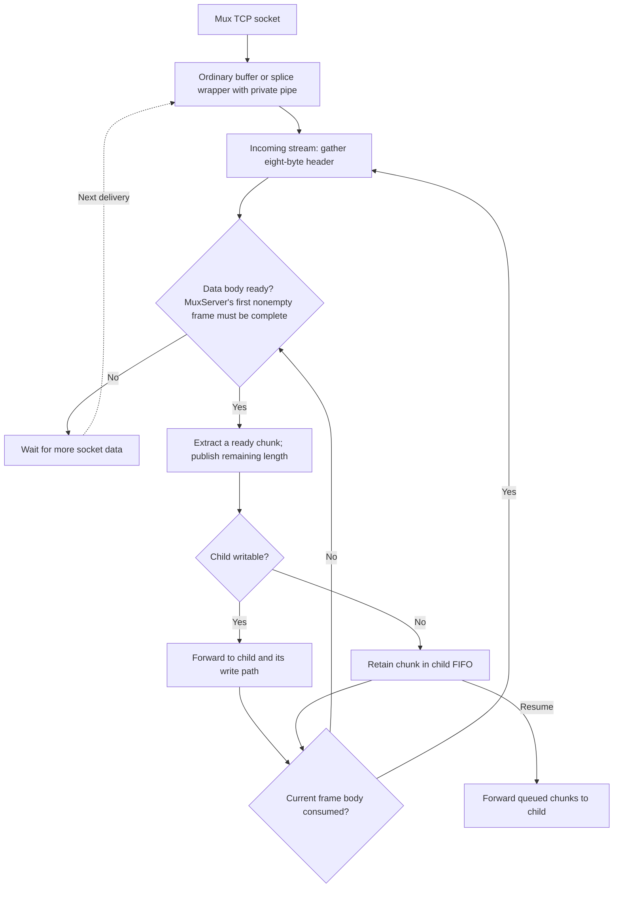

# Protocol buffering

Apply [Part 3](../part3-buffers-and-padding.mdx) and the relevant [container or reader contract](./buffer-containers.mdx) before the node-specific rules below. [Line and protocol ownership](./line-protocols.mdx) covers the corresponding callback and lifetime rules.

## TCP adapter write accounting {#tcp-adapter-write-accounting}

`TcpAdapterCommon/adapter_write_queue.h` in `tunnels/Internals/TcpAdapterCommon/`
owns the TCP adapters' FIFO, shared budget, active reservation and
pressure-notification latches.
Initialize `adapter_write_queue_t` at its final stable address on the owning
event worker; never copy it while the FIFO or reservation borrows its budget.
The helper has no socket I/O, line access or callbacks. Buffer recycling can
still discard private splice bodies. Callers supply the owning worker's pool.

The combined FIFO and active reservation enforce `kAwqMaxRetained` independently
for logical bytes and canonical queue-capacity charge.
`awqAdmit()` consumes and clears its buffer argument except for `kAwqWriteNow`,
which leaves the exact buffer caller-owned with its cost reserved for WIO.
Refusal recycles the input once. Direct empty input undergoes admission before
release and recycling without a socket write; blocked empty input stays queued
and charged. Neither path treats emptiness as permission to bypass admission.

After transfer, WIO owns the buffer independently. `awqRefreshPending()` reduces
logical bytes using WIO's pending-byte count, never by reading the transferred
buffer. The original capacity charge remains until a completed write
or terminal cleanup. `awqNextToWrite()` transfers FIFO accounting into that active
reservation without admitting or charging it again; empty entries are recycled.
Socket-write failure remains distinct from successful drain, including when WIO
defers its close callback. It blocks direct admission so further input joins the
bounded FIFO until terminal cleanup instead of replacing the active reservation.
Pressure ordering belongs to the
[adapter flow contract](../part2-lines-and-callbacks.mdx#flow-control-roles-and-admission).

Terminal flushing uses `awqPopForFinish()` only after node-side callback
detachment. Each popped entry releases its FIFO cost before transfer to WIO;
this path creates no active reservation and never requests Resume. `awqDestroy()`
recycles remaining FIFO ownership and settles active accounting, without touching
the active buffer. WIO may finish flushing after line-state destruction and
retains no pointer to the component or its budget. The adapter follows the
[TCP close policy](./line-protocols.mdx#tcp-socket-close-lingering) even when reads are paused.

## Deferred next-Init input {#deferred-next-init-input}

`Internals/NextInitGate` preserves ordinary and splice buffers in the startup
FIFO used by HeaderServer and SoftIpLimiter. Both nodes permit at most 2 MiB of
queued logical bytes and 8 MiB of queue-capacity charge. These limits cover only
nested input still in that FIFO; the original already-accepted input passed to
the opening call is separate working storage. Popping an entry releases its
queued cost before dispatch. Empty entries consume charge, and there is no
separate buffer-count limit.

Submission while starting either transfers the buffer into the FIFO and clears
the caller's pointer, or rejects without changing ownership or queue totals.
Open-state submission leaves ownership with the caller for direct forwarding.
Pre-start parsing remains with the node. On rejection the node recycles the
refused buffer and uses its existing close path. Teardown drains queued buffers through
the exact line's pool before zeroing the gate; it does not materialize private
pipe bodies. The gate serializes startup only and retains no payload after
successful replay. Its [callback and lifetime contract](../part2-lines-and-callbacks.mdx#shared-deferred-next-init-gate)
applies through Init, pending Pause and every Payload callback.

## SoftIpLimiter identity and SpeedLimit shaping {#softiplimiter-identity-and-speedlimit-shaping}

SoftIpLimiter materializes each complete delivery through `sbufEnsureOrdinary()`
only while identity admission is undecided. Empty deliveries contribute no identity
bytes and are recycled before buffering. Its BufferStream stays ordinary and
replays the original identity bytes and coalesced tail intact. The committed phase
is published before next Init; nested input retains its private pipe in the
shared next-Init gate's bounded FIFO behind initial replay. Established and
passthrough payloads in both directions are opaque. Temporary inspection never sets permanent
ordinary-read preferences.
Both admitted and passthrough startup replay an outstanding early upstream Pause
after next Init and before the initial bytes. Resume or a newer notification
during Init clears stale replay. Keep the FIFO guard through that callback;
Pause does not gate the identity bytes or their coalesced tail.

Each admitted line records its IP row's generation. Pruning and recreating the
same identity/IP pair creates a new generation; an old line must neither refresh
nor release the replacement row. Concurrent lines admitted to the same live row
share its generation and reference count. A live row retains its newest sampled
activity time even when workers deliver admissions or touches out of order.
Generation allocation and table changes stay under the existing instance write lock.

SpeedLimit retains ordinary and splice entries in its existing directional FIFOs.
Whole grants forward the original wrapper; partial grants pop the source, extract
exactly the permitted range through `sbufMoveRangeTo()`, and reinsert its remainder
before any callback. Splice splits use an independent destination pipe with complete
ordinary fallback on pipe creation or transfer pressure. Ordinary ranges preserve
onward pool padding. Each FIFO has explicit logical-byte and queue-capacity-charge
budgets, including charge for empty entries. Failed admission recycles the rejected
buffer and settles both queues before closing the borrowed normal line through
its owner. Queue pop/extraction/reinsertion invokes no callbacks; remaining ownership
and accounting are published before a slice is transferred. Reinserting a split
remainder reuses the popped slot and no greater byte/charge cost, with no callback
in between; use the ordinary push wrapper. Initial admission still
retains its ordinary refusal path. An orderly stream Finish cancels both timers, releases
buffers addressed to the sender, and hands the opposite FIFO to the live receiver in order.
Any undeliverable remainder is recycled before teardown checks both budgets.

## DomainResolver DNS transport retention {#domainresolver-dns-transport-retention}

Generated DNS lines request ordinary reads in both directions before outward
Init. On input the adapter converts any splice-backed delivery through the
supported complete-buffer ordinary conversion before c-ares reads bytes.
Application forwarding retains its existing representation and FIFO contracts.
A logical sbuf length never proves DNS bytes are resident.

Custom c-ares send callbacks copy accepted bytes into a buffer from the DNS
line's pool, with the assembled chain's padding. They never retain borrowed
c-ares memory. UDP preserves complete datagrams up to 65,535 bytes. TCP accepts
ordered chunks up to 16 KiB, leaving short-write suffixes with c-ares; c-ares
already supplies DNS TCP length framing and the adapter adds none.
Empty TCP payload deliveries contain no stream bytes and are recycled before
queue admission; only transport closure produces EOF. Empty UDP deliveries
remain complete datagrams.

Each virtual socket retains at most 128 input entries, 1 MiB logical bytes and
2 MiB allocation charge. A resolver/worker channel caps the inventory at 128
sockets and shares 8 MiB logical/16 MiB charge across their input queues.
Admission refusal closes the affected DNS transport without native fallback.
Input high/low watermarks of 64/32 KiB Pause and Resume its exact DNS producer;
these holds are independent of the original application's DNS/order hold.
Queued buffers are owned, remain FIFO-ordered across partial TCP reads, and
settle on receive or socket/channel closure. Readiness is deferred until the
enclosing c-ares operation returns. Repeated notifications preserve the earliest
pending processing deadline; continuing traffic must not postpone already-ready
responses. Handles are never reused, so old readiness cannot address a later
connection. A write blocked by downstream pressure is retried after Resume even
when c-ares has cleared its UDP write interest; that retry does not wait for a DNS
timeout or a new query. The retry stops while pressure remains and clears its
pending state when the send progresses or fails.

UdpStatelessSocket bounds application datagrams waiting for DNS independently
of its completed-answer cache. Each instance and submitting worker shares at
most 256 pending requests, 2 MiB logical payload and 4 MiB buffer allocation
charge across borrowed normal and packet lines. Admission reserves all three
before retaining the buffer or line; refusal drops the entire datagram without
closing its line or emitting Pause. Every terminal lookup result, including
synchronous completion, failed submission, dead-line completion and shutdown,
releases the reservation exactly once. The accounting storage remains alive
until provider requests have settled.

Hard-limit refusal diagnostics use the DNS logger. DomainResolver reports
application-retention and incoming DNS transport closures at `ERROR`; socket-open
and outgoing DNS send refusals use `WARN`. UdpStatelessSocket reports pending-DNS
datagram drops at `WARN`. Messages identify the node, worker, destination or known
DNS peer, reason, current and incoming usage, limit and action. Limiters are
independent per node, worker and refusal reason: the first failure reports
immediately, then a further failure at least five seconds after the previous
report emits the next report with the suppressed count. Reporting is event-driven,
with no timer flush. Merely reaching an allowed value, normal Pause/Resume and
cache operations do not emit these diagnostics; existing admission and cleanup
semantics remain unchanged.

## UserController retained payload and delivery {#usercontroller-retained-payload-and-delivery}

UserController's stream and datagram FIFOs retain original ordinary or splice buffers. Stream grants use logical
`sbufGetLength()` and exact `sbufMoveRangeTo()` splits, preserving independent private pipes and ordinary fallback.
Datagrams are never split; zero-length entries retain their FIFO position and transfer once without rate or quota cost.
Reject datagrams above 65,535 bytes without charging, while preserving any smaller producer bound.

Both directions share line ceilings of 1 MiB logical bytes and 2 MiB actual allocation charge. One user's
queues in one AuthenticationClient share 4 MiB, 8 MiB and 1024 direction tickets; that client shares 64 MiB,
128 MiB and 16384 tickets. Each line has at most two direction tickets. These are resource bounds, not
bandwidth settings. Queues and tickets allocate lazily. Owner-local budget primitives remain owner-local; synchronized
user/client reservations account shared costs and roll back admission refusal without lock inversion.

Detached/prepared output remains part of retained costs until handoff or discard. Reserve split destinations and required
continuations before the shared bandwidth/quota commit. A preview grants no ownership of credit; a concurrent worker or
refresh may invalidate it. No fallible work intervenes between a successful commit and the neighboring Payload callback.
Stream retention refusal discards the refused buffer and closes that line; datagram overflow drops only the new whole
entry and preserves accepted FIFO contents. Required timer/continuation refusal closes either mode. Every still-owned
buffer returns to its line pool, and transferred buffers are never recycled locally.

For an orderly stream Finish, cancel asynchronous output and release the queue addressed to the
finished sender first. Both directions share the retention budget, and the surviving direction may
need that space to prepare its next slice. Hand off its prepared prefix and then its FIFO on the
borrowed line, releasing retained queue costs as each buffer leaves the shaper.
Managed, charged output uses slices of at most 16 KiB. Prepare each slice before the eligibility
and quota check. A hard resource refusal while preparing a slice, quota exhaustion, or a receiver
close during a handoff ends the flush and releases the unsent remainder. Buffered bytes that never reach handoff consume no traffic quota.

Reservation identity includes its runtime ticket. Removal and recreation of the same numeric user ID must not let late
release subtract from the replacement account. Client aggregate cost stays reserved while old buffers remain retained,
and the owner releases it once. See Part 7 for cancellation and shutdown ordering.

## HeaderServer and KeepAlive framing {#headerserver-and-keepalive-framing}

HeaderServer materializes each complete delivery with `sbufEnsureOrdinary()`
only while waiting for its port, TCP/UDP protocol, or PROXY protocol header. BufferStream remains
ordinary, including coalesced application tails. It publishes the established
phase before next Init; nested input then enters the shared next-Init gate's
opaque FIFO behind the original tail. Constant-port mode and established payloads in both directions
preserve splice buffers. Temporary parsing does not set permanent ordinary-read
preferences.

HeaderClient protocol modes snapshot exactly the selected source or destination
protocol during Init, before next Init can rewrite the context. A one-byte header
carries `6` for TCP or `17` for UDP; unset, ambiguous, or unsupported protocol
flags close the borrowed line through its owner without next Init. The snapshot
is zeroed before Finish or before bypassing and handing off the first prefixed
payload. Port and PROXY modes keep no per-line state and use default Init/Finish.
The active-node mask prevents another header. HeaderServer's protocol mode
consumes the byte and changes only destination protocol before next Init;
addresses, ports, and source metadata remain intact. This marker does not provide
UDP datagram framing.
In constant-port mode, HeaderServer publishes the destination context, destroys
and zeros its line state, and bypasses itself before next Init. Parsed-header
modes wait until next Init and the ordered initial replay finish. This keeps
nested input behind the original tail before retirement.
Parsed-header modes retain the latest early upstream Pause, cleared by Resume,
and replay it after Init before the original tail or bypass. Newer signals during
Init supersede that pending notification. The initial FIFO guard also covers the
replayed Pause and any nested input or Finish it causes.
Both nodes relay repeated Pause/Resume once the destination side is initialized;
neither retains consumer permission to gate output.

KeepAliveClient and KeepAliveServer frame every payload throughout the connection.
The prefix contains a four-byte big-endian body length and one kind byte. Each
frame carries at most 1 MiB of payload; length includes the kind, so body length
is at most 1 MiB + 1. Oversized lengths reject immediately after the header.
Their five-byte frame-reader cache consumes only frame length and kind; normal
bodies can remain in private pipes. Encoders prepend only in advertised real
headroom, preserving complete wrappers when one frame suffices. Larger payloads
split through `sbufMoveRangeTo()`, with complete ordinary fallback on pipe pressure.
No generic resident-buffer reserve/copy operation touches a splice body.

Each encoder publishes its active suffix before callbacks and serializes nested
inputs behind it. Active suffix plus queued nested input share an 8 MiB logical
and 16 MiB queue-charge reentry limits, including the active suffix. Decoders serialize nested input
under an 8 MiB logical reentry bound. After validating the five-byte header, the
shared frame reader forwards available normal payload bytes without waiting for the
whole frame. It discards other kinds incrementally, but sends Pong or acknowledges
an empty Pong only after consuming that control's declared body. Empty normal
frames produce no Payload callback. Frame boundaries do not define application
callback boundaries; an already delivered prefix survives a truncated frame.
The reader drains available top-level bytes before checking the 16 MiB retained
buffer charge; beneficial compaction precedes charge refusal.
Validated frame lengths and draining guarantee that the incomplete remainder is
smaller than 1 MiB + 5 bytes, including the cached header. Check this derived bound
with a Debug assertion. Nested admission checks logical bytes before Push and
settles the same charge bound immediately afterward, before returning to the
outer drain.
Body lengths outside `1..1,048,577` or refusal close through the normal
line owner instead of silently losing TCP bytes. Both nodes require L4 on both
edges and borrow normal lines; a mixed chain does not send its worker packet line
through them. Finish settles the stream, active suffix and reentry queue. Pause
relays promptly while an admitted synchronous batch can complete. In both client
modes, the first ping is due one `ping-interval` after downstream transport Est;
waiting for it does not block application data or start a reply deadline. Repeated
Est does not reset this schedule. Timer checks and outstanding monotonic reply
deadlines continue during either directional Pause. Both nodes relay repeated
Pause/Resume through the default callbacks. Due pings and pong replies do not
wait for Resume. An unsent ping blocked by an active encoder or an outstanding
pong leaves one due obligation without starting another reply deadline.
Each parsed Ping sends its Pong directly; the decoder's existing reentry guard
keeps nested input behind older frames under the same input bounds. No separate
pending-Pong queue is needed. Finish stops the drain and discards retained input.
The optional reply watchdog uses ordinary empty control frames and leaves body
representation unchanged. Missing or late empty pongs close through the borrowed
normal line's owner; the framing node does not recreate the line. KeepAliveServer
remains the responder.
Both nodes remain active throughout the line because every payload still needs
framing and control processing; neither is eligible for permanent bypass.

## Protocol storage and admitted batches {#protocol-storage-and-admitted-batches}

APIServer's hard input-byte limit includes older complete/active request charges, raw backlog and the current
partial frame. Its ordinary byte watermarks subtract only the current frame's copied header/body. Predictive
pressure compares retained older request bytes plus the next complete frame against that same hard limit:
use `max_request_envelope + 4` before its header is known, then its declared complete size. Count already buffered
bytes once. Request completion and output drain must release the hold and Resume without new input. An incomplete
frame alone must remain able to receive its missing bytes. Preserve hysteresis, independent memory/fragment limits,
absolute frame deadlines and bounded closure when late or coalesced input exceeds hard caps; advisory Pause is no
reservation. Protect line lifetime across Pause/Resume, which may synchronously Finish the borrowed line.

AuthenticationServer is an exact-line response endpoint. Its queued and active
backing responses share one stable budget: 16 MiB plus the 20-byte
envelope in logical bytes, and 32 MiB allocation charge. Reserved pop preserves
active charge; a guarded drain publishes its cursor before callbacks and emits
at most 16 KiB per stream chunk with full chain padding. Refusal closes that borrowed
line toward its owner after settling all retained state. One bounded frame, growing
message, serialized text and output chunk are construction scratch outside that budget;
see the node reference for the precise envelope and overlap limits. Parser reentry
storage is also bounded at each authentication endpoint. AuthenticationClient retains the ordinary 32 MiB charge
and maximum-wire-message limits, with 2 MiB nested headroom. AuthenticationServer grants those limits only
with validated token evidence. Unvalidated server input is bounded to 16 KiB of frame payload plus the 68-byte envelope,
allocation charge no greater than the larger of 128 KiB and one best-fit pool allocation
for that envelope. Inspect the length/token prefix before waiting for a body, and revalidate at dispatch. Nested bytes
and the older unread suffix share their applicable allowance; a valid earlier message does not authorize a large
unvalidated successor. Compact oversized carriers and tiny-fragment runs before returning from admission.
Extraction copies fragmented messages once. Server response capacity grows geometrically within the complete-response
cap; old and new allocations can overlap briefly during replacement. The current synchronous delivery, one extracted
message and temporary compaction overlap are outside the retained-input allowance. Empty input retains nothing.
Publish the older suffix before callbacks so nested input cannot overtake it; Finish settles the remaining stream.

Choose storage by the work it represents: incomplete metadata/body, a protocol
wait, an initialization/reentrancy ordering barrier, delayed replay, or an
association's independent producers. An otherwise-ready synchronous TCP buffer
must not acquire another output queue solely for Pause or Est. See
[Part 2's admission contract](../part2-lines-and-callbacks.mdx#flow-control-roles-and-admission).

Ordinary middle-node timers and deferred drains may submit due output through
advisory Pause while preserving FIFO and protocol readiness. Retained data still
belongs to that node's hard budget: a receiving adapter's limit cannot protect
storage that has not reached it. Pause requests and eventual Resume do not reserve
capacity, and overload may close the affected connection. Node-specific gates
described below are local implementation behavior, not a generic scheduling rule.

Middle tunnels that need an application-data backlog use a default budget of
**2 MiB logical bytes and 8 MiB queue-capacity charge per retention budget**.
Account for queued and active backlog buffers still retained under that budget;
multiple queues sharing it do not each receive a separate allowance. This is a hard admission
limit, not a universal payload-size limit, a memory/RSS limit or a Pause threshold.
Do not create a queue on an otherwise-ready synchronous forwarding path just to
apply the default.

Protocol parsers, frame allowances, ciphertext shaping and transport/Mux storage
retain their own explicit bounds. Explicit node-specific application-backlog
limits take precedence over the default. For example,
[Socks5Server](../../02-noderefs/Socks5Server.mdx) retains its 1 MiB logical-byte /
8 MiB queue-charge ordering limit per direction, including active retained tails and
nested input together. Each negotiation message contains at most 513 metadata
bytes; complete messages are consumed before waiting for more input. Fragmented
metadata extraction copies only the protocol prefix, excluding application bytes
after a complete CONNECT header. Empty TCP deliveries consume no staging entries;
UDP-control tails are discarded after association acceptance.
Socks5Client follows the default application-data limit
for its upstream negotiation FIFO and, independently, downstream input retained
for parser reentry or an older response backlog. The latter counts active stream
bytes and queued sources together. Its 4,096-byte limit bounds input waiting for
the first transport Est or incomplete reply metadata; prefix extraction does not
merge an arbitrary coalesced body.
Ready direct payloads are not subject to a backlog cap, and empty TCP input does
not consume retention entries.

Socks5Client and Socks5Server materialize complete negotiation deliveries with
`sbufEnsureOrdinary()` before parser or reentrant-input admission. BufferStream
stays ordinary; complete coalesced application tails are replayed without charging
them as incomplete metadata. Client upstream application storage can retain
splice buffers opaquely. After TCP setup, direct payload and necessary FIFO
forwarding preserve original buffers. Server input conversion continues through
CONNECT-wait until its TCP-established phase; success-reply ordering is unchanged.
Their ready direct TCP ordering queues drain through advisory Pause. The client
still waits for SOCKS command success before releasing application data, and the
server still places its one success reply before response bodies. UDP association
producer control remains separate from these same-line TCP drains.

ConnectionFisherClient and ConnectionFisherServer materialize complete deliveries
only before ordinary handshake/selection stream admission. Their five-byte markers
are parsed as soon as complete; an incomplete marker retains at most four bytes.
The following application body has its own inclusive 2 MiB allowance, independent
of delivery fragmentation or coalescing. Client downstream selection ordering has
that same byte bound; upstream waiting queues and server temporary input share
2 MiB logical-byte and 8 MiB queue-charge bounds with their retained input, including the server body
held across next Init. Empty staged TCP input consumes no entries.

Their application FIFOs can retain exclusive private pipes. After protocol setup
and the necessary FIFO drain, they release ordinary handshake streams and empty
queue storage. Ready payloads use direct whole-buffer forwarding without the
startup backlog cap or ordinary-read preferences. The client remains a junction
between its borrowed main line and its owned selected child; it cannot remove that
line mapping. Server next Init still waits for the first application payload.
After Init and replay settle, the server destroys its full line state and
permanently bypasses itself; ready ordinary and splice buffers retain their
identity through dispatch. See [ConnectionFisher retirement](./line-protocols.mdx#connectionfisher-line-mapping-and-retirement).

SOCKS UDP uses ordinary storage throughout: client application input is
materialized before retention, and both nodes materialize every datagram before
header decoding or framing. Client UDP application/control/relay and server UDP
client/remote lines request `linePreferOrdinaryReadBoth()` on their exact lines.
Client target preparation also requests it before local DNS retains input.
A UDP-only server requests ordinary reads on its TCP control line during Init;
a mixed service requests them when it parses an allowed UDP ASSOCIATE command.
These preferences are permanent and advisory, do not propagate between associated
lines, and never replace handling already-delivered or transformed splice input.
TCP CONNECT does not request an ordinary-read preference.

TrojanClient, TrojanServer, VlessClient and VlessServer also use a **2 MiB logical-byte base
budget** for their necessary parser state. Input fragments have a byte
bound plus bounded parser metadata; do not apply an output-datagram count limit to
fragments of one incomplete frame. Empty queued datagrams consume output charge.
A parser's active head, cached header and queued sources are charged exactly once.

| Necessary retained state | Byte limit |
| --- | --- |
| Protocol/order/replay or output backlog in these four nodes | 2,097,152 logical bytes; 8 MiB queue-capacity charge |
| Trojan UDP input, including partial-frame/header state | 2,162,950 bytes: 2 MiB plus the 65,798-byte maximum incoming frame |
| TrojanServer initial request assembly | 2,162,950 wire bytes |
| VlessClient TCP response assembly | 2,097,409 bytes: 2 MiB plus 257 response metadata bytes |
| VlessServer request/UDP input, including active head and cached metadata | 2,162,689 bytes: 2 MiB plus the 65,537-byte maximum UDP frame |
| VlessClient UDP input, including pending response/frame metadata | 2,162,689 bytes: 2 MiB plus the 65,537-byte maximum frame |

Equality is accepted. Overflow or failed queue admission settles only the affected
flow/association; private-pipe pressure instead uses the shared ordinary fallback.
Remove consumed metadata before applying a remaining-body/backlog budget.
TrojanServer needs at most 320 request-header bytes and VlessServer at most 278
before accepting or rejecting the request. Incomplete request metadata fits within
each node's header cache; a complete header coalesced with body is parsed before
the remaining-body budget applies.
These logical limits do not measure RSS or descriptor use. Receiving adapters
additionally bound entries or allocation charge for decoded datagrams, including
empty ones. Mux bounds queue charge for retained stream chunks.

TlsClient's pre-handshake application queue and RealityClient's early application
queue follow the default 2 MiB logical-byte / 8 MiB queue-charge bound. They represent a real protocol wait,
including application data admitted before TCP Est. Once protocol-ready, their
plaintext drains progress without waiting for consumer Resume. Reentrant input
stays behind the active plaintext remainder, and active reservations retain their
byte and capacity charge until consumed and released. Local backlog pressure has
its own release path and combines with received next-side pressure; neither
reason's Resume releases the other. Keep ciphertext-shaping budgets separate.

TlsServer also bounds pre-handshake backend plaintext to 2 MiB logical bytes / 8 MiB queue charge.
Equality is admitted; overflow closes the affected line and releases its queued
buffers. This limit applies even when the handshake deadline is disabled.

TlsClient and TlsServer combine local source holds with received pressure without
adding a gate to due record output. Configured record delays, FIFO order, local
shaping watermarks and hard limits still apply. TlsClient's plaintext drain can wait for its own shaping
backlog to clear; that local scheduling obligation is independent of consumer
notifications. Its receive path also drains ready plaintext after flushing TLS
output: inbound traffic can retire the final shaped records and cancel the timer
that would otherwise wake that plaintext drain. RealityServer already relays
notifications through the selected live branch while retaining its authentication,
branch-cutoff and Finish guards.

On peer `close_notify` or cleartext-side `Finish`, TlsServer preserves accepted
ciphertext and places its closing alert after it. The existing output queue drains
in order at its configured deadlines before downstream `Finish`, including during
advisory Pause. Raw wire-side `Finish` cancels that drain and discards retained
output; it cannot send back toward the finished side.

TlsClient and TlsServer use owned-buffer ciphertext BIOs. Feeding ordinary input
transfers its complete `sbuf_t` on every result, including admission refusal;
empty input is recycled without an entry. Reads advance the owned buffers without
copying into an intermediate memory BIO or moving the unread suffix. TLS library
writes normally copy directly into padded pooled output buffers. Taking output transfers
the allocation, which remains valid after later SSL calls or TLS-state release.
BIO callbacks must never invoke another tunnel: drain owned output only after
the SSL operation returns, with the usual line-reference and reentry checks.
Successful per-line TLS initialization attaches both BIOs to its SSL object
before returning. Later startup failures, including TlsClient's inner ClientHello
generation, can then use normal line-state teardown. Only partial initialization
before that attachment frees BIOs separately.

Each ciphertext BIO admits at most 8 MiB of unread bytes and 32 MiB of retained
allocation charge. Equality is accepted; refusal consumes new input and closes the affected
connection through its existing failure path. These are protocol-storage limits,
separate from application backlogs and record-shaping storage, not RSS guarantees.
Reset and destruction recycle all retained buffers through the BIO's original
worker pool. An SSL context and its BIOs have serialized owner-worker access;
the context owns their shared BIO method and must outlive them. OpenSSL and
BoringSSL compile separate instances of the common BIO implementation and must
never exchange library objects. Initial ClientHello delivery still assembles a
complete flight for StreamFragmenter; takeover still exposes the exact unread
wire tail. ServerHello routing inspects a non-consuming prefix across BIO entries.
Neither uses a borrowed pointer into TLS-library storage.

Each main worker SSL context owns an immutable decoded copy of TlsClient's
configured ECHConfigList and frees it with the context. ECH-inner scratch
contexts have no copy. Ordinary fixed-SNI connections use it and require ECH
acceptance; rejection must not release application data, retry the transport,
or downgrade to GREASE. Raw arbitrary-hostname ClientHello generation remains fresh GREASE.
Preflight measures the configured ClientHelloOuter flight. Handshake takeover
bindings retain the emitted outer client random, even when BoringSSL switches to
the accepted inner handshake. See [configured ECH](../../02-noderefs/TlsClient.mdx#configured-ech).

With verification enabled, TlsClient keeps its pinned Trust Anchor ID
intermediate cache in each SSL context. The context owns the immutable
certificate objects. A matching server response permits verification to
supplement the peer's untrusted stack
with those candidates; it never grants trust. Preserve the original root store,
hostname and verification parameters when calling `X509_verify_cert()`, restore
the borrowed stack afterward, and free only the temporary stack container.
Never add these cached intermediates to the trusted store or enable partial-chain
trust to support certificate elision. Keep the advertised IDs and cached
certificates paired with the [pinned source mappings](../../02-noderefs/TlsClient.mdx#trust-anchor-ids).

TlsClient's per-node, per-worker SSL context owns at most two cached session
references. Lookup and ticket callbacks run through explicitly admitted runtime
SSL objects on that owner worker; preflight and generated ClientHellos must not
consume or populate the cache. Derive the ticket-size limit from the worst-case
fresh ClientHello preflight, reserving space for PSK framing and up to
31 bytes of inner padding with real ECH, and discard oversized tickets. Selecting
a TLS 1.3 ticket consumes its cache reference before the connection can send it. Before offering a verified session,
revalidate its certificates with the current roots, hostname and parameters,
using cached TAI intermediates only as untrusted candidates. Discard invalid
candidates; if none remain usable, perform a full handshake. SSL-context
destruction releases cached sessions after its SSL users are gone; cache
operations never retain a line or borrow a worker pool. See [session resumption](../../02-noderefs/TlsClient.mdx#session-resumption)
for identity scope, expiry and the static-RSA exclusion.

TlsClient installs an optional BoringSSL record-output reservation hook. Completed
TLS 1.2/1.3 handshakes can seal nonempty application records directly into the
owned BIO's padded output storage when no control flight or write retry is pending.
The ordinary output path handles other cases, including a declined reservation.
Reserve obtains writable capacity and any required queue slot before sealing;
commit publishes only the actual ciphertext length and cannot allocate or fail.
A sealing error cancels the reservation without retrying encryption. New output
allocations retain onward headroom and prefer aligned ciphertext bodies; appends
preserve existing tail coalescing. The byte and allocation-charge limits still apply.

A reservation is exclusive and synchronous within one SSL operation. Callbacks
may query SSL state but must not start SSL I/O, replace its BIOs or output
callbacks, or drain/mutate its reserved BIO before commit or cancellation.
The library retains no output pointer afterward, and outward delivery still waits
until the SSL operation returns. The hook uses the existing record sealer, so
record padding is selected once and control-record ordering remains in BoringSSL.
Its commits bypass `BIO_write`, including that function's byte counters; payload
accounting follows the owned output buffers. TlsServer's OpenSSL path uses ordinary
BIO writes.

When updating the vendored BoringSSL tree, port the record-padding patch before
`tunnels/TlsClient/RadkesvatPatches/record_write_buffer_callbacks.patch`, then
apply `prefix_symbols.patch` after all custom public API patches. Keep both record
APIs mapped in the checked-in `include/openssl/prefix_symbols.h`; preserve
upstream's internal and architecture-specific prefix headers as well. Normal
builds consume those headers without a prefix generator. Rerun the upgrade
checks in `tunnels/TlsClient/my notes.txt`. The output patch is incremental
on top of the earlier local patches; successful patch application alone does not
verify record ordering, retry behavior or ownership against the newer library.

An admitted input batch is not a newly allocated array of all decoded outputs.
Decode and transfer each complete frame in order, continuing after Pause for the
remainder of this accepted input while the exact lines remain live. Hold only an
incomplete suffix or data genuinely blocked by protocol/reentrancy. Stop on Finish,
malformed input or receiver closure; never exceed a receiver's hard limit just to
finish the batch. Separately scheduled or deferred work follows the exact node's
role in [Part 2](../part2-lines-and-callbacks.mdx#flow-control-roles-and-admission);
ordinary middle-node output needs no consumer-pause gate.

## Raw QUIC carrier and retention {#raw-quic-carrier-and-retention}

`QuicClient.next` and `QuicServer.prev` exchange one complete QUIC datagram
per carrier Payload. Their application sides carry a byte stream. Use
`UdpConnector` with `UdpListener` for direct UDP, or place
`UdpOverTcpClient` and `UdpOverTcpServer` on the QUIC carrier sides when a TCP
connection carries the datagrams. Startup validates the payload kinds declared
on those sides. The application stream can be segmented at any callback
boundary. See the [four working example chains](https://github.com/radkesvat/WaterWall/tree/main/tunnels/QuicClient/examples).

QUICHE borrows input only for the duration of its call. Complete wire packets
and decoded plaintext are staged in independently bounded owned events and
delivered after the driver returns. WaterWall buffers use the line's pool and
full chain padding. Both QUIC nodes advertise zero additional left padding
and `kNodeFlagBlocksSplice`.

The default per-backlog limits are 2 MiB and 1,024 QUIC resource entries. These
entry limits remain local to QUIC rather than part of `buffer_budget_t`. Count queued and
active application retention together with accepted but unacknowledged engine
send data, including the opening byte. Carrier admission also counts its queued
and active input buffers and any partially assembled carrier-body allocation. The engine uses at most 16 KiB per send
chunk and a FIFO ledger of offsets, lengths and allocation charges; only fully
acknowledged entries at the front release credit. Partial or out-of-order ACKs
cannot free later entries across a gap. Each documented backlog also caps
retained WaterWall allocation charge at twice its byte budget. Overflow closes
the association rather than discarding arbitrary reliable bytes. These are
storage-accounting limits, not a total QUICHE heap/RSS cap.

The fixed stream and connection receive windows are 16 KiB–16 MiB, no greater
than the configured receive/storage budget, with receive autotuning disabled.
The engine permits only application stream 0: the server advertises one incoming
bidirectional stream, the client zero, and both zero application unidirectional
streams. It bounds undecryptable packets at eight. QUICHE rejects more than
16 KiB of buffered CRYPTO receive data per encryption level after processing a
frame. The enabled crypto-send check rejects growth past 16 KiB only when that
level already has unsent data; it skips an empty unsent buffer and excludes sent
but unacknowledged data. This is not a 16 KiB cap on total TLS/CRYPTO retention.
The engine advertises active connection-ID limit two, disables migration, and
retains strict pre-validation amplification factor three. The pinned library
separately caps self-issued active plus retiring IDs at ten and may also retain
the original destination connection ID; the advertised limit does not describe
total CID storage.
Fixed descriptor rings require `(max-buffered-buffers + 1) * 24 <= max-buffered-bytes`.
Send-ledger backing charges 16 bytes per configured entry. Wire backing charges
`(max-buffered-buffers + 1) * 24` bytes and plaintext/control backing charges
`(max-buffered-buffers + 2) * 24` bytes, including empty-ring reservations. The
shared event ring therefore reserves `2 * max-buffered-buffers + 3` descriptors
for the two payload backlogs and READY/PEER_FIN/CLOSED control events. PEER_FIN
preserves decoded-byte order; it carries no application payload. Accepted send
reservations remain owned by the session after its application line detaches,
until acknowledged or discarded at deadline/abort. Allocate onward buffers from
the exact surviving destination line's pool with that chain's full padding.
The configured maximum emitted datagram size is 1,200–1,452 bytes; ordinary QUIC
packets may be smaller. Both datagram and framed input are independently bounded
at 1,472 bytes, regardless of local `max-packet-size`. Keep these internal bounds aligned with the production engine when
changing its pinned library or admission mapping.

## ConnectionStripe framing and receive windows {#connectionstripe-framing-and-receive-windows}

ConnectionStripeClient and ConnectionStripeServer share
`Internals/ConnectionStripeCommon`. Both accept ordinary, private-pipe splice,
and mixed reliable-stream input and advertise `kNodeFlagSupportsSplice`. Their
node metadata reserves 24 bytes of left padding. Splice output follows the final
expanded chain capability and `misc.splice`; plain TCP and Mux/TCP can qualify.
TLS and KCP remain whole-chain blockers. Support does not establish a measured
throughput or CPU benefit. Each direction has an independent byte-offset space
and DATA record-index space, both beginning at zero. Every frame begins with this fixed
24-byte header; multibyte integers are big endian:

| Byte range | Meaning |
| --- | --- |
| `0` | Type, from the table below. |
| `1..3` | Reserved, all zero. |
| `4..7` | Body length, unsigned 32-bit. |
| `8..15` | Offset or first control value, unsigned 64-bit. |
| `16..23` | Auxiliary control value or DATA index, unsigned 64-bit. |

| Type | Name | Body and header values |
| --- | --- | --- |
| `1` | JOIN | Body is 24 bytes: session ID (16), member index (2), member count (2), and receive-window bytes (4). Offset and auxiliary fields are zero. |
| `2` | READY | No body. Offset is the server's receive window; auxiliary value is the group count. Sent by the server on member zero. |
| `3` | DATA | Body has 1–16,384 application bytes. Offset is the first byte's stream position; auxiliary value is the DATA record index. |
| `4` | WINDOW | No body. Offset is the cumulative consumed-byte count; auxiliary value is the cumulative consumed-record count. |
| `5` | CLOSE | No body. Offset is the final byte count; auxiliary value is the final DATA record count. |
| `6` | CLOSE_ACK | No body. Echoes the accepted CLOSE counts. |

The complete JOIN is 48 bytes. Every member sends one with the same fresh random
128-bit session ID, consistent count and client window, and a unique index in
`0..count-1`. Client counts are 1–32; the server also enforces its configured
`max-connections`. Session IDs are grouping metadata, not peer authentication.
Control framing and DATA remain parseable when headers or bodies are split
across input buffers or several frames arrive in one buffer.
All control frames after JOIN travel on member zero; DATA can use any member.
READY and server DATA can consequently arrive in either order across members.
The client admits pre-READY DATA into its bounded receive inventory but waits
for valid READY before delivering it. The server still rejects DATA before its
group is complete. Never infer cross-member ordering from the server having
submitted READY first.

The local receive window defaults to 1 MiB and permits 16 KiB–16 MiB. The peer
may send only within the cumulative consumed-byte count plus that window, and
may have at most 256 unconsumed DATA records outstanding. Check arithmetic before
adding lengths or advancing counts. Receiver records retain an extracted body
only when its onward headroom is sufficient and its queue charge is no larger than the exact canonical ordinary
allocation for that length and padding, using checked sbuf geometry helpers.
Otherwise consume it into that exact ordinary allocation. This retains suitable
private pipes without retaining oversized ordinary pool tiers. Records remain
bounded by both the logical-byte window and 256-record inventory; queue charge
is local accounting, not kernel pipe capacity or physical memory. Each retained
splice body owns a private pipe from the finite global inventory; empty slots
allocate no pipes.
Record indices and byte offsets must agree when contiguous data is delivered.
At admission, each gap between known boundaries must contain 1–16,384 bytes
per missing record. Check the consumed prefix, buffered records and any CLOSE
boundary. Adjacent boundaries must have identical byte offsets.
Overlapping, duplicate, inconsistent or out-of-window DATA is a protocol error.

These limits reserve space for earlier missing data even when later records
arrive first. Withholding new WINDOW credit after application Pause bounds
reordering without stopping every transport's control or gap-filling traffic.
Consume and release received storage in order, then advertise cumulative credit.
CLOSE may overtake DATA on another member; verify and consume its complete
announced prefix before acknowledging it. Data is delivered while the application
remains attached and discarded after local Finish. Closure and owned-line teardown follow
[Part 2](./line-protocols.mdx#connectionstripe-ownership-flow-and-close).

Unsent application input has a separate FIFO. `max-buffered-bytes` defaults to
4 MiB, accepts 64 KiB–64 MiB, and caps logical bytes and canonical allocation
charge independently. Each member's frame parser also has its own byte and
allocation-charge bounds set to this value. The setting does not cap the
receiver's separate reordering storage or the neighboring transports' buffers.
Source payload admission retains suitable splice input only within the canonical
charge allowance and existing FIFO budget; ordinary input still uses exact
canonical storage. Account for retained capacity even when logical input is
small. Keep a partially consumed transmit source charged until ownership ends.
Extract each selected DATA body through the range-move helper. On a
splice-disabled chain, choose ordinary output even when the application
supplies a pipe-backed body. Prepend the resident 24-byte header within
advertised padding and dispatch header and body together after committing
offsets, record credit and lane cursor. Pipe checkout or partial transfer
refusal immediately selects complete ordinary fallback.
JOIN and protocol controls remain small ordinary output. JOIN parsing consumes
only missing intro bytes through range reads, preserving the unread suffix.
Admit the completing member's suffix to its frame reader before backend Init
or READY can synchronously supply the next bytes on that member.
Cross-worker JOIN handoff deliberately copies the saved 48-byte intro plus
unread suffix into the existing bounded ordinary replay allocation, never into
the node's 24-byte prepend budget. The fixed-header reader extracts whole DATA
bodies, accepts mixed input, and retains its drain guard and independent parser
bounds. DATA acceptance owns and settles its input on every result before
abort callbacks can retire session context. Recycle only buffers still owned
locally and use the exact line's pool. Fresh frames and reconstructed
payload must retain onward padding. Session setup and close drain default to
10,000 ms each, with accepted values 1–600,000 ms; deadlines do not extend on
partial progress. The local idle table services expiration once per second, so
millisecond settings do not imply exact or subsecond timer precision.

## HalfDuplex setup and direct forwarding {#halfduplex-setup-and-direct-forwarding}

HalfDuplexClient selects its transport entries at startup. With neither
`settings.upload` nor `settings.download`, both lines use the required `next`.
With both nonempty node names, `next` must be absent. Equal names share one
attached branch. Resolve callable entries after branch chaining has inserted
private helpers, and include every branch in the assembled chain's state,
padding, layer solving and lifecycle traversal. Register a same-layer relation
between the extra upload inlet and the client's L4 next edge; a prev-link alone
does not constrain that branch to L4. All child callbacks use that
child's immutable selected entry through the normal dispatch helpers. Path
selection does not change the pairing wire format or exact-line ownership.
The configuration author must make both transports reach one HalfDuplexServer
pairing group: one primary instance, optionally with secondary ingress servers.

HalfDuplexServer without `settings.pair` owns the matching maps and requires
`next`. A secondary names that primary with a nonempty `settings.pair` and has no
`next`; reject self references, other node types, missing targets and targets
that themselves declare `pair`. Multiple secondaries may share one primary, and
either half may enter any member. Before combining branches, reject cycles along
configured `next` and HalfDuplexServer secondary-to-primary `pair` links, including
cycles spanning different pairing groups. Inspect configuration nodes so this
check is independent of chaining order; other node types' `pair` settings do not
define HalfDuplex routing edges. Combine their transport branches before line
state indexing and retain every branch in padding, layer and lifecycle traversal.
The primary creates and owns the reconstructed main line and dispatches application
callbacks through its next entry. Transport halves remain borrowed, including
PipeTunnel companions. Store the ingress tunnel alongside each half-line; its
line-state slot, downstream callbacks and Finish cleanup belong to that ingress.
Use the arriving ingress's own PipeTunnel for worker handoff, even though matching
uses the primary's shared maps. Never substitute the primary's ingress or wrapper
for a secondary half's return path. The pairing wire format is unchanged.

Both HalfDuplex nodes remain exact-line endpoints after pairing. The client maps
a borrowed main line to two owned transport lines; the server maps two borrowed
transports to its owned main line. Permanent bypass would lose that mapping and
Finish cleanup. Their aggregate producer holds and startup replay gates retain
the endpoint flow-control responsibilities described in Part 2.

HalfDuplexClient must combine its 17-byte upload intro and complete first input
into one ordinary buffer. It advertises 17 bytes of headroom and reuses ordinary input
when those bytes fit. Insufficient headroom uses a best-fit allocation with full onward padding. Consume splice input
through exact representation helpers, including any resident prefix before its
private-pipe body; never treat logical length as pointer accessibility. Its
separate download intro is ordinary. Both intros and the publication guard exist
before callbacks. Empty input retains the same first-Payload timing. The existing
Init/intro FIFO may own splice wrappers and retains its inclusive 2 MiB logical-byte /
8 MiB queue-charge policy. Later payload in both directions transfers the original wrapper.
Application Pause/Resume maps directly to the initialized download child,
including repeats. Before that child exists, the client remembers only a pending
Pause; an intervening Resume cancels it. Child write pressure remains aggregated
separately to control the application source.

Once both client intros have been submitted, upload transport Finish retires
only that owned line while the borrowed main and download remain available for
the response. Clear the upload association, recycle queued upload input, and
settle its producer hold before any resulting Resume callback; late application
input is recycled. Download Finish closes the live main association during normal operation. On
an orderly main Finish after both transport Inits return, the owned child
association retains pending intros and accepted upload data. It publishes any
remaining intros once and drains to upload under its transport Pause. Finish
follows the final upload handoff. Download can remain for peer completion until
the same 30-second deadline, and an earlier download Finish cannot cancel an
already-published upload. A transport loss before upload intro submission
aborts setup.
Publish upload submission immediately before its payload callback, so a
synchronous upload Finish during that callback can preserve the response without
mistaking earlier download-intro callbacks for completed startup. The server's
deferred upload close does not guarantee delivery order across the transports.

HalfDuplexServer must materialize whole deliveries in unknown and waiting-upload
states before parsing or retention. Its buffering slot is always ordinary,
including body bytes accompanying an intro. Check combined lengths and reserve
full onward padding before merging. Pair an available peer before applying the
existing waiting-upload limit. Strip exactly 17 ordinary bytes and replay the
retained body before direct traffic. After startup replay, upload and return traffic remain
representation-blind; download-side extra input is recycled without reading its
body. Conversion refusal removes any waiting map entry and releases retained input
before finishing the borrowed half through its owner.

The owned server main line publishes startup ownership before next Init: a separate
ordinary initial body, an Init/replay barrier, permission state, and a budgeted
FIFO for later input. Both transport halves (including a PipeTunnel companion)
remain borrowed. Reentrant upload must join that FIFO while the barrier is active,
even when the role enum already indicates direct upload. The initial body retains
its previous admission and is not charged to the new FIFO budget.

The later-input budget has inclusive 2 MiB logical bytes, 2 MiB canonical
allocation charge. Initialize it and attach its queue at their
final stable addresses. Empty entries consume charge. Materialize each
retained splice delivery fully with checked best-fit storage and onward padding;
refusal closes the association. Ready deliveries have no new cap or transport
queue. If a validated waiting upload closes before a download joins,
HalfDuplexServer retains its pair ID, intro and body on the upload worker
without retaining the upload line. Pending detached entries share per-group
limits of 64 entries and 8 MiB of queue charge alongside the existing per-body
bound. A matching download can be migrated to that worker. The original
30-second deadline continues through pairing and service replay.

Replay cannot run inside next Init or recursively inside initial-body dispatch.
It waits while next is paused, detaches the initial body before handing it off,
then rechecks exact main/upload/download life and associations. Keep the barrier
active across that first handoff. Prepare the entire currently queued tail without
outward callbacks, reusing a sole entry or coalescing multiple entries into checked
ordinary storage. Release queue charges as ownership moves into this bounded
scratch. Clear the barrier immediately before the final tail handoff, so any
nested direct input follows all older bytes already handed to next. Do not loop
through a FIFO that callbacks can continuously refill or require a future input
to make progress. Materialization and coalescing overlap are not an aggregate
physical-memory bound.

Next-side Pause publishes permission and source notification state before
callbacks. Resume during Init/replay records permission without bypassing the
barrier. Release source Resume only after older startup output is handed off and
next remains writable. Publish notification state before callbacks and retain and
recheck all exact association lines. Paired upload Finish detaches the
borrowed upload and leaves the owned service line and its initial/FIFO storage
live. The service receives that output under its existing Pause and then gets
Finish. Detach the download from the service before that callback. The borrowed
download can send Finish during the callback and remain logically alive. Its
Finish consumes the pending notification, so only a download still awaiting
notification receives Finish afterward. Service Finish itself releases any pending
output and makes the owned service line logically dead before returning. Internal refusal settles all
initialized sides. Preserve the existing sibling-close scheduling fallback.

PipeTunnel transfers the wrapper through worker messages without inspecting its
body. The already-inspected intro is replayed as ordinary memory on the target
worker. Private-pipe bytes survive source closure; canceled messages destroy the
wrapper without borrowing a foreign worker's pool. No permanent ordinary-read
preference is needed for either HalfDuplex node.

## Reverse activation prefix {#reverse-activation-prefix}

ReverseServer sends one ordinary prefix per pair: a four-byte big-endian total
length followed by random padding. Length includes the header, ranges from 4 to
65,536 bytes, and is selected afresh with the fast CSPRNG family. Server-only
`activation-min-size` and `activation-max-size` default to 64 and 1,024 inclusive;
strict integer validation enforces wire bounds and `min <= max`. ReverseClient
uses only the received length and protocol bounds, never the configured range.
No fixed magic bytes or recurring application framing are added. Random sizing
is not a guarantee against fingerprinting; a plaintext length and timing remain
observable without an enclosing encrypted transport.

The server builds the prefix in a separate padded buffer and hands it off exactly
once even if the reverse consumer is paused. This startup exception applies only
to activation, with no buffered user bytes attached. Publish a reentry barrier in
both halves before inherited Pause notifications and keep it through the prefix
handoff; nested Payload or Resume cannot release application data ahead of it.
An orderly paired Finish keeps an unsent prefix when its reverse destination
survives. The prefix is released when that destination retires. Receiver hard
limits still apply, and the next transport may queue activation until it can
physically write.

Retained application replay preserves FIFO through reentry and waits for output
Resume. Each server half has one budgeted application FIFO with inclusive limits
of 2 MiB logical bytes and 8 MiB queue charge, independent of RAM profile. Waiting data
and startup retention share that budget; pop releases its cost before handoff.
Nested admission during one prefix handoff or backlog-drain dispatch separately
bounds cumulative input to 2 MiB and 1,024 deliveries, preventing callbacks from
endlessly refilling the FIFO.
Empty TCP input is recycled without an entry. Refusal closes the waiting half or
both paired halves through their owners. The separate activation buffer is at most
65,536 bytes. Reverse handshake fragments are compared in constant time and recycled;
only the consumed offset and accumulated mismatch are retained. Neither acceptance
nor mismatch rejection occurs before the complete configured handshake arrives.
Continue comparing every fragment even after a mismatch; a matching partial prefix
must not produce different connection behavior from an incorrect one. Cross-worker replay coalesces the admitted FIFO
behind a synthetic handshake, without outward callbacks during preparation.

ReverseClient caches four header bytes and discards padding incrementally through
`sbufReadRangeToMemory()` using at most 256 bytes of scratch. Never interpret pipe
metadata as header/body memory, allocate the announced length, or forward padding
to the destination. Validate length before consuming its body. Preserve an
accompanying application's ordinary/private-pipe remainder and forward it after
destination Init; later deliveries transfer intact. Nested application input
while destination Init/initial handoff is active stays behind older data in one
owned FIFO. The original initial body has an active reservation in the same budget
as queued input: 2 MiB logical bytes and 8 MiB queue charge, with empty input
recycled immediately. Release the reservation or pop cost before handoff. Preserve the first
body's identity and queued private pipes. Nested admission across one initial
dispatch separately has cumulative bounds of 2 MiB and 1,024 deliveries. Close releases the
initial body, its reservation and all queued entries exactly once. These budgets
do not promise physical-memory or kernel-resource bounds; ready direct
payloads do not enter them.

## Client first-payload requests {#client-first-payload-requests}

TrojanClient and VlessClient assemble their initial request and the entire first
eligible application payload in **one ordinary buffer**. Reuse a locally owned ordinary
body when the complete request and any first UDP frame header fit its advertised left
padding. Otherwise allocate best-fit ordinary storage and append the source with the shared exact range
helpers, preserving any existing resident prefix and fully materializing a pipe
body. Do not spend another node's padding or leave the body in a splice wrapper
for this first combined transfer. Later opaque TCP preserves buffer identity and
splice representation where the existing helpers permit it.

Each client exposes `first-payload-timeout-ms`, a nonnegative integer defaulting
to **400**. A valid payload after next Init triggers the combined request immediately,
even before transport Est. Start the deadline after next Init returns on the
live direct TCP line or owned UDP carrier, if the request remains unsent. Paused
time counts. At expiry, direct TCP submits a header-only
request even during advisory Pause. An owned UDP carrier waits for Resume while
its output is paused. Zero disables deliberate waiting.
An already-available eligible payload is still combined; expiry never forces it
into a second send if the request has not yet been submitted.

Both clients relay repeated TCP Pause/Resume transparently; pressure state remains
only for the owned UDP carrier's producer. A synchronous admitted input can complete
its combined handoff while that carrier timer waits. Publish request admission
before forwarding, cancel the timer, and never send a second header. Empty TCP
input does not trigger a request or restart the deadline. UDP eligibility follows
the protocol's own datagram rules.

Keep full onward padding in new allocations. TrojanClient advertises **331** bytes:
the 68-byte UDP association request plus the largest 263-byte datagram header; its largest
TCP request is 320 bytes. VlessClient advertises **280** bytes: its largest 278-byte request
plus the two-byte UDP length prefix. UDP first output contains the initial request, one
datagram frame header and that complete body. Later datagrams still prepend only their
own frame header (at most 263 bytes for Trojan and two for VLESS). Header-only timeout
output has ordinary best-fit storage with onward padding. No queue or extra timer
is needed just to await Est or a peer response before outbound submission.

First-buffer construction can transiently add the actual request/frame headers
to a selected retained payload's size. That finite construction overhead is not
permission to hide a second retained output queue. Nested clients add headers and
repeat assembly; a normal 1 MiB splice delivery plus 64 maximum-size Trojan headers
adds only 20 KiB, within the 2 MiB retained-input base budget. One ordinary output
buffer does not promise one syscall, TCP packet or TLS record.

## TrojanClient variable headers and opaque TCP {#trojanclient-variable-headers-and-opaque-tcp}

The initial request is 68 bytes for IPv4, 80 for IPv6, or 65 plus domain length,
at most 320. UDP association uses `0.0.0.0:0`, a 68-byte initial request. The first
combined UDP output also includes `ATYP ADDR PORT LEN CRLF` for its datagram.
Subsequent upstream datagrams are wrapped inline; insufficient headroom uses
`sbufEnsureHeadroom()` with maximum-header replacement padding and preserves
its returned pointer.

TrojanClient, TrojanServer and Socks5Server share the pure `Internals/SocksAddress`
codec. Its allocation-free owning value preserves raw address bytes, kind and
host-order port, with explicit
incomplete/complete/invalid results; failed decode or capacity-checked encoding
leaves outputs unchanged. Port zero is syntactically valid; empty domains and
unknown address kinds are invalid. Command, CRLF, endpoint port, datagram-size
policy, DNS and routing-context conversion remain with callers. Socks5Client's
reply parser retains its separate acceptance of empty bound-domain replies.
Validating a Trojan reply source creates no owning routing context and never
changes the application's destination.

UDP receive caches at most 263 header bytes: 11 for IPv4, 23 for IPv6, or 8 plus
domain length. Consume only required metadata with `sbufReadRangeToMemory()`.
Validate address, nonzero port and CRLF before extraction. The two-byte body length
accepts the full 0..65,535-byte range; the frame adds at most 263 header bytes.
Never retarget the application from a received source address. A zero-length body
is a valid datagram, including as the first application payload. Oversized local
UDP above 65,535 bytes is dropped without triggering the first request; malformed carrier frames close
that association. Complete current-input datagrams continue after Pause; only an
incomplete suffix or a genuine protocol/ordering barrier is retained.

## VlessClient response transition and UDP framing {#vlessclient-response-transition-and-udp-framing}

The initial request is 26 bytes for IPv4, 38 for IPv6, or 23 plus domain length,
at most 278. Target preparation establishes a valid address and nonzero port;
Init saves a private copy that remains unchanged until cleanup. The request
encoder can assert those preconditions. Keep its checked allocation for the
combined request and first body: an arbitrary TCP delivery can still exceed
representable buffer geometry after adding headers and padding.
UDP frames contain a two-byte big-endian body length and no address.
Bodies are 0 through 65,535 bytes. Local oversized datagrams are dropped without triggering the initial request.
An empty datagram emits a `00 00` length prefix and triggers the initial request when it is the first application
payload. A received zero length consumes its two-byte prefix and delivers exactly one empty UDP datagram; keep the
association open and continue parsing the next frame in order.
This differs from [Xray's base VLESS implementation](https://github.com/XTLS/Xray-core/blob/0888beb38a9ba45440557175e71ce21cf8ba3b13/proxy/vless/encoding/addons.go), whose writers drop empty datagrams and whose reader skips zero-length frames.
Empty-datagram delivery requires a peer that supports it; nonempty framing is unchanged.
Empty datagrams are valid at the [UDP layer (RFC 8085 §5)](https://datatracker.ietf.org/doc/html/rfc8085#section-5).

Response parsing caches at most 257 metadata bytes. Consume exactly the two fixed
response bytes and the indicated addons before body delivery. Version must be zero;
nonempty addons are accepted/skipped with the existing warning. TCP then stops
interpreting headers; preserve a coalesced body in its representation without
waiting for Est or building a separate ready-output queue. UDP gathers its exact
length header and extracts one complete body at a time, including every complete
frame in the accepted input after Pause. Retain the incomplete suffix.

After response completion, nested TCP body input uses a 2 MiB logical-byte /
8 MiB queue-charge ordering bound, including any still-local active head once.
Publish admission before callbacks and release accounting before body transfer.
Ready synchronous TCP forwarding does not enter that backlog.

Whole suitable bodies transfer directly. Split/mixed bodies use shared exact range
movement and preserve the returned replacement pointer, unrequested suffix and full
onward padding. Mutate only a popped, locally owned active head. Metadata, active
input and queued sources remain charged once until consumed.

## TrojanServer request inspection and retained wire bytes {#trojanserver-request-inspection-and-retained-wire-bytes}

Initial parsing caches at most 320 resident header bytes. Preserve authentication
and fallback policy: the first callback's logical length must include all 56 hash
bytes, even if splice-backed; validate available hex/CRLF before authentication and
cache successful lookup. Post-authentication malformed input closes the protected
flow. Rejected unauthenticated input replays every inspected byte before its untouched
tail, with replay ownership secured before fallback Init. Do not read opaque TCP
body merely to fill a maximum-sized header cache.

After selecting and initializing CONNECT, ordinary body/reply forwarding is inline;
retain only input needed to preserve ordering across branch Init or nested callbacks.
UDP stages address/port/length/CRLF with at most 263 metadata bytes and accepts
0..65,535 body bytes in both directions. A complete current-input datagram is submitted
through its selected backend even after Pause; the receiver owns bounded tolerance.
Keep only incomplete input or actual initialization/protocol-ordering state. Replies
preserve the same 65,535-byte body maximum and prepend at most 263 bytes.

The Trojan body bound is a framing capacity, independent of UDP socket/path or peer
limits. Ordinary IPv4 UDP payloads reach at most 65,507 bytes without IP options.
Preserve each accepted datagram intact: a frame may span carrier reads, but neither
endpoint truncates the application body or splits it into separate UDP datagrams.

TrojanServer retains only cached address metadata while awaiting a UDP body.
It constructs a routing context only for a new backend or a TCP target; reusing a
backend needs no transient domain ownership. Each remote separately owns its
immutable lookup key. New destination-domain storage follows the fatal
heap-allocation policy. Address encoding checks its complete extent
before writing and leaves splice bodies untouched.

A necessary association reply FIFO accounts encoded wire bytes and retained
queue charge under the 2 MiB / 8 MiB limits. Live initialized backend replies have no Est waiter.
Immutable replies already accepted into the client FIFO belong to that FIFO, not to
a borrowed backend pointer. Its independent drain honors Pause; inline forwarding
of an already-admitted backend reply follows the synchronous batch rule.

Delayed fallback retains a real bounded backlog, including inspected replay bytes.
Its scheduled drain and narrow source-Finish final batch use exact representation-aware
assembly, sole-buffer transfer where suitable, and complete ordinary fallback. Those
independent/final drains preserve FIFO, completed branch Init and no-reflection
obligations; advisory Pause does not block a due or final batch.

## Shared fallback replay ownership {#shared-fallback-replay-ownership}

`Internals/FallbackReplay` consumes the moved transcript and every submitted
buffer on every result, including refusal. Admission refusal recycles the input;
scheduling refusal leaves retained input owned by replay until node cleanup.
The node closes the affected line without recycling transferred input again. Its embedded
FIFO reserves storage lazily and binds to the node's stable replay budget.
Moving an already-bound transcript preserves its accounting; attaching an
unbound transcript admits all bytes and allocation charge transactionally.
The batch byte limit is inclusive and checked before retention.
Replay configuration and pool geometry stay immutable while their lines are
active, so admission also proves the later batch's allocation geometry.

TrojanServer and VlessServer reuse their upstream accounting for replay. With a
positive intentional delay, replay permits 2 MiB logical bytes and 8 MiB allocation
charge. TlsServer's delayed replay permits 1 MiB logical bytes and 8 MiB allocation
charge. These limits are inclusive and node-supplied. Zero-delay and authenticated TCP ordering retain their existing
policies. VmessServer preserves its 2 MiB logical-byte and 8 MiB
allocation-charge limits.

TLS, Trojan and VLESS opt into pressure compaction for positive-delay replay.
If ordinary input fits the byte limit but its backing storage charge
cannot be admitted, first try coalescing the pending batch and incoming input
into one best-fit ordinary buffer. Prove that the replacement fits the budget
before consuming the sources. This also applies to the initial transcript.
Keep FIFO order, onward padding and the original scheduled drain; do not compact
on every fragment. Splice batches retain their representation-aware path, and
zero-delay entry boundaries stay unchanged. Compaction does not bypass byte
limits or make these per-line allowances a process-memory guarantee.

A sole buffer with sufficient onward padding transfers directly. Mixed batches
preserve FIFO with exact range movement, including resident prefixes and private
pipe bodies; unavailable splice storage selects a complete ordinary result.
Detaching releases the queue's budget contribution before handing the batch
onward. Destroy replay before asserting the node budget empty or zeroing its
storage, on the line's owner worker using that worker's pool. Task cancellation
does not borrow a worker pool or settle owner-only replay state; normal owner
cleanup remains authoritative. These rules preserve each consumer's existing limits and representation
capabilities.

## VlessServer request inspection and replay {#vlessserver-request-inspection-and-replay}

VlessServer borrows the client normal line and owns only its fixed-destination UDP backend. It caches at most 278 request
metadata bytes, consuming only the next required field through the staged buffer reader. The first callback must contain
17 logical bytes (version plus UUID), regardless of resident/pipe boundaries; shorter or empty input takes fallback/reject.
Cache successful authentication. Nonzero request addons remain unsupported once their advertised bytes arrive;
post-authentication malformed input closes rather than replays. Remove accepted metadata before body budgeting.

One guarded mixed-input FIFO and popped active head preserve old body bytes across Init and nested input. TCP output
uses a 2 MiB logical-byte / 8 MiB queue-charge upstream budget, also used for fallback.
The response-header/reentry FIFO has its own 2 MiB logical-byte / 8 MiB queue-charge budget.
Attach populated parser storage transactionally only when it becomes output. Parser bytes include cached metadata,
active head and queued sources exactly once, without an output-entry limit on incomplete UDP fragments.

Fallback restores all inspected bytes before untouched tails before branch Init. No drain or final batch runs inside Init.
Zero-delay admitted handoff follows synchronous input rules; due delayed or independently retained replay does not wait for Resume.
Sole suitable buffers transfer directly; mixed batches use exact range movement with complete ordinary fallback.
UDP gathers exactly two length bytes and extracts 0..65,535 body bytes with full onward padding. Zero delivers exactly
one empty datagram and leaves the association open; continue with the next frame. Body extraction leaves
following frames untouched. Complete accepted frames continue after Pause. UDP replies prepend a two-byte length prefix;
insufficient headroom uses shared movement, preserving any resident prefix and private body. Empty replies emit `00 00`;
oversized local replies drop without closing the backend. Send the `00 00` response header exactly once, combined with
the complete first nonempty TCP reply or first framed UDP reply in one ordinary buffer. An empty first UDP reply emits
`00 00 00 00`, containing the response header and datagram length. VlessServer advertises four padding bytes for the response header plus the UDP
length prefix on the first datagram. Reuse ordinary input in place when its remaining headroom fits the response header.
Otherwise allocate a best-fit ordinary buffer with full onward pool padding and copy through shared range helpers,
materializing any private-pipe body. For UDP the combined buffer also contains the datagram length prefix. Later replies retain their
normal representation. Est, Resume and empty TCP input must not generate a standalone response header; no timeout or Finish
flush emits one. Publish the response-sent latch before the combined handoff to preserve FIFO under reentry.
Est remains prompt and independent of reply availability and output Pause.

## VmessCommon and VmessClient ordinary records {#vmesscommon-and-vmessclient-ordinary-records}

`tunnels/Internals/VmessCommon` owns the shared VMess KDF, prepared UUID keys,
AuthID/header operations, mode validation, response derivation and persistent body
codec. Server credential vectors, candidate searches, authentication pumps and replay
tables stay in VmessServer. Explicit timestamp/entropy inputs make client seals
deterministic in independent vectors; production draws fresh request material at its
first transmission commit. Mutable cipher/SHAKE contexts stay on the line's worker;
temporary, session and node-owned key material is wiped at its lifetime boundary.

Both endpoints use the shared ordinary record reader in `VmessCommon` to gather
framed body lengths, validate them through the codec, assemble one incomplete body,
and authenticate/decode a complete record. The reader retains its own partial length
prefix and body reservation, borrowing the caller's queue, active input buffer and
reservation during each read. It makes no tunnel callbacks and owns no line reference.
Handshake parsing, raw unframed forwarding, server authentication/fallback, packetaddr
routing, statistics and connection lifetime remain in each node. Either endpoint can
be built without the other.

Count every received byte once as ownership moves from queued or active wire input
into a partial record prefix or body. Reserve the complete ordinary body's allocation
charge as soon as its validated length selects storage; reserve logical body bytes only
as they arrive. Announced but missing body bytes consume no logical-byte allowance.
Release prefix bytes when their length is consumed, and settle the body's reservation
before returning decoded output or authenticated EOF. Reader destruction releases any
remaining prefix/body accounting and recycles its incomplete body through the bound
pool; node cleanup settles the source queue and active input reservation. All borrowed
storage, pools and budgets must outlive their corresponding ownership.

Request plaintext is at most 316 bytes and its full envelope at most 374 bytes.
The client authenticates the fixed 18-byte response length before retaining a response
plaintext of 4..259 bytes, at most 293 wire bytes including both tags. Validate the
expected marker and exact outer command length, consume bounded options/commands
without applying remote account changes, and preserve coalesced body bytes. The server
continues to emit its ordinary 38-byte response. Response authenticated-length keys
and nonces use request key/IV; response body encryption and SHAKE use derived response
key/IV, matching the pinned peer's independent directional material.

VmessClient blocks splice for the expanded chain and advertises zero required left
padding. Allocate ordinary output with full onward padding, combining the request with
the first encoded body record. TCP records use at most 16 KiB plaintext; UDP uses one
record per datagram, with empty local datagrams retained only in packetaddr mode.
Reuse the codec's maximum-frame arithmetic: tags, authenticated-length offsets and
worst-case padding all count. Drop native empty/oversized local UDP without splitting
or request emission. An empty framed record is termination;
verify its encrypted tag before accepting EOF.

Each client direction has inclusive 2 MiB logical and 8 MiB allocation
charge limits. Active popped buffers and incomplete fragments retain reservations;
compact fragments when that reduces retained storage. Release reservations and owned
buffers exactly once on handoff, refusal or close. Separate TX/RX guards retain input
only for incomplete parsing or FIFO ordering; complete decoded records are delivered
incrementally without a pressure-only output queue. Server unauthenticated input stays
limited to 64 KiB: a large early plaintext burst can exceed that wire allowance after
framing during identification. No response acknowledgement barrier, implicit pacing
or enlarged server limit hides that admission refusal.

Both endpoints explicitly pass their immutable `encrypted-counter-policy` to each
body context. Default `wrap` permits data at all ordinals 0..65,535 and continues
65,535 to 0 under the same session key. This deliberately repeats the 16-bit AEAD
nonce sequence for interoperability: it is not rekeying and does not preserve nonce
uniqueness. `strict` reserves output ordinal 65,535 for EOF, delivers valid incoming
data at that ordinal and then closes before another nonce use. NONE/zero are unaffected.
The policy is local with no negotiation; a strict peer can close a wrap peer at its limit.

Advance once only after a successful record, keeping body and authenticated-length
nonces on the same ordinal. Preserve pending length/padding state across partial input.
SHAKE masking/padding continues across rollover without resetting session material or
response parsing. Authentication failure and EOF remain terminal; never retry using
another ordinal or policy. In wrap mode the counter is bounded modulo 65,536; strict
retains the 65,536 exhaustion sentinel. No reconnect or automatic replay is introduced.

Packetaddr uses ordinary UDP command 2 with the exact outer domain
`sp.packet-addr.v2fly.arpa` and port 0. This is the only zero-port request exception;
never route that marker to DNS or an outbound connector. Every authenticated body
record contains envelope family 0x01/IPv4 or 0x02/IPv6, its network-order address,
a big-endian nonzero port, then exactly one datagram. The envelope occupies 7 or
19 bytes, which must be subtracted from the body-mode maximum application payload.
It carries no domain encoding. Validate the complete envelope before routing and
never split a datagram. A header-only envelope is an empty application datagram;
an empty outer framed record is still EOF. Native UDP keeps its empty-drop/EOF rules.

Client packetaddr retains one immutable final IP/port and one owned carrier. Explicit
local DNS may supply that IP; an unresolved domain is refused before transport Init.
Unexpected reply sources are dropped/counted rather than delivered to another
association. Server packetaddr owns one bounded destination backend per IP/family/port,
and encodes replies from that immutable backend target. Queued encoded replies own
all envelope/payload bytes independently of backend lifetime. Existing per-direction
logical-byte and allocation-charge budgets remain unchanged by the destination-count limit.

## VmessServer ordinary records and bounded retention {#vmessserver-ordinary-records-and-bounded-retention}

VmessServer blocks splice for the complete expanded chain. Its borrowed normal carrier owns
incremental authenticated-header and record parsing; each native or packetaddr UDP backend is a
separately owned normal line. Never copy VLESS's initial-callback UUID requirement or successful
TCP bypass into VMess: its AuthID/header may be split at any byte, and encrypted records remain
active for the connection lifetime.

The AEAD request prefix is 42 bytes, followed by at most 316 plaintext-header bytes plus a
16-byte tag. Validate the authenticated length before allocating or opening that header. Decode
record lengths in wide arithmetic: authenticated-length framing can represent 65,535 plus its
16-byte offset. Keep parser length/padding state until exactly that body is consumed. Empty
framed records terminate the protocol and must not become empty UDP datagrams; authenticate an
encrypted terminal record before accepting it. Raw `none` (`zero` client configuration) is TCP
only. A UDP reply must fit one record; oversized replies are dropped without splitting.
Native UDP drops empty replies; packetaddr encodes their nonempty address envelope.

Each unauthenticated carrier retains at most 65,536 logical input bytes under
the node-wide `auth-pending-max-bytes` allowance. Consumed AuthID/header bytes remain charged to
that allowance until authentication or fallback selection settles. Per-direction ordering and
fallback queues have inclusive 2 MiB logical and 8 MiB allocation-charge bounds.
Popped active buffers retain their reservations across callbacks. Incomplete bodies have one
bounded ordinary allocation; completed bodies are handed onward before parsing later records.
No queue is maintained solely because an ordinary TCP consumer sent advisory Pause.

The first response includes exactly one encrypted response header before its body.
Both directions follow the configured wrap/strict policy above; unencrypted bodies
have no AEAD counter limit. Terminal closure follows WaterWall's full-close model and
does not promise delivery of unsubmitted application replies at strict exhaustion.
`send-termination=false` suppresses only optional outgoing empty framed EOF; valid
incoming EOF remains authenticated and accepted, and raw zero has no framed EOF.

Fallback restores every inspected byte before untouched carrier input and secures replay ownership
before branch Init. Only unknown credentials or unavailable authentication before recognition can
select fallback. Recognized time/replay, integrity, command/option and resource failures never do.
Due fallback replay proceeds through advisory Pause; source-Finish final replay follows the same
finished-side and reentry rules as VlessServer.

## MUX parent streams and decoded child queues {#mux-parent-streams-and-decoded-child-queues}

Mux uses this exact eight-byte wire header, separate from decoded host fields:

| Offset | Size | Meaning |
| --- | --- | --- |
| 0 | 3 bytes | Unsigned payload length, big-endian. |
| 3 | 1 byte | Frame type/flags. |
| 4 | 4 bytes | Unsigned connection ID, big-endian. |

The inclusive payload maximum is **1 MiB (1,048,576 bytes)** for every frame
type, independent of RAM profile, buffer sizes and requested or granted pipe
capacity. A maximum frame occupies 1,048,584 wire bytes; a preceding Open adds
another eight bytes (1,048,592 total). Decoding rejects a larger declaration as
soon as all eight header bytes arrive, even for unknown CIDs or types, and closes
only that parent through normal parent-loss cleanup. After a valid Data header,
the decoder normally delivers available body bytes incrementally. MuxServer
waits for each child's first nonempty Data frame to arrive completely, then hands
off its whole body in one Payload or retains it in the child's paused queue.
VlessServer and TrojanServer can reject credentials split across their first
Payload callbacks, so this exception preserves the first frame across carrier
read boundaries. Later Data frames and MuxClient's receive path keep incremental
delivery. Data for an unknown or closed CID is discarded incrementally. Empty
Data is consumed without a child Payload callback. Other frame bodies are also
consumed incrementally, but control effects wait until their declared bodies end.
Ready body bytes and completed controls drain before retained incomplete
input is checked against **1,048,584 bytes**, including its cached header.
Bytes not yet received do not count as retained input.

Open=0, Close=1, FlowPause=2, FlowResume=3 and Data=4 retain their meanings; child CID
uses the full 32-bit range. Ping=5 and Pong=6 are parent controls independent of
child lookup. Their payload is empty and CID bytes carry a 32-bit probe token,
echoed unchanged by the responder. Each control occupies eight wire bytes;
Data framing and splice representation remain unchanged. Disabled keepalive
consumes controls without responding or acknowledging. The serializer uses `mux_wire_header_t`; decoded
`mux_frame_t` has a 32-bit length and must never be copied as wire bytes.
Each child is an ordered byte stream, with the first nonempty MuxServer Data
frame exception above. Other Payload boundaries remain arbitrary. Both Mux
decoders track the current Data CID and remaining body length, publishing progress
before child callbacks. MuxServer also publishes its first-frame completion before
callbacks, so reentrant input observes the later-frame policy. Extraction returns
only body bytes: do not shift away another eight bytes. A later Data frame may
produce several callbacks and paused children may retain several queue entries
for it. Empty Data creates no callback
or child queue entry and does not satisfy MuxServer's first-frame condition.
Data for a missing or closing child is discarded as bytes arrive. If delivery
closes the child partway through a frame, discard the remaining
body before decoding the next header. Look up the child again for each chunk;
do not cache its state pointer in the frame state. Parent receive reentry appends behind current input
and observes the already-published frame progress. After callbacks, physical
references protect allocation life and logical life/state checks decide whether
parsing may continue.

MuxClient owns normal parent lines and borrows children. MuxServer borrows parents
and owns children created on Open. Splice support changes neither direction nor
Finish/lifetime rules. Available Data chunks and complete controls drain before
checking the logical incomplete-carrier overflow limit. If a parent fails halfway
through Data, already delivered bytes stay delivered and accepted queued chunks
retain their usual detached drain; the missing suffix is not reconstructed.
Later frames still follow the current frame's body on the shared carrier, so
incremental delivery does not eliminate transport head-of-line blocking.
MuxServer treats received nonempty Data bytes as child idle activity, including
bytes retained while waiting for the first frame. That wait does not delay the
initial-to-active timeout transition or its refresh.

MuxServer reserves each admitted child in one atomic count across all parents
and workers until its line state is destroyed, including detached and draining
children. `max-live-children` defaults to `0`, disabling the configured aggregate
count ceiling. A positive value enforces that ceiling before allocation.
`max-children` remains a positive per-parent limit. A nonzero aggregate ceiling
must be at least both `max-children` and `memory-fallback-max-live-children`.

Fresh cached memory data still applies the configured high/low pressure
watermarks and byte reserve when the aggregate count ceiling is disabled.
Unavailable, unsupported, or stale memory data instead applies the positive
`memory-fallback-max-live-children` ceiling, including when `max-live-children`
is `0`; a positive aggregate ceiling also remains in force. Nonfresh data cannot
reopen a gate closed by fresh memory pressure. These gates affect new Opens;
the separate queue-capacity budgets below continue to bound retained buffers.

### Queue-capacity budgets {#queue-capacity-budgets}

Mux uses one **queue-capacity charge** for every owned buffer:

```text
sizeof(sbuf_t) + sbufGetTotalCapacity(buf) + kSbufAllocationAlignment
```

Capacity includes reserved left padding. Ordinary entries therefore retain their
allocation-based charge; splice entries charge logical sbuf capacity, without
adding wrapper control storage or kernel pipe capacity. Inventory accounting is
independent of this queue charge and does not force a valid retained source into
ordinary storage.

The sbuf header and alignment overhead are each 32 bytes. For example, after a
read delivers 100 body bytes into a splice wrapper with 64 bytes of left padding:

| Value | Bytes |
| --- | ---: |
| `sbuf->len`, before any prepend | 100 |
| `sbuf->capacity`, including padding | 164 |
| Queue-capacity charge: `32 + 164 + 32` | **228** |

The charge stays 228 bytes even if the private pipe supports 1 MiB. This formula
does not add kernel capacity or the wrapper's control storage. Use
`sbufGetAllocationCharge()` when the question is the wrapper's actual userspace
allocation instead. An ordinary buffer holding 100 bytes still charges its full
allocated capacity, which can be larger than its length.

The boundaries below have different scopes and units. A **parent** is one Mux
carrier connection; its **children** are the streams multiplexed through it.

| Boundary | Default | Scope and behavior at the boundary |
| --- | --- | --- |
| Splice socket read request | **1 MiB in every profile** | Upper bound per read attempt. A positive short transfer produces a shorter valid buffer; remaining bytes wait for a later read. |
| Payload in one Mux frame | **1 MiB** | Independent protocol maximum. A larger declaration closes that parent as soon as its complete eight-byte header is decoded. |
| Retained incomplete input | **1 MiB + 8 bytes** | Received logical bytes, including the cached header. Ready Data chunks and complete controls drain first; an oversized remainder closes the parent. Unreceived body bytes do not count. |
| `child-buffer-limit` | **128 MiB charge** | One child's queued decoded data. Reaching the limit closes that child. |
| `parent-buffer-limit` | **512 MiB charge** | Incoming stream plus all attached child queues on one parent. At the limit, try beneficial incoming compaction, then shed largest queued children. Unrelieved pressure closes the parent. |
| `parent-write-buffer-pause-threshold` | **128 MiB charge** | One outgoing parent FIFO. Reaching it pauses child producers while the FIFO drains. |
| `parent-write-buffer-resume-threshold` | **4 MiB charge** | Release the outgoing producer gate at or below this charge while transport is writable. |
| `parent-write-buffer-limit` | **512 MiB charge** | One outgoing parent FIFO, including admitted frame batches. Equality is allowed; exceeding it refuses the new output and closes that parent. |
| `detached-buffer-limit` | **32–256 MiB charge**, by RAM profile | Per Mux instance/worker, for blocked child queues retained after parent loss. Reaching it closes the newly detached blocked child. L2 defaults to **256 MiB**. |
| `detached-child-limit` | **4,096–12,000 children**, by RAM profile | Count of those detached blocked children on one Mux instance/worker. Reaching it closes the newly detached blocked child. L2 defaults to **12,000**. |

The named queue settings are JSON-overridable. `parent-buffer-limit: 0` disables
the combined receive limit; it leaves individual-child and protocol limits in
force. The two detached limits also support `0` independently. Outgoing pause and hard limits
stay positive; resume may be zero, with `resume < pause < hard`. The read size follows the
pool/RAM profile, while the Mux frame maximum remains independent of it.
See the [MuxClient](../../02-noderefs/MuxClient.mdx) and
[MuxServer](../../02-noderefs/MuxServer.mdx) references for complete settings and
profile tables. Connection-count, idle-timeout, and server admission settings
remain separate from these buffer boundaries.

`parent-buffer-limit` (512 MiB by default) covers incoming frame assembly plus
all attached child queues. The stream counter remains separate from the child
aggregate, and their sum is checked at stable return boundaries. Ready Data
chunks and complete controls in a coalesced delivery drain first, even if its
temporary charge exceeds the limit. A paused child retains chunks as they arrive,
so one Data frame may create several charged queue entries. Cached header bytes
count toward the independent 1,048,584-byte incomplete-input bound until the body
ends, but the header cache and stream/queue metadata carry no sbuf charge.
The declared body bytes still missing from the transport carry no retention charge.
For an unpaused child, a partial Data frame normally needs only its cached header
and remaining-length state between arrivals. MuxServer retains the received body
of the first nonempty frame until it is complete, under the same parent receive
budget and 1 MiB frame maximum. A configured budget too small for that retained
input can close the parent after compaction and child shedding; first-frame
assembly does not bypass the limit. Any decoded chunks retained for paused
children belong to their queues, not to frame assembly.
Active splice-head body consumption reduces logical capacity and its charge;
prefix consumption and ordinary cursor movement do not reduce capacity.

```text
parent_receive_charge = incoming_stream_charge
                      + sum(attached_child_queue_charges)
```

Each child reads its charge from its queue. Attached queues bind to a budget in
the stable parent-only state; parent loss rebinds them to their worker's detached
budget before any outward callback. Both budgets use `SIZE_MAX` for bytes and charge
for accounting; the Mux policies below still decide admission and
closure. Detached child count remains separate from queued entry count. Ordinary
pop releases queue and aggregate usage before delivery, including during
reentrant callbacks.

Reaching a finite receive limit first attempts to combine incoming fragments
into one ordinary best-fit buffer, only if its predicted total charge is strictly
lower. Compaction preserves the cached header and exact byte order. It does not
run on every Push or rewrite child/output queues. Remaining pressure sheds the
largest queued child, preferring the oldest on ties, and rechecks after every
callback. Several victims may be needed. No victim or no progress closes only
that parent through normal parent-loss cleanup. A zero parent limit disables
this combined finite bound; it introduces no other aggregate cap.

`child-buffer-limit` remains 128 MiB by default and rejects equality. Outgoing
parent queues remain separate: their default pause threshold is 128 MiB, resume
threshold is 4 MiB, and hard limit is 512 MiB; hard-limit equality is permitted.
Detached queues retain their per-worker settings and zero/unlimited meanings.
The FlowResume threshold defaults
to 512 KiB and counts logical payload bytes; FlowPause follows the local child pause state. Ordinary
child candidates may still compact to a cheaper pooled tier; valid splice
candidates are not individually materialized for queue pressure.

There is no worker-wide pipe-count or pipe-capacity quota. Other parents cannot
force fallback through shared pipe reservations. These charges are not physical
memory, FD, kernel page-reference, socket-queue or RSS bounds, nor a strict
instantaneous memory ceiling. More retained splice data can use more descriptors
and nominal kernel capacity under the same logical budget. Pools may cache empty
pipes after recycling; lower charge does not prove those resources were closed.

`sbufTryGetQueueCharge()` checks the scalar formula, including 32-bit overflow;
`sbufGetQueueCharge()` is the internal representable-result helper.
`splicestreamCharge()` exposes source ownership, while `splicestreamCompact()`
performs the explicit beneficial pressure operation. Queue entries are immutable;
the mutable active head reconciles its charge after every consumption. Extraction
settles source charge before a result is forwarded or charged to a child queue.
Parser depth defers combined enforcement across nested delivery until available
body bytes and completed controls have drained. Pressure cleanup prevents
recursive enforcement and requires progress after Close.

## Mux allocation and data flow {#mux-allocation-and-data-flow}

For a Data frame addressed to a live child, the receive direction from the
carrier socket follows this path:



Incoming-stream sbufs and all attached child queues share the parent's receive
budget. A forwarded result leaves Mux ownership; socket-adapter write queues
have their own ownership and are outside this Mux budget.

| Object or storage | When allocated or obtained | How it is released |
| --- | --- | --- |
| Worker buffer pools and caches | Runtime/worker setup; ordinary tiers and splice wrappers refill through their pools. | Worker/runtime teardown after their users have drained. |
| Parent-only Mux state | Parent initialization. Includes the child map, outgoing queue, and incoming stream. | Normal parent-loss/Finish cleanup. |
| `splice_stream_t` and its eight-byte header cache | One allocation per parent, with the cache trailing the stream object. | Parent stream destruction; the cache is not a separate sbuf. |
| Child state and pending queue | Child initialization. The queue requests initial room for eight entries and can grow. | Child cleanup, or completion of its detached drain. |
| Ordinary sbuf or splice wrapper | Checked out from the owning worker's pool when data or framing needs it. | Forwarded to its next owner, recycled when consumed/discarded, or physically destroyed by pool policy. |
| Private pipe pair | Created on demand within the global ceilings and exclusively leased when its wrapper is checked out. | Consumption/discard returns the lease to the shared inventory. Healthy pipes close only at final inventory teardown. |

Opening a child does not allocate a pipe for it. Queue-entry storage grows as
needed; the initial eight-entry reservation is not a maximum number of buffered
chunks. Each splice wrapper still owns its own pipe exclusively.

1. **Read into an owned buffer.** The event loop checks out a wrapper containing
   the normal 32-byte sbuf header, left padding, and 32 bytes of control storage.
   It moves socket bytes into the private pipe before handing the buffer to a
   callback. Only actual positive progress becomes its logical length/capacity.
   Ordinary fallback instead obtains resident storage from the buffer pool.

2. **Gather the Mux header.** The incoming stream takes ownership and physically
   consumes only the missing header bytes into its eight-byte cache. Three bytes
   arriving first, then five bytes plus part of the body, complete the header
   without requiring the body to become resident. An exhausted source is
   recycled; any remaining body stays in its buffer or pipe while waiting.

3. **Extract ready Data bytes.** A complete header is required. MuxServer waits
   for the first nonempty frame's whole body; later frames to a writable child
   and MuxClient's receive path can deliver available body bytes. Consume at most
   the current frame's remaining length and publish the new remainder before
   callbacks. A suitable whole source
   buffer can transfer directly. A chunk spanning inputs or using part of an input
   gets an independent result assembled in order. Pipe bodies can move
   pipe-to-pipe; resident prefixes and ordinary sources copy or write as needed.
   Use the returned buffer because ordinary fallback can replace the proposed
   destination. Keep the current header cached until its last body chunk is consumed.

4. **Deliver or retain for the child.** Writable children receive the result
   immediately. Paused children retain the chunks in FIFO order; a wire frame
   can occupy several queue entries. Source
   charges settle before the result is forwarded or added to a child queue.
   A split source remainder and a retained output each contribute their own
   charge; a whole-buffer handoff is not charged twice.

5. **Enforce receive retention after available input drains.** Mux adds incoming
   stream charge to attached child queue charge. Under pressure, only a strictly
   cheaper ordinary representation justifies combining incoming fragments.
   After any compaction, remaining pressure follows the largest-child/oldest-tie
   and parent-close policy in the limits table. Compaction preserves the cached
   header. It does not run on every Push or rewrite existing child/output queues.
   Ordinary child candidates
   retain their separate smaller-pool compaction behavior; a large kernel pipe
   alone does not cause a splice child buffer to be materialized.

6. **Encode the opposite direction toward the parent.** A fitting child payload
   receives its frame header in reserved left padding and can go directly to a
   writable parent when ordering permits. Paused admitted output, including Pong
   replies, shares one FIFO and charge limit inside Mux. New probes remain due
   until direct handoff is possible. Pops release charge before forwarding.
   A blocked writer is paused after admission; the outgoing pause threshold
   additionally pauses all children. Local holds resume
   at or below the resume charge threshold while the parent is writable, respecting other
   pause reasons. Large splice inputs are staged as complete ordered batches;
   admission precedes callbacks and Open precedes the first Data frame. A failed
   batch cannot publish just its first frames.

7. **Consume, recycle, or finish.** Once forwarded to an adapter, a buffer leaves
   Mux's queue accounting. Socket writes may send only part of its real prefix or
   pipe body; the write queue owns the remainder. Recycling discards unread body
   bytes and may cache a healthy empty pair. A wrapper has no source-socket
   reference, so closing its original reader cannot invalidate its private body.
   Parent loss discards its incoming stream and outgoing FIFO; eligible already
   decoded child queues can finish under the detached-child budgets.

## Mux buffer edge cases {#mux-buffer-edge-cases}

| Situation | Result |
| --- | --- |
| Fixed inventory is exhausted at socket read | Checkout recycles the unused wrapper and ordinary socket reading takes over for that delivery. Splice mode remains available for later reads. |
| Lazy pipe creation or sizing fails | Reject the candidate, retain earlier full-sized acquisitions and stop that refill. A shared one-second cooldown bounds retries; ordinary fallback handles exhaustion. |
| Socket-to-pipe splice returns `EAGAIN` or zero | Recycle the empty wrapper and try an ordinary nonblocking receive. That receive distinguishes no-data-yet from EOF and handles TCP urgent-data boundaries. |
| Destination pipe fills during frame assembly | Return a complete ordinary fallback, preserving bytes already moved and appending the remaining source bytes exactly once. |
| A read of claimed private-pipe bytes is short or interrupted | Accumulate positive progress and retry `EINTR`. EOF, `EAGAIN`, or another failure before the claimed range is complete remains a fatal invariant. This is different from a short socket read. |
| One small splice buffer would become a larger pooled ordinary buffer | Skip pressure compaction when it would not strictly reduce total incoming charge. Kernel pipe capacity alone does not justify conversion. |
| One delivery contains complete frames and a partial Data body | Drain ready Data bytes and complete controls before checking combined retained receive charge. MuxServer keeps a child's incomplete first nonempty frame in the incoming stream. The limit is not an instantaneous ceiling on the current delivery. |
| A configured parent budget cannot fit retained incomplete input and child queues | After beneficial compaction and available child shedding, close only that parent; do not loop indefinitely or abort the process for ordinary limit pressure. |
| A child dies while its encoded data is queued to the parent | The parent still owns the admitted output and preserves its ordering until sent or discarded by parent cleanup. |
| Parent loss interrupts Data after some chunks were accepted | Delivered prefixes remain delivered. Eligible queued chunks detach and can drain independently, subject to their per-worker charge/count limits. The parent's remaining input and outgoing data are discarded. |
| A callback closes a child or parent during delivery or pressure recovery | Hold the required temporary line reference and recheck logical life/state before continuing. A reference protects allocation life, not permission to use destroyed state. |
| Empty parent input or a zero-length Data frame | Empty incoming sbufs recycle. A zero-length Data frame is consumed without a child Payload callback or child queue entry; it is neither EOF nor Close and does not satisfy MuxServer's first-frame condition. |

The queue-capacity formula and ownership transitions do not promise that physical
RAM, descriptors, or fixed inventory capacity fall when a charge is released. Runtime
I/O failures and the fatal claimed-byte invariants remain separate from configured
queue overflow and its connection-level cleanup.

## MUX outgoing parent queues {#mux-outgoing-parent-queues}

Inputs from zero through 1 MiB inclusive keep the in-place single-buffer path;
zero emits one Data header. The frame cap limits payload, not a local callback.
Large ordinary inputs keep
the ordinary aggregate encoder. A large splice input, including a real resident
prefix, splits into independently owned Data bodies of at most 1,048,576 bytes.
A real 1 MiB pipe body plus a resident prefix can exceed this cap and still requires splitting.
The encoder stages **the complete batch before any callback**, with Open before
first Data for a new client CID. It uses the shared exact range-transfer fallback;
no temporary stream is allocated around one encoder input.

Batch preflight includes checked wire/frame counts, existing parent backlog,
staged queue-capacity charges. Pipe estimates use completed logical sbuf capacity,
not the empty wrapper or nominal kernel capacity. Reserve the remaining
frames' ordinary allocation costs before selecting expensive pipes, so greedy
pipe choices cannot refuse a batch that fits as ordinary. Reserve all parent FIFO
entries before publication. Failure recycles the whole local batch and remainder,
publishes no Open state or output charge, and closes only the affected parent.

After admission, all frames belong to the parent. Publish wire state before gate
notifications or payload callbacks. The guarded pump preserves FIFO, including
Ping/Pong, and stops output immediately on Pause. Resume continues the admitted
remainder; nested payload or
reentrant child Close queues after it. Parent death discards undelivered frames.
Quiescence admits no new stream work, child, batch or protocol output.

`parent-write-buffer-pause-threshold` defaults to **128 MiB**,
`parent-write-buffer-resume-threshold` to **4 MiB**, and
`parent-write-buffer-limit` to **512 MiB** of queue-capacity charge. Pause and hard
accept strict integers in `[1, INT_MAX]`; resume accepts `[0, INT_MAX]`.
An omitted resume defaults to `4194304` (4 MiB) independently of the effective
pause threshold; explicit values are honored.
Require `0 <= resume < pause < hard` without clamping; diagnostics name all three
effective values. Zero requires an empty outgoing queue and writable transport;
a positive resume threshold permits release before the queue empties.
Every split splice batch must fit the hard limit even when the transport is writable;
unusually small limits can therefore reject a large splice delivery before any
frame is sent. The existing fitting single-buffer direct path remains eligible
for immediate delivery without FIFO admission. Gate release occurs at or below resume while writable, before selecting the
next buffer and only after the previous callback has returned. Keep the pump
guarded during fanout so reentrant output follows the FIFO. Renewed pressure
interrupts Resume; the intrusive FIFO of held children releases only that subset,
even if the aggregate gate never activated. A writer held again joins the tail.
Snapshot references protect every member before callbacks, and current line life,
attachment and mux state are checked before use. Startup completion reconciles
reasons separately from emitted permission. Detach and terminal transitions
remove membership before destruction; cleanup does not send Resume. Peer-flow and terminal-close reasons stay
independent. Quiescence cannot release producers.

Individual holds are applied after complete ordinary/splice admission while the
transport is paused, or when delivery leaves it paused. Control submissions alone
do not acquire writer holds. Neither this policy nor a new child changes the
hard-limit accounting or FIFO ownership. Check low water after delivery returns,
not between subtracting a popped buffer's charge and delivering it. A release
that raises charge above low water stops; writable draining supplies the next
opportunity. An empty writable FIFO also releases ready held children.

These are per-parent retained charges, not physical memory or transport capacity.
The thresholds do not promise continuous sender output or increased
carrier bandwidth. Already-admitted Data is not withdrawn by peer FlowPause;
the default 128 MiB child and 512 MiB aggregate receive budgets still apply.
A zero-child ordinarily exhausted client parent waits for its final FIFO frames
to leave before orderly close; crossing resume is not a terminal drain barrier.
Watchdog-expired idle parents instead discard blocked final output and close
without waiting for Resume, including after their last attached child leaves.

MUX children carry ordered bytes; neither callback nor wire-frame boundaries are
preserved. Put UdpOverTcpClient before MuxClient and UdpOverTcpServer after
MuxServer when carrying UDP datagrams. UdpOverTcp currently requires nonempty
datagrams.

## Stream delivery headroom and datagram framing {#stream-delivery-headroom-and-datagram-framing}

ConnectionToPackets retains at most `P + L` pending TCP payload bytes per flow,
where `P` is its configured `max-pending-bytes` and `L` is fixed at 1 MiB,
independent of pool sizes, RAM profile and splice settings. This headroom bounds
already-delivered input before Pause can take effect. Its 1,024-entry cap remains independent, and overflow is rejected
before queue insertion. PacketsToConnection applies the same `P + L` bound on
the return path; its acknowledgement records charge their original payload
length until fully acknowledged and keeps production paused while that charge
exceeds `P`, including when only ACK records remain. Both retain their independent
entry caps. UDP
has no such pending stream queue.

UdpOverTcpClient and UdpOverTcpServer carry UDP datagrams over a byte-stream
carrier. Each datagram-facing Payload callback supplies exactly one datagram.
The encoder prepends the two-byte length and hands off the whole owned buffer
in one callback; input beyond 65,505 bytes is dropped intact. Source protocol
flags never select a TCP payload mode. Mixed listeners route TCP separately.

Both nodes advertise splice support. Their shared fixed-header frame reader caches
only the two-byte length, and each complete body is extracted into one owned
buffer with onward padding. Datagram bodies remain eligible for private pipes;
neither node sets an ordinary-read preference for UDP. UDP socket fallback
belongs to the sender. Both initialize their framing state in Init and forward
next Init immediately; the client sets the destination protocol to TCP and the
server sets it to UDP first. Neither changes the source protocol or selects a
destination address or port.
There is no protocol-selection marker. Transport Est, Pause and Resume are
forwarded promptly, without an encoder queue or pending control output.

Each receive stream drains complete admitted frames before checking its
4 MiB retained buffer charge, attempting beneficial compaction before refusal.
The decoder accepts nonzero 16-bit wire lengths through 65,535 bytes. Its drain
can stop only on an incomplete header or body, leaving at most 65,536 bytes
including the two-byte header. Assert this derived bound instead of adding an
unreachable overflow path. It does not bound allocation charge: a small suffix
can retain a large backing buffer, so charge checks remain necessary. Parser reentry shares
2 MiB of retained logical bytes and 4 MiB of charge with the older stream.
Nested input is byte-checked before Push and charge-settled immediately afterward;
coalescing or beneficial compaction may release oversized backing storage before
refusal. The outer drain preserves older-frame-first delivery.
Complete frames in the synchronous dispatch continue after Pause; hard
admission refusal, zero data length or Finish stops dispatch and closes a
borrowed normal carrier through its owner. Neither node discards arbitrary
stream bytes to resume parsing. Their fixed-header stream allocation follows the
fatal heap-allocation policy.

Stream admission limits belong to the node and do not derive from the pool
large tier, splice read target or actual pipe capacity. HttpProxyServer keeps a
fixed 2 MiB of delivery headroom per direction alongside its configured working
budget. An active large delivery publishes its unconsumed buffer while its prefix
streams through working storage. Nested input appends behind that suffix and must
fit the same direction's delivery headroom together with any deferred remainder;
there is no separate reentry allowance. Raw fallback and CONNECT relay can hand
off retained ordinary buffers directly, preserving padding and FIFO order even
when the opposite direction occupies the working budget.
When first-request authentication fallback is eligible, only the original
complete header gets an extra immutable snapshot, bounded by `max-header-bytes + 1`.
Wipe it on protected commitment or refusal. Selected replay enters the existing
working/output budget before fallback Init; bodies and pipelined tails stay in
the existing input/deferred slots. Admission must account for the active Payload
suffix before any reentrant branch callback; snapshot storage is not another
backlog allowance. ObfuscatorClient/Server retain at most 2 MiB plus one maximum wire record
(65,540 bytes); their 65,535-byte record-body maximum remains separate. The
packet/stream adapters above keep 1 MiB of extra delivery headroom. These values
apply independently of RAM profile, platform support and `misc.splice`. Their
entry limits, allocation checks and overflow/close behavior remain in force.

A pool tier is not a universal maximum callback size: frame assembly and other
transforms can produce larger ordinary buffers even in chains without splice.
Keep protocol record limits, pending-data budgets and allocation geometry
distinct. Multiple valid records delivered together are not an oversized record;
process them when possible while preserving bounded admission, FIFO and the exact
node's flow-control role. Changing a pool or pipe target must not silently change
these node policies.

HalfDuplexServer and HttpServer split waiting caps use
`bufferpoolGetWaitingBudgetBasis()`, a separate immutable pool setting: 64 KiB in
S1/S2 and 1 MiB in higher profiles. They keep
`131070 * max(1, ceil(basis / 32768))`: 262,140 bytes in S1/S2 and 4,194,240 bytes
in higher profiles. Enlarging splice targets does not enlarge these
waiting caps. Device pools inherit both the splice limit and waiting-budget
basis from their worker pool; custom pools provide each explicitly.

ReverseServer also materializes complete splice deliveries in both directions
while a half is unpaired. Handshake validation/removal, waiting FIFOs
and cross-worker handshake replay use ordinary buffers. Handshake completion
does not permit opaque retention while waiting; only pairing enables unchanged
splice forwarding after startup FIFO replay. Materialization preserves onward
padding; application retention follows the default 2 MiB logical-byte / 8 MiB queue-charge budget,
independent of pool geometry and splice read sizes. PipeTunnel transfers paired opaque
buffers across workers under its existing ownership and cancellation contract.

## HTTP receive framing and retention {#http-receive-framing-and-retention}

`HttpClient.pending_up` and `HttpServer.pending_down` bound application data waiting
for protocol readiness to 2 MiB logical bytes and 8 MiB queue-capacity charge per
line. All admission paths use the attached budget, including WebSocket, upgrade
and HTTP/2 startup. Refusal recycles the unaccepted input and closes the affected
line or split association through its normal ownership path. Existing stricter
nested-output and upgrade limits still apply. Ready direct output is not given a
backlog merely to enforce these limits; parser and HTTP/2 DATA-provider storage
retain their separate contracts.
Readiness replay serializes nested application input behind older queued data.
Leave waiting buffers charged until their transport is ready; the server also
keeps them queued while response-header callbacks run. Pop releases queue cost
when handing the buffer to its output encoder or raw transport.

HttpClient's HTTP/2 provider queue separately caps pending payload and retained
allocation charge at 16 MiB each. Payload cost falls as nghttp2 consumes bytes;
charge stays until the corresponding provider buffer is actually released.
Admission failure recycles the rejected input and closes the affected application/carrier association. Pause above 1 MiB
and Resume below 256 KiB are advisory producer pressure; combine this pressure
with carrier Pause, and never notify an already-finished application. The hard
limits remain authoritative when a producer has already admitted more input.
The server's provider queue keeps its existing independent policy.

`HttpClient` and `HttpServer` share callback-free chunk and WebSocket decoders
in `Internals/HttpCommon`. HTTP/1 chunk bodies and WebSocket data frames drain
available bytes in at most 16 KiB outputs; a peer-declared length never requires
retaining the complete body. Publish remaining length, parser phase and WebSocket
mask position before returning each output. The node owns callbacks, line and
association checks, protocol completion and closure. A malformed chunk terminator
can close the line after a body prefix has already been delivered.

Chunk sizes use length-aware hexadecimal parsing up to `INT64_MAX`. The size
line, including extensions and CRLF, is at most 1,024 bytes. Discarded trailers
are at most 16,384 bytes in aggregate, including every CRLF and the final empty
line. Metadata is consumed once into parser state instead of retaining or
rescanning partial lines. Existing HTTP headers retain their 64 KiB limit through
the first complete header terminator. WebSocket headers are checked before body
retention; data frames may declare up to `UINT32_MAX` bytes, while Ping, Pong and
Close remain complete events with at most 125 body bytes. Mask offsets continue
across input deliveries and output slices.

The receive cursor owns an active delivery and a separate FIFO for nested input.
Nested input has inclusive limits of 1 MiB logical bytes and 2 MiB allocation charge; a popped nested buffer keeps its reservation while its suffix
remains active. The synchronous outer delivery and one extracted output are
working storage outside that backlog budget. Consume the outer suffix before
nested input, in at most 16 KiB pieces. Empty inputs are recycled immediately.
After processing, ordinary `in_stream` retention is at most 64 KiB. Compact
storage exceeding the larger of 2 MiB and the best-fit allocation for its actual
bytes with chain padding. Empty streams release all
entries. These are retained-storage limits, not a limit on one immediately
drainable application delivery.

Unpaired split uploads retain their existing waiting-byte allowance and explicit
`no-split-upload-buffering-limit` override; their charge compaction uses the same
best-fit rule for the waiting bytes. Pairing enters the upload receive guard
before Init or body output, and drains waiting bytes before nested input.
Cross-worker pairing transfers the buffered prefix, active suffix and nested
FIFO in that order before retiring source state. Custom raw upgrade waits for
this receive cursor to drain before permanent bypass. HTTP/2 input is fed to
nghttp2 in bounded steps, with decoded events drained between calls rather than
from inside nghttp2 receive callbacks.

## IPv4 stream codec and batch admission {#ipv4-stream-codec-and-batch-admission}

PacketsToStream and StreamToPackets share `Internals/Ipv4StreamCodec` for
structural framing, bounded resynchronization and none/loose/hard validation.
The codec accepts ordinary buffers and makes no line or tunnel callbacks.
Validation returns a reason for node-owned logging and restores inspected
checksum fields. The wire remains concatenated IPv4 packets within the current
1,500-byte bound; parsing preserves incomplete headers across deliveries.

The node owns the drain, packet publication, heartbeat handling and lifecycle
checks. A large current delivery is processed before incomplete-input retention
is settled. Nested callbacks append to a separate FIFO, with 128 KiB logical
bytes and 2 MiB queue charge shared by queued and active nested
input. An active nested batch retains its reservation until extraction reaches
an incomplete suffix. The outer current delivery and one extracted packet are
synchronous processing storage outside that nested budget. Refusal closes only
the affected normal carrier using its node's ownership/recreation policy.

After each batch, the remaining logical bytes are below the packet bound.
Compact retained charge above the larger of 128 KiB and the pool's best-fit
allocation for that suffix. Empty streams
release empty entries. Publish consumption before callbacks, serialize nested
input after older bytes, and stop on logical death or association replacement.
Reset and destruction settle both pending and active accounting.

## Encryption and Obfuscator record cores {#encryption-and-obfuscator-record-cores}

`Internals/EncryptionCommon` owns synchronous ordinary-buffer record encoding,
header/length parsing and AEAD decoding. Nodes retain chunking, callback direction,
line references and failure cleanup. Encoding requires the advertised 17-byte
prefix padding, generates the existing 12-byte nonce and authenticates the
five-byte header; the tag is 16 bytes. Empty application input is discarded by
the nodes, while a valid authenticated empty plaintext record remains decodable.
Wire constants, key derivation and configured frame limits are unchanged.

The same common module also owns an independent IPv4 packet codec. Explicit
`packet-mode: true` selects XChaCha20-Poly1305, a 24-byte CSPRNG nonce and a
16-byte tag, with no TLS-like header. The packet prefix is the actual IPv4 header
and visible TCP/UDP header/options; only its transport payload is encrypted.
Packet nodes advertise 24 bytes of left padding and the codec manages tag
capacity. They never feed packet data into the stream reader or split one packet
across records. Empty transport payload is valid; an empty buffer is not a packet.
The packet codec operates on a caller-owned worker-local buffer and may replace
it when growing tag capacity; it consumes no buffer on return. Callers forward
the returned buffer once on success or recycle it on refusal, including after a
refusal that follows mutation.
Packet authentication failure never closes or destroys a chain-owned packet line.
See [packet encryption](../part4-packet-tunnels.mdx#encryption-packet-profile)
for framing, checksums, keys and admission.

`Internals/ObfuscatorCommon` owns XOR/skip processing, five-byte record wrapping
and stripping, record splitting and stream aggregation. It takes an owner-worker
pool and ordinary buffers/streams and makes no callbacks. Nodes retain packet
checksum marking, malformed/oversized packet drops, line initialization and
Finish order. Client encodes upstream and decodes downstream; Server decodes
upstream and encodes downstream. Complete decoded records are aggregated before
node dispatch; incomplete input remains in the bounded receive stream.

## ENet native receive allocations {#enet-native-receive-allocations}

The vendored ENet receive queue accounts for each incoming packet's requested
payload allocation, `ENetPacket`, `ENetIncomingCommand` and fragment bitmap in
`totalWaitingData`. Empty messages still consume this budget. Admission charges
once after successful allocation; delivery and discard release the same charge.
Queue moves and subsequent fragments do not charge again. The count excludes
allocator overhead, other protocol allocations and packets delivered to the
application; it is not a process-memory measurement.

`EnetCommon` sets the ordinary admission threshold from `receive-buffer-limit`
and caps packet payloads at half that value. For a datagram carrying the next
missing reliable command, the driver temporarily doubles the threshold to
reserve recovery room. ENet checks the current charge before admission, so one
accepted packet can cross the active threshold by its payload and bookkeeping.
Keep this native allocation accounting separate from session buffer/work budgets:
consuming an input datagram does not release native messages still queued in ENet.

A session charges input retained before startup or during a reentrant callback
against a FIFO budget of 2 MiB in payload and 8 MiB in buffer allocation charge.
An immediately consumable application write goes directly through ordinary
send admission. The driver splits an admitted write into native messages of at
most 64 KiB each and keeps their byte order. Bandwidth throttling uses 64-bit
outgoing byte totals and interval allowances for the full configured rate range.

## KCP node envelope and retained buffers {#kcp-node-envelope-and-retained-buffers}

`Internals/KcpCommon` owns the paired nodes' wire framing and KCP/FEC
session driver. Its explicitly serialized 40-byte envelope precedes each
handshake, KCP packet or FEC shard. The configured `send-mtu` is an outgoing
IPv4 packet budget:
subtract 20 bytes IPv4, 8 UDP, 40 envelope and, when enabled, 8 FEC before deriving
KCP MTU. KCP accepts at least 50 bytes and is capped at 64000; an application
chunk also subtracts its 24-byte KCP header and one-byte internal record flag.
The minimum configured MTU is therefore 118 without FEC and 126 with FEC.

Incoming KCP packets use the independent 64000-byte protocol limit; FEC shards
allow up to 64008 bytes, excluding the 40-byte envelope. Never validate input
against the local `send-mtu`: peers may choose different sending budgets, and
MTU is not negotiated. Envelope, session identity, FEC geometry and completed
message validation remain required.

The envelope fixes magic `0x57574b43` (`WWKC`), kinds HELLO=1, CHALLENGE=2,
CONFIRM=3, READY=4, KCP=5 and FEC=6, a zero reserved byte, network-order 16-bit
body length and two 16-byte nonces. Exact lengths, kind, identity and negotiated
FEC geometry are checked before decoder access. Handshake settings are an
8-byte body: network-order 32-bit close interval, data/parity shard bytes and two
zero reserved bytes. Golden fixtures live in `kcp_session_test`.

The 16-bit KCP receive-window field advertises available receive segments up to
65,535. The configured local receive capacity remains in effect. A full queue
advertises zero and reports newly available space when the receiver drains it.

Application framing still advertises one byte of left padding and blocks splice.
Forwarding transfers an entire ordinary sbuf. Completed KCP records use the
smallest fitting ordinary pool tier while preserving the large tier's reserved
left padding; the existing large-buffer receive-size bound still applies.
This avoids charging a large allocation per small record against the next node's
retention budget. KCP owns accepted ordered payload;
there is no second pre-handshake stream queue. Retained nested input uses the
ordinary budget helpers with 2 MiB logical and 8 MiB allocation-charge bounds,
without a buffer-count cap. An outer application call copies its complete input
into KCP before any pressure callback.

KCP/FEC output callbacks stage exact owned encoded datagram bytes. One batch
covers an update and optional explicit flush for ACKs, pings, CLOSE or due
retransmissions. Each older batch is handed off before another flush starts.
Nested input is consumed between handoffs so its buffer charge can settle
while the older output keeps FIFO priority. The checked byte and record ceilings
derive from the existing unacknowledged flight, at most one send window of
queued segments per flush, the current ACK list and two probes,
including the envelope and FEC expansion needed to complete a partial parity
block. Each handoff creates one ordinary buffer from the owner-worker pool.
This preserves the configured KCP window and prevents framing expansion or
pooled buffer capacity from rejecting an otherwise accepted application write.
Final release settles queued work, staged wire bytes, KCP/FEC state and timers
before the pool disappears. These internal wire copies and KCP/FEC heap storage
are separate from sbuf allocation-charge accounting; these bounds do not provide
a process-wide transport heap budget.

## HttpProxyClient framing and retention {#httpproxyclient-framing-and-retention}

Optional origin DNS precedes client Init. DomainResolver retains early ordinary,
private-pipe and prefix-plus-pipe input under its own 2 MiB logical/2 MiB allocation
charge FIFO bound, with no separate 1,024-entry cap. Client retention below starts
after core Init; these are separate stages, not a shared entry cap or an aggregate
2 MiB connection-memory guarantee. Neither DNS nor helper insertion requires
materializing body bytes or changing read preferences or splice capability.

Successful CONNECT acceptance releases response carry and the final header copy,
clearing all borrowed parsed-header pointers before queued uploads or coalesced
tunnel bytes can trigger callbacks. Pending queues, active buffer reservations
and the idle/work timer remain live. HTTP mode retains its parsing storage for
body framing and trailer validation until teardown.

HttpProxyClient advertises ten bytes of chunk-prefix padding. Its initial request
uses a separate checked best-fit ordinary buffer with onward padding. A chunk's
size prefix stays with its original body wrapper; an ordinary two-byte CRLF
suffix is published before handing off the body and sent immediately afterward.
Nested upload input waits behind that suffix. Pause/Resume relay transparently;
the suffix and ready backlogs do not wait for Resume. Init, request/response
readiness and reentrant dispatch still impose ordering barriers.

HttpProxyClient does not request ordinary reads by default: uploads and body-only
response deliveries can preserve splice buffers. Preferences set by other nodes
remain advisory; both ordinary and splice input are valid in every phase.

Ready CONNECT, fixed uploads, and response buffers wholly within an established
fixed/EOF/chunk-data range can transfer intact. Inputs containing HTTP metadata
or crossing a body boundary materialize completely into best-fit ordinary storage
through `sbufEnsureOrdinary()`, after admission enforces the delivery bound.
No splice wrapper enters the ordinary parser. This practical scope deliberately
allows copies for mixed inputs and small chunks.

A delivery is at most 2 MiB. Necessary pending input per direction shares a
buffer_budget_t bound of 2 MiB logical bytes and 2 MiB queue-capacity charge. Active retained parsing input holds a reservation under the same
budget; consumption releases bytes before callbacks. The opposite direction has
its own budget so full upload storage cannot stop response progress. Header and
framing carry have explicit fixed bounds; they are not general body queues.
Materialization may transiently allocate one additional complete ordinary input
of at most 2 MiB payload with onward padding, independently of pool tier sizes.
This is not a physical-memory or kernel-pipe capacity guarantee.
