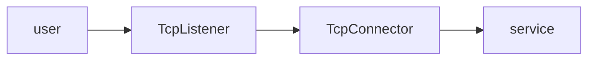
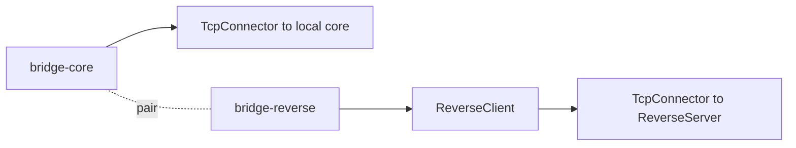
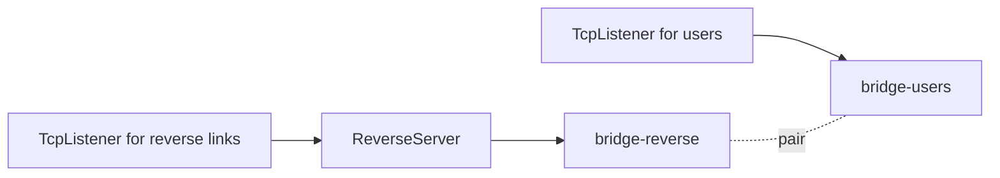
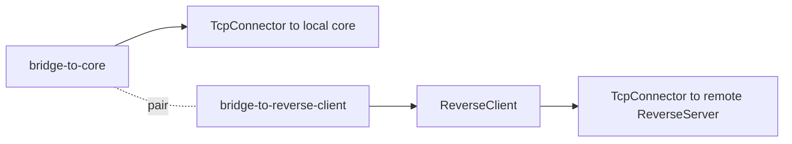

<!--
Documentation version: 154
-->

# Bridge

## نمای کلی {#overview}

`Bridge` دو نقطهٔ جداگانه را در یک پیکربندی WaterWall به هم وصل می‌کند. یک جفت گره `Bridge`، callbackهای چرخهٔ حیات و payload را با تغییر جهت میان یکدیگر عبور می‌دهند.

این گره عمدتاً برای چیدمان تونل معکوس ساخته شده است. به کمک آن، WaterWall مدل عادی زنجیره با یک `next` را حفظ می‌کند و در عین حال «پشت» گرهی مانند `ReverseClient` یا `ReverseServer` را به بخش دیگری از زنجیره متصل می‌کند.

`Bridge` پروتکلی اضافه نمی‌کند، سوکت باز نمی‌کند، payload را تجزیه یا داده را بافر نمی‌کند، سرآیند اضافه نمی‌کند و بستر انتقال نمی‌سازد. فقط رویدادهای line در WaterWall را بین دو گره نام‌گذاری‌شدهٔ Bridge عبور می‌دهد.

## جایگاه معمول در زنجیره {#typical-placement}

`Bridge` برای استفاده به‌صورت جفت در نظر گرفته شده است. در یک چیدمان معمول تونل معکوس:

- یک `Bridge` در سمت کلاینت مستقیماً پیش از `ReverseClient` قرار می‌گیرد.
- یک `Bridge` در سمت سرور مستقیماً پس از `ReverseServer` قرار می‌گیرد.
- هر bridge با نام به دیگری اشاره می‌کند.
- بخش معکوس زنجیره به یک سمت این جفت وصل می‌شود.
- بخش سرویس محلی زنجیره به سمت دیگر وصل می‌شود.

به همین دلیل معمولاً `ReverseClient` و `ReverseServer` همراه `Bridge` توضیح داده می‌شوند: جفت bridge اتصال تونل معکوس به بخش دیگری از زنجیره را آسان می‌کند.

<a id="قواعد-مجاورت-نودهای-reverse"></a>

### قواعد مجاورت گره‌های معکوس {#reverse-node-adjacency-rules}

هنگام استفاده از Bridge با گره‌های معکوس، اتصال‌های زیر باید مستقیم باشند:

- `Bridge -> ReverseClient`
- `ReverseServer -> Bridge`

هیچ گرهی نباید در هیچ‌یک از این دو فاصله قرار گیرد. برای مثال، `Bridge -> SpeedLimit -> ReverseClient` و `ReverseServer -> SpeedLimit -> Bridge` ممنوع‌اند. پردازش اضافی را بیرون از این فاصله‌ها قرار دهید.

این قاعده فرض‌های مالکیت تونل‌های عادی جریان را حفظ می‌کند. downstream Init از ReverseClient مستقیماً به Bridge می‌رود و Bridge آن را به شکل upstream Init در شاخهٔ جفت عبور می‌دهد. Bridge همان line را عبور می‌دهد و مالک آن نمی‌شود. تغییر جهت را در همین مرز نگه دارید و تونل میانی‌ای را که مالک را در سمت `prev` فرض می‌کند در آن قرار ندهید.

این‌ها قواعد طراحی زنجیره‌اند که کاربر باید رعایت کند؛ کد الزامات مجاورت را خودکار بررسی نمی‌کند. این قواعد برای اتصال‌های یادشده به گره‌های معکوس هستند و الزام نمی‌کنند که هر Bridge همسایه‌ای از نوع گره معکوس داشته باشد.

## نمونهٔ کاربردی ساده {#minimal-practical-example}

JSON زیر یک جفت **قطعهٔ گره** است، نه یک فایل پیکربندی کامل. هر دو نام `pair` و هر نام `next` باید در همان پیکربندی قابل حل باشند؛ مقدارهای جای‌نگهدار مسیر را با شاخه‌هایی که می‌خواهید به هم وصل کنید جایگزین کنید.

<a id="راهنمای-پیکربندی"></a>

### نمونهٔ پیکربندی {#configuration-example}

دو گره bridge جفت‌شده:

```json
{
  "name": "bridge-a",
  "type": "Bridge",
  "settings": {
    "pair": "bridge-b"
  },
  "next": "path-a-next-node"
}
```

```json
{
  "name": "bridge-b",
  "type": "Bridge",
  "settings": {
    "pair": "bridge-a"
  },
  "next": "path-b-next-node"
}
```

فیلد `next` در سطح JSON اختیاری است، زیرا bridge اغلب در ابتدا یا انتهای یک شاخهٔ تعریف‌شده قرار می‌گیرد. نیاز یک bridge مشخص به `next` به جهتی بستگی دارد که در چیدمان شما از آن bridge خارج می‌شود.

## پیکربندی {#configuration}

<a id="فیلدهای-اجباری"></a>

### فیلدهای لازم {#required-fields}

فیلدهای سطح اصلی:

| فیلد | نوع | توضیح |
| --- | --- | --- |
| `name` | رشته | نام انتخابی کاربر برای گره؛ باید در فایل پیکربندی یکتا باشد. |
| `type` | رشته | باید دقیقاً `"Bridge"` باشد. |
| `settings` | شیء | باید `pair` را داشته باشد. |

فیلدهای لازم در `settings`:

| فیلد | نوع | توضیح |
| --- | --- | --- |
| `pair` | رشته | نام گره bridge دیگر در همان پیکربندی بارگذاری‌شده. |

`settings` هیچ فیلد اختیاری ندارد.

اگر `pair` وجود نداشته باشد یا گره نام‌برده پیدا نشود، راه‌اندازی شکست می‌خورد. برای توپولوژی مفید و قابل پیش‌بینی، جفت را به‌صورت متقابل پیکربندی کنید:

```text
bridge-a.settings.pair = bridge-b
bridge-b.settings.pair = bridge-a
```

## کاربرد و رفع اشکال {#usage-and-troubleshooting}

<a id="نکتهها"></a>

### نکته‌ها و ملاحظات {#notes-and-caveats}

- `Bridge` یک آداپتور شبکه نیست و به آدرس یا پورت متصل نمی‌شود.
- پل Ethernet نیست و فرادادهٔ IP، TCP، UDP یا مسیریابی را بررسی نمی‌کند.
- مبدل بسته و جریان نیست؛ تنها callbackهایی را که زنجیرهٔ اطراف می‌فرستد عبور می‌دهد.
- bridge جفت باید در همان فایل پیکربندی که با همان تنظیمات مدیر گره بارگذاری شده وجود داشته باشد.
- بدون جفت و چیدمان معنادار شاخه‌های همسایه از bridge استفاده نکنید؛ bridge منفرد رفتار مفیدی ندارد.
- `Bridge` قابلیت `kNodeLayerAnything` را اعلام می‌کند و روابط هم‌ارزی منطقی لایه میان نمونه‌های جفت را ثبت می‌کند (`Bridge A prev == Bridge B prev` و `Bridge A next == Bridge B next`). اگر لایه‌های شبکهٔ متصل به bridgeهای جفت ناسازگار باشند، راه‌اندازی شکست می‌خورد.

## رفتار پیشرفته {#advanced-behavior}

<a id="چرا-bridge-ساخته-شد"></a>

### دلیل وجود Bridge {#why-bridge-exists}

بیشتر زنجیره‌های لایهٔ 4 در WaterWall به‌آسانی از چپ به راست خوانده می‌شوند:



`ReverseClient` این شکل ساده را تغییر می‌دهد. در ماشین سمت کلاینت، باید از مسیر عادی `next` خود برای ساخت اتصال‌های معکوس خروجی به `ReverseServer` راه دور استفاده کند. هم‌زمان باید به یک مقصد محلی، مانند ورودی xray-core، پراکسی محلی یا مسیر سرویس محلی دیگر نیز متصل شود.

<a id="ایده-اول-دو-next-برای-reverseclient"></a>

یکی از طرح‌های ردشده این بود که به `ReverseClient` دو فیلد next اختصاصی داده شود:

```json
{
  "name": "reverse-client",
  "type": "ReverseClient",
  "settings": {
    "next-core": "local-core-path",
    "next-peer": "remote-peer-path"
  }
}
```

<a id="ایده-پذیرفتهشده-bridge"></a>

این کار `ReverseClient` را خاص می‌کرد و مدل عادی ترکیب زنجیره در WaterWall را دور می‌زد. `Bridge` همان مسئله را بدون افزودن مفهوم `next` دوم حل می‌کند. یک bridge مستقیماً کنار گره معکوس قرار می‌گیرد، دیگری به مسیر سرویس محلی وصل می‌شود و این جفت callbackها را در جهت مخالف بازتاب می‌دهد.



همین ایده در سمت `ReverseServer` نیز به کار می‌رود، هنگامی که یک مسیر پیوندهای معکوس از `ReverseClient` و مسیر دیگر ترافیک واقعی کاربران را دریافت می‌کند:



`Bridge` دو شاخه را طوری به هم مرتبط می‌کند که گویی به هم متصل‌اند، در حالی که پیکربندی معمول گره با یک `next` را حفظ می‌کند.

### چیدمان ReverseClient {#reverseclient-layout}

در یک تنظیم معمول `ReverseClient`، این گره مسیر عادی `next` را برای پیوندهای معکوس خروجی به همتا نگه می‌دارد. مسیر هستهٔ محلی از طریق bridge جفت‌شده وصل می‌شود:



ماشین خصوصی یک برنامهٔ HTTP روی `127.0.0.1:3000` اجرا می‌کند و می‌تواند به درگاه عمومی `198.51.100.10:8443` متصل شود. این پیکربندی کامل گره‌ها را در ماشین خصوصی ذخیره کنید و نام فایل آن را در `core.json.configs` قرار دهید:

```json
{
  "name": "private-service-reverse",
  "nodes": [
    {
      "name": "outbound_to_core",
      "type": "TcpConnector",
      "settings": {
        "address": "127.0.0.1",
        "port": 3000
      }
    },
    {
      "name": "bridge_core",
      "type": "Bridge",
      "settings": {
        "pair": "bridge_reverse_client"
      },
      "next": "outbound_to_core"
    },
    {
      "name": "bridge_reverse_client",
      "type": "Bridge",
      "settings": {
        "pair": "bridge_core"
      },
      "next": "reverse_client"
    },
    {
      "name": "reverse_client",
      "type": "ReverseClient",
      "settings": {
        "minimum-unused": 4
      },
      "next": "outbound_to_peer"
    },
    {
      "name": "outbound_to_peer",
      "type": "TcpConnector",
      "settings": {
        "address": "198.51.100.10",
        "port": 8443
      }
    }
  ]
}
```

در این چیدمان:

- `reverse_client.next` مسیر همتا است.
- `bridge_core.next` مسیر سرویس محلی است.
- `bridge_core` و `bridge_reverse_client` این دو شاخهٔ تعریف‌شده را به هم وصل می‌کنند.

### چیدمان ReverseServer {#reverseserver-layout}

در سمت `ReverseServer`، معمولاً یک شنونده پیوندهای معکوس از `ReverseClient` راه دور را می‌پذیرد و شنونده دیگری ترافیک واقعی کاربران را دریافت می‌کند. جفت bridge این دو بخش را به هم وصل می‌کند:


روی آن درگاه عمومی از پیکربندی متناظر زیر استفاده کنید. پورت همتای معکوس `8443` با گره اتصال‌دهندهٔ ماشین خصوصی مطابقت دارد؛ `203.0.113.20` آدرس خروجی عمومی/NAT ماشین خصوصی از دید درگاه است. هر دو آدرس نمونه را برای محیط خود جایگزین کنید. سپس درخواست به `http://127.0.0.1:18080` روی درگاه به برنامهٔ HTTP ماشین خصوصی روی پورت `3000` می‌رسد.

```json
{
  "name": "public-gateway-reverse",
  "nodes": [
    {
      "name": "users_inbound",
      "type": "TcpListener",
      "settings": {
        "address": "127.0.0.1",
        "port": 18080
      },
      "next": "bridge_users"
    },
    {
      "name": "bridge_users",
      "type": "Bridge",
      "settings": {
        "pair": "bridge_reverse"
      }
    },
    {
      "name": "bridge_reverse",
      "type": "Bridge",
      "settings": {
        "pair": "bridge_users"
      }
    },
    {
      "name": "reverse_server",
      "type": "ReverseServer",
      "settings": {},
      "next": "bridge_reverse"
    },
    {
      "name": "peers_inbound",
      "type": "TcpListener",
      "settings": {
        "address": "0.0.0.0",
        "port": 8443,
        "whitelist": [
          "203.0.113.20/32"
        ]
      },
      "next": "reverse_server"
    }
  ]
}
```

شنوندهٔ مربوط به همتا معمولاً باید با `whitelist` یا یک لایهٔ مسیریابی/امنیتی معادل به سمت راه دور مورد انتظار محدود شود. استقرارهای عملیاتی معمولاً TLS، mux، مسیریابی یا لایه‌های بستر انتقال دیگر را بیرون از فاصله‌های مجاورت الزامی `Bridge -> ReverseClient` و `ReverseServer -> Bridge` اضافه می‌کنند.

## جزئیات پیاده‌سازی {#implementation-details}

### عملکرد {#what-it-does}

- گره `Bridge` دیگر را با نام از طریق `settings.pair` پیدا می‌کند.
- هنگام اتصال زنجیره، اشاره‌گر تونل جفت را ذخیره می‌کند.
- رویدادهای upstream این bridge را به سمت downstream bridge جفت می‌فرستد.
- رویدادهای downstream این bridge را به سمت upstream bridge جفت می‌فرستد.
- `Init`، `Est`، `Payload`، `Finish`، `Pause` و `Resume` را عبور می‌دهد.
- از همان `line_t *` و بافر payload استفاده می‌کند و فریم پروتکل جدیدی اختصاص نمی‌دهد.
- به padding چپ اضافی نیاز ندارد.

`Bridge` باید به‌صورت جفت پیکربندی شود و هر دو گره باید به یکدیگر اشاره کنند.

<a id="رفتار-جهتها"></a>

### وارونگی جهت {#direction-flip}

رفتار اصلی تبدیل payload نیست، بلکه تغییر جهت callback است:

| رویداد ورودی به این bridge | فراخوانی Bridge روی جفت | خروج از bridge جفت |
| --- | --- | --- |
| upstream `Init` / `Est` / `Payload` / `Finish` / `Pause` / `Resume` | `tunnelPrevDownStream*` | سمت قبلی bridge جفت |
| downstream `Init` / `Est` / `Payload` / `Finish` / `Pause` / `Resume` | `tunnelNextUpStream*` | سمت بعدی bridge جفت |

به همین دلیل Bridge مانند آینه عمل می‌کند: داده‌ای که وارد یکی می‌شود، با جهت مخالف WaterWall از دیگری خارج می‌شود.

<a id="lifecycle-و-رفتار-line"></a>

### چرخهٔ حیات و رفتار line {#lifecycle-and-line-behavior}

`Bridge` هیچ شیء `line_t` نمی‌سازد یا از بین نمی‌برد. همان اشاره‌گر line را از bridge جفت عبور می‌دهد و هیچ وضعیت مخصوص هر line رزرو نمی‌کند.

payload مستقیماً عبور داده می‌شود:

| جهت ورود به bridge فعلی | نحوهٔ ارسال |
| --- | --- |
| upstream payload | downstream payload از bridge جفت به سمت گره قبلی آن |
| downstream payload | upstream payload از bridge جفت به سمت گره بعدی آن |

چون Bridge هیچ بایتی به ابتدای داده اضافه نمی‌کند و قاب‌بندی انجام نمی‌دهد، `required_padding_left = 0` است.

<a id="متادیتای-نود"></a>

### فرادادهٔ گره {#node-metadata}

فراداده برگرفته از کد منبع:

| ویژگی | مقدار |
| --- | --- |
| پرچم‌های گره | `kNodeFlagChainHead` &#124; `kNodeFlagChainEnd` &#124; `kNodeFlagSupportsSplice` |
| `can_have_prev` | `true` |
| `can_have_next` | `true` |
| `layer_group` | `kNodeLayerAnything` |
| `layer_group_prev_node` | `kNodeLayerAnything` |
| `layer_group_next_node` | `kNodeLayerAnything` |
| `required_padding_left` | `0` بایت |

<a id="پشتیبانی-splice"></a>

### پشتیبانی splice {#splice-support}

در هر دو جهت پشتیبانی‌شدهٔ payload، بافر اصلی و همان line با نگاشت موجود جهت callback از Bridge جفت عبور می‌کنند. کل توپولوژی ادغام‌شده باید واجد شرایط باشد. Bridge هرگز مالک line عبوری نمی‌شود.

بافرهای عادی fallback همچنان پذیرفته می‌شوند. splice به ساخت پشتیبانی‌شدهٔ Linux، فعال بودن `misc.splice`، نبود گره‌های بسته و پشتیبانی همهٔ گره‌ها در زنجیرهٔ نهایی گسترش‌یافته و ادغام‌شده نیاز دارد. پرچم قابلیت این بررسی‌ها را دور نمی‌زند. بدون اندازه‌گیری، بهبود کارایی تضمین نمی‌شود.

پیکربندی‌های بسته این گره دولایه همچنان splice را فعال نمی‌کنند.
