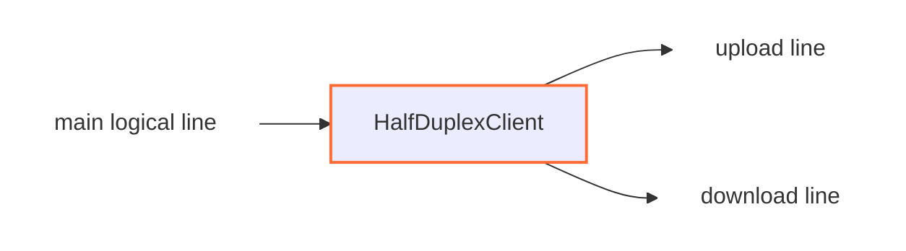

<!--
Documentation version: 163
-->

# HalfDuplexClient {#halfduplexclient}

## نمای کلی {#overview}

`HalfDuplexClient` یک line عادی دوطرفه را از گره قبلی می‌گیرد و آن را به
دو line خروجی جداگانه از طریق `next` مشترک یا مسیرهای نام‌گذاری‌شدهٔ upload و download تبدیل می‌کند:

- یک line برای upload، یعنی انتقال payload از کلاینت به سرور
- یک line برای download، یعنی انتقال payload از سرور به کلاینت

این گره باید در سمت مقابل با `HalfDuplexServer` استفاده شود تا آن دو اتصال
دوباره به یک اتصال منطقی عادی تبدیل شوند.

کلاینت هنگام `Init` از پیشنهاد انتقال مقصد ورودی TCP را انتخاب می‌کند.
هر یک از `line`های بارگذاری و دریافت پیش از `Init` خودش تنها TCP را پیشنهاد
می‌دهد.

## جایگاه معمول در زنجیره {#typical-placement}

<a id="جایگاه-رایج"></a>

جفت مستقیم درون یک فرایند:

```text
TesterClient -> HalfDuplexClient -> HalfDuplexServer -> TesterServer
```

نمونه روی TCP:

```text
client side: TcpListener -> HalfDuplexClient -> TcpConnector
server side: TcpListener -> HalfDuplexServer -> TcpConnector
```

هر گره جریان بایتی که میان کلاینت و سرور قرار می‌گیرد باید بایت‌های دو half-connection
را بدون تغییر عبور دهد. برای مثال اگر بعد از `HalfDuplexClient` یک `TlsClient`
بگذارید، هر دو اتصال upload و download handshake جداگانه TLS خواهند داشت.

## نمونهٔ کاربردی ساده {#minimal-practical-example}

این‌ها قطعه‌های پیکربندی گره هستند؛ گره‌های همسایهٔ ارجاع‌شده را در پیکربندی پیرامون آن‌ها تعریف کنید.

### نمونهٔ پیکربندی {#configuration-example}

<a id="نمونه-تنظیم"></a>

```json
{
  "name": "halfduplex-client",
  "type": "HalfDuplexClient",
  "settings": {},
  "next": "outbound-transport"
}
```

## پیکربندی {#configuration}

### فیلدهای الزامی {#required-fields}

<a id="فیلدهای-لازم"></a>

| فیلد | نوع | توضیح |
| --- | --- | --- |
| `name` | string | نام دلخواه و یکتای گره. |
| `type` | string | باید دقیقاً `"HalfDuplexClient"` باشد. |
| `next` | string | وقتی هر دو تنظیم مسیر حذف شده‌اند الزامی است و هر دو اتصال را دریافت می‌کند. همراه `upload`/`download` باید حذف شود. |

این گره باید گره قبلی و مسیرهای transport داشته باشد. برای ابتدا یا انتهای زنجیره نیست.

### تنظیمات {#settings}

<a id="تنظیمات"></a>

| تنظیم | نوع | توضیح |
| --- | --- | --- |
| `upload` | string | نام گره ورودی مسیر آپلود؛ همراه `download` الزامی است. |
| `download` | string | نام گره ورودی مسیر دانلود؛ همراه `upload` الزامی است. |

اگر هر دو تنظیم حذف شوند، هر دو line از `next` الزامی استفاده می‌کنند. اگر هر دو
نام داده شوند، `next` باید کاملاً حذف شود. تنها یکی از دو تنظیم، ترکیب آن‌ها با
`next` حتی با مقدار `null`، نام خالی، نوع نادرست یا نام ناموجود باعث رد پیکربندی
می‌شود. هر دو نام می‌توانند یک گره باشند؛ در این حالت شاخه فقط یک بار متصل می‌شود.
ارجاع به خود، مسیر چرخه‌ای، لایهٔ ناسازگار یا شاخه‌ای که قبلاً به گره دیگری متصل
شده باشد پذیرفته نیست.

هر مسیر باید line عادی لایهٔ ۴ را بپذیرد. مسیر download نیز Init و intro را در جهت
upstream دریافت می‌کند؛ نام آن جهت دادهٔ برنامه را مشخص می‌کند. کاربر مسئول است
که هر دو مسیر در نهایت به یک گروه جفت‌سازی `HalfDuplexServer` برسند: یک نمونهٔ
واحد یا چند سرور که با `settings.pair` به هم متصل شده‌اند. کلاینت نمی‌تواند این
شرط را در توپولوژی سمت مقابل بررسی کند.

## کاربرد و رفع اشکال {#usage-and-troubleshooting}

### نمونه‌های دیگر {#alternative-examples}

مسیرهای جداگانهٔ transport:

```json
{
  "name": "halfduplex-client",
  "type": "HalfDuplexClient",
  "settings": {
    "upload": "upload-transport",
    "download": "download-transport"
  }
}
```

### توپولوژی کامل TLS/KCP {#complete-tlskcp-topology}

<a id="توپولوژی-کامل-tlskcp"></a>

یک جریان بایتی محلی TCP می‌تواند آپلود را از TLS/TCP و دانلود را از KCP/UDP عبور دهد.
دو شاخهٔ کلاینت از `HalfDuplexClient` شروع می‌شوند و هر دو شاخهٔ سرور در یک
پیکربندی قرار دارند:

```text
Client:
TcpListener -> VlessClient -> HalfDuplexClient
  upload   -> TlsClient -> TcpConnector == TLS/TCP ==> server TcpListener
  download -> KcpClient -> UdpConnector == KCP/UDP ==> server UdpListener

Server:
TcpListener -> TlsServer -> hs1 -> VlessServer -> TcpUdpConnector
UdpListener -> KcpServer -> hs2 (pair: hs1)
```

`hs1` و `hs2` یک گروه جفت‌سازی مشترک دارند و line برنامهٔ بازسازی‌شده از `hs1`
به `VlessServer` و `TcpUdpConnector` می‌رود.
هر دو اتصال transport را کلاینت آغاز می‌کند. نام مسیرها جهت payload برنامه را
مشخص می‌کند؛ KCP همچنان تأیید دریافت و ترافیک کنترلی را در هر دو جهت ردوبدل
می‌کند. با جابه‌جایی مقدارهای `upload` و `download` در کلاینت می‌توان نقش دو
transport را عوض کرد، بدون تغییر تنظیم `pair` سرور.

برای فایل‌های کامل کلاینت و سرور و مراحل اجرا، [نمونهٔ TLS/KCP (انگلیسی)](https://radkesvat.github.io/WaterWall-Docs/docs/examples/tunnels/halfduplex-split-transports) را ببینید.

### محدودیت‌ها و فضای خالی {#limits-and-padding}

<a id="محدودیتها-و-padding"></a>

| مقدار | اندازه |
| --- | --- |
| intro داخلی | `17 bytes` (یک بایت نقش و یک شناسه تازه ۱۲۸ بیتی) |
| `required_padding_left` | `17 bytes` |

این گره برای intro نخستین payload آپلود، ۱۷ بایت padding چپ رزرو می‌کند.
اگر بافر معمولی فضای کافی داشته باشد، همان بافر استفاده می‌شود؛ ورودی splice
یا بافر بدون فضای کافی به یک بافر معمولی جدید با padding کامل مسیر بعدی منتقل
می‌شود. intro مربوط به download نیز در یک بافر معمولی جداگانه با padding کامل
مسیر بعدی ارسال می‌شود.

### نکته‌ها و ملاحظات {#notes-and-caveats}

<a id="نکتهها"></a>

- باید با `HalfDuplexServer` استفاده شود.
- هر اتصال منطقی ورودی، دو اتصال خروجی می‌سازد.
- پس از ارسال introها، بسته‌شدن آپلود همچنان اجازه می‌دهد پاسخ روی دانلود کامل شود.
- intro تنها پس از رسیدن نخستین payloadِ upstream ارسال می‌شود.
- یکی از دو حالت `next` مشترک یا هر دو مسیر نام‌گذاری‌شدهٔ `upload` و `download` را انتخاب کنید؛ مسیرهای سمت مقابل باید به یک گروه جفت‌سازی سرور برسند.

## رفتار پیشرفته {#advanced-behavior}

### معرفی اولیه برای جفت‌سازی {#pairing-intro}

<a id="intro-برای-جفت-کردن-اتصالها"></a>

نخستین payload در مسیر upstream به‌شکل ویژه پردازش می‌شود. همراه همان payload،
`HalfDuplexClient` با CSPRNG سریع یک شناسه تازه ۱۲۸ بیتی تولید می‌کند. intro دقیقاً
۱۷ بایت است: بایت صفر فرمان دقیق نقش و بایت‌های ۱ تا ۱۶ شناسه pair هستند:

| Line | رفتار intro |
| --- | --- |
| upload line | intro هفده‌بایتی به ابتدای نخستین payload واقعی کاربر اضافه می‌شود. |
| download line | فقط intro هفده‌بایتی، بدون payload کاربر، ارسال می‌شود. |

بعد از اولین payload:

- همه payload‌های upstream فقط از upload line ارسال می‌شوند.
- payload‌های downstream باید از download line برگردند.

این intro جزئیات داخلی پروتکل بین `HalfDuplexClient` و `HalfDuplexServer` است و
تنظیم کاربر محسوب نمی‌شود و نباید قالب عمومی و پایدار روی مسیر تلقی شود. شناسه pair فقط فراداده مسیریابی داخلی است و احراز
هویت یا حفاظت transport را فراهم نمی‌کند؛ برای این ویژگی‌ها باید security گره
مناسب پیکربندی شود.

## جزئیات پیاده‌سازی {#implementation-details}

### عملکرد گره {#what-it-does}

<a id="عملکرد"></a>

- یک line ورودی از گرهٔ قبلی می‌پذیرد.
- دو line خروجی جدید از مسیرهای transport انتخاب‌شده می‌سازد.
- همراه نخستین payload در upstream، معرفی داخلی کوچکی می‌فرستد تا `HalfDuplexServer` بتواند دو line انتقال را جفت کند.
- همهٔ payloadهای بعدی کلاینت به سرور را روی line آپلود می‌فرستد.
- payload سرور به کلاینت را از line دانلود دریافت می‌کند و به گرهٔ قبلی می‌فرستد.
- پس از `Finish` line اصلی، داده‌های پذیرفته‌شدهٔ آپلود را تخلیه می‌کند و منتظر پایان دانلود می‌ماند.



`HalfDuplexClient` یک تونل میانی جریان بایتی است. خودش سوکت یا line بسته‌ای نمی‌سازد.

### رفتار جهت‌ها {#direction-behavior}

<a id="رفتار-جهتها"></a>

| جهت | رفتار |
| --- | --- |
| upstream payload از گره قبلی | پس از introِ نخستین payload، روی upload line به مسیر انتخاب‌شده فرستاده می‌شود. |
| downstream payload از گره بعدی | به main line اصلی و گره قبلی برگردانده می‌شود. |
| upstream pause/resume | به download line فرستاده می‌شود. |
| downstream pause/resume | اگر main line هنوز وجود داشته باشد، به آن برگردانده می‌شود. |

upload line مسیر اصلی داده از کلاینت به سرور است و download line مسیر برگشت
داده از سرور به کلاینت.

### رفتار چرخهٔ عمر {#lifecycle-behavior}

<a id="lifecycle"></a>

در upstream `Init`، گره وضعیت مربوط به main line را مقداردهی می‌کند و دو line
جدید روی همان worker می‌سازد:

1. line آپلود
2. line دانلود

هر line انتقال از طریق ورودی شاخهٔ انتخاب‌شدهٔ خود مقداردهی اولیه می‌شود. هر سه line به یک ساختار جفت اشاره می‌کنند که متعلق به کلاینت است. داده‌های آپلود در انتظار ارسال و پیام معرفی جفت، هم در زمان فعالیت برنامه و هم هنگام بستن اتصال، در همین ساختار نگهداری می‌شوند.

رویداد transport Est از هر کدام از child‌ها با latch همین گره فقط یک بار به برنامه
اعلام می‌شود. اگر Est همزمان داخل Init اولین child برسد، تنها تا پذیرش Init هر دو
child منتظر می‌ماند؛ handshake جفت‌سازی مانع Est نیست. پس از این Init، payload معتبر
پیش از Est هم پذیرفته می‌شود و callback آن می‌تواند اولین payload را ارسال یا جفت
را ببندد.

صف موقت آپلود ورودی را برای رعایت ترتیب Init و intro یا هنگام Pause شاخه نگه می‌دارد: سقف شامل برابری
2 MiB برای بایت‌های منطقی و 8 MiB برای هزینهٔ حافظهٔ صف است. پیش از callback وضعیت ارسال intro ثبت می‌شود؛ ورودی تو در تو
هنگام intro دانلود، پشت intro آپلود قبلی و با همان شناسه جفت قرار می‌گیرد.
ورودی پذیرفته‌شده می‌تواند پس از Pause تکمیل شود، ولی تخلیه بعدی backlog مربوط به
Init، Pause تجمیعی child‌ها را رعایت می‌کند. Resume یک child دلیل Pause child دیگر
را رفع نمی‌کند. Pause خواندن برنامه که پیش از ایجاد child دانلود برسد، پس از Init
آن اعمال می‌شود، مگر اینکه Resume بعدی آن را لغو کند. پس از مقداردهی اولیهٔ این
child، همهٔ Pause/Resume‌های خواندن برنامه، حتی اعلان‌های تکراری، مستقیماً به آن
نگاشت می‌شوند. مسیر آماده داده، صف transport اضافی ندارد.

کلاینت در تمام طول عمر جفت فعال می‌ماند: نگاشت payload، فشار و Finish میان main line
از نوع borrowed و child‌های متعلق به گره با bypass دائمی روی همان line سازگار
نیست. تجمیع فشار child‌ها و کنترل تخلیهٔ backlog مربوط به Init، مسئولیت‌های endpoint
هستند؛ حتی وقتی این گره در میانهٔ زنجیرهٔ پیکربندی‌شده قرار دارد.

پس از ارسال هر دو intro، دریافت `Finish` آپلود فقط line آپلود را بازنشسته می‌کند و main و دانلود برای پاسخ باقی می‌مانند. اگر برنامه پس از بازگشت هر دو `Init` پایان یابد، کلاینت main قرضی را جدا می‌کند و توقف خواندن دانلود از سوی برنامه را برمی‌دارد. سپس introهای باقیمانده را با شناسهٔ مشترک جفت می‌فرستد و داده‌های پذیرفته‌شدهٔ آپلود را با رعایت `Pause` به‌ترتیب تحویل می‌دهد. کلاینت ابتدا آپلود را می‌بندد و دانلود را برای مشاهدهٔ پایان سمت مقابل نگه می‌دارد. اگر دانلود پس از تحویل intro آن زودتر پایان یابد، تخلیهٔ آپلود ادامه دارد. مهلت هر دو مرحله ۳۰ ثانیه از `Finish` برنامه است. توقف worker یا خرابی transport، line و بافرهای مربوط را آزاد می‌کند. `Finish` به فرستندهٔ آن بازتاب داده نمی‌شود.

callback‌های `UpStreamEst` و `DownStreamInit` برای این گره غیرفعال هستند.

### splice و فضای نگه‌داری راه‌اندازی {#splice-and-setup-storage}

<a id="splice-و-حافظهٔ-مرحلهٔ-آغازین"></a>

اولین تحویل upstream، حتی تحویل خالی، دو intro هفده‌بایتی با شناسهٔ ۱۲۸ بیتی
یکسان ایجاد می‌کند. intro آپلود و تمام payload اول در یک بافر معمولی ترکیب
می‌شوند. بافر معمولی با فضای کافی برای سرآیند بدون کپی استفاده می‌شود؛ در صورت
کمبود فضا یک بافر جدید ساخته می‌شود. ورودی splice کاملاً materialize می‌شود و
prefix موجود در حافظه و بدنهٔ pipe به ترتیب کپی می‌شوند. intro دانلود نیز معمولی است.
تحویل‌های بعدی در هر دو جهت نمایش معمولی یا splice خود را حفظ می‌کنند.
صف موقت آپلود می‌تواند wrapper‌های splice را بدون تبدیل به حافظهٔ عادی نگه دارد. سقف‌های ۲ MiB بایت منطقی و ۸ MiB هزینهٔ حافظهٔ صف، با مجاز بودن رسیدن به خود سقف، برقرار هستند و محدودیت هر تحویل در مسیر آماده نیست.
بافر‌های خروجی padding لازم برای گره‌های بعدی را حفظ می‌کنند.

هر دو گره پرچم `kNodeFlagSupportsSplice` دارند. کلاینت برای intro آپلود به ۱۷ بایت
padding چپ نیاز دارد؛ padding موردنیاز سرور صفر است.
خواندن splice تنها با پشتیبانی پلتفرم و build، فعال بودن `misc.splice` و پشتیبانی
تمام گره‌های زنجیرهِ گسترش‌یافته، از جمله wrapper نوع PipeTunnel سرور و همهٔ همسایه‌ها، فعال می‌شود.
بافر معمولی در همهٔ وضعیت‌ها پذیرفته می‌شود. انتخاب مسیر قالب پروتکل جفت‌سازی یا رفتار ترجیح خواندن را تغییر نمی‌دهد.

### فرادادهٔ گره {#node-metadata}

<a id="متادیتای-نود"></a>

فراداده برگرفته از کد منبع:

| ویژگی | مقدار |
| --- | --- |
| پرچم‌های گره | `kNodeFlagSupportsSplice` |
| `can_have_prev` | `true` |
| `can_have_next` | `true` |
| `layer_group` | `kNodeLayer4` |
| `layer_group_prev_node` | `kNodeLayer4Stream` |
| `layer_group_next_node` | `kNodeLayer4Stream` |
| `required_padding_left` | `17` بایت |
