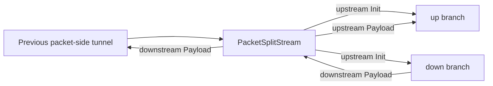

<!--
Documentation version: 153
-->

# PacketSplitStream

## نمای کلی {#overview}

`PacketSplitStream` یک split bridge است که state آن به packet-line متصل می‌شود. زمانی به کار می‌رود که یک line در سمت بسته به دو ورودی شاخه با نام مشخص نیاز داشته باشد:

- `up`: شاخه‌ای که payload‌های بسته را در جهت upstream دریافت می‌کند
- `down`: شاخه‌ای که به‌عنوان مسیر برگشت یا download مقداردهی اولیه می‌شود

این گره router عمومی نیست و به‌تنهایی بسته‌ها را روی جریان frame نمی‌کند؛ بلکه ابزاری برای کنار هم قرار دادن شاخه‌ها در چیدمان‌های خاص بسته/جریان است.

:::info
`PacketSplitStream` با `HalfDuplexClient` تفاوت دارد: handshake مربوط به pairing را انجام نمی‌دهد، connection جفت‌شده را بازیابی نمی‌کند و برای packet-line یک lifecycle معمول per-connection نمی‌سازد.
:::

## جایگاه معمول در زنجیره {#typical-placement}

<a id="جایگاه-رایج"></a>

### جایگاه معمول {#typical-placement-1}

زنجیره اصلی به `PacketSplitStream` می‌رسد و نام دو شاخه split در `settings` مشخص می‌شود:

```text
packet-side-node -> PacketSplitStream
                    settings.up   -> upload-branch-head
                    settings.down -> download-branch-head
```

`PacketSplitStream` عمداً از فیلد `next` سطح بالا استفاده نمی‌کند.

این نمودار چیدمان شاخه‌ها را نشان می‌دهد، نه transport کامل بسته. ورودی هر
شاخه باید line بسته‌ای موجود را بپذیرد؛ قرار دادن نام یک `TcpConnector` معمولی
در `up` یا `down` تبدیل بسته به جریان انجام نمی‌دهد. برای تونل معمول دو میزبان،
از [چیدمان PacketsToStream / StreamToPackets](./PacketsToStream.mdx#packet-over-tls)
شروع کنید. این helper زمانی لازم است که خودِ تقسیم شاخه‌ها موردنیاز باشد.

JSON زیر فقط قطعهٔ گره مربوط به split است و هیچ‌یک از شاخه‌ها یا peer راه‌دور
را تعریف نمی‌کند.

### چه وقت از آن استفاده کنید {#when-to-use-it}

<a id="چه-وقت-از-آن-استفاده-کنید"></a>

از `PacketSplitStream` زمانی استفاده کنید که pipeline سمت بسته باید داده را به شاخه upload بفرستد و هم‌زمان شاخه جداگانه‌ای آماده باشد تا payload‌های downstream آن به سمت بسته برگردند.

اگر به policy routing، انتخاب چندشاخه بر اساس rule یا مدیریت lifecycle معمول connection نیاز دارید، این گره مناسب نیست. در این موارد از یک گره router یا تونل مرزی بسته/جریان متناسب با جریان مورد نظر استفاده کنید.

## نمونهٔ کاربردی ساده {#minimal-practical-example}

این نمونه‌ها بخش‌هایی از پیکربندی گره هستند؛ گره‌های مجاور ارجاع‌داده‌شده را در پیکربندی پیرامون آن تعریف کنید.

### نمونهٔ پیکربندی {#configuration-example}

<a id="نمونه-تنظیم"></a>

```json
{
  "name": "packet-split",
  "type": "PacketSplitStream",
  "settings": {
    "up": "upload-branch-head",
    "down": "download-branch-head"
  }
}
```

گره‌های ارجاع‌داده‌شده برای شاخه‌ها باید در جای دیگری از همان پیکربندی WaterWall تعریف شده باشند.

## پیکربندی {#configuration}

### فیلدهای لازم {#required-fields}

<a id="فیلدهای-ضروری"></a>

فیلدهای سطح بالا:

| فیلد | نوع | توضیح |
| --- | --- | --- |
| `name` | string | نام دلخواه گره. باید داخل فایل پیکربندی یکتا باشد. |
| `type` | string | باید دقیقاً `"PacketSplitStream"` باشد. |
| `settings` | object | اجباری. شامل ورودی‌های شاخه split نام‌دار است. |

فیلدهای اجباری `settings`:

| گزینه | نوع | توضیح |
| --- | --- | --- |
| `up` | string | نام گره‌ای که به‌عنوان تونل ورودی upstream برای بسته‌های ارسالی استفاده می‌شود. |
| `down` | string | نام گره‌ای که به‌عنوان شاخه downstream/return عادی زنجیره می‌شود. |

### قوانین اعتبارسنجی {#validation-rules}

<a id="قوانین-اعتبارسنجی"></a>

سورس فعلی این قوانین را اعمال می‌کند:

- `next` سطح بالا نباید تنظیم شود
- `settings.up` لازم است
- `settings.down` لازم است
- هر دو گره ارجاع‌داده‌شده باید وجود داشته باشند
- `up` و `down` باید به گره‌های متفاوت اشاره کنند
- هیچ‌کدام از شاخه‌ها نباید به گره `PacketSplitStream` خودش اشاره کنند
- ورودی شاخه‌ها نباید از قبل به تونل قبلی دیگری متصل شده باشند

هنگام ساخت زنجیره، WaterWall پس از زنجیره شدن هر گره ارجاع‌داده‌شده، ورودی واقعی شاخه را پیدا می‌کند. این موضوع برای گره‌هایی مهم است که تونل‌های داخلی را پیش از خودشان قرار می‌دهند.

## جزئیات پیاده‌سازی {#implementation-details}

### مدل جریان {#flow-model}

<a id="مدل-جریان"></a>



رفتار پیاده‌سازی فعلی:

| callback دریافت‌شده توسط `PacketSplitStream` | رفتار |
| --- | --- |
| upstream `Init` | upstream `Init` را روی هر دو ورودی شاخه `up` و `down` صدا می‌زند. |
| upstream `Payload` | payload را به شاخه `up` می‌فرستد. |
| downstream `Payload` | payload را به تونل قبلی برمی‌گرداند. |
| upstream `Est`، `Pause`، `Resume` | بدون عمل. |
| downstream `Init`، `Est`، `Pause`، `Resume` | بدون عمل. |
| upstream یا downstream `Finish` | غیرمنتظره تلقی می‌شود و برنامه را خاتمه می‌دهد. |

از آن‌جا که `Finish` در runtime پشتیبانی نمی‌شود، این گره را فقط در جریان‌های packet-line به کار ببرید؛ جایی که line بسته‌ایِ worker تا پایان عمر زنجیره زنده می‌ماند.

### نکات packet-line {#packet-line-notes}

<a id="نکات-packet-line"></a>

این گره بر اساس رفتار packet-line در WaterWall طراحی شده است. line بسته‌ایِ worker میان همه بسته‌های همان worker مشترک است و با یک connection line معمولی از نوع TCP تفاوت دارد.

نتایج عملی:

- آن را مانند گره‌ای که مالک line‌های معمول per-connection است به کار نبرید.
- از آن انتظار close یا reconnect جداگانه برای هر flow نداشته باشید.
- آن را در مسیری قرار ندهید که باید `Finish` را به‌طور عادی به گره مجاور منتقل کند.
- برای حمل بسته‌های کامل IPv4 روی جریان، از [PacketsToStream](./PacketsToStream.mdx) و [StreamToPackets](./StreamToPackets.mdx) استفاده کنید. این دو گره مرز بسته‌ها را از فیلد `total-length` در IPv4 بازیابی می‌کنند و length prefix جداگانه‌ای اضافه نمی‌کنند.

### فرادادهٔ گره {#node-metadata}

<a id="متادیتای-نود"></a>

هنگام ساخت زنجیره، `PacketSplitStream` شاخهٔ پیکربندی‌شدهٔ `down` را به‌عنوان تونل `next` خود متصل می‌کند تا بسته‌های برگشتی downstream آن شاخه را دریافت کند. این گره چیزی به ابتدای payload اضافه نمی‌کند و buffer آن را بازنویسی یا مصرف نمی‌کند.

متادیتای برگرفته از کد منبع:

| ویژگی | مقدار |
| --- | --- |
| گره flags | `kNodeFlagChainEnd` |
| `can_have_prev` | `true` |
| `can_have_next` | `true` |
| `layer_group` | `kNodeLayer3` |
| `layer_group_prev_node` | `kNodeLayer3` |
| `layer_group_next_node` | `kNodeLayer3` |
| `required_padding_left` | `0` بایت |
