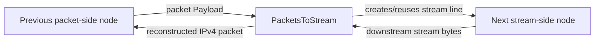

<!--
Documentation version: 153
-->

# PacketsToStream

## نمای کلی {#overview}

`PacketsToStream` بخش packet-oriented یک زنجیره را به بخش stream-oriented آن متصل می‌کند. این گره payload‌های بسته را از سمت قبلی می‌گیرد، برای هر worker یک line رو به جریان در سمت گره بعدی می‌سازد و بایت‌های خام هر بسته IPv4 را روی همان line می‌نویسد.

پیاده‌سازی فعلی فقط از IPv4 پشتیبانی می‌کند و headerless است:

```text
IPv4 packet bytes + IPv4 packet bytes + IPv4 packet bytes + ...
```

هیچ length prefix دوبایتی وجود ندارد. مرز بسته‌ها با فیلد `total-length` در header هر بسته IPv4 بازیابی می‌شود. در مستندات قدیمی ممکن است نام `PacketAsData` را ببینید، اما نام نوع فعلی گره `PacketsToStream` است.

## جایگاه معمول در زنجیره {#typical-placement}

### انتخاب پل بسته‌ای {#choosing-a-packet-bridge}

bridge را بر اساس داده‌ای که وارد گره می‌شود انتخاب کنید:

| ورودی و هدف | گره یا جفت مناسب |
| --- | --- |
| حمل بسته‌های کامل IPv4 روی جریان و بازیابی آن‌ها در سمت مقابل. | `PacketsToStream` همراه با [StreamToPackets](./StreamToPackets.mdx). |
| تبدیل بسته‌های دریافت‌شده IPv4 TCP/UDP به connection‌های جدا برای زنجیره پروکسی یا connector. | [PacketsToConnection](./PacketsToConnection.mdx). |
| تبدیل connection‌های TCP/UDP برنامه به بسته‌های خام IPv4 برای یک مسیر حمل بسته. | [ConnectionToPackets](./ConnectionToPackets.mdx). |

جفت جریان، بسته‌های IP را همراه با header آن‌ها حمل می‌کند. bridge‌های
connection از stack TCP/UDP در فضای کاربر استفاده می‌کنند و در سمت connection
خود payload برنامه را تحویل می‌دهند.

### جایگاه معمول {#typical-placement-1}

<a id="جایگاه-رایج"></a>

بسته input به جریان transport:

```text
TunDevice -> PacketsToStream -> TcpConnector
```

جفت با `StreamToPackets` روی سرور دیگر:

```text
server1: TunDevice -> PacketsToStream -> TcpConnector
server2: TcpListener -> StreamToPackets -> TunDevice
```

این چیدمان کار می‌کند، چون `PacketsToStream` و `StreamToPackets` هر دو از قالب یکسانِ بسته‌های خام IPv4 پشت‌سرهم استفاده می‌کنند.

#### حمل بسته روی TLS {#packet-over-tls}

برای مسیر رمزنگاری‌شدهٔ IPv4، TLS را دور جریان بسته قرار دهید:

```text
client host: TunDevice -> PacketsToStream -> TlsClient -> TcpConnector
server host: TcpListener -> TlsServer -> StreamToPackets -> TunDevice
```

این نمودار زنجیره دو میزبان است، نه پیکربندی کامل. بخش‌های زیر را هماهنگ تنظیم کنید:

- `TcpConnector` سمت client به آدرس و پورت `TcpListener` سمت server متصل می‌شود.
- `TlsServer` گواهی و کلید را فراهم می‌کند؛ `TlsClient` نام server و تنظیمات
  بررسی گواهی متناظر را دارد. TLS روی جریان بسته کار می‌کند و باید میان
  bridgeهای بسته و TCP قرار بگیرد.
- به TUNها آدرس داخلی متفاوت، مثلاً `10.80.0.1/24` و `10.80.0.2/24` بدهید و
  مقصدهای داخلی موردنظر را از آن‌ها عبور دهید. آدرس بیرونی TCP سرور باید خارج
  از route تونل بماند. دسترسی به مقصدهای پشت server به forwarding و مسیر برگشت
  روی میزبان نیاز دارد.
- اگر heartbeat می‌خواهید، `sensitive-mode` را روی هر دو bridge تنظیم کنید.
  interval و tolerance فقط متعلق به `PacketsToStream` هستند؛ آن‌ها را متناسب
  با تأخیر واقعی مسیر بگذارید، نه صرفاً بر اساس زمان‌بندی کوتاه تست‌ها.

خود bridgeها رمزنگاری یا route میزبان فراهم نمی‌کنند. ابتدا ارتباط دو آدرس
داخلی interfaceها را بررسی کنید و سپس subnet یا default route اضافه کنید.
JSON زیر فقط قطعهٔ گره مربوط به `PacketsToStream` است؛ در این چیدمان `next`
آن نام `TlsClient` خواهد بود.

## نمونهٔ کاربردی ساده {#minimal-practical-example}

این نمونه‌ها بخش‌هایی از پیکربندی گره هستند؛ گره‌های مجاور ارجاع‌داده‌شده را در پیکربندی پیرامون آن تعریف کنید.

### نمونهٔ پیکربندی {#configuration-example}

<a id="نمونه-تنظیم"></a>

```json
{
  "name": "packet-to-stream",
  "type": "PacketsToStream",
  "settings": {
    "sensitive-mode": true,
    "interval-ms": 50,
    "tolerance-ms": 150,
    "packet-validation-level": "hard"
  },
  "next": "stream-node"
}
```

## پیکربندی {#configuration}

### تنظیمات {#settings}

<a id="تنظیمات"></a>

فیلدهای سطح بالا:

| فیلد | نوع | اجباری | توضیح |
| --- | --- | --- | --- |
| `name` | string | بله | نام دلخواه گره. باید داخل فایل پیکربندی یکتا باشد. |
| `type` | string | بله | باید دقیقاً `"PacketsToStream"` باشد. |
| `settings` | object | خیر | object تنظیمات اختیاری. |
| `next` | string | بله | گره stream-oriented که data line مربوط به هر worker را دریافت می‌کند. |

فیلدهای اختیاری `settings`:

| گزینه | نوع | پیش‌فرض | توضیح |
| --- | --- | --- | --- |
| `sensitive-mode` | boolean | `false` | فعال‌سازی heartbeat stream-side روی هر output line worker-local. |
| `interval-ms` | integer | `50` | فاصله ارسال heartbeat بر حسب میلی‌ثانیه. حداقل `1`. فقط وقتی `sensitive-mode` فعال است استفاده می‌شود. |
| `tolerance-ms` | integer | `150` | مهلت پاسخ بر حسب میلی‌ثانیه، از تحویل PING به گره بعدی تا پردازش PONG متناظر در `PacketsToStream`. حداقل `1`. |
| `packet-validation-level` | string | `"none"` | حالت اعتبارسنجی برای بسته‌های decode شده از data برگشتی جریان. مقادیر: `"none"`، `"loose"`، `"hard"`. |

هیچ setting اختصاصی و اجباری برای این تونل وجود ندارد.

## کاربرد و رفع اشکال {#usage-and-troubleshooting}

### نکته‌های عملی {#practical-notes}

<a id="نکتههای-عملی"></a>

- آن را با `StreamToPackets` در سمت دیگر جفت کنید.
- با framing قدیمی 2-byte-prefix جفت نکنید مگر اینکه peer به فرمت فعلی IPv4-total-length به‌روز شده باشد.
- وقتی می‌خواهید lwIP flow‌های TCP/UDP را به‌عنوان line‌های عادی WaterWall بازسازی کند، از `PacketsToConnection` استفاده کنید نه از این گره.
- برای تشخیص دقیق‌تر خرابی داده در جریان برگشتی، `packet-validation-level: "hard"` را انتخاب کنید؛ در این حالت هزینهٔ محاسبهٔ checksum را هم در نظر بگیرید.
- parser می‌تواند پس از داده نامعتبر دوباره sync شود، اما یک جریان مخرب ممکن است داده‌هایی تولید کند که تا زمان realignment از نظر ساختاری بسته معتبر به نظر برسند.

## رفتار پیشرفته {#advanced-behavior}

### قالب روی شبکه {#wire-format}

<a id="فرمت-wire"></a>

قالب wire در سمت جریان از بسته‌های کامل IPv4 تشکیل شده که بدون فاصله پشت سر هم قرار می‌گیرند:

```text
packet A: N bytes, where IPv4 total-length = N
packet B: M bytes, where IPv4 total-length = M
packet C: K bytes, where IPv4 total-length = K
```

`PacketsToStream` هیچ length field، message type یا metadata به ابتدای داده اضافه نمی‌کند. peer باید با خواندن header مربوط به IPv4 مرز بسته‌ها را پیدا کند.

بسته‌هایی که روی جریان فرستاده می‌شوند باید شرایط زیر را داشته باشند:

- دست‌کم به اندازه حداقل header مربوط به IPv4 طول داشته باشند
- از `kMaxAllowedPacketLength` بزرگ‌تر نباشند
- IP version برابر `4` باشد
- IPv4 total length برابر طول buffer باشد

IPv6، payload‌های غیر IPv4، بسته‌های نامعتبر IPv4 و بسته‌هایی که پس از `total-length` بایت اضافه دارند کنار گذاشته می‌شوند؛ زیرا parser سمت peer را از sync خارج می‌کنند.

### اعتبارسنجی بسته {#packet-validation}

<a id="اعتبارسنجی-packet"></a>

`packet-validation-level` روی بسته‌هایی اعمال می‌شود که از data جریان downstream decode شده‌اند، قبل از اینکه به سمت بسته ارسال شوند.

این گزینه جای بررسی‌های همیشگیِ قابل‌ارسال بودن بسته سمت ورودی را نمی‌گیرد. ورودی سمت بسته همچنان باید یک IPv4 سازگار باشد تا peer بتواند آن را بخواند.

| سطح | رفتار |
| --- | --- |
| `"none"` | پیش‌فرض. هیچ اعتبارسنجی configurable بعد از استخراج ندارد. extractor هنوز بررسی‌های structural سبک انجام می‌دهد تا بتواند مرز بسته‌ها را پیدا کند. |
| `"loose"` | بسته‌های غیر IPv4 و بسته‌های نامعتبر IPv4 را کنار می‌گذارد. حداقل اندازه header، version، طول header مربوط به IPv4 و برابری total length با طول بسته را بررسی می‌کند. |
| `"hard"` | `loose` را اعمال می‌کند، IPv4 header checksum را verify می‌کند، و checksum‌های TCP، UDP و ICMP را برای بسته‌های non-fragmented verify می‌کند. IPv4 UDP checksum برابر `0` پذیرفته می‌شود. |

برای بسته‌های fragment‌شده IPv4 در حالت `"hard"`، فقط checksum مربوط به header در IPv4 بررسی می‌شود. بررسی checksum در لایه transport به reassembly نیاز دارد و انجام نمی‌شود.

وقتی یک بسته decodeشده در اعتبارسنجی رد شود، تونل سطح اعتبارسنجی و دلیل را به‌صورت warning در log می‌نویسد.

### حالت حساس {#sensitive-mode}

Sensitive mode سلامت جریان line را بررسی می‌کند. چون قالب wire، control frame جداگانه‌ای ندارد، این قابلیت با بسته‌های heartbeat معتبر IPv4 پیاده‌سازی شده است.

وقتی فعال است:

- هر worker یک heartbeat timer می‌گیرد
- هر `interval-ms`، `PacketsToStream` یک heartbeat ping روی stream-facing line فعال می‌فرستد
- ping یک بسته IPv4 حداقلی با protocol `0xFD` و payload پنج‌بایتی پر از `0xFF` است
- `StreamToPackets` سمت peer آن بسته را به‌عنوان ping در نظر می‌گیرد و یک heartbeat pong متناظر برمی‌گرداند
- pong یک بسته IPv4 حداقلی با protocol `0xFD` و payload پنج‌بایتی پر از `0xDD` است
- ping و pong به سمت بسته ارسال نمی‌شوند
- اگر PONG متناظر نرسد یا در لحظهٔ پایان مهلت یا پس از آن پردازش شود، stream-facing line فعلی به‌صورت local بسته و سپس دوباره ساخته می‌شود

در هر لحظه برای هر worker فقط یک ping منتظر پاسخ است. اگر worker مشغول باشد، ممکن است PONG را دیر پردازش کند، حتی اگر پیش از پایان مهلت رسیده باشد.

## جزئیات پیاده‌سازی {#implementation-details}

### کارکرد گره {#what-it-does}

<a id="کار-این-نود"></a>

- payload‌های بسته را از سمت قبلی دریافت می‌کند.
- در صورت نیاز، برای هر worker یک line معمول WaterWall رو به جریان می‌سازد.
- همان line را برای بسته‌های بعدی روی آن worker دوباره به کار می‌گیرد.
- اگر buffer همان بسته درخواست کرده باشد، پیش از تبدیل بسته به بایت‌های جریان checksum مربوط به IPv4 را دوباره محاسبه می‌کند.
- بسته‌های IPv4 ناسازگار یا نامعتبر را کنار می‌گذارد.
- بسته‌های معتبر IPv4 را بدون افزودن framing header روی جریان می‌نویسد.
- بایت‌های برگشتی جریان را در buffer نگه می‌دارد و با استفاده از فیلد `total-length` مرز بسته‌های IPv4 را بازیابی می‌کند.
- بسته‌های بازیابی‌شده را روی line بسته‌ای همان worker مالک جریان دریافتی به سمت قبلی برمی‌گرداند.
- ترافیک برگشتی هر inner flow را روی هر یک از جریان line‌های خود می‌پذیرد.
- اگر line رو به جریان بسته شود یا heartbeat در sensitive mode timeout شود، line تازه‌ای می‌سازد.

این یک adapter میان بسته و جریان بر پایه parsing مربوط به IPv4 است، نه یک protocol عمومی برای framing بایت‌ها.

### مدل جریان {#flow-model}

<a id="مدل-جریان"></a>



خلاصه جهت:

| جهت | رفتار |
| --- | --- |
| سمت بسته به سمت جریان بایتی | بسته IPv4 معتبر به‌صورت خام روی line جریان بایتیِ محلیِ worker ارسال می‌شود. |
| سمت جریان بایتی به سمت بسته | بایت‌های جریان در buffer جمع و به بسته‌های IPv4 decode می‌شوند؛ سپس پس از اعتبارسنجی اختیاری، در جهت downstream روی line بسته‌ای همان worker مالک جریان دریافتی می‌روند. |

### line جریان مختص هر worker {#worker-local-stream-line}

<a id="stream-line-worker-local"></a>

`PacketsToStream` state خود را روی line بسته‌ای مشترک worker نگه می‌دارد. برای هر worker، هنگام رسیدن نخستین ترافیک یک line معمولی رو به جریان در سمت تونل بعدی می‌سازد.

این line رو به جریان:

- روی upstream بسته `Init` یا اولین upstream بسته `Payload` ساخته می‌شود
- با upstream `Init` در سمت تونل بعدی مقداردهی اولیه می‌شود
- برای بسته‌های بعدی روی همان worker reuse می‌شود
- اگر بسته شود یا timeout حالت sensitive رخ دهد، دوباره ساخته می‌شود

خود line بسته‌ای همان state مشترک worker است و با ساخته شدن دوباره line رو به جریان از بین نمی‌رود.

### رمزگشایی بسته در مسیر برگشت {#packet-decoding-on-return-path}

<a id="decode-packet-در-مسیر-برگشت"></a>

ترافیک برگشتی از سمت جریان در یک read جریان جمع می‌شود. decoder سپس:

1. منتظر می‌ماند تا به‌اندازهٔ حداقل header در IPv4 داده برسد
2. بررسی می‌کند آیا ابتدای جریان شبیه یک IPv4 بسته معتبر است
3. فیلد IPv4 total-length را می‌خواند
4. منتظر می‌ماند تا به‌اندازهٔ total length بایت در buffer جمع شود
5. دقیقاً همان تعداد بایت را به‌عنوان یک بسته استخراج می‌کند
6. در صورت فعال بودن این گزینه، بسته decodeشده را اعتبارسنجی می‌کند
7. بسته را روی line بسته‌ای همان worker مالک جریان دریافتی به گره سمت بسته می‌فرستد

هر flow داخلی ممکن است روی هر جریان line برسد. decoder روی همان worker ادامه
می‌دهد و مصرف‌کنندهٔ stateful بعدی خودش worker جریان را انتخاب می‌کند. parser،
state مربوط به heartbeat در sensitive mode و ساخت دوباره output line نیز روی
worker مالک جریان باقی می‌مانند. مسیر ارسال برای هر worker یک جریان line دارد.

parser در برابر داده نامعتبر مقاوم است. اگر ابتدای جریان شروع معتبر یک بسته IPv4 نباشد، decoder در یک پنجره محدود به دنبال نقطه resync می‌گردد و بایت‌ها را تا header معتبر بعدی کنار می‌گذارد. parser همواره جلو می‌رود و از محدوده buffer خارج نمی‌شود.

packetهای کاملِ delivery جاری پیش از بررسی حد نگه‌داری پردازش می‌شوند؛ حتی اگر
اندازهٔ delivery بیشتر از 128 KiB باشد. هنگام انتظار برای ورودی بعدی، کمتر از
1,500 بایت ناقص باقی می‌ماند. اگر allocation این باقی‌مانده بزرگ باشد، فشرده
می‌شود؛ حد آن بزرگ‌ترِ 128 KiB و یک allocation مناسب برای باقی‌مانده با padding
لازم است.

ورودیِ تو در تو هنگام callback پشت delivery جاری در FIFO قرار می‌گیرد. این صف،
با احتساب delivery تو در توی فعال، به 128 KiB بایت منطقی و 2 MiB فضای حساب‌شده محدود است. ورودی خالی نگه داشته نمی‌شود.
عبور از حد ورودی تو در تو، جریان carrier را می‌بندد و ساخت دوبارهٔ آن را زمان‌بندی می‌کند.

### Pause، Resume و Finish {#pause-resume-and-finish}

<a id="pause-resume-و-finish"></a>

این گره مالک line رو به جریان بایتی است و آن را به یک line بسته‌ایِ مجزا روی همان worker نگاشت
می‌کند. کنترل جریان endpoint باید حفظ شود و bypass دائمی ممکن نیست؛ parser مربوط
به IPv4، نگاشت هویت line و ساخت دوباره line همچنان لازم‌اند. تکرار Pause یا Resume
بی‌اثر است؛ چند Pause به چند Resume نیاز ندارد.

رفتار callback:

| callback دریافت‌شده توسط `PacketsToStream` | رفتار |
| --- | --- |
| upstream `Init` | اطمینان از وجود stream-facing line worker-local. |
| upstream `Payload` | در صورت درخواست checksum را محاسبه می‌کند، IPv4 forwardability را بررسی می‌کند، بسته خام را به جریان line می‌فرستد. |
| upstream `Est` | warning log؛ انتظار نمی‌رود. |
| upstream `Pause` / `Resume` | warning log؛ از سمت بسته انتظار نمی‌رود. |
| upstream `Finish` | fatal guard؛ finish سمت بسته انتظار نمی‌رود. |
| downstream `Payload` | بایت‌های جریان را به بسته‌های IPv4 decode می‌کند و به سمت قبلی می‌فرستد. |
| downstream `Est` | `Est` را به سمت بسته قبلی propagate می‌کند اگر متعلق به line فعالِ جریان بایتی باشد. |
| downstream `Pause` | سمت بسته را paused علامت می‌زند و downstream `Pause` را به سمت بسته قبلی propagate می‌کند. |
| downstream `Resume` | حالت paused را پاک می‌کند و downstream `Resume` را به سمت بسته قبلی propagate می‌کند. |
| downstream `Finish` | stream-facing line فعال را destroy/recreate می‌کند؛ line بسته‌ای زنده می‌ماند. |
| downstream `Init` | fatal guard؛ path callback معتبری نیست. |

اگر جریان line در حالت pause باشد و گره قبلی سمت بسته به backpressure توجه نکند، payload ورودی به‌جای صف شدن کنار گذاشته می‌شود.

پس از ساخت یک جریان line زنده و unpaused، این گره به source سمت بسته یک Resume
می‌فرستد تا Pause باقی‌مانده از جریان قبلی آزاد شود؛ نیازی به بسته تازه یا Est
نیست. Pause هنگام Init خط تازه، source را paused نگه می‌دارد. بسته یا heartbeat
که باعث ساخت line شده، پیش از این Resume تعیین تکلیف می‌شود تا ورودی تازه از آن
سبقت نگیرد. Init ناموفق و shutdown باعث ارسال Resume بازیابی نمی‌شوند.

heartbeat Ping در sensitive mode هنگام Pause هم ارسال می‌شود. Pause مهلت دریافت
Pong را متوقف نمی‌کند و ارسال Ping نیز مسیر بسته عادی را دوباره باز نمی‌کند.

### محاسبهٔ مجدد checksum {#checksum-recalculation}

<a id="محاسبه-مجدد-checksum"></a>

callback بسته، پیش از هر دورریختن داده یا callback ساخت جریان، درخواست بافر را با `packettunnelTakeChecksumRequest(buf)` دریافت و پاک می‌کند. درخواست ذخیره‌شده فقط متعلق به همان بسته است؛ بنابراین دورریختن بسته یا اجرای بازگشتی `Init` نمی‌تواند آن را به ترافیک نامرتبط منتقل کند.

گره پیش از ارسال، درخواست ذخیره‌شدهٔ checksum را اعمال می‌کند و همان ساختار پایهٔ قاب‌بندی IPv4 مورد استفادهٔ رمزگشا را بررسی می‌کند: نسخهٔ 4، سرآیند حداقل 20 بایتی که در طول کل اعلام‌شده جا شود، و طول کلی که با اندازهٔ بافر برابر و در محدودهٔ `kMaxAllowedPacketLength` باشد. IPv6 و قاب‌بندی نامعتبر مستقل از `packet-validation-level` دور ریخته می‌شوند.

این رفتار برای گره‌های دست‌کاری بسته مهم است که عمداً بسته را برای ترمیم checksum علامت‌گذاری می‌کنند.

### فرادادهٔ گره {#node-metadata}

<a id="متادیتای-نود"></a>

این تونل هیچ بایتی به ابتدای داده اضافه نمی‌کند؛ بنابراین به فضای خالی اضافی در ابتدای بافر نیاز ندارد.

متادیتای برگرفته از کد منبع:

| ویژگی | مقدار |
| --- | --- |
| گره flags | `kNodeFlagNone` |
| `can_have_prev` | `true` |
| `can_have_next` | `true` |
| `layer_group` | `kNodeLayer3` &#124; `kNodeLayer4` |
| `layer_group_prev_node` | `kNodeLayer3` |
| `layer_group_next_node` | `kNodeLayer4` |
| `required_padding_left` | `0` بایت |
