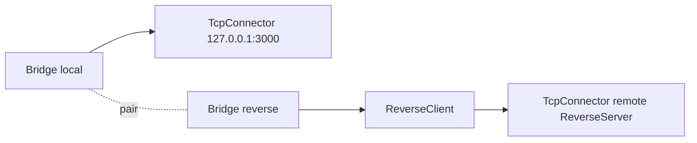
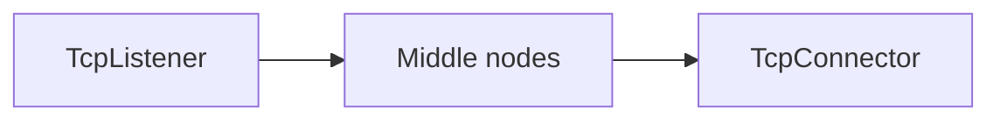
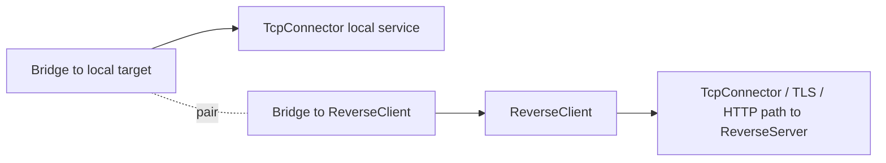

<!--
Documentation version: 156
-->

# ReverseClient


## نمای کلی {#overview}

`ReverseClient` سمت کلاینت در تونل معکوس است. این گره تعدادی اتصال
ازپیش‌بازشده و آماده به سمت `ReverseServer` نگه می‌دارد. هر زمان سمت سرور به
یک مسیر واقعی نیاز داشته باشد، یکی از این اتصال‌ها از مخزن خارج و به یک
line در سمت محلی متصل می‌شود تا تونل از مسیر ماشین کلاینت به سمت مقصد محلی ادامه یابد.

این گره معمولاً روی ماشینی قرار می‌گیرد که امکان برقراری اتصال خروجی دارد،
اما نمی‌تواند اتصال مستقیم ورودی بپذیرد.

کلاینت پیش از مقداردهی اولیهٔ شاخه‌ها، روی هر دو خط تحت مالکیت خود TCP را
ثبت می‌کند.

## جایگاه معمول در زنجیره {#typical-placement}

<a id="جایگاه-رایج"></a>

ساختار سمت کلاینت:

```text
Bridge(local target side) <-> Bridge(to ReverseClient) -> ReverseClient -> outbound peer path
```

نمونه ساده:



مسیر خروجی به همتا می‌تواند TCP ساده باشد یا شامل TLS، HTTP، Reality، Mux یا سایر گره‌های انتقال باشد، تا زمانی که در نهایت به `ReverseServer` متناظر برسد.

### هم‌جواری الزامی در زنجیره {#required-chain-adjacency}

<a id="همجواری-الزامی-در-زنجیره"></a>

گره `Bridge` باید دقیقاً قبل از `ReverseClient` قرار بگیرد: `Bridge -> ReverseClient`.
هیچ گره‌ای نباید بین این دو قرار بگیرد. در سمت سرور نیز `Bridge` باید دقیقاً بعد
از `ReverseServer` باشد: `ReverseServer -> Bridge`، بدون هیچ گره واسط.

این‌ها قواعد طراحی زنجیره هستند و کاربر باید هنگام طراحی آن‌ها را رعایت کند.
کد هیچ‌یک از این دو شرط هم‌جواری را به‌صورت خودکار بررسی و اعمال نمی‌کند.
گره‌های لایهٔ انتقال یا پردازش باید بیرون از این دو فاصله قرار بگیرند؛ مسیر خروجی
بعد از `ReverseClient` همچنان می‌تواند شامل گره‌های لایهٔ انتقال نشان‌داده‌شده در نمودار جایگاه باشد.

## نمونهٔ کاربردی ساده {#minimal-practical-example}

JSON زیر **قطعهٔ گره** است و پیکربندی کامل نیست. جفت Bridge و گره معکوس همتای دوردست را مطابق بالا پیکربندی کنید؛ `shared-secret` و نام گره‌های انتقال و سرویس را با مقادیر استقرار خود جایگزین کنید.

### نمونهٔ پیکربندی {#configuration-example}

<a id="نمونه-تنظیم"></a>

```json
{
  "name": "reverse-client",
  "type": "ReverseClient",
  "settings": {
    "minimum-unused": 16,
    "reverse-secret-length": 640,
    "reverse-secret": "shared-secret"
  },
  "next": "outbound-to-reverse-server"
}
```

## پیکربندی {#configuration}

### فیلدهای الزامی {#required-fields}

<a id="فیلدهای-اجباری"></a>

فیلدهای سطح بالا:

| فیلد | نوع | توضیح |
| --- | --- | --- |
| `name` | رشته | نام انتخابی کاربر که باید در فایل پیکربندی یکتا باشد. |
| `type` | رشته | باید دقیقاً `"ReverseClient"` باشد. |
| `next` | رشته | اجباری در پیکربندی‌های عملی. مسیر خروجی به همتا به سمت `ReverseServer`. |

`settings` می‌تواند حذف شود یا خالی باشد. اگر موجود باشد، باید شیء باشد.

## کاربرد و رفع اشکال {#usage-and-troubleshooting}

### نمونه با Bridge {#bridge-oriented-example}

<a id="نمونه-با-bridge"></a>

نمونهٔ ساده با Bridge:


```json
{
  "name": "outbound_to_core",
  "type": "TcpConnector",
  "settings": {
    "address": "127.0.0.1",
    "port": 3000,
    "nodelay": true
  }
}
```

```json
{
  "name": "bridge_local",
  "type": "Bridge",
  "settings": {
    "pair": "bridge_reverse"
  },
  "next": "outbound_to_core"
}
```

```json
{
  "name": "bridge_reverse",
  "type": "Bridge",
  "settings": {
    "pair": "bridge_local"
  },
  "next": "reverse_client"
}
```

```json
{
  "name": "reverse_client",
  "type": "ReverseClient",
  "settings": {
    "minimum-unused": 4
  },
  "next": "outbound_to_peer"
}
```

```json
{
  "name": "outbound_to_peer",
  "type": "TcpConnector",
  "settings": {
    "address": "198.51.100.10",
    "port": 8443,
    "nodelay": true
  }
}
```

این‌ها قطعه‌های گره هستند. [مثال کامل دوماشینه‌ی Bridge](Bridge.mdx#reverseclient-layout)
نحوه‌ی قرارگرفتن آن‌ها در فایل‌های پیکربندی را نشان می‌دهد: سرویس خصوصی روی
`127.0.0.1:3000` است، دروازه عمومی پیوندهای معکوس را روی
`198.51.100.10:8443` می‌گیرد و ورودی کاربر روی دروازه برابر با
`127.0.0.1:18080` است. فهرست مجاز آدرس خروجی عمومی ماشین خصوصی را دارد، نه آدرس
خود دروازه را.

### نکته‌های عملی {#practical-notes}

<a id="نکتههای-عملی"></a>

- `minimum-unused` میان تأخیر و ظرفیت تعادل ایجاد می‌کند. مقدار بیشتر، اتصال‌های خروجی آماده بیشتری نگه می‌دارد.
- اتصال‌های از قبل باز شده عمداً بیکار هستند. آن‌ها را به‌عنوان نشت اتصال در نظر نگیرید.
- تنظیمات راز مشترک پیوند معکوس را در هر دو همتا یکسان نگه دارید.
- برای اتصال سمت مقصد محلی از `Bridge` استفاده کنید و فیلدهای سفارشی برای زنجیره نسازید.
- مسیر خروجی به همتا می‌تواند شامل گره‌های انتقال یا امنیت دیگر باشد، اما باید اتصال جریان بایتی به `ReverseServer` متناظر را حفظ کند.

## رفتار پیشرفته {#advanced-behavior}

### چرا این ساختار از Bridge استفاده می‌کند {#why-this-layout-uses-bridge}

<a id="چرا-در-این-ساختار-از-bridge-استفاده-میشود"></a>

در بیشتر زنجیره‌های WaterWall مسیر ساده چپ به راست است:



اما `ReverseClient` شکل متفاوتی دارد. از یک طرف باید اتصال‌های آماده به
سمت همتا یعنی `ReverseServer` بسازد. از طرف دیگر، وقتی یکی از آن اتصال‌ها
فعال شد، باید آن را به مقصد محلی مثل xray-core، سرویس SOCKS محلی یا یک نقطهٔ پایانی TCP محلی وصل کند.

چون در مدل WaterWall هر گره فقط یک `next` دارد، به‌جای اضافه کردن فیلدهای
خاصی مثل `next-peer` و `next-core`، از یک جفت `Bridge` استفاده می‌شود:



در این ساختار:

- `ReverseClient.next` مسیر همتا است که در نهایت به `ReverseServer` می‌رسد.
- مسیر مقصد محلی از سمت قبلی `ReverseClient` و با جفت `Bridge` متصل می‌شود.
- با فعال شدن پیوند معکوس، `ReverseClient` سمت محلی را برای گره قبلی مقداردهی اولیه می‌کند.

پیش از طراحی توپولوژی معکوس، صفحهٔ `Bridge` را بخوانید. گره‌های Reverse به این وارونگی جهت و [هم‌جواری الزامی](#required-chain-adjacency) وابسته‌اند.

### دست‌دهی پیوند معکوس {#reverse-link-handshake}

<a id="handshake-داخلی"></a>

هر اتصال معکوس آماده ابتدا یک دست‌دهی داخلی می‌فرستد.

دست‌دهی پیش‌فرض:

```text
640 bytes of 0xFF
```

اگر `reverse-secret` تنظیم شده باشد، هر بایت پیش‌فرض با بایت متناظر از راز مشترک ASCII به شکل تکرارشونده XOR می‌شود تا `reverse-secret-length` بایت تولید شود.

این دست‌دهی بخشی از داده کاربر نیست؛ تنها به `ReverseServer` کمک می‌کند پیوندهای معکوس آماده را از اتصال‌های محلی/کاربر تشخیص دهد.

### رفتار راه‌اندازی و مخزن {#startup-and-pool-behavior}

<a id="رفتار-startup-و-pool"></a>

هنگام راه‌اندازی، `ReverseClient` روی همه worker‌ها پیوندهای معکوس خروجی می‌سازد تا تعداد اتصال‌های آماده به مقدار هدف برسد.

برای هر worker:

- پیوندهای معکوس در حال اتصال
- پیوندهای معکوس برقرار‌شده ولی هنوز استفاده‌نشده

را جداگانه دنبال می‌کند.

اگر مجموع این دو از `minimum-unused` کمتر باشد، گره ساخت اتصال‌های معکوس بیشتری را روی آن worker زمان‌بندی می‌کند.

وقتی سمت `next` برقراری اتصال را در جهت downstream اعلام کند، پیوند فقط اگر هنوز در حال اتصال باشد به مخزن
آماده اضافه می‌شود. فعال‌سازی می‌تواند پس از Init مسیر لایهٔ انتقال و پیش از Est
برسد؛ تکمیل آن، پیوند را مستقیماً از حالت در حال اتصال به حالت فعال می‌برد. Est دیرهنگام یا
تکراری فقط آمادگی لایهٔ انتقال را ثبت می‌کند و نه شمارنده‌های جفت فعال را تغییر
می‌دهد و نه پیوند آمادهٔ جایگزین دیگری ایجاد می‌کند.

## جزئیات پیاده‌سازی {#implementation-details}

### عملکرد {#what-it-does}

<a id="این-نود-چه-میکند"></a>

- پیوندهای معکوس خروجی را از سمت `next` ایجاد می‌کند.
- روی هر پیوند معکوس یک دست‌دهی داخلی می‌فرستد.
- برای هر worker تعداد مشخصی اتصال آماده و استفاده‌نشده نگه می‌دارد.
- اتصال‌های در حال اتصال و اتصال‌های آماده را جداگانه می‌شمارد.
- وقتی سمت دوردست روی یکی از پیوندهای معکوس داده واقعی بفرستد، آن پیوند را از مخزن خارج و جفت می‌کند.
- با مصرف شدن یک پیوند آماده، line جفت‌شده رو به سمت محلی را برای گره قبلی مقداردهی اولیه می‌کند.
- داده، پایان، توقف و ازسرگیری را بین دو سمت جفت‌شده عبور می‌دهد.
- بعد از مصرف یا بسته شدن اتصال، ظرفیت آماده را دوباره پر می‌کند.
- اتصال آماده‌ای را که حدود ۳۰ ثانیه بدون استفاده بماند می‌بندد و جایگزین می‌کند.

`ReverseClient` نه شنونده معمولی است و نه اتصال‌دهنده معمولی. line‌های داخلی را خودش می‌سازد و با callback‌های عادی next/previous در WaterWall، مسیر همتا را به مسیر محلی متصل می‌کند.

### تنظیمات اختیاری {#optional-settings}

<a id="تنظیمات-اختیاری"></a>

| گزینه | نوع | پیش‌فرض | توضیح |
| --- | --- | --- | --- |
| `minimum-unused` | عدد صحیح | `workers * 4` | حداقل تعداد پیوند معکوس آماده برای هر تونل. باید بزرگ‌تر از `0` باشد. |
| `reverse-secret-length` | عدد صحیح | `640` | طول دست‌دهی داخلی. باید در بازه <code dir="ltr">1..1024</code> باشد. |
| `reverse-secret` | رشتهٔ ASCII | تنظیم‌نشده | بایت‌های دست‌دهی پیش‌فرض را با این راز مشترک به‌صورت تکرارشونده XOR می‌کند. وقتی تنظیم شود باید رشتهٔ ASCII غیرخالی باشد. |

`ReverseClient`، `ReverseServer` و هر `SniffRouter` که پیوند معکوس را تشخیص می‌دهد باید مقدارهای یکسانی برای `reverse-secret-length` و `reverse-secret` داشته باشند.

در مستندات قدیمی آمده بود که تغییر دست‌دهی به ویرایش منبع نیاز دارد. در نسخه فعلی این دو گزینه مستقیماً از پیکربندی قابل تنظیم‌اند.

### جریان فعال‌سازی {#activation-flow}

<a id="جریان-فعالسازی"></a>

پیوند معکوس آماده پس از دریافت کامل پیام فعال‌سازی یک‌باره از ReverseServer
فعال می‌شود. هدر چهار بایتی big-endian طول کل پیام را مشخص می‌کند؛ طول شامل
هدر است و باید در بازه <code dir="ltr">4..65536</code> باشد. پدینگ تصادفی به‌صورت تدریجی با حافظهٔ موقت چهار
بایتی و فضای موقت برابر 256 بایت کنار گذاشته می‌شود و تخصیص حافظه به اندازه طول
اعلام‌شده لازم نیست. هدر یا پدینگ تکه‌تکه و داده برنامه همراه پیام پشتیبانی
می‌شوند. طول نامعتبر جفت را می‌بندد؛ مهلت موجود ۳۰ ثانیه‌ای پیام ناقص را هم
پوشش می‌دهد.

بعد از مصرف پیام، پیوند از شمارنده در حال اتصال یا استفاده‌نشده و جدول بیکار خارج می‌شود، شمارنده فعال
افزایش می‌یابد، پیوند آماده جایگزین زمان‌بندی می‌شود و line مقصد به سمت گره قبلی
مقداردهی اولیه می‌شود. مقصد می‌تواند حتی بدون دریافت داده از کاربر، پیام آغازین بفرستد.
هدر و پدینگ به مقصد نمی‌رسند. داده باقی‌مانده به ترتیب عبور می‌کند و همه
تحویل‌های بعدی مستقیم‌اند. پس از آن قالب فعال‌سازی دیگری وجود ندارد و ReverseClient
گزینه‌ای برای بازهٔ اندازهٔ سرور ندارد. ورودی تودرتوی برنامه در حین Init مقصد
یا تحویل اولیه، پشت بایت‌های قدیمی‌تر در FIFO قرار می‌گیرد. بدنهٔ اولیه و ورودی‌های
صف‌شده از بودجهٔ مشترک 2 MiB بایت منطقی و 8 MiB هزینهٔ صف استفاده می‌کنند. ورودی تو در تو در یک نوبت ارسال اولیه محدودیت تجمعی جداگانهٔ 2 MiB و 1,024 تحویل دارد. ورودی
خالی بازیافت می‌شود؛ سرریز، جفت را می‌بندد. داده آماده مستقیم عبور
می‌کند و از این داده‌های معوق استفاده نمی‌کند.

بعد از جفت شدن:

| مسیر | جریان |
| --- | --- |
| محلی به دوردست | گره قبلی -> `ReverseClient` -> گره بعدی |
| دوردست به محلی | گره بعدی -> `ReverseClient` -> گره قبلی |

callback‌های Pause و Resume، شامل پیام‌های تکراری، میان دو line جفت‌شده عبور
داده می‌شوند. پیش از Init مقصد، آخرین Pause مسیر لایهٔ انتقال نگه داشته می‌شود و
Resume آن را لغو می‌کند. Pause باقی‌مانده پس از بازگشت Init و پیش از بدنه اولیه
به مقصد اعلام می‌شود. داده پذیرفته‌شده حتی در حالت Pause به ترتیب FIFO تخلیه
می‌شود. گره فعال می‌ماند، چون هر تحویل میان دو line متفاوت نگاشت می‌شود.

### رفتار Finish و جایگزینی {#finish-and-replacement-behavior}

<a id="رفتار-finish-و-جایگزینی"></a>

اگر یک پیوند جفت‌شده از هر سمت بسته شود:

- وضعیت داخلی هر دو line از بین می‌روند
- سمت همتا با `Finish` بسته می‌شود
- line‌های داخلی را `ReverseClient` از بین می‌برد، چون خودش آن‌ها را ساخته است
- شمارنده فعال کاهش می‌یابد
- ساخت یک پیوند معکوس جایگزین زمان‌بندی می‌شود

اگر یک پیوند معکوس آماده قبل از جفت شدن بسته شود:

- شمارنده‌های اتصال‌های در حال اتصال یا استفاده‌نشده به‌روز می‌شوند
- ورودی جدول بیکار آن حذف می‌شود
- هر دو line داخلی از بین می‌روند
- ساخت یک جایگزین زمان‌بندی می‌شود

اگر یک پیوند آماده حدود ۳۰ ثانیه (`30 seconds`) استفاده نشده باشد، مهلت بیکاری آن را می‌بندد و جایگزین می‌کند.

### جهت‌ها و چرخهٔ عمر {#direction-and-lifecycle-notes}

<a id="جهتها-و-lifecycle"></a>

`ReverseClient` line‌های داخلی خودش را می‌سازد. فراخوانی مستقیم `Init` از خارج در جهت upstream یا downstream بخشی از مسیر عادی این گره نیست.

| callback | رفتار |
| --- | --- |
| upstream `Init` | غیرفعال؛ به‌عنوان استفادهٔ نادرستِ منجر به توقف فرایند در نظر گرفته می‌شود. |
| downstream `Init` | غیرفعال؛ به‌عنوان استفادهٔ نادرستِ منجر به توقف فرایند در نظر گرفته می‌شود. |
| downstream `Est` از سمت next | آمادگی لایهٔ انتقال را ثبت می‌کند؛ پیوند هنوز در حال اتصال را فقط یک بار به استفاده‌نشده می‌برد. |
| downstream `Payload` از سمت next | یک پیوند معکوس آماده را فعال می‌کند یا داده را به line جفت‌شده سمت previous می‌فرستد. |
| upstream `Payload` از سمت previous | داده سمت محلی را به پیوند معکوس خروجی جفت‌شده می‌فرستد. |
| `Finish` | هر دو line داخلی را برای پیوندهای جفت‌شده می‌بندد؛ شمارنده‌ها را پاک و ظرفیت را جایگزین می‌کند. |

### متادیتای گره {#node-metadata}

<a id="متادیتای-نود"></a>

`ReverseClient` پس از دست‌دهی خودش داده را قاب‌بندی نمی‌کند؛ بنابراین به فضای خالی در ابتدای بافر نیاز ندارد.

متادیتای برگرفته از کد منبع:

| ویژگی | مقدار |
| --- | --- |
| پرچم‌های گره | `kNodeFlagSupportsSplice` |
| `can_have_prev` | `true` |
| `can_have_next` | `true` |
| `layer_group` | `kNodeLayer4` |
| `layer_group_prev_node` | `kNodeLayer4Stream` |
| `layer_group_next_node` | `kNodeLayer4Stream` |
| `required_padding_left` | `0` بایت |

### پشتیبانی splice {#splice-support}

<a id="پشتیبانی-splice"></a>

دست‌دهی در حافظهٔ عادی ساخته می‌شود. تجزیه‌گر فعال‌سازی فقط بایت‌های پیشوند را
با توابع کمکیِ آگاه از شکل ذخیره‌سازی مصرف می‌کند؛ بدنه برنامه همراه آن می‌تواند
pipe خصوصی خود را حفظ کند. داده آماده در هر دو جهت بدون تغییر عبور می‌کند.
ورودی‌های بازگشتی هنگام شروع، شکل ذخیره‌سازی عادی یا pipe خصوصی خود را در FIFO حفظ می‌کنند. بسته شدن در Init مقصد
داده نگه‌داشته‌شده را دقیقاً یک بار آزاد می‌کند. هر دو گره معکوس از زنجیره واجد
شرایط splice پشتیبانی می‌کنند؛ مجاورت مستقیم Bridge -> ReverseClient حفظ می‌شود.

بافر‌های عادی در مسیر جایگزین همچنان پذیرفته می‌شوند. splice زمانی فعال می‌شود که ساخت لینوکس از آن پشتیبانی کند، `misc.splice` فعال باشد، زنجیره هیچ گره از نوع بسته نداشته باشد و همهٔ گره‌های زنجیره نهایی پس از گسترش و ادغام از splice پشتیبانی کنند. اعلام پرچم این قابلیت جای این بررسی‌ها را نمی‌گیرد. بهبود کارایی باید با اندازه‌گیری تأیید شود.
