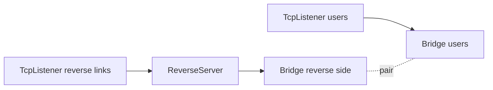
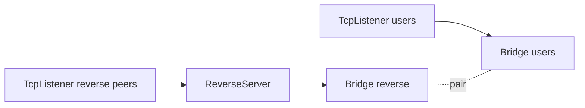

<!--
Documentation version: 156
-->

# ReverseServer

`ReverseServer` همتای سمت server برای `ReverseClient` است. از یک طرف
reverse connection‌های آماده `ReverseClient` و از طرف دیگر connection‌های واقعی
user/local را می‌پذیرد؛ سپس یک connection از هر طرف را با هم جفت می‌کند تا ترافیک از reverse
tunnel عبور کند.

این node معمولاً روی ماشینی در دسترس قرار می‌گیرد که می‌تواند هم connection‌های
peer و هم connection‌های user/local را بپذیرد.

## چرا معمولاً Bridge لازم است

`ReverseServer` باید دو منبع connection را به هم وصل کند:

- reverse link‌هایی که از `ReverseClient` آمده‌اند
- connection‌های واقعی user/local که باید از آن reverse link‌ها استفاده کنند

در config‌های رایج این دو مسیر با یک جفت `Bridge` وصل می‌شوند:



listener مربوط به peer‌ها reverse link‌ها را به `ReverseServer` می‌رساند و listener مربوط به کاربران ترافیک واقعی را به `Bridge` متناظر می‌دهد. سپس `ReverseServer` یک reverse half را با یک local/user half جفت می‌کند.

در نتیجه `ReverseServer` یک tunnel ساده از چپ به راست نیست، بلکه به‌صورت پویا دو نوع connection را با هم تطبیق می‌دهد.

node بعدی `ReverseServer` باید مستقیماً `Bridge` باشد: `ReverseServer -> Bridge`، بدون هیچ node واسطه. قاعدهٔ متناظر در سمت کلاینت نیز `Bridge -> ReverseClient` است و بین این دو node هم نباید node دیگری قرار بگیرد. رعایت این قواعد در طراحی chain بر عهدهٔ کاربر است؛ کد هیچ‌یک از این دو قاعدهٔ مجاورت را به‌صورت خودکار بررسی و اعمال نمی‌کند.

## این node چه می‌کند؟ {#این-نود-چه-میکند}

- reverse link‌های آمده از `ReverseClient` را می‌پذیرد.
- handshake داخلی reverse link را اعتبارسنجی می‌کند.
- connection‌های local/user را از سمت دیگر topology می‌پذیرد.
- تا پیدا شدن peer، مقدار محدودی داده را در buffer نگه می‌دارد.
- یک reverse half و یک local/user half را pair می‌کند.
- payload، finish، pause و resume را بین دو سمت paired عبور می‌دهد.
- handshake‌های نامعتبر را کنار می‌گذارد.
- اگر حجم داده ذخیره‌شده در buffer بیش از حد شود، half منتظر را کنار می‌گذارد.
- برای جفت‌سازی میان worker‌ها می‌تواند reverse half را از طریق pipe داخلی به worker دیگری منتقل کند.

## جایگاه رایج

```text
peer listener -> ReverseServer -> Bridge(reverse side)
user listener -> Bridge(user side)
```

نمونه topology:



معمولاً روی listener مربوط به reverse peer‌ها whitelist قرار می‌دهیم تا فقط ماشین `ReverseClient` بتواند reverse link باز کند.

## نمونه تنظیم

```json
{
  "name": "reverse-server",
  "type": "ReverseServer",
  "settings": {
    "reverse-secret-length": 640,
    "reverse-secret": "shared-secret"
  },
  "next": "bridge_reverse"
}
```

نمونه کامل با Bridge:

```json
{
  "name": "users_inbound",
  "type": "TcpListener",
  "settings": {
    "address": "0.0.0.0",
    "port": 443,
    "nodelay": true
  },
  "next": "bridge_users"
}
```

```json
{
  "name": "bridge_users",
  "type": "Bridge",
  "settings": {
    "pair": "bridge_reverse"
  }
}
```

```json
{
  "name": "bridge_reverse",
  "type": "Bridge",
  "settings": {
    "pair": "bridge_users"
  }
}
```

```json
{
  "name": "reverse_server",
  "type": "ReverseServer",
  "settings": {},
  "next": "bridge_reverse"
}
```

```json
{
  "name": "reverse_peer_inbound",
  "type": "TcpListener",
  "settings": {
    "address": "0.0.0.0",
    "port": 8443,
    "nodelay": true,
    "whitelist": [
      "203.0.113.10/32"
    ]
  },
  "next": "reverse_server"
}
```

در سناریوی واقعی معمولاً TLS، HTTP، Mux، Reality یا سایر transport/security node‌ها قبل از `ReverseServer` اضافه می‌شوند.

## فیلدهای اجباری

فیلدهای top-level:

| فیلد | نوع | توضیح |
| --- | --- | --- |
| `name` | string | نام یکتای node داخل config. |
| `type` | string | باید دقیقاً `"ReverseServer"` باشد. |
| `next` | string | اجباری در layout های Bridge عملی. باید نام Bridge مجاور را مشخص کند که به user/local traffic منتهی می‌شود؛ هیچ node واسطه‌ای مجاز نیست. |

`settings` می‌تواند حذف شود یا خالی باشد. اگر موجود باشد، باید object باشد.

## تنظیمات اختیاری

| گزینه | نوع | پیش‌فرض | توضیح |
| --- | --- | --- | --- |
| `activation-min-size` | integer | `64` | حداقل طول کل پیام فعال‌سازی با header چهار بایتی؛ `4..65536`. |
| `activation-max-size` | integer | `1024` | حداکثر طول کل پیام؛ `4..65536` و `min <= max`. |
| `reverse-secret-length` | integer | `640` | طول handshake داخلی. باید در بازه `1..1024` باشد. |
| `reverse-secret` | ASCII string | unset | بایت‌های handshake مورد انتظار را با secret به‌صورت تکرارشونده XOR می‌کند. وقتی تنظیم شود باید ASCII غیرخالی باشد. |

`ReverseServer` و `ReverseClient` و هر `SniffRouter` که reverse link را تشخیص می‌دهد
باید برای `reverse-secret-length` و `reverse-secret` مقدارهای یکسانی داشته باشند.
بازه فعال‌سازی فقط در ReverseServer تنظیم می‌شود.

## handshake داخلی {#handshake-داخلی}

reverse-link side با یک handshake داخلی از `ReverseClient` شناخته می‌شود.

handshake پیش‌فرض مورد انتظار:

```text
640 bytes of 0xFF
```

اگر `reverse-secret` تنظیم شده باشد، همان XOR transformation که توسط `ReverseClient` استفاده می‌شود قبل از مقایسه اعمال می‌شود.

`ReverseServer` بایت‌های handshake را به‌صورت تدریجی مقایسه می‌کند و فقط offset
بایت‌های تأییدشده را تا کامل شدن handshake نگه می‌دارد:

- اگر handshake match باشد، بایت‌های آن حذف می‌شوند
- هر payload پس از handshake به‌عنوان داده ذخیره‌شده در buffer نگه داشته می‌شود
- اگر handshake اشتباه باشد، آن reverse-link half کنار گذاشته می‌شود

## مدل Two-Sided Matching

`ReverseServer` برای هر worker دو لیست انتظار نگه می‌دارد:

| half منتظر | معنی |
| --- | --- |
| reverse-link half | connection آمده از `ReverseClient` که handshake را پاس کرده است. |
| local/user half | connection واقعی که منتظر reverse link است. |

وقتی payload روی یک reverse-link half غیر-paired برسد:

1. بایت‌های handshake به‌صورت تدریجی مقایسه می‌شوند
2. handshake کامل و معتبر، half را وارد لیست انتظار reverse می‌کند
3. دادهٔ برنامهٔ همراه آن پیش از callbackها وارد FIFO محدود می‌شود
4. source در حالت انتظار Pause می‌شود و matching محلی یا بین workerها انجام می‌شود

local/user half در Init وارد لیست انتظار می‌شود و همان موقع pair شدن را امتحان
می‌کند؛ ارسال نخستین payload لازم نیست. داده زودهنگام تا آماده شدن peer در
buffer نگه داشته می‌شود. داده‌های منتظر برنامه پس از pair شدن هم در حالت Pause
مصرف‌کننده در صف می‌مانند.
پس از Est، source کاربرِ بدون peer Pause می‌شود. source سمت reverse هم پس از
handshake کامل و معتبر تا pair شدن نگه داشته می‌شود. پس از فعال‌سازی و تخلیهٔ
داده‌های قدیمیِ مجاز، این hold آزاد می‌شود؛ Pause مصرف‌کننده همچنان مانع Resume
source مربوطه است. hold و فشار مصرف‌کننده در انتقال بین workerها حفظ می‌شوند.

بعد از pair شدن:

| سمت ورودی | رفتار forwarding |
| --- | --- |
| reverse-link payload | در جهت upstream به سمت local/user فرستاده می‌شود. |
| local/user payload | در جهت downstream به سمت reverse link فرستاده می‌شود. |
| finish از هر سمت | سمت مقابل را می‌بندد. |
| pause/resume | به paired peer half منعکس می‌شود. |

## پیام فعال‌سازی با طول متغیر

هر pair دقیقاً یک پیام فعال‌سازی پیش از بایت‌های برنامه می‌فرستد:

```text
4-byte big-endian total length | random padding | direct application stream
```

طول کل شامل header چهار بایتی است و در بازه `4..65536` قرار دارد.
`activation-min-size` با پیش‌فرض `64` و `activation-max-size` با پیش‌فرض `1024`
فقط در ReverseServer تنظیم می‌شوند. طول هر پیام به‌صورت تصادفی و شامل دو سر بازه
انتخاب می‌شود. هر دو مقدار باید integer در بازه `4..65536` باشند و `min <= max` باشد.
ReverseClient طول را از خود پیام می‌خواند و به تنظیم بازه یکسان نیازی ندارد.

ReverseClient پیام را کامل مصرف می‌کند و سپس line مقصد را باز می‌کند؛ در نتیجه
کاربر بدون ارسال داده هم می‌تواند greeting مقصد را دریافت کند. این prefix برای
کاربری که فوراً داده می‌فرستد هم فقط یک بار و پیش از داده‌های برنامه ارسال می‌شود.
header و padding به مقصد نمی‌رسند و پس از آن stream مستقیم است. پیام تکه‌تکه یا
پیامی که با داده برنامه در یک read برسد هم پشتیبانی می‌شود.

ReverseServer پیام فعال‌سازی را دقیقاً یک بار، حتی در حالت Pause سمت reverse،
در buffer جداگانه و بدون دادهٔ برنامه تحویل می‌دهد. داده‌های ذخیره‌شدهٔ برنامه
همچنان تا Resume منتظر می‌مانند و ترتیب FIFO در callbackهای شروع حفظ می‌شود.
transport دریافت‌کننده ممکن است پیام فعال‌سازی را تا امکان نوشتن در صف نگه دارد.
payload آماده پس از شروع به‌صورت مستقیم عبور می‌کند.

طول تصادفی اندازه ثابت پیام فعال‌سازی را حذف می‌کند، اما بدون transport رمزگذاری‌شده،
فیلد طول و زمان‌بندی ترافیک قابل مشاهده‌اند؛ این روش تضمین عدم fingerprint نیست.

## مدل جهت‌ها

| callback | رفتار |
| --- | --- |
| upstream `Init` | یک reverse-link half را مقداردهی اولیه می‌کند و فوراً برقراری downstream را به previous side گزارش می‌دهد. |
| upstream `Payload` | پیش از جفت شدن، handshake مربوط به `ReverseClient` را پردازش می‌کند؛ پس از جفت شدن نیز payload را با `tunnelNextUpStreamPayload()` به سمت local/user می‌فرستد. |
| downstream `Init` | local/user half را مقداردهی اولیه و ثبت می‌کند، برقراری upstream را گزارش می‌دهد و بدون payload جفت‌سازی را آغاز می‌کند. |
| downstream `Payload` | منتظر reverse-link half می‌ماند یا با آن جفت می‌شود؛ پس از جفت شدن نیز payload را با `tunnelPrevDownStreamPayload()` به سمت reverse می‌فرستد. |
| `Pause` / `Resume` | فقط پس از جفت شدن دو half عبور داده می‌شوند. |
| `Finish` | half‌های جفت‌نشده منتظر را حذف می‌کند یا peer half جفت‌شده را با `Finish` می‌بندد. |

callback فوری establishment فقط به این معناست که `ReverseServer` آن half را پذیرفته است؛ نه اینکه tunnel حتماً جفت شده و payload مفیدی را عبور می‌دهد.

## Cross-worker Pairing {#cross-worker-pairing}

ورود user جدید به worker یک reverse peer منتظر اطلاع داده می‌شود؛ هر دو ترتیب ورود بدون payload تازه pair شدن را شروع می‌کنند. پیام worker حاوی line pointer خارجی نیست.

لیست‌های انتظار per-worker هستند. اگر یک reverse-link half روی یک worker برسد و یک local/user half روی worker دیگری منتظر باشد، `ReverseServer` می‌تواند reverse-link half را از یک pipe tunnel layer داخلی عبور دهد و pair را روی target worker کامل کند.

به همین دلیل reverse setup حتی زمانی کار می‌کند که دو half را worker thread یکسانی نپذیرفته باشد.

## محدودیت buffer {#محدودیت-buffer}

هر half یک FIFO برای دادهٔ برنامه با سقف شامل **2 MiB بایت منطقی و 1024 buffer**
دارد که مستقل از RAM profile است. دادهٔ انتظار و بازپخش اولیه از همین بودجه
استفاده می‌کنند. ورودی TCP خالی entry مصرف نمی‌کند؛ offset handshake و پیام
فعال‌سازی جداگانه، metadata پروتکل هستند.

رد شدن admission، half منتظر یا هر دو half یک pair را می‌بندد. payload آماده
مستقیم عبور می‌کند و سقف backlog روی آن اعمال نمی‌شود.

`ReverseServer` پیام فعال‌سازی را در buffer جداگانه می‌سازد و به left padding اضافی نیاز ندارد.

## نکته‌های عملی

- تنظیمات reverse secret را در هر دو peer یکسان نگه دارید.
- روی listener ای که reverse link‌ها را از ماشین `ReverseClient` می‌پذیرد، access control مثل `TcpListener.whitelist` اعمال کنید.
- از `Bridge` برای وصل کردن سمت user/local traffic به شکل تمیز استفاده کنید.
- handshake‌های نامعتبر reverse link کنار گذاشته می‌شوند.
- payload‌های بزرگ و جفت‌نشده پس از عبور از محدودیت buffer کنار گذاشته می‌شوند.
- `ReverseServer` کاملاً به `ReverseClient` وابسته است؛ آن را با client عمومی‌ای که reverse handshake مورد انتظار را نمی‌فرستد جفت نکنید.

## پشتیبانی از splice

تا زمانی که هر half جفت نشده است، `ReverseServer` کل payload مبتنی بر splice
را در هر دو جهت به حافظهٔ عادی تبدیل می‌کند. اعتبارسنجی و حذف handshake، ادغام
buffer‌های انتظار و بازپخش handshake هنگام انتقال به worker دیگر روی buffer‌های
عادی انجام می‌شوند. کامل‌شدن handshake به‌تنهایی این تبدیل را متوقف نمی‌کند؛
buffer‌های انتظار تا پایان pairing عادی می‌مانند. بازپخش اولیه و ورودی که پشت
داده‌های منتظر شروع در صف قرار می‌گیرد هم از حافظهٔ عادی استفاده می‌کند.
payload آمادهٔ pair در هر دو جهت بدون تغییر عبور می‌کند.

`PipeTunnel` داخلی همان قابلیت splice node `ReverseServer` را دارد و buffer‌های
payload را بین worker‌ها منتقل می‌کند. محدودیت‌های انتظار، نگاشت callback‌ها و
مجاورت مستقیم `ReverseServer -> Bridge` همچنان برقرارند. فعال‌شدن splice به
chain نهاییِ واجد شرایط و تنظیم `misc.splice` وابسته است.

## متادیتای node {#متادیتای-نود}

متادیتای برگرفته از کد منبع:

| ویژگی | مقدار |
| --- | --- |
| node flags | `kNodeFlagSupportsSplice` |
| `can_have_prev` | `true` |
| `can_have_next` | `true` |
| `layer_group` | `kNodeLayer4` |
| `layer_group_prev_node` | `kNodeLayer4` |
| `layer_group_next_node` | `kNodeLayer4` |
| `required_padding_left` | `0` بایت |

دادهٔ برنامهٔ نگه‌داشته‌شده در همهٔ RAM profileها سقف 2 MiB / 1024 buffer دارد.
