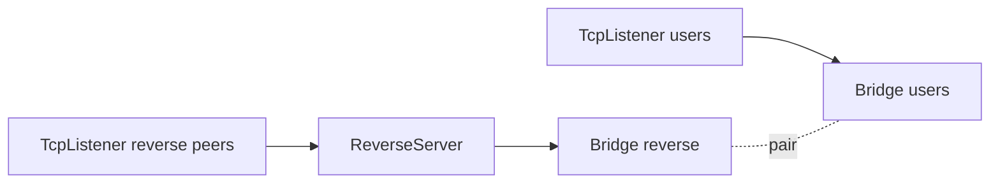
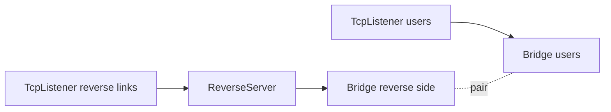

<!--
Documentation version: 158
-->

# ReverseServer


## نمای کلی {#overview}

`ReverseServer` همتای سمت سرور برای `ReverseClient` است. از یک طرف
اتصال‌های معکوس آماده `ReverseClient` و از طرف دیگر اتصال‌های واقعی
کاربر/محلی را می‌پذیرد؛ سپس یک اتصال از هر طرف را با هم جفت می‌کند تا ترافیک از تونل
معکوس عبور کند.

این گره معمولاً روی ماشینی در دسترس قرار می‌گیرد که می‌تواند هم اتصال‌های
همتا و هم اتصال‌های کاربر/محلی را بپذیرد.

## جایگاه معمول در زنجیره {#typical-placement}

<a id="جایگاه-رایج"></a>

ساختار سمت سرور:

```text
peer listener -> ReverseServer -> Bridge(reverse side)
user listener -> Bridge(user side)
```

نمونه توپولوژی:



معمولاً روی شنونده مربوط به همتاهای معکوس فهرست مجاز قرار می‌دهیم تا فقط ماشین `ReverseClient` بتواند پیوند معکوس باز کند.

## نمونهٔ کاربردی ساده {#minimal-practical-example}

JSON زیر **قطعهٔ گره** است و پیکربندی کامل نیست. جفت Bridge و گره معکوس همتای دوردست را مطابق بالا پیکربندی کنید؛ `shared-secret` و نام گره‌های انتقال و سرویس را با مقادیر استقرار خود جایگزین کنید.

### نمونهٔ پیکربندی {#configuration-example}

<a id="نمونه-تنظیم"></a>

```json
{
  "name": "reverse-server",
  "type": "ReverseServer",
  "settings": {
    "reverse-secret-length": 640,
    "reverse-secret": "shared-secret"
  },
  "next": "bridge_reverse"
}
```

## پیکربندی {#configuration}

### فیلدهای الزامی {#required-fields}

<a id="فیلدهای-اجباری"></a>

فیلدهای سطح بالا:

| فیلد | نوع | توضیح |
| --- | --- | --- |
| `name` | رشته | نام انتخابی کاربر که باید در فایل پیکربندی یکتا باشد. |
| `type` | رشته | باید دقیقاً `"ReverseServer"` باشد. |
| `next` | رشته | اجباری در چیدمان‌های عملی Bridge. باید نام Bridge مجاور را مشخص کند که به ترافیک کاربر/محلی منتهی می‌شود؛ هیچ گره واسطه‌ای مجاز نیست. |

`settings` می‌تواند حذف شود یا خالی باشد. اگر موجود باشد، باید شیء باشد.

## کاربرد و رفع اشکال {#usage-and-troubleshooting}

### نمونه با Bridge {#bridge-oriented-example}

<a id="نمونه-با-bridge"></a>

نمونهٔ سادهٔ سمت سرور با Bridge:


```json
{
  "name": "users_inbound",
  "type": "TcpListener",
  "settings": {
    "address": "127.0.0.1",
    "port": 18080,
    "nodelay": true
  },
  "next": "bridge_users"
}
```

```json
{
  "name": "bridge_users",
  "type": "Bridge",
  "settings": {
    "pair": "bridge_reverse"
  }
}
```

```json
{
  "name": "bridge_reverse",
  "type": "Bridge",
  "settings": {
    "pair": "bridge_users"
  }
}
```

```json
{
  "name": "reverse_server",
  "type": "ReverseServer",
  "settings": {},
  "next": "bridge_reverse"
}
```

```json
{
  "name": "reverse_peer_inbound",
  "type": "TcpListener",
  "settings": {
    "address": "0.0.0.0",
    "port": 8443,
    "nodelay": true,
    "whitelist": [
      "203.0.113.20/32"
    ]
  },
  "next": "reverse_server"
}
```

در سناریوی واقعی معمولاً TLS، HTTP، Mux، Reality یا سایر گره‌های انتقال یا امنیت قبل از `ReverseServer` اضافه می‌شوند.

این‌ها قطعه‌های گره هستند. [مثال کامل دوماشینه‌ی Bridge](Bridge.mdx#reverseclient-layout)
نحوه‌ی قرارگرفتن آن‌ها در فایل‌های پیکربندی را نشان می‌دهد: سرویس خصوصی روی
`127.0.0.1:3000` است، دروازه عمومی پیوندهای معکوس را روی
`198.51.100.10:8443` می‌گیرد و ورودی کاربر روی دروازه برابر با
`127.0.0.1:18080` است. فهرست مجاز آدرس خروجی عمومی ماشین خصوصی را دارد، نه آدرس
خود دروازه را.

### نکته‌های عملی {#practical-notes}

<a id="نکتههای-عملی"></a>

- تنظیمات راز مشترک پیوند معکوس را در هر دو همتا یکسان نگه دارید.
- روی شنونده‌ای که پیوندهای معکوس را از ماشین `ReverseClient` می‌پذیرد، کنترل دسترسی مثل `TcpListener.whitelist` اعمال کنید.
- از `Bridge` برای وصل کردن سمت ترافیک کاربر/محلی استفاده کنید.
- دست‌دهی‌های نامعتبر پیوند معکوس کنار گذاشته می‌شوند.
- داده‌های بزرگ و جفت‌نشده پس از عبور از محدودیت بافر کنار گذاشته می‌شوند.
- `ReverseServer` کاملاً به `ReverseClient` وابسته است؛ آن را با کلاینت عمومی‌ای که reverse دست‌دهی مورد انتظار را نمی‌فرستد جفت نکنید.

## رفتار پیشرفته {#advanced-behavior}

### چرا معمولاً Bridge لازم است {#why-bridge-is-usually-needed}

<a id="چرا-معمولاً-bridge-لازم-است"></a>

`ReverseServer` باید دو منبع اتصال را به هم وصل کند:

- پیوندهای معکوسی که از `ReverseClient` آمده‌اند
- اتصال‌های واقعی کاربر/محلی که باید از آن پیوندهای معکوس استفاده کنند

در پیکربندی‌های رایج این دو مسیر با یک جفت `Bridge` وصل می‌شوند:



شنونده مربوط به همتا‌ها پیوندهای معکوس را به `ReverseServer` می‌رساند و شنونده مربوط به کاربران ترافیک واقعی را به `Bridge` متناظر می‌دهد. سپس `ReverseServer` یک نیمهٔ معکوس را با یک نیمهٔ محلی/کاربر جفت می‌کند.

در نتیجه `ReverseServer` یک تونل ساده از چپ به راست نیست، بلکه به‌صورت پویا دو نوع اتصال را با هم تطبیق می‌دهد.

گره بعدی `ReverseServer` باید مستقیماً `Bridge` باشد: `ReverseServer -> Bridge`، بدون هیچ گره واسطه. قاعدهٔ متناظر در سمت کلاینت نیز `Bridge -> ReverseClient` است و بین این دو گره هم نباید گره دیگری قرار بگیرد. رعایت این قواعد در طراحی زنجیره بر عهدهٔ کاربر است؛ کد هیچ‌یک از این دو قاعدهٔ مجاورت را به‌صورت خودکار بررسی و اعمال نمی‌کند.

### دست‌دهی پیوند معکوس {#reverse-link-handshake}

<a id="handshake-داخلی"></a>

سمت پیوند معکوس با یک دست‌دهی داخلی از `ReverseClient` شناخته می‌شود.

دست‌دهی پیش‌فرض مورد انتظار:

```text
640 bytes of 0xFF
```

اگر `reverse-secret` تنظیم شده باشد، همان تبدیل XOR که توسط `ReverseClient` استفاده می‌شود قبل از مقایسه اعمال می‌شود.

`ReverseServer` هر قطعهٔ دست‌دهی را با مقایسهٔ زمان‌ثابت بررسی می‌کند و فقط آفست
بایت‌های دریافت‌شده و نتیجهٔ تجمعی عدم تطابق را نگه می‌دارد. پذیرش یا رد شدن تنها
پس از دریافت تمام طول تنظیم‌شدهٔ دست‌دهی انجام می‌شود، حتی اگر قطعه‌ای قبلی
اشتباه بوده باشد؛ بنابراین بسته‌شدن زودهنگام، درستی پیشوند را آشکار نمی‌کند:

- اگر دست‌دهی منطبق باشد، بایت‌های آن حذف می‌شوند
- هر داده پس از دست‌دهی به‌عنوان داده ذخیره‌شده در بافر نگه داشته می‌شود
- اگر دست‌دهی اشتباه باشد، آن نیمهٔ پیوند معکوس کنار گذاشته می‌شود

### مدل تطبیق دوطرفه {#two-sided-matching-model}

<a id="مدل-two-sided-matching"></a>

`ReverseServer` برای هر worker دو فهرست انتظار نگه می‌دارد:

| نیمه منتظر | معنی |
| --- | --- |
| نیمهٔ پیوند معکوس | اتصال آمده از `ReverseClient` که دست‌دهی را پاس کرده است. |
| نیمهٔ محلی/کاربر | اتصال واقعی که منتظر پیوند معکوس است. |

وقتی داده روی یک نیمهٔ پیوند معکوس جفت‌نشده برسد:

1. بایت‌های دست‌دهی به‌صورت تدریجی مقایسه می‌شوند
2. دست‌دهی کامل و معتبر، نیمه را وارد فهرست انتظار معکوس می‌کند
3. دادهٔ برنامهٔ همراه آن پیش از callbackها وارد FIFO محدود می‌شود
4. منبع در حالت انتظار Pause می‌شود و جفت‌سازی محلی یا بین workerها انجام می‌شود

نیمهٔ محلی/کاربر در Init وارد فهرست انتظار می‌شود و همان موقع جفت شدن را امتحان
می‌کند؛ ارسال نخستین داده لازم نیست. داده زودهنگام تا آماده شدن همتا در
بافر نگه داشته می‌شود. داده‌های منتظر برنامه پس از جفت شدن هم در حالت Pause
مصرف‌کننده در صف می‌مانند.
پس از Est، منبع کاربرِ بدون همتا Pause می‌شود. منبع سمت معکوس هم پس از
دست‌دهی کامل و معتبر تا جفت شدن نگه داشته می‌شود. پس از فعال‌سازی و تخلیهٔ
داده‌های قدیمیِ مجاز، این توقف آزاد می‌شود؛ Pause مصرف‌کننده همچنان مانع Resume
منبع مربوطه است. توقف و فشار مصرف‌کننده در انتقال بین workerها حفظ می‌شوند.

بعد از جفت شدن:

| سمت ورودی | رفتار انتقال |
| --- | --- |
| دادهٔ پیوند معکوس | در جهت upstream به سمت محلی/کاربر فرستاده می‌شود. |
| دادهٔ محلی/کاربر | در جهت downstream به سمت پیوند معکوس فرستاده می‌شود. |
| پایان از هر سمت | داده‌های پذیرفته‌شده را تخلیه می‌کند و سپس سمت مقابل را می‌بندد. |
| توقف/ازسرگیری | به نیمهٔ همتای جفت‌شده منعکس می‌شود. |

### فعال‌سازی با اندازهٔ متغیر {#variable-size-activation}

<a id="پیام-فعالسازی-با-طول-متغیر"></a>

هر جفت دقیقاً یک پیام فعال‌سازی پیش از بایت‌های برنامه می‌فرستد:

```text
4-byte big-endian total length | random padding | direct application stream
```

طول کل شامل هدر چهار بایتی است و در بازه <code dir="ltr">4..65536</code> قرار دارد.
`activation-min-size` با پیش‌فرض `64` و `activation-max-size` با پیش‌فرض `1024`
فقط در ReverseServer تنظیم می‌شوند. طول هر پیام به‌صورت تصادفی و شامل دو سر بازه
انتخاب می‌شود. هر دو مقدار باید عدد صحیح در بازه <code dir="ltr">4..65536</code> باشند و `min <= max` باشد.
ReverseClient طول را از خود پیام می‌خواند و به تنظیم بازه یکسان نیازی ندارد.

ReverseClient پیام را کامل مصرف می‌کند و سپس line مقصد را باز می‌کند؛ در نتیجه
کاربر بدون ارسال داده هم می‌تواند پیام آغازین مقصد را دریافت کند. این پیشوند برای
کاربری که فوراً داده می‌فرستد هم فقط یک بار و پیش از داده‌های برنامه ارسال می‌شود.
هدر و پدینگ به مقصد نمی‌رسند و پس از آن جریان بایتی مستقیم است. پیام تکه‌تکه یا
پیامی که با داده برنامه در یک دریافت برسد هم پشتیبانی می‌شود.

ReverseServer پیام فعال‌سازی را دقیقاً یک بار، حتی در حالت Pause سمت معکوس،
در بافر جداگانه و بدون دادهٔ برنامه تحویل می‌دهد. داده‌های ذخیره‌شدهٔ برنامه
همچنان تا Resume منتظر می‌مانند و ترتیب FIFO در callbackهای شروع حفظ می‌شود.
لایهٔ انتقال دریافت‌کننده ممکن است پیام فعال‌سازی را تا امکان نوشتن در صف نگه دارد.
داده آماده پس از شروع به‌صورت مستقیم عبور می‌کند.

طول تصادفی اندازه ثابت پیام فعال‌سازی را حذف می‌کند، اما بدون لایهٔ انتقال رمزگذاری‌شده،
فیلد طول و زمان‌بندی ترافیک قابل مشاهده‌اند؛ این روش تضمینی در برابر شناسایی اثر انگشت ترافیک نیست.

## جزئیات پیاده‌سازی {#implementation-details}

### عملکرد {#what-it-does}

<a id="این-نود-چه-میکند"></a>

- پیوندهای معکوس آمده از `ReverseClient` را می‌پذیرد.
- دست‌دهی داخلی پیوند معکوس را اعتبارسنجی می‌کند.
- اتصال‌های محلی/کاربر را از سمت دیگر توپولوژی می‌پذیرد.
- تا پیدا شدن همتا، مقدار محدودی داده را در بافر نگه می‌دارد.
- یک نیمهٔ معکوس و یک نیمهٔ محلی/کاربر را جفت می‌کند.
- داده، پایان، توقف و ازسرگیری را بین دو سمت جفت‌شده عبور می‌دهد.
- دست‌دهی‌های نامعتبر را کنار می‌گذارد.
- اگر حجم داده ذخیره‌شده در بافر بیش از حد شود، نیمه منتظر را کنار می‌گذارد.
- برای جفت‌سازی میان worker‌ها می‌تواند نیمهٔ معکوس را از طریق pipe داخلی به worker دیگری منتقل کند.

`ReverseServer` یک آداپتور خالص یا پوشش سادهٔ پروتکل نیست؛ تونل میانی است که هنگام انتظار برای جفت، وضعیت هر line را نگه می‌دارد.

### تنظیمات اختیاری {#optional-settings}

<a id="تنظیمات-اختیاری"></a>

| گزینه | نوع | پیش‌فرض | توضیح |
| --- | --- | --- | --- |
| `activation-min-size` | عدد صحیح | `64` | حداقل طول کل پیام فعال‌سازی با هدر چهار بایتی؛ <code dir="ltr">4..65536</code>. |
| `activation-max-size` | عدد صحیح | `1024` | حداکثر طول کل پیام؛ <code dir="ltr">4..65536</code> و `min <= max`. |
| `reverse-secret-length` | عدد صحیح | `640` | طول دست‌دهی داخلی. باید در بازه <code dir="ltr">1..1024</code> باشد. |
| `reverse-secret` | رشتهٔ ASCII | تنظیم‌نشده | بایت‌های دست‌دهی مورد انتظار را با راز مشترک به‌صورت تکرارشونده XOR می‌کند. وقتی تنظیم شود باید رشتهٔ ASCII غیرخالی باشد. |

`ReverseServer` و `ReverseClient` و هر `SniffRouter` که پیوند معکوس را تشخیص می‌دهد
باید برای `reverse-secret-length` و `reverse-secret` مقدارهای یکسانی داشته باشند.
بازه فعال‌سازی فقط در ReverseServer تنظیم می‌شود.

### مدل جهت‌ها {#direction-model}

<a id="مدل-جهتها"></a>

| callback | رفتار |
| --- | --- |
| upstream `Init` | یک نیمهٔ پیوند معکوس را مقداردهی اولیه می‌کند و فوراً برقراری downstream را به سمت قبلی گزارش می‌دهد. |
| upstream `Payload` | پیش از جفت شدن، دست‌دهی مربوط به `ReverseClient` را پردازش می‌کند؛ پس از جفت شدن نیز داده را با `tunnelNextUpStreamPayload()` به سمت محلی/کاربر می‌فرستد. |
| downstream `Init` | نیمهٔ محلی/کاربر را مقداردهی اولیه و ثبت می‌کند، برقراری upstream را گزارش می‌دهد و بدون داده جفت‌سازی را آغاز می‌کند. |
| downstream `Payload` | منتظر نیمهٔ پیوند معکوس می‌ماند یا با آن جفت می‌شود؛ پس از جفت شدن نیز داده را با `tunnelPrevDownStreamPayload()` به سمت معکوس می‌فرستد. |
| `Pause` / `Resume` | فقط پس از جفت شدن دو نیمه عبور داده می‌شوند. |
| `Finish` | نیمهٔ جفت‌نشده را حذف می‌کند یا پس از تخلیهٔ داده‌های پذیرفته‌شده، نیمهٔ همتا را می‌بندد. |

پس از `Finish` عادی، نیمهٔ باقی‌مانده صف داده‌های پذیرفته‌شدهٔ مربوط به خود را تحویل می‌گیرد. پیشوند فعال‌سازیِ باقی‌مانده پیش از دادهٔ برنامه ارسال می‌شود و ارسال دادهٔ برنامه منتظر `Resume` همان نیمه می‌ماند. این نیمه تا پایان تخلیه به همان جفت تعلق دارد و پس از تحویل داده‌ها یک `Finish` می‌گیرد. اتصال‌های تازه تا پیدا شدن جفت دیگری در صف می‌مانند. بسته‌شدن گیرنده، توقف worker یا گذشت ۳۰ ثانیه از `Finish` مبدأ، باقیماندهٔ تخلیه را لغو می‌کند.

callback فوری اعلام برقراری اتصال فقط به این معناست که `ReverseServer` آن نیمه را پذیرفته است؛ نه اینکه تونل حتماً جفت شده و داده مفیدی را عبور می‌دهد.

### جفت‌سازی میان workerها {#cross-worker-pairing}

ورود کاربر جدید به worker یک همتای معکوس منتظر اطلاع داده می‌شود؛ هر دو ترتیب ورود بدون داده تازه جفت شدن را شروع می‌کنند. پیام worker حاوی اشاره‌گر line خارجی نیست.

فهرست‌های انتظار به‌ازای هر worker هستند. اگر یک نیمهٔ پیوند معکوس روی یک worker برسد و یک نیمهٔ محلی/کاربر روی worker دیگری منتظر باشد، `ReverseServer` می‌تواند نیمهٔ پیوند معکوس را از یک لایهٔ تونل pipe داخلی عبور دهد و جفت را روی worker مقصد کامل کند.

به همین دلیل چیدمان معکوس حتی زمانی کار می‌کند که دو نیمه را رشتهٔ worker یکسانی نپذیرفته باشد.

### محدودیت‌های بافر {#buffering-limits}

<a id="محدودیت-buffer"></a>

هر نیمه یک FIFO برای دادهٔ برنامه با سقف **2 MiB بایت منطقی و 8 MiB هزینهٔ صف**
دارد؛ رسیدن به خود سقف نیز مجاز است و این سقف مستقل از پروفایل RAM است. دادهٔ انتظار و بازپخش اولیه از همین بودجه
استفاده می‌کنند. هر نوبت ارسال بازپخش ورودی تو در تو را جداگانه به مجموع 2 MiB و 1,024 تحویل محدود می‌کند. ورودی TCP خالی بازیافت می‌شود؛ وضعیت مقایسهٔ دست‌دهی و پیشوند
فعال‌سازی جداگانه، متادیتای پروتکل هستند.

رد شدن پذیرش، نیمه منتظر یا هر دو نیمه یک جفت را می‌بندد. داده آماده
مستقیم عبور می‌کند و سقف داده‌های معوق روی آن اعمال نمی‌شود.

### پشتیبانی splice {#splice-support}

<a id="پشتیبانی-از-splice"></a>

تا زمانی که هر نیمه جفت نشده است، `ReverseServer` کل داده مبتنی بر splice
را در هر دو جهت به حافظهٔ عادی تبدیل می‌کند. این شامل اعتبارسنجی و حذف دست‌دهی، FIFOهای
انتظار و بازپخش داده‌ها هنگام انتقال جفت‌سازی به worker دیگر است. کامل‌شدن دست‌دهی به‌تنهایی این تبدیل را متوقف نمی‌کند؛
بافر‌های انتظار تا پایان جفت‌سازی عادی می‌مانند. بازپخش اولیه و ورودی که پشت
داده‌های منتظر شروع در صف قرار می‌گیرد هم از حافظهٔ عادی استفاده می‌کند.
داده آمادهٔ جفت در هر دو جهت بدون تغییر عبور می‌کند.

`PipeTunnel` داخلی همان قابلیت splice گره `ReverseServer` را دارد و بافر‌های
داده را بدون تفسیر محتوایشان بین worker‌ها منتقل می‌کند. محدودیت‌های انتظار، نگاشت callback‌ها و
مجاورت مستقیم `ReverseServer -> Bridge` همچنان برقرارند. فعال‌شدن splice به
زنجیره نهاییِ واجد شرایط و تنظیم `misc.splice` وابسته است.

### متادیتای گره {#node-metadata}

<a id="متادیتای-نود"></a>

`ReverseServer` پس از پردازش دست‌دهی بایت پروتکلی به ابتدای داده اضافه نمی‌کند و به فضای خالی در ابتدای بافر نیاز ندارد.

متادیتای برگرفته از کد منبع:

| ویژگی | مقدار |
| --- | --- |
| پرچم‌های گره | `kNodeFlagSupportsSplice` |
| `can_have_prev` | `true` |
| `can_have_next` | `true` |
| `layer_group` | `kNodeLayer4` |
| `layer_group_prev_node` | `kNodeLayer4` |
| `layer_group_next_node` | `kNodeLayer4` |
| `required_padding_left` | `0` بایت |
