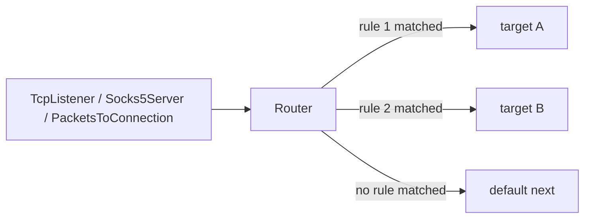

<!--
Documentation version: 159
-->

# Router

`Router` node‌ای مبتنی بر rule برای تقسیم connection‌ها میان شاخه‌های مختلف
WaterWall است. این node در میانه chain قرار می‌گیرد، ruleها را به‌ترتیب بررسی می‌کند
و هر connection از نوع TCP یا UDP را به یک شاخه می‌فرستد. اولین rule مطابق، مسیر را
انتخاب می‌کند؛ اگر هیچ ruleای مطابق نباشد، connection به `next` می‌رود. بعضی ruleها
از اطلاعات موجود هنگام ورود connection استفاده می‌کنند؛ بعضی دیگر پیش از انتخاب
شاخه، نخستین بایت‌های دادهٔ برنامه را بررسی می‌کنند.

زمانی از آن استفاده کنید که یک مسیر inbound باید بر اساس source IP، port ورودی،
destination IP یا domain، نوع شبکه، protocol تشخیص‌داده‌شده، وجود HTTP Upgrade
یا username/password احرازشده میان چند مسیر outbound تقسیم شود.



## مدل ذهنی

`Router` شاخهٔ مناسب را در اولین فرصت انتخاب می‌کند؛ فقط وقتی تصمیم به بررسی payload
نیاز داشته باشد، منتظر رسیدن داده می‌ماند:

- در نبود root `sniffing`، ruleهای metadata-only ابتدای فهرست در `Init` بررسی
  می‌شوند. Router از nonmatch عبور می‌کند و اولین match را همان‌جا Init می‌کند، حتی
  اگر ruleهای بعدی به payload نیاز داشته باشند. اگر همه ruleها metadata-only باشند
  و هیچ‌کدام match نشوند، `next` پیش‌فرض بلافاصله انتخاب می‌شود.
- با رسیدن به اولین rule دارای `protocol` یا `attributes`، بررسی اولیه متوقف می‌شود.
  Router برای رسیدن به match متادیتای بعدی از آن عبور نمی‌کند. ترکیب metadata با این
  شرط‌ها در یک rule نیز منتظر payload می‌ماند.
- root `sniffing` صریح همچنان تصمیم را وابسته به payload نگه می‌دارد تا مشاهده یا
  بازنویسی دامنه پیش از Init شاخه انجام شود. line تأخیری داده‌های upstream را تا
  زمان تصمیم در buffer نگه می‌دارد.
- خطای ارزیابی metadata، line را می‌بندد؛ rule بعدی یا مسیر پیش‌فرض جایگزین آن نمی‌شود.
- پس از match شدن یک rule تأخیری، شاخه انتخابی را مقداردهی اولیه می‌کند و
  بایت‌های bufferشده را روی همان شاخه دوباره پخش می‌کند.
- برای هر connection فقط یک‌بار تصمیم می‌گیرد و payload‌های بعدی مستقیم از همان
  شاخه عبور می‌کنند.
- ترافیک downstream شاخه انتخابی از راه `Router` به node قبلی برمی‌گردد.

اگر هیچ rule‌ای match نشود، connection به `next` در سطح اصلی می‌رود؛ این همان
مسیر پیش‌فرض است.

:::warning
تصمیم وابسته به payload نیاز دارد client ابتدا داده بفرستد. برای جریان
server-first یا transport DNS که پیش از write به establishment نیاز دارد، rule
متادیتای مطابق آن را پیش از هر rule دارای `protocol` یا `attributes` بگذارید و
root `sniffing` را خاموش نگه دارید. ruleهای payload بعدی این match زودهنگام را عقب
نمی‌اندازند؛ اما rule وابسته به payload در جایگاه قبلی یا root sniffing صریح چنین
اثری دارد.
:::

## جایگاه رایج

مسیریابی یک TCP listener عادی:

```text
TcpListener -> Router
                 |-- target: tls_path
                 |-- target: ssh_path
                 `-- next: default_path
```

پس از proxy server‌ای که metadata مقصد را از قبل خوانده است:

```text
TcpListener -> Socks5Server -> Router -> TcpConnector
```

بعد از تبدیل packet به connection:

```text
TunDevice -> PacketsToConnection -> Router -> TcpUdpConnector
```

`Router` یک node لایه ۴ است و line‌های WaterWall را route می‌کند، نه packet‌های خام
را. اگر در یک packet chain به routing در سطح connection نیاز دارید، ابتدا از
`PacketsToConnection` استفاده کنید.

مقصد می‌تواند یک آدرس IP یا نام میزبانی باشد که node قبلی مشخص کرده است. مطابقت
نام میزبان با `destination-domain` به lookup در DNS نیاز ندارد. برای بررسی نام
میزبان حل‌نشده با ruleهای IP یا GeoIP، ابتدا باید IP آن را پیدا کنید؛ اگر IP از
قبل موجود باشد، lookup لازم نیست.
[resolve کردن DNS پیش از مسیریابی](#dns-behaviour) را ببینید.

## نمونه کامل {#complete-example}

### انتخاب مسیر خروجی برای یک SOCKS proxy محلی

این config کامل node‌ها درخواست‌های SOCKS5 CONNECT محلی را می‌پذیرد. پورت 25
را رد می‌کند، مقصدهای `*.example.org` را از HTTP proxy بالادستی عبور می‌دهد و
به بقیه مقصدها مستقیم وصل می‌شود. مقصد را SOCKS node مشخص می‌کند؛ این rule‌ها
به sniff کردن payload یا username احراز هویت‌شده نیاز ندارند.

```text
TcpListener -> Socks5Server -> Router
                                 |-- destination port 25 -> BlackHole(active)
                                 |-- *.example.org -> HttpProxyClient -> TcpConnector(proxy)
                                 `-- default -> TcpConnector(requested destination)
```
```json
{
  "name": "local-socks-routing",
  "nodes": [
    {
      "name": "entry",
      "type": "TcpListener",
      "settings": {
        "address": "127.0.0.1",
        "port": 1080
      },
      "next": "socks"
    },
    {
      "name": "socks",
      "type": "Socks5Server",
      "settings": {
        "no-auth": true,
        "connect": true,
        "udp": false
      },
      "next": "route"
    },
    {
      "name": "route",
      "type": "Router",
      "settings": {
        "rules": [
          {
            "destination-port": 25,
            "target": "reject"
          },
          {
            "destination-domain": [
              "*.example.org"
            ],
            "target": "via-proxy"
          }
        ]
      },
      "next": "direct"
    },
    {
      "name": "reject",
      "type": "BlackHole",
      "settings": {
        "mode": "active"
      }
    },
    {
      "name": "via-proxy",
      "type": "HttpProxyClient",
      "settings": {
        "target-address": "dest_context->address",
        "port": "dest_context->port"
      },
      "next": "proxy-socket"
    },
    {
      "name": "proxy-socket",
      "type": "TcpConnector",
      "settings": {
        "address": "192.0.2.20",
        "port": 3128
      }
    },
    {
      "name": "direct",
      "type": "TcpConnector",
      "settings": {
        "address": "dest_context->address",
        "port": "dest_context->port"
      }
    }
  ]
}
```
این object را در یک فایل node config ذخیره کنید و مسیرش را در `core.json.configs`
بگذارید. `192.0.2.20:3128` را با endpoint واقعی HTTP proxy جایگزین کنید. آن proxy
باید CONNECT به مقصد درخواستی را اجازه دهد؛ اگر نیاز دارد، اعتبارنامه‌اش را روی
`HttpProxyClient` تنظیم کنید. آدرس connector مربوط به proxy است؛ `HttpProxyClient`
پیش از آن، مقصد درخواستی برنامه را از context برمی‌دارد.

برای آزمایش rule دامنه، client باید hostname را در درخواست SOCKS بفرستد؛ برای
نمونه با گزینه‌ی `--socks5-hostname` در curl. اگر برنامه نام را محلی resolve کند
و فقط IP بفرستد، این نمونه‌ی مبتنی بر metadata نمی‌تواند `*.example.org` را
تطبیق دهد. ترتیب rule‌ها مهم است: رد پورت 25 زودتر بررسی می‌شود. listener بدون
authentication فقط به loopback متصل است.

## فیلدهای اصلی

| فیلد | نوع | توضیح |
| --- | --- | --- |
| `name` | string | نام node. باید داخل فایل config یکتا باشد. |
| `type` | string | باید دقیقاً `"Router"` باشد. |
| `next` | string | اجباری؛ مسیر default وقتی هیچ rule‌ای match نشود. |

`settings` می‌تواند خالی باشد یا اصلاً نوشته نشود. در این حالت همه connection‌ها به
`next` می‌روند. اگر `sniffing` فعال باشد و domain sniffing برای line مجاز باشد،
ممکن است `Router` پیش از فرستادن payload اول، آن را برای پر کردن
`dest_ctx.domain` بررسی کند. اگر `rules` وجود دارد، باید array غیرخالی باشد.

## تنظیمات

| گزینه | نوع | پیش‌فرض | توضیح |
| --- | --- | --- | --- |
| `rules` | array | unset | فهرست مرتب rule‌ها. نبودن این گزینه یعنی تمام ترافیک به `next` می‌رود؛ آرایه خالی معتبر نیست. |
| `sniffing` | array | unset | mode‌های domain sniffing. مقدارهای مجاز: `"http1"`، `"http2"`، `"http"`، `"tls"`، `"quic"` و `"http3"`. |
| `sniff-even-if-domain-is-already-provided` | boolean | `false` | وقتی `false` باشد، Router برای مقصدهایی که از قبل `dest_ctx.domain` دارند، Host/:authority/SNI domain sniffing را اجرا نمی‌کند. اگر `true` باشد، domain sniff شده می‌تواند domain موجود را جایگزین کند. |
| `dns-behaviour` | object | resolve غیرفعال | تنظیم اختیاری [resolve کردن DNS پیش از مسیریابی](#dns-behaviour). وقتی مقصد یک نام میزبان حل‌نشده است و ruleها به IP آن نیاز دارند، کاربرد دارد. |
| `geoip-db-path` | string | unset | فقط وقتی لازم است که rule از `geoip:<cc>` استفاده کند. |
| `geosite-db-path` | string | unset | فقط وقتی لازم است که rule از `geosite:<list>` استفاده کند. |

`"http"` نام مستعار sniff کردن HTTP/1 Host و authority در HTTP/2 cleartext است.
این مقدار HTTP/3 را شامل نمی‌شود؛ برای QUIC/HTTP/3 SNI باید `"http3"` را نیز
اضافه کنید.

## مبانی rule

هر rule باید یک `target` و دست‌کم یک شرط داشته باشد:

```json
{
  "destination-port": [
    80,
    443
  ],
  "network": "tcp",
  "target": "web_path"
}
```

منطق matching:

| سطح | منطق |
| --- | --- |
| مقدارهای داخل یک condition | رابطه OR دارند؛ `destination-port: [80, 443]` با هر یک از این دو port match می‌شود. |
| condition‌های داخل یک rule | رابطه AND دارند؛ همه شرط‌های تنظیم‌شده باید match شوند. |
| rule‌های داخل `rules` | نخستین match کامل برنده است و rule‌های بعدی دیگر بررسی نمی‌شوند. |
| بدون match | connection به top-level `next` می‌رود. |

فیلدهای ناشناخته درون rule با ثبت warning نادیده گرفته می‌شوند. rule‌ای که فقط `target` داشته باشد و هیچ شرطی نداشته باشد معتبر نیست.

## شرط‌های قابل استفاده

| شرط | ورودی | توضیح |
| --- | --- | --- |
| `source-ips` | string یا array | IP/CIDR مبدا یا `geoip:<cc>`. |
| `source-port` | integer یا array | port محلی/inbound که peer به آن وصل شده و در `src_ctx.port` ذخیره شده است. |
| `source-port-range` | آرایه دو عددی | بازه بسته برای source/local listener port. |
| `destination-ip` | string یا array | IP/CIDR مقصد یا `geoip:<cc>`. مقصد فقط-domain تا پیش از resolve شدن با این شرط مطابقت ندارد. |
| `destination-port` | integer یا array | port مقصد داخل `dest_ctx.port`. |
| `destination-port-range` | آرایه دو عددی | بازه بسته برای destination port. |
| `destination-domain` | string یا array | domain مقصد، از جمله domain sniff شده از HTTP Host/:authority یا TLS/QUIC SNI وقتی root `sniffing` فعال باشد و domain sniffing برای line مجاز باشد؛ همچنین wildcard `*` یا `geosite:<list>`. |
| `network` | string یا array | فلگ‌های transport: `tcp`، `udp`، `icmp`، `packet`. ترکیب مثل `"tcp,udp"` هم قبول می‌شود. |
| `resolver-dns` | boolean | ترافیک منطقی DNS تولیدشده توسط resolver با `true` و line بدون این marker با `false`؛ بدون sniffing در Init در دسترس است. |
| `protocol` | string یا array | protocol تشخیص داده‌شده از payload اول: `http1`، `tls`، `bittorrent`. |
| `attributes` | array غیرخالی | مشخصات boolean sniff شده. فعلاً فقط `http_upgrade_present`. |
| `username` | string یا array | match دقیق و case-sensitive روی marker‌های credential authenticated شده روی line. |
| `password` | string یا array | match دقیق و case-sensitive روی marker‌های credential authenticated شده روی line. |

مقدارهای port باید integer در بازه `0..65535` باشند. بازه port دقیقاً دو integer دارد و مقدار نخست باید کوچک‌تر یا مساوی دومی باشد.

## شرط‌های source {#شرطهای-source}

### `source-ips`

`source-ips` با source address تطبیق داده می‌شود:

```json
{
  "source-ips": [
    "10.0.0.0/8",
    "192.0.2.10",
    "geoip:ir"
  ],
  "target": "local_or_iran_path"
}
```

مقدارهای پشتیبانی‌شده:

- آدرس IPv4 یا IPv6
- بازه CIDR مربوط به IPv4 یا IPv6
- `geoip:<ISO-3166-alpha-2>` مانند `geoip:ir` یا `geoip:us`

IP‌های تکی به شکل host route در نظر گرفته می‌شوند: `/32` برای IPv4 و `/128` برای IPv6.

### `source-port` و `source-port-range`

در پیاده‌سازی فعلی listener، `source-port` همان port محلی/inbound است که peer به
آن متصل شده، نه port موقت و تصادفی peer.

برای multiport listener مفید است:

```json
{
  "source-port": [
    80,
    443
  ],
  "target": "web_path"
}
```

می‌توانید port‌های دقیق و یک بازه را در یک rule با هم ترکیب کنید؛ این دو با رابطه OR بررسی می‌شوند:

```json
{
  "source-port": 443,
  "source-port-range": [
    10000,
    10100
  ],
  "target": "selected_inbound_ports"
}
```

## شرط‌های destination {#شرطهای-destination}

### `destination-ip`

`destination-ip` با `dest_ctx` مطابقت دارد وقتی مقصد IP است:

```json
{
  "destination-ip": [
    "198.51.100.0/24",
    "geoip:us"
  ],
  "target": "us_path"
}
```

اگر مقصد فقط domain باشد، این شرط مطابقت ندارد، چون IPای برای مقایسه وجود ندارد.
برای resolve کردن چنین مقصدی پیش از مسیریابی بر پایه IP یا GeoIP،
[resolve کردن DNS پیش از مسیریابی](#dns-behaviour) را فعال کنید.

### `destination-port` و `destination-port-range`

`destination-port` با port سرویس مقصد مقایسه می‌شود:

```json
{
  "destination-port": [
    80,
    443
  ],
  "target": "web_path"
}
```

دو سر بازه در `destination-port-range` نیز جزو بازه هستند:

```json
{
  "destination-port-range": [
    1000,
    2000
  ],
  "target": "range_path"
}
```

### `destination-domain`

`destination-domain` با `dest_ctx.domain` مقایسه می‌شود.

```json
{
  "destination-domain": [
    "example.com",
    "*.example.org",
    "geosite:cn"
  ],
  "target": "domain_path"
}
```

الگوهای پشتیبانی‌شده:

| pattern | معنی |
| --- | --- |
| `example.com` | match دقیق، case-insensitive. |
| `*.example.com` | با subdomain‌هایی مانند `www.example.com` مطابقت دارد، اما با خود `example.com` نه. |
| `*` | هر domain غیرخالی. |
| `geosite:cn` | لیست نام‌دار GeoSite که از `geosite-db-path` بارگذاری شده. |

برای مقصدهای فقط-IP، `sniffing` را در سطح اصلی فعال کنید تا `Router` مقدار HTTP
Host/:authority یا TLS/QUIC SNI را در `dest_ctx.domain` ذخیره کند و
شرط `destination-domain` بتواند برقرار شود، بدون آن‌که IP endpoint اصلی پاک شود.

## شرط‌های Network و Metadata {#شرطهای-network-و-protocol}

### `network`

`network` با flag‌های transport مقصد مقایسه می‌شود:

```json
{
  "network": "tcp,udp",
  "target": "tcp_or_udp_path"
}
```

مقدارهای پشتیبانی‌شده:

- `tcp`
- `udp`
- `icmp`
- `packet`

می‌توانید یک string، آرایه‌ای از string‌ها یا string‌های جداشده با comma بدهید. مقدارهای داخل این فیلد با رابطه OR بررسی می‌شوند.

### `resolver-dns`

این شرط نشانگر مبدأ تولید ترافیک را در lineهای DNS روی UDP و TCP تطبیق می‌دهد؛
lineهایی که یک `DomainResolver` در حالت `direct` یا `chain` می‌سازد، از جمله resolver
داخلی که `dns-behaviour` در Router یا node دیگری ایجاد می‌کند. مقدار `true` برای این
lineها و `false` برای lineهای بدون نشانگر است. فقط boolean واقعی JSON پذیرفته می‌شود.

شرط از metadata موجود استفاده می‌کند؛ payload مربوط به DNS را بررسی نمی‌کند و
sniffing را فعال نمی‌کند. DNS دلخواه client، ترافیک TUN یا صرفاً ترافیک پورت ۵۳ را
تشخیص نمی‌دهد. این نشانگر از `network` و شرط `protocol` که با sniffing مشخص می‌شود
جداست.

وقتی DNS باید در Init مسیریابی شود، rule آن را پیش از ruleهای وابسته به payload
بگذارید. این قطعه Router، ترافیک resolver را به `dns_vless` می‌فرستد؛ ترافیک دیگر
می‌تواند با rule بعدی TLS یا مسیر پیش‌فرض هدایت شود:

```json
{
  "name": "router",
  "type": "Router",
  "settings": {
    "rules": [
      { "resolver-dns": true, "target": "dns_vless" },
      { "protocol": "tls", "target": "tls_application" }
    ]
  },
  "next": "application_out"
}
```

شاخه‌های خروجی `dns_vless`، `tls_application` و `application_out` را نیز تعریف کنید.
در resolver صریح، `mode` را `chain`، مقدار `next` را `router` و `servers` را
endpointهای عددی DNS قرار دهید. با حذف `dns-next`، lineهای برنامه و lineهای جداگانهٔ
DNS هر دو وارد همین Router می‌شوند. نوشتن `dns-next: "router"` نیز همین نتیجه را
دارد؛ نام ورودی دیگری در این فیلد فقط مسیر DNS را تغییر می‌دهد. شاخهٔ DNS باید UDP و fallback به TCP را حمل کند. برای رمزنگاری از پوشش
امن مناسب استفاده کنید؛ VLESS ساده رمزنگاری ندارد.

وقتی root `sniffing` وجود ندارد، rule اول DNS در همان Init تصمیم می‌گیرد، حتی اگر
rule بعدی `protocol: "tls"` به payload نیاز داشته باشد. line غیر DNS از rule اول
عبور می‌کند و در rule TLS منتظر می‌ماند. اگر rule TLS را بالاتر بگذارید، DNS هم
منتظر می‌ماند: Router برای رسیدن به match متادیتای بعدی، یک rule وابسته به payload
را رد نمی‌کند. ترکیب `resolver-dns` با `protocol` یا `attributes` در یک rule نیز
به payload نیاز دارد. root `sniffing` صریح همچنان تصمیم را عقب می‌اندازد تا مشاهده
یا بازنویسی دامنه انجام شود؛ اگر DNS به establishment زودهنگام نیاز دارد، آن را
روی این Router تنظیم نکنید.

پاک‌کردن مشاهده‌های protocol در Init نشانگر را از بین نمی‌برد. کپی کامل context
برای همان جریان منطقی DNS آن را حفظ می‌کند؛ جایگزینی کامل endpoint یا reset آن را
پاک می‌کند. برنامهٔ اصلی و carrier بیرونی مستقلی که ساخته می‌شود نشانگر ندارند.
VlessClient مقصد منطقی DNS را نگه می‌دارد، ولی carrier جداگانهٔ UDP-over-TCP context
بدون نشانگر خودش را دارد.

تطبیق با Router اختیاری است. `dns-next` در resolver صریح می‌تواند مستقیم به
VlessClient یا شاخهٔ مناسب دیگری اشاره کند؛ نمونهٔ chain در راهنمای DomainResolver
را ببینید.

## شرط‌های Payload

### `protocol`

`protocol` از اولین upstream payload تشخیص داده می‌شود:

```json
{
  "protocol": [
    "tls",
    "bittorrent"
  ],
  "target": "special_protocol_path"
}
```

| مقدار | تشخیص |
| --- | --- |
| `http1` | prefix متد HTTP/1 مانند `GET `، `POST ` یا `CONNECT `. |
| `tls` | TLS ClientHello. |
| `bittorrent` | handshake بیت‌تورنت. |

`protocol` به `sniffing` در سطح اصلی نیاز ندارد. اگر rule‌ای از آن استفاده کند، `Router` detector لازم را خودش اجرا می‌کند.

مقدارهای ناشناخته خطای fatal config هستند. `http`، `http2`، `quic` و `http3`
فقط mode/alias برای root `settings.sniffing` هستند و مقدارهای `protocol`
نیستند.

## Attributes

`attributes` با ویژگی‌های boolean استخراج‌شده از نخستین payload تطبیق داده می‌شود:

| attribute | معنی |
| --- | --- |
| `http_upgrade_present` | اولین HTTP/1 request شامل header با نام `Upgrade:` است. |

```json
{
  "attributes": [
    "http_upgrade_present"
  ],
  "target": "websocket_path"
}
```

برای این attribute باید root `sniffing` شامل `"http1"` باشد:

```json
{
  "sniffing": [
    "http1"
  ],
  "rules": [
    {
      "attributes": [
        "http_upgrade_present"
      ],
      "target": "websocket_path"
    }
  ]
}
```

اگر sniffing مربوط به `http1` فعال نباشد، rule هرگز برقرار نمی‌شود و `Router` هنگام startup یک warning ثبت می‌کند. نام attribute ناشناخته نیز خطای fatal در config است.

## Authenticated Identity

`username` و `password` با marker‌های credential که توسط tunnel‌های upstream دارای authentication به line اضافه شده‌اند مطابقت دارند:

```json
{
  "username": [
    "alice",
    "bob"
  ],
  "target": "premium_path"
}
```

```json
{
  "password": "customer-secret",
  "target": "customer_path"
}
```

تطبیق دقیق و case-sensitive است. اگر line، username یا password احرازشده نداشته باشد، شرط متناظر برقرار نمی‌شود. اگر یک rule هم `username` و هم `password` داشته باشد، هر دو باید به همان marker مربوط به credential تعلق داشته باشند؛ در authentication‌های چندلایه، username یک لایه با password لایه‌ای دیگر ترکیب نمی‌شود.

نمونه‌هایی از tunnel‌هایی که می‌توانند credentials را populate کنند: `Socks5Server`، `TrojanServer` و `VlessServer`.

## Domain sniffing {#domain-sniffing}

گزینه `sniffing` در سطح اصلی به `Router` اجازه می‌دهد domain را از نخستین payload بخواند.

بعضی tunnel‌های upstream ممکن است قبل از رسیدن line به Router، مقدار
`dest_ctx.domain` را از قبل فراهم کرده باشند، برای مثال:

```text
... -> Socks5Server -> Router -> ...
... -> TrojanServer / VlessServer -> Router -> ...
```

این به چیزی بستگی دارد که client درخواست کرده است. یک client مربوط به SOCKS،
Trojan یا VLESS ممکن است domain بفرستد، اما ممکن است IP مستقیم هم بفرستد. ممکن
است client از قبل IP را بداند، نام را به‌صورت local resolve کرده باشد، از DoH/DoT یا یک
مسیر DNS دیگر قبل از اتصال استفاده کرده باشد، یا اساساً ترافیک IP-only را
عبور دهد. در این حالت‌ها ممکن است `Router` در `dest_ctx.domain` هیچ destination
domain‌ای نبیند؛ در نتیجه `sniffing` می‌تواند domain مقصد را از
Host/:authority/SNI مفید باشد.

```json
{
  "sniffing": [
    "http",
    "tls",
    "http3"
  ]
}
```

| مقدار | می‌خواند |
| --- | --- |
| `http1` | HTTP/1 header با نام `Host`. |
| `http2` | cleartext HTTP/2 prior-knowledge `:authority`، با fallback به `host`. |
| `http` | alias برای `http1` به اضافه `http2`. |
| `tls` | TLS ClientHello SNI. |
| `quic` | QUIC Initial TLS ClientHello SNI. |
| `http3` | alias برای `quic`. |

مقدارها بدون حساسیت به حروف کوچک و بزرگ خوانده می‌شوند. اگر `sniffing` حذف شود یا خالی باشد،
domain sniffing غیرفعال است.

`http` عمداً HTTP/3 را شامل نمی‌شود. برای همه نسخه‌های HTTP، هر دو مقدار را
استفاده کنید:

```json
{
  "sniffing": [
    "http",
    "http3"
  ]
}
```

HTTP/2 sniffing فقط domain sniffing است: Router فقط request‌های cleartext HTTP/2
prior-knowledge را روی destination context‌های TCP تشخیص می‌دهد و `:authority`
را از اولین request HEADERS کامل می‌خواند و در نبود آن از `host` همان request
استفاده می‌کند. streamهای request بعدی نمی‌توانند domain اولین request را تغییر
دهند، حتی اگر چند request در یک payload برسند. h2c upgrade همچنان از مسیر
HTTP/1 Host sniffing پوشش داده می‌شود.

تشخیص protocol نوع TLS و sniff کردن SNI از ClientHello تقسیم‌شده میان چند TLS
record پشتیبانی می‌کند، حتی اگر مرز record داخل handshake header یا hostname
باشد. بازسازی handshake تقسیم‌شده حداکثر 8192 بایت حافظه دارد و ورودی ناقص
همچنان تابع محدودیت sniff window است. ClientHello کامل در یک record از مسیر
مستقیم parse می‌شود.

HTTP/2 sniffing وقتی در دسترس است که WaterWall با
`router_enable_http2_sniffing=ON` ساخته شده باشد (پیش‌فرض `ON`). QUIC/HTTP3
sniffing وقتی در دسترس است که build با `router_enable_quic_sniffing=ON` باشد
(پیش‌فرض `ON`). چون `http` به `http1` به‌علاوه `http2` گسترش می‌یابد، به گزینه
build مربوط به HTTP/2 هم نیاز دارد. نام‌های `http`، `http2`، `quic` و `http3` فقط برای root
`settings.sniffing` هستند و `rules[].protocol` را تغییر نمی‌دهند.

این قابلیت بیشتر برای مقصدهایی به کار می‌آید که endpoint اصلی آن‌ها IP است اما می‌خواهید routing بر اساس domain انجام شود:

```json
{
  "sniffing": [
    "tls"
  ],
  "rules": [
    {
      "destination-domain": "*.example.org",
      "target": "example_path"
    }
  ]
}
```

به‌صورت پیش‌فرض، `Router` برای line‌ای که از قبل `dest_ctx.domain` دارد
Host/:authority/SNI domain sniffing را اجرا نمی‌کند. این رفتار جلوی جایگزین شدن
domain انتخاب‌شده توسط config یا tunnel قبلی با داده‌ای که client داخل connection
فرستاده را می‌گیرد. تشخیص `protocol` و sniffing مربوط به `attributes` جدا هستند
و می‌توانند همچنان اجرا شوند، چون `dest_ctx.domain` را جایگزین نمی‌کنند.

اگر می‌خواهید مقدار Host/:authority/SNI عمداً بر domain قبلی اولویت داشته باشد، از
`sniff-even-if-domain-is-already-provided: true` استفاده کنید.

وقتی Host/:authority/SNI پیدا شود و Router اجازه ذخیره آن را داشته باشد، مقدار
در `dest_ctx.domain` نوشته می‌شود، اما فیلدهای endpoint مثل IP، port، transport
flags، optional protocol flags و address type پاک نمی‌شوند.

| شکل destination | نتیجه |
| --- | --- |
| IP مشخص بدون domain قبلی | domain ذخیره می‌شود، `domain_resolved = true`؛ connector‌های بعدی همان IP اصلی را استفاده می‌کنند و نام sniff شده را resolve نمی‌کنند. |
| IP wildcard/any مثل `0.0.0.0` یا `::` بدون domain قبلی | domain ذخیره می‌شود، اما resolved حساب نمی‌شود چون endpoint IP مشخصی وجود ندارد. |
| domain موجود، تنظیم پیش‌فرض | Host/:authority/SNI domain sniffing اجرا نمی‌شود و `dest_ctx.domain` جایگزین نمی‌شود. |
| مقصد فقط domain، با `sniff-even-if-domain-is-already-provided: true` | domain sniff شده جایگزین `dest_ctx.domain` می‌شود، `domain_resolved = false`؛ connector بعدی نام جدید را DNS-resolve می‌کند و به آن وصل می‌شود. |

## buffer کردن payload اول {#بافر-کردن-payload-اول}

`Router` برای تصمیم‌گیری، payload نخست را در buffer نگه می‌دارد. detector‌ها ممکن است برای
HTTP ناقص، HTTP/2 preface/HEADERS ناقص، TLS ClientHello یا BitTorrent handshake
ناقص بایت‌های بیشتری درخواست کنند.

حد پنجره sniffing:

```text
8192 bytes
```

اگر اطلاعات لازم تا رسیدن به این حد پیدا نشود، detector آن را موجود نمی‌داند و `Router` با همان اطلاعاتی که دارد تصمیم می‌گیرد.

نتایج عملی:

- rule‌هایی که از `protocol`، از `destination-domain` همراه `sniffing` یا از `http_upgrade_present` استفاده می‌کنند، ممکن است انتخاب شاخه را تا رسیدن بایت‌های کافی به تأخیر بیندازند.
- protocol‌هایی که مطابقت ندارند معمولاً زود تعیین تکلیف می‌شوند، چون بایت‌های ابتدایی آن‌ها شبیه prefix‌های شناخته‌شده نیست.
- بعد از انتخاب route، payload‌های بعدی دوباره classify نمی‌شوند.

در زمان مقداردهی اولیهٔ شاخه و بازپخش داده‌های اولیه، ترتیب FIFO حفظ می‌شود:
ورودی‌ای که از callbackهای تودرتو می‌رسد پشت بایت‌های قبلاً پذیرفته‌شده منتظر
می‌ماند. برای ورودی stream، این دادهٔ اضافی در یک buffer عادی با سقف ۲ MiB
بایت منطقی جمع می‌شود؛ عبور از این سقف line را می‌بندد. این محدودیت، نخستین
ورودی کامل و قبلاً پذیرفته‌شده را صرفاً به‌دلیل بزرگ‌تر بودن از پنجرهٔ sniff
رد نمی‌کند. در ورودی UDP هر datagram، حتی datagram خالی، جداگانه نگه داشته
می‌شود و یک نمای بایتی مستقل برای sniffing استفاده می‌شود. سقف FIFO برابر
۲ MiB payload، مجموع ۴ MiB ظرفیت bufferها و ۱۰۲۴ datagram است؛ عبور از هر
یک از این سقف‌ها line را می‌بندد. بازپخش، محتوا و مرز هر datagram را حتی در
ورودی تودرتوی زمان مقداردهی اولیه یا بازپخش حفظ می‌کند. پس از پایان بازپخش
اولیه، payloadهای بعدی بدون صف خروجی در Router عبور می‌کنند.

## GeoIP

`geoip:<cc>` در `source-ips` و `destination-ip` قابل استفاده است:

```json
{
  "settings": {
    "geoip-db-path": "/var/lib/waterwall/GeoLite2-Country.mmdb",
    "rules": [
      {
        "source-ips": "geoip:ir",
        "target": "iran_path"
      },
      {
        "destination-ip": [
          "geoip:us",
          "geoip:de"
        ],
        "target": "western_path"
      }
    ]
  },
  "next": "default_path"
}
```

نکته‌ها:

- `geoip-db-path` فقط وقتی اجباری است که rule واقعاً از `geoip:` استفاده کند.
- دیتابیس باید MaxMind country database باشد.
- country code دو حرفی ISO-3166 و case-insensitive است.
- اگر IP در دیتابیس نباشد، شرط GeoIP برقرار نمی‌شود.
- مقصد فقط-domain باید پیش از تطبیق با `destination-ip: geoip:...` resolve شود.

## GeoSite

`geosite:<list>` در `destination-domain` استفاده می‌شود:

```json
{
  "settings": {
    "geosite-db-path": "/var/lib/waterwall/geosite_generated.json",
    "sniffing": [
      "http",
      "tls",
      "http3"
    ],
    "rules": [
      {
        "destination-domain": [
          "geosite:cn",
          "geosite:category-ads-all"
        ],
        "target": "special_domain_path"
      }
    ]
  },
  "next": "default_path"
}
```

`geosite-db-path` تنها زمانی الزامی است که rule از token مربوط به `geosite:` استفاده کند. `Router` دیتابیس JSON را هنگام startup بارگذاری و اعتبارسنجی می‌کند.

نوع‌های پشتیبانی‌شده در GeoSite:

| نوع | رفتار |
| --- | --- |
| `full` | match دقیق domain. |
| `domain` / `root_domain` | root domain و subdomain‌ها. |
| `plain` / `keyword` | substring case-insensitive. |
| `regex` / `regexp` | الگوی STC `cregex`، case-insensitive. |

فایل GeoSite با generator داخل سورس ساخته می‌شود:

```text
tunnels/Router/geosite_ww_style_generator/do_the_job.py
```

## resolve کردن DNS پیش از مسیریابی {#dns-behaviour}

resolve کردن مقصد یعنی جست‌وجوی یک نام میزبان، مانند `example.com`، برای به‌دست‌آوردن
IP آن. Router زمانی به این کار نیاز دارد که یک نام میزبان حل‌نشده دریافت کند و
باید بر اساس IP مقصد، مسیر را انتخاب کند.

ممکن است connection از ابتدا با یک آدرس IP به Router برسد. برای مثال، برنامه پیش
از باز کردن اتصال SOCKS، نام میزبان را resolve کرده باشد، یا یک `DomainResolver`
در بخش قبلی chain این کار را انجام داده باشد. فعال کردن سیاست DNS در Router باعث
تکرار این lookup نمی‌شود.

| مقصد هنگام رسیدن connection به Router | رفتار با resolve فعال |
| --- | --- |
| یک آدرس IP، مانند `192.0.2.10:443` | مسیریابی با همان IP؛ بدون lookup در DNS. |
| یک نام میزبان حل‌نشده، مانند `example.com:443` | ابتدا نام میزبان resolve و یک IP انتخاب می‌شود؛ سپس ruleها بررسی می‌شوند. port همان ۴۴۳ می‌ماند. |
| یک نام میزبان همراه با IP که قبلاً resolve شده است | IP و نام میزبان موجود حفظ می‌شوند؛ بدون lookup جدید. |
| مقصد هنوز مشخص نشده است | بررسی با سایر metadata موجود ادامه می‌یابد؛ نام میزبانی برای resolve کردن وجود ندارد. |

نیاز به resolve کردن را بر اساس ruleهای خود تعیین کنید:

- ruleهای `destination-domain` و GeoSite مستقیماً نام میزبان موجود را مقایسه
  می‌کنند. به IP آن نیاز ندارند و خودشان lookup در DNS انجام نمی‌دهند.
- ruleهای `destination-ip` و GeoIP مقصد به آدرس IP نیاز دارند. تا وقتی مقصد فقط
  یک نام میزبان حل‌نشده دارد، این ruleها نمی‌توانند با آن مطابقت داشته باشند.
- ruleهای source IP، port، نوع شبکه و کاربر احرازشده به DNS مقصد نیاز ندارند.

resolve کردن DNS، نام میزبان را از روی IP بازیابی نمی‌کند. اگر فقط IP دارید، از
ruleهای IP استفاده کنید؛ یا وقتی protocol برنامه نام میزبان را در اختیار می‌گذارد،
از [domain sniffing](#domain-sniffing) کمک بگیرید. sniffing ترافیک برنامه را می‌خواند؛
resolve کردن، آدرس را از DNS می‌پرسد. این دو کار مستقل‌اند.

### تنظیم resolve

برای lookupهایی که همین Router انجام می‌دهد از `settings.dns-behaviour` استفاده
کنید. `resolve: true` یعنی **نام میزبان حل‌نشده را در صورت نیاز resolve کن**، نه
اینکه برای همهٔ connectionها lookup انجام شود. `mode` مسیر ترافیک DNS را انتخاب
می‌کند؛ `strategy` مشخص می‌کند کدام آدرس از نتایج انتخاب شود.

| فیلد | پیش‌فرض | معنی |
| --- | --- | --- |
| `resolve` | در object اجباری است | `true`، resolve در صورت نیاز را فعال می‌کند؛ `false`، lookupهای این Router را غیرفعال می‌کند. |
| `mode` | `native` | یکی از `native`، `direct` یا `chain` که در ادامه توضیح داده شده‌اند. |
| `strategy` | `core-settings` | استفاده از اولویت آدرس core، یا انتخاب یکی از `accept-dns-returned-order`، `prefer-ipv4`، `prefer-ipv6`، `only-ipv4` یا `only-ipv6`. این فیلد مسیر انتقال DNS را انتخاب نمی‌کند. |
| `servers` | تعیین نشده | برای `direct` و `chain` اجباری و برای `native` ممنوع است. ۱ تا ۳۲ مقصد عددی با قالب IP، IP:port یا [IPv6]:port می‌پذیرد. port پیش‌فرض ۵۳ است. |
| `dns-next` | ruleهای همین Router در حالت `chain` | نام اختیاری node ورودی یک مسیر جداگانه برای DNS؛ فقط در `chain` مجاز است. برای استفاده از شاخه‌های موجود همین Router، آن را ننویسید. |

هر مثال زیر یک node از نوع Router است. شاخه‌هایی که نامشان در `next` و `target`
آمده باید در همان پیکربندی nodeها وجود داشته باشند. IPهای نمونه را با آدرس سرورهای
خود جایگزین کنید.

### resolve غیرفعال

Router به‌طور پیش‌فرض lookup در DNS انجام نمی‌دهد. اگر نام میزبان موجود باشد،
ruleهای domain همچنان کار می‌کنند؛ اگر IP موجود باشد، ruleهای IP کار می‌کنند. یک
connector در ادامهٔ مسیر یا proxy راه دور می‌تواند نام میزبان را resolve کند، اما
این اتفاق پس از تصمیم Router می‌افتد و به ruleهای IP مقصد یا GeoIP این Router
کمکی نمی‌کند.

این مثال یک نام میزبان موجود را بدون resolve کردن در Router مسیریابی می‌کند:

```json
{
  "name": "router",
  "type": "Router",
  "settings": {
    "dns-behaviour": { "resolve": false },
    "rules": [
      { "destination-domain": "*.example.org", "target": "vpn-client" }
    ]
  },
  "next": "direct-out"
}
```

وقتی `resolve` برابر `false` است، باید تنها فیلد `dns-behaviour` باشد.

### حالت native

برای resolve کردن با تنظیمات DNS در `core.json` از `native` استفاده کنید. resolver
مشترک worker از socketهای native استفاده می‌کند؛ این پرس‌وجوهای DNS از ruleهای
Router یا شاخهٔ VPN آن عبور نمی‌کنند. اگر فهرست سرور در core مشخص نشده باشد،
resolver از تنظیمات DNS سیستم استفاده می‌کند. این حالت DNS را رمزنگاری نمی‌کند.

در این مثال، نام میزبان حل‌نشده پیش از بررسی subnet مقصد resolve می‌شود:

```json
{
  "name": "router",
  "type": "Router",
  "settings": {
    "dns-behaviour": {
      "resolve": true,
      "mode": "native",
      "strategy": "prefer-ipv4"
    },
    "rules": [
      { "destination-ip": "192.0.2.0/24", "target": "direct-out" }
    ]
  },
  "next": "vpn-client"
}
```

سرورهای DNS حالت native را در `core.json` تنظیم کنید؛ فیلد `servers` این سیاست
برای این حالت نیست. فرستادن ترافیک برنامه از `vpn-client` باعث نمی‌شود DNS در حالت
native نیز از همان مسیر عبور کند.

### حالت direct

برای انتخاب سرورهای مشخص DNS و دسترسی به آن‌ها از طریق یک connector خصوصی TCP/UDP
در WaterWall، از `direct` استفاده کنید. Router این connector را در داخل خود
می‌سازد. ترافیک DNS مستقیماً به آن سرورها می‌رود و از ruleهای Router یا `next`
پیروی نمی‌کند. این حالت رمزنگاری اضافه نمی‌کند.

```json
{
  "name": "router",
  "type": "Router",
  "settings": {
    "dns-behaviour": {
      "resolve": true,
      "mode": "direct",
      "servers": ["203.0.113.53:53"],
      "strategy": "prefer-ipv4"
    },
    "rules": [
      { "destination-ip": "192.0.2.0/24", "target": "direct-out" }
    ]
  },
  "next": "vpn-client"
}
```

در این مثال، ruleها فقط مسیر ترافیک برنامه را انتخاب می‌کنند. DNS همیشه از
connector خصوصی به `203.0.113.53:53` می‌رود. در حالت direct، `dns-next` نه لازم است
و نه مجاز.

### حالت chain: استفاده از مسیر VPN موجود

وقتی DNS باید از مسیری در WaterWall، مانند
`VlessClient -> TlsClient -> TcpConnector`، عبور کند، از `chain` استفاده کنید.
در نبود `dns-next`، Router connectionهای DNS تولیدشده را از ruleهای خودش عبور
می‌دهد؛ مقصد این connectionها همان IP و port سرور DNS تنظیم‌شده است. connection
برنامه منتظر نتیجهٔ DNS می‌ماند، سپس با مقصد resolveشده از ruleها عبور می‌کند. این‌ها
connectionهای جداگانه‌اند؛ مقصد برنامه هیچ‌وقت به سرور DNS تبدیل نمی‌شود.

برای جداسازی مسیر ایران، rule مربوط به DNS را اول بگذارید تا DNS همیشه از VPN
عبور کند؛ سپس مقصدهای برنامه در ایران را مستقیم بفرستید:

```json
{
  "name": "router",
  "type": "Router",
  "settings": {
    "dns-behaviour": {
      "resolve": true,
      "mode": "chain",
      "servers": ["203.0.113.53:53"],
      "strategy": "prefer-ipv4"
    },
    "geoip-db-path": "/var/lib/waterwall/GeoLite2-Country.mmdb",
    "rules": [
      { "resolver-dns": true, "target": "vpn-client" },
      { "destination-ip": "geoip:ir", "target": "direct-out" }
    ]
  },
  "next": "vpn-client"
}
```

در اینجا `vpn-client` یک کلاینت VLESS با انتقال TLS است و `direct-out` یک
`TcpUdpConnector`. سرور DNS باید از سمت سرور VPN راه دور قابل دسترسی باشد. برای
listener، سرور SOCKS و nodeهای خروجی،
[پیکربندی کامل DNS محافظت‌شده با مالکیت Router](./DomainResolver.mdx#dns-محافظتشده-متعلق-به-router)
را ببینید.

rule مربوط به `resolver-dns` با DNS تولیدشده توسط resolver در WaterWall مطابقت
دارد؛ هر بستهٔ کلاینت به port ۵۳ را شناسایی نمی‌کند. آن را پیش از هر rule نیازمند
بررسی payload قرار دهید و root `sniffing` را در این Router تنظیم نکنید تا DNS
بلافاصله مسیریابی شود. مسیر VPN باید هم پرس‌وجوهای UDP و هم fallback روی TCP را
پشتیبانی کند. رمزنگاری از انتقال انتخابی، مانند TLS، می‌آید؛ خود حالت `chain` یا
VLESS بدون چنین انتقالی، رمزنگاری فراهم نمی‌کند.

برای اختصاص مسیر جداگانه به DNS، `dns-next` را برابر نام ورودی یک شاخهٔ جداگانه
بگذارید. این شاخه نباید از قبل به node دیگری تعلق داشته باشد. نام همین Router یا
شاخهٔ VPN که از قبل متصل است را ننویسید؛ برای استفاده از مسیریابی بالا، `dns-next`
را حذف کنید. برای سرور VPN از آدرس IP عددی یا روشی مستقل برای resolve کردن آدرس
آن استفاده کنید تا باز کردن مسیر DNS، به باز بودن همان مسیر وابسته نباشد.

### زمان lookup و رفتار خطا

Router پیش از بررسی ruleها و پیش از domain sniffing خودش، resolve را انجام می‌دهد.
نام میزبان اصلی پس از resolve شدن نیز برای مطابقت domain در دسترس می‌ماند. نام
میزبانی که بعداً از sniffing به دست می‌آید، باعث lookup دوباره توسط این Router
نمی‌شود. می‌توانید یک `DomainResolver` صریح پیش از Router قرار دهید تا lookup را
انجام دهد؛ Router در این حالت از مقصدی که قبلاً resolve شده استفاده می‌کند.

اگر lookup شکست بخورد، connection برنامه بسته می‌شود. حالت DNS دیگری امتحان
نمی‌شود و connection حل‌نشده به `next` پیش‌فرض Router فرستاده نمی‌شود.

این سیاست فقط lookupهای همین Router را کنترل می‌کند. DNS برنامه، سیستم‌عامل یا
lookupهای nodeهای دیگر را تنظیم نمی‌کند. گزینه‌های مشترک DNS، cache و استفادهٔ
دوباره از connectionها را در [DomainResolver](./DomainResolver.mdx) ببینید.

این سیاست باید یک object غیرخالی با فیلدهای فهرست‌شده در بالا باشد. فیلدهای ناشناخته
و strategy عددی رد می‌شوند. strategy باید یکی از رشته‌های canonical بالا با حروف کوچک باشد.

## Target Branch‌ها {#target-branchها}

`target` نام یک node واقعی در همان config است. `Router` هنگام ساخت chain، این
target‌ها را وارد chain خودش می‌کند تا:

- target‌ها line state داشته باشند.
- downstream traffic از branch‌ها دوباره از Router برگردد.
- lifecycle chain حفظ شود.

قوانین مهم:

- target باید وجود داشته باشد.
- target نباید خود Router باشد.
- یک target نباید قبلاً به previous ناسازگار وصل شده باشد.
- قرار گرفتن در یک chain مشترک، یک node داخل شاخهٔ تنظیم‌شدهٔ دیگر را به
  target معتبر تبدیل نمی‌کند. Router شاخهٔ پیش‌فرض خودش و targetهای صریحاً
  متصل‌شده، همراه helperهای داخلی آن‌ها، را می‌پذیرد.
- چند rule می‌توانند یک target مشترک داشته باشند.

اگر branch شما جای دیگری در config است، از `Bridge` به‌عنوان target استفاده کنید.

```text
TcpListener -> Router
               |-- target: bridge_to_special_path
               `-- next: direct_path
```

## جهت و lifecycle {#جهت-و-lifecycle}

رفتار callback:

| callback | رفتار |
| --- | --- |
| upstream `Init` | state داخلی را مقداردهی اولیه و فقط بیت‌های protocol تشخیص‌داده‌شده را از `dest_ctx.optional_flags` پاک می‌کند؛ metadata کنترل مسیر یک‌بارمصرف و marker مبدأ DNS حفظ می‌شوند. در نبود root sniffing، اولین match در بخش ابتدایی ruleهای metadata-only همین‌جا شاخه را آماده می‌کند؛ رسیدن به rule وابسته به payload بررسی اولیه را متوقف می‌کند. |
| اولین upstream `Payload` | اگر تصمیم به بررسی payload نیاز داشته باشد، داده را buffer و بررسی می‌کند، rule‌ها را ارزیابی و شاخهٔ انتخابی را مقداردهی اولیه می‌کند و سپس داده را بازپخش می‌کند؛ در غیر این صورت آن را به شاخهٔ انتخاب‌شده در Init می‌فرستد. |
| payload‌های بعدی upstream | مستقیم به target انتخابی یا default `next` می‌روند. |
| upstream `Pause` / `Resume` | پس از انتخاب route، حتی در صورت تکرار، به شاخهٔ انتخابی می‌روند؛ پیش از انتخاب نادیده گرفته می‌شوند و مانع بازپخش payload نیستند. |
| upstream `Finish` | state داخلی را از بین می‌برد و اگر شاخه target/default انتخاب شده باشد، آن را با `Finish` می‌بندد. |
| downstream `Payload` / `Pause` / `Resume` / `Est` | به node قبلی برمی‌گردند. |
| downstream `Finish` | state داخلی را از بین می‌برد و سپس `Finish` را به node قبلی می‌فرستد. |

`Router` عمداً در upstream `Init` فقط زیرمجموعه بیت‌های protocol تشخیص‌داده‌شده در `dest_ctx.optional_flags` را پاک می‌کند تا این بیت‌ها از یک `Router` به `Router` بعدی روی همان line منتقل نشوند. بیت‌های جداگانه کنترل مسیر که tunnel‌های protocol برای یک adapter بعدی حمل می‌کنند حفظ می‌شوند و هرگز `protocol` match محسوب نمی‌شوند.

Pause/Resume در هر دو جهت advisory هستند. Router وضعیت Pause مصرف‌کننده را
نگه نمی‌دارد و برای تکمیل راه‌اندازی شاخه یا تحویل ورودی آماده منتظر Resume نمی‌ماند.

پس از بازگشت Init شاخه و پایان بازپخش اولیه، اگر ورودی شاخهٔ انتخاب‌شده همان
پیوند واقعی `next` باشد، Router state مربوط به line را از بین می‌برد، کاملاً
صفر می‌کند و خودش را برای آن line به‌طور دائمی bypass می‌کند. این حالت هم مسیر
پیش‌فرض و هم rule‌ای را پوشش می‌دهد که همان ورودی را انتخاب کند. target متفاوت
Router را فعال نگه می‌دارد تا callbackهای upstream بعدی به همان شاخه فرستاده
شوند. bypass مقصد انتخابی را تغییر نمی‌دهد و nodeهای بعدی را از chain حذف نمی‌کند.

## دستورالعمل‌ها

### مسیریابی بر اساس domain با default fallback

```json
{
  "name": "router",
  "type": "Router",
  "settings": {
    "sniffing": [
      "http",
      "tls",
      "http3"
    ],
    "rules": [
      {
        "destination-domain": [
          "*.example.com",
          "api.vendor.test"
        ],
        "target": "domain_path"
      }
    ]
  },
  "next": "default_path"
}
```

### مسیریابی GeoIP

```json
{
  "name": "router",
  "type": "Router",
  "settings": {
    "geoip-db-path": "/var/lib/waterwall/GeoLite2-Country.mmdb",
    "rules": [
      {
        "source-ips": [
          "geoip:ir",
          "10.0.0.0/8"
        ],
        "target": "regional_path"
      }
    ]
  },
  "next": "default_path"
}
```

### جداسازی WebSocket Upgrade

```json
{
  "name": "router",
  "type": "Router",
  "settings": {
    "sniffing": [
      "http1"
    ],
    "rules": [
      {
        "attributes": [
          "http_upgrade_present"
        ],
        "target": "websocket_path"
      }
    ]
  },
  "next": "plain_http_path"
}
```

### ترکیب چند شرط با AND

```json
{
  "name": "router",
  "type": "Router",
  "settings": {
    "rules": [
      {
        "network": "tcp",
        "destination-port": 443,
        "protocol": "tls",
        "target": "tls_443_path"
      }
    ]
  },
  "next": "default_path"
}
```

این rule فقط زمانی برقرار می‌شود که connection از نوع TCP، destination port برابر `443` و نخستین payload از نوع TLS تشخیص داده شود.

### مسیریابی بر اساس کاربر authenticate‌شده

```json
{
  "name": "router",
  "type": "Router",
  "settings": {
    "rules": [
      {
        "username": [
          "alice",
          "bob"
        ],
        "target": "premium_path"
      },
      {
        "username": "guest",
        "target": "limited_path"
      }
    ]
  },
  "next": "anonymous_path"
}
```

`Router` را پس از tunnelی قرار دهید که احراز هویت را انجام می‌دهد و credential‌ها را روی line ذخیره می‌کند.

## اشتباه‌های رایج

### انتظار priority-free بودن ترتیب rule‌ها {#انتظار-priority-free-بودن-ترتیب-ruleها}

همه rule‌ها ارزیابی و امتیازدهی نمی‌شوند؛ نخستین rule که به‌طور کامل برقرار شود برنده است. rule‌های مشخص‌تر را بالاتر و rule‌های عمومی‌تر را پایین‌تر قرار دهید.

### استفاده از match-all rule

rule‌ای که فقط `target` داشته باشد و شرطی نداشته باشد نامعتبر است. برای مسیر پیش‌فرض از `next` در سطح اصلی استفاده کنید. اگر پیش از مسیر پیش‌فرض یک rule عمومی صریح می‌خواهید، برای routing فقط-domain شرطی واقعی مانند `"destination-domain": "*"` قرار دهید.

### انتظار کار کردن `destination-domain` روی traffic IP-only بدون sniffing

برای flow‌های IP-only، `dest_ctx.domain` خالی است مگر اینکه node قبلی آن را داده
باشد یا Router، وقتی domain sniffing برای line مجاز است، آن را از HTTP
Host/:authority یا TLS/QUIC SNI sniff کرده باشد.
برای این حالت root `sniffing` را فعال کنید.

### انتظار اینکه `protocol` به root `sniffing` نیاز داشته باشد

تشخیص `protocol` از sniffing مربوط به Host/:authority/SNI جدا است. اگر rule‌ای
از `protocol` استفاده کند، Router detector‌های لازم برای protocol را خودش اجرا
می‌کند.

### اشتباه گرفتن `source-port` با port ephemeral کلاینت

در listener‌های معمول، `source-port` همان port محلی/inbound است که peer به آن وصل شده است. از آن برای routing روی listener‌های چندپورتی استفاده کنید.

### routing برای protocol‌های server-first {#routing-برای-protocolهای-server-first}

در نبود root `sniffing`، اولین rule مطابق در بخش metadata-only ابتدای فهرست، شاخه را در همان Init آماده می‌کند؛ ruleهای payload در ادامه مانعی نیستند. rule جریان server-first را در همان بخش ابتدایی بگذارید. وجود rule دارای `protocol` یا `attributes` پیش از آن، یا root `sniffing` صریح، همچنان تصمیم را تا دریافت دادهٔ upstream عقب می‌اندازد.

`Router` header تازه‌ای به ابتدای payload اضافه نمی‌کند و به left padding نیاز ندارد.

## متادیتای node {#متادیتای-نود}

متادیتای برگرفته از کد منبع:

| ویژگی | مقدار |
| --- | --- |
| node flags | `kNodeFlagSupportsSplice` |
| `can_have_prev` | `true` |
| `can_have_next` | `true` |
| `layer_group` | `kNodeLayer4` |
| `layer_group_prev_node` | `kNodeLayer4` |
| `layer_group_next_node` | `kNodeLayer4` |
| `required_padding_left` | `0` بایت |
