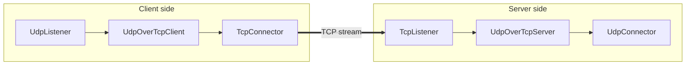

<!--
Documentation version: 153
-->

# UdpOverTcpClient

## نمای کلی {#overview}

`UdpOverTcpClient` دیتاگرام‌های UDP را روی یک جریان بایتی از نوع TCP حمل می‌کند. برای حفظ مرز بسته‌ها، یک فیلد دو بایتی طول به ابتدای هر بار مفید خروجی اضافه می‌کند و نتیجه را به گره رو به جریان بعدی می‌فرستد.

این گره معمولاً با `UdpOverTcpServer` در سمت مقابل استفاده می‌شود.

## جایگاه معمول در زنجیره {#typical-placement}

### جایگاه معمول در زنجیره {#typical-placement-1}

<a id="جایگاه-رایج"></a>

سمت کلاینت:

```text
UdpListener -> UdpOverTcpClient -> TcpConnector
UdpListener -> UdpOverTcpClient -> TlsClient -> TcpConnector
UdpListener -> UdpOverTcpClient -> EncryptionClient -> TcpConnector
TcpUdpListener -> Router (UDP branch) -> UdpOverTcpClient -> TcpConnector
```

سمت سرور:

```text
TcpListener -> UdpOverTcpServer -> UdpConnector
TcpListener -> TlsServer -> UdpOverTcpServer -> UdpConnector
TcpListener -> EncryptionServer -> UdpOverTcpServer -> UdpConnector
```

گره قبل از `UdpOverTcpClient` معمولاً رو به بسته است و گره بعد از آن باید یک مسیر جریان قابل اعتماد فراهم کند.

### نمونهٔ جریان {#flow-example}

<a id="نمودار-جریان"></a>



این الگو برای عبور برنامه‌های UDP مانند DNS یا ترافیک UDP شبیه WireGuard از مسیری مناسب است که فقط با TCP کار می‌کند.

## نمونهٔ کاربردی ساده {#minimal-practical-example}

این‌ها قطعه‌های پیکربندی گره هستند؛ گره‌های همسایهٔ ارجاع‌شده را در پیکربندی پیرامونی تعریف کنید.

### نمونهٔ پایه {#basic-example}

<a id="نمونه-ساده"></a>

برای دسترسی به سرویس UDP راه‌دور، دیتاگرام‌های برنامه‌ی محلی را به
`127.0.0.1:15182` بفرستید. این پیکربندی کامل آن‌ها را روی TCP به دروازه مربوط
به WaterWall در `198.51.100.10:7443` حمل می‌کند. [سرور متناظر](UdpOverTcpServer.mdx)
دیتاگرام‌های رمزگشایی‌شده را به سرویس UDP خود روی `127.0.0.1:51820` می‌فرستد.
مقصد اتصال‌دهنده اینجا دروازه است، نه سرویس نهایی UDP.

```json
{
  "name": "udp-service-over-tcp-client",
  "nodes": [
    {
      "name": "udp-in",
      "type": "UdpListener",
      "settings": {
        "address": "127.0.0.1",
        "port": 15182
      },
      "next": "udp-over-tcp-client"
    },
    {
      "name": "udp-over-tcp-client",
      "type": "UdpOverTcpClient",
      "settings": {},
      "next": "stream-out"
    },
    {
      "name": "stream-out",
      "type": "TcpConnector",
      "settings": {
        "address": "198.51.100.10",
        "port": 7443
      }
    }
  ]
}
```

## پیکربندی {#configuration}

### فیلدهای لازم {#required-fields}

<a id="فیلدهای-ضروری"></a>

فیلدهای سطح بالا:

| فیلد | نوع | توضیح |
| --- | --- | --- |
| `name` | string | نام دلخواه گره. باید داخل فایل پیکربندی یکتا باشد. |
| `type` | string | باید دقیقاً `"UdpOverTcpClient"` باشد. |
| `next` | string | گره رو به جریان که بایت‌های قاب‌بندی‌شده را حمل می‌کند. در استفاده معمول لازم است. |

`settings` می‌تواند `{}` باشد؛ پیاده‌سازی فعلی هیچ تنظیم اختصاصی این تونل را نمی‌خواند.

### تنظیمات اختیاری {#optional-settings}

<a id="تنظیمات-اختیاری"></a>

در پیاده‌سازی فعلی هیچ تنظیم اختصاصی تونل وجود ندارد.

رفتار سوکت، TLS، رمزنگاری، مسیریابی یا مقصد مربوط به گره‌های اطراف است؛ مثل `TcpConnector`، `TlsClient`، `EncryptionClient`، `UdpListener` یا `TcpUdpListener`.

## کاربرد و رفع اشکال {#usage-and-troubleshooting}

### محدودیت اندازهٔ بسته {#packet-size-limit}

<a id="محدودیت-اندازه-packet"></a>

حداکثر اندازهٔ دیتاگرام UDP خروجی:

```text
65535 - 20 - 8 - 2 = 65505 bytes
```

دیتاگرام بزرگ‌تر از این حد به‌صورت کامل حذف می‌شود. بار مفید خروجی خالی شرط ثابت موجود در Debug را
نقض می‌کند و در Release، حذف می‌شود. قاب ورودی با طول صفر نامعتبر است و حامل را می‌بندد.

### بافرکردن و سرریز {#buffering-and-overflow}

<a id="buffering-و-overflow"></a>

بایت‌های جریان ورودی از گره بعدی تا زمان استخراج قاب‌های کامل در بافر نگه داشته می‌شوند.

پس از تخلیهٔ قاب‌های کامل، فیلد طول 16 بیتیِ قالب انتقال باعث می‌شود حداکثر 65,536 بایت ورودی ناقص، با احتساب سرآیند دو بایتی، باقی بماند. رمزگشا طول‌های غیرصفر تا 65,535 بایت را می‌پذیرد؛ سقف دیتاگرام خروجی همچنان 65,505 بایت است.

هزینهٔ محاسبه‌شده برای بافرهای نگهداری‌شده به 4 MiB محدود است و پس از تخلیهٔ قاب‌های کامل، در صورت سودمند بودن، فشرده‌سازی امتحان می‌شود. قاب‌های بدساخت، فضای ذخیره‌سازی با اندازهٔ غیرقابل‌نمایش یا اتمام بودجه‌ها باعث می‌شوند مالک حامل آن را ببندد. ورود مجدد به رمزگشا و جریان نگهداری‌شدهٔ آن، محدودیت مشترک 2 MiB برای تعداد بایت‌ها و 4 MiB برای هزینهٔ محاسبه‌شده دارند. تجزیه‌گر هرگز برای ادامهٔ کار، بایت‌هایی دلخواه از جریان را دور نمی‌ریزد.

### اشتباه‌های رایج {#common-mistakes}

<a id="اشتباههای-رایج"></a>

- بدون `UdpOverTcpServer` در سمت مقابل از این گره استفاده نکنید.
- بعد از کلاینت گره فقط مخصوص بسته نگذارید؛ سمت بعدی جریان بایت‌های قاب‌بندی‌شده دریافت می‌کند.
- انتظار نداشته باشید این گره خودش اتصال TCP بسازد؛ بعد از آن `TcpConnector` یا انتقال جریان دیگری بگذارید.
- سرآیند دو بایتی را بخشی از بار مفید اصلی UDP فرض نکنید.
- دیتاگرام UDP بزرگ‌تر از `65505` بایت نفرستید.

## رفتار پیشرفته {#advanced-behavior}

### مدل قاب‌بندی {#framing-model}

<a id="مدل-framing"></a>

`UdpOverTcpClient` به ابتدای هر بار مفید رسیده از گره قبلی در جهت `upstream`، یک فیلد طول بار مفید دو بایتیِ بدون علامت با ترتیب بایت بزرگ‌انتها اضافه می‌کند و نتیجه را در جهت `upstream` به گره بعدی می‌فرستد.

```text
00 2a <42 bytes of packet payload>
```

در مسیر برگشت `downstream`، بایت‌های گره جریان بعدی در یک جریان خواندن داخلی جمع می‌شوند. وقتی یک قاب کاملِ دارای پیشوند طول آماده شد، سرآیند دو بایتی حذف می‌شود و بار مفید بازسازی‌شده در جهت `downstream` به گره قبلی برمی‌گردد.

پیشوند طول فقط برای قاب‌بندی مسیر انتقال است و جزئی از بار مفید اصلی UDP نیست.

هر `callback` بار مفید در سمت دیتاگرام دقیقاً یک دیتاگرام از نوع UDP است. این گره‌ها همیشه بار مفید UDP حمل
می‌کنند و فراداده مربوط به پروتکل مبدأ، قاب‌بندی را تغییر نمی‌دهد. شنونده چندپروتکلی باید ترافیک
TCP را پیش از کلاینت به مسیر جداگانه‌ای هدایت کند.

## جزئیات پیاده‌سازی {#implementation-details}

### دلیل وجود این گره {#why-this-exists}

<a id="چرا-این-نود-وجود-دارد"></a>

UDP پیام‌گراست و TCP جریان‌گراست. اگر بستهٔ UDP را مستقیماً از یک جریان TCP عبور دهیم، گیرنده راهی برای تشخیص پایان یک بسته و شروع بسته بعدی ندارد.

`UdpOverTcpClient` این مشکل را با قاب‌بندی هر بسته حل می‌کند:

```text
2-byte length prefix + original packet payload
```

`UdpOverTcpServer` در سمت مقابل جریان را می‌خواند، قاب‌های کامل را بیرون می‌کشد، پیشوند دو بایتی را حذف می‌کند و بار مفید اصلی هر بسته را دوباره تحویل می‌دهد.

### رفتار چرخهٔ عمر {#lifecycle-behavior}

<a id="رفتار-lifecycle"></a>

با دریافت `Init` در جهت `upstream`، کلاینت وضعیت قاب‌بندی هر `line` را مقداردهی اولیه می‌کند و بلافاصله `Init` را در جهت `upstream` به گره بعدی می‌فرستد. رویدادهای `Est`، `Pause` و `Resume` مربوط به انتقال نیز بدون تأخیر عبور داده می‌شوند.

برای بار مفید `upstream`، دیتاگرام گره قبلی قاب‌بندی و به سمت جریان بعدی ارسال می‌شود. برای بار مفید `downstream`، بایت‌های قاب‌بندی‌شده رمزگشایی می‌شوند و دیتاگرام‌های بازیابی‌شده به گره قبلی برمی‌گردند.

با دریافت `Finish` از هر جهت، گره وضعیت محلی `line` خود را از بین می‌برد و `Finish` را دور از فرستنده، در جهت متناظر WaterWall، عبور می‌دهد. این گره `lineDestroy()` را فراخوانی نمی‌کند.

`UpStreamEst` و `DownStreamInit` در پیاده‌سازی فعلی غیرفعال‌اند.

### پشتیبانی از splice {#splice-support}

<a id="پشتیبانی-از-splice"></a>

هر دو گره بافرهای عادی و بدنه‌های موجود در لوله‌های خصوصی را می‌پذیرند. هر دیتاگرام UDP خروجی بدنهٔ خود را حفظ می‌کند، یک پیشوند طول دو بایتیِ مقیم حافظه می‌گیرد و در یک `callback` ارسال می‌شود. دیتاگرام‌های بیش از حد بزرگ به‌صورت کامل حذف می‌شوند. رمزگشا فقط سرآیند طول دو بایتی را در حافظهٔ موقت نگه می‌دارد و هر دیتاگرام کامل را به‌شکل یک بافر با مالکیت مستقل استخراج می‌کند؛ اگر منابع لوله در دسترس نباشند، از مسیر عادی استفاده می‌شود.

مرزهای دیتاگرام‌های UDP حفظ می‌شوند و حامل TCP همچنان واجد شرایط splice می‌ماند. هر مسیر جایگزین برای انتقال داده به حافظهٔ عادی در سوکت UDP بر عهدهٔ فرستندهٔ UDP است. پردازش قاب‌های کامل در ورودی جریانِ پذیرفته‌شده پس از `Pause` ادامه می‌یابد؛ `Finish` یا رد پذیرش، پردازش را متوقف می‌کند.

### فضای پیشوند (padding) {#padding}

این گره با `sbufShiftLeft()` یک سرآیند دو بایتی به ابتدای قاب اضافه می‌کند، بنابراین مقدار زیر را اعلام می‌کند:

```text
required_padding_left = 2
```

این نیازمندی فضای پیشوند را از محاسبه زنجیره حذف نکنید؛ قاب‌بندی به آن وابسته است.

### فرادادهٔ گره {#node-metadata}

<a id="متادیتای-نود"></a>

فرادادهٔ برگرفته از کد منبع:

| ویژگی | مقدار |
| --- | --- |
| پرچم‌های گره | `kNodeFlagSupportsSplice` |
| `can_have_prev` | `true` |
| `can_have_next` | `true` |
| `layer_group` | `kNodeLayer4` |
| `layer_group_prev_node` | `kNodeLayer4` |
| `layer_group_next_node` | `kNodeLayer4` |
| `required_padding_left` | `2` بایت |
