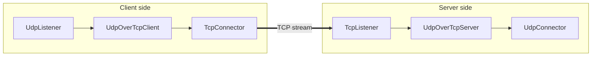

<!--
Documentation version: 153
-->

# UdpOverTcpServer

## نمای کلی {#overview}

`UdpOverTcpServer` همتای سمت مقابل `UdpOverTcpClient` است. یک جریان بایتی دارای پیشوند طول را از گره رو به جریان قبلی می‌گیرد، مرزهای دیتاگرام‌های UDP را بازسازی می‌کند و بار مفید هر بسته را به گره بعدی می‌فرستد.

پاسخ گره بعدی هم با همان پیشوند طول دو بایتی قاب می‌شود و از طریق جریان در جهت `downstream` برمی‌گردد.

## جایگاه معمول در زنجیره {#typical-placement}

### جایگاه معمول در زنجیره {#typical-placement-1}

<a id="جایگاه-رایج"></a>

سمت سرور:

```text
TcpListener -> UdpOverTcpServer -> UdpConnector
TcpListener -> TlsServer -> UdpOverTcpServer -> UdpConnector
TcpListener -> EncryptionServer -> UdpOverTcpServer -> UdpConnector
```

سمت کلاینت متناظر:

```text
UdpListener -> UdpOverTcpClient -> TcpConnector
UdpListener -> UdpOverTcpClient -> TlsClient -> TcpConnector
TcpUdpListener -> Router (UDP branch) -> UdpOverTcpClient -> TcpConnector
```

گره قبلی `UdpOverTcpServer` باید یک مسیر جریان فراهم کند؛ گره بعدی بارهای مفید بازسازی‌شدهٔ بسته‌ها را دریافت می‌کند.

### نمونهٔ جریان {#flow-example}

<a id="نمودار-جریان"></a>



## نمونهٔ کاربردی ساده {#minimal-practical-example}

این‌ها قطعه‌های پیکربندی گره هستند؛ گره‌های همسایهٔ ارجاع‌شده را در پیکربندی پیرامونی تعریف کنید.

### نمونهٔ پایه {#basic-example}

<a id="نمونه-ساده"></a>

این پیکربندی کامل با [مثال کلاینت](UdpOverTcpClient.mdx) متناظر است. TCP `7443`
انتقال قاب‌بندی‌شده‌ی WaterWall را دریافت می‌کند؛ UDP `127.0.0.1:51820` نقطهٔ پایانی
واقعی سرویس روی این دروازه است. آدرس و پورت سرویس را متناسب با نیاز عوض کنید.
خود قاب‌بندی رمزنگاری اضافه نمی‌کند؛ چیدمان TLS بالا، `TlsClient` و `TlsServer`
را دور همین انتقال جریان قرار می‌دهد.

```json
{
  "name": "udp-service-over-tcp-server",
  "nodes": [
    {
      "name": "stream-in",
      "type": "TcpListener",
      "settings": {
        "address": "0.0.0.0",
        "port": 7443
      },
      "next": "udp-over-tcp-server"
    },
    {
      "name": "udp-over-tcp-server",
      "type": "UdpOverTcpServer",
      "settings": {},
      "next": "udp-out"
    },
    {
      "name": "udp-out",
      "type": "UdpConnector",
      "settings": {
        "address": "127.0.0.1",
        "port": 51820
      }
    }
  ]
}
```

## پیکربندی {#configuration}

### فیلدهای لازم {#required-fields}

<a id="فیلدهای-ضروری"></a>

فیلدهای سطح بالا:

| فیلد | نوع | توضیح |
| --- | --- | --- |
| `name` | string | نام دلخواه گره. باید داخل فایل پیکربندی یکتا باشد. |
| `type` | string | باید دقیقاً `"UdpOverTcpServer"` باشد. |
| `next` | string | گره‌ای که بارهای مفید بازسازی‌شدهٔ بسته‌ها را دریافت می‌کند. در استفاده معمول لازم است. |

`settings` می‌تواند `{}` باشد؛ پیاده‌سازی فعلی هیچ تنظیم اختصاصی این تونل را نمی‌خواند.

### تنظیمات اختیاری {#optional-settings}

<a id="تنظیمات-اختیاری"></a>

در پیاده‌سازی فعلی هیچ تنظیم اختصاصی تونل وجود ندارد.

رفتار انتقال، مقصد، سوکت، TLS، رمزنگاری یا مسیریابی مربوط به گره‌های همسایه است؛ مثل `TcpListener`، `TlsServer`، `EncryptionServer`، `UdpConnector` یا `TcpUdpConnector`.

## کاربرد و رفع اشکال {#usage-and-troubleshooting}

### محدودیت اندازهٔ بسته {#packet-size-limit}

<a id="محدودیت-اندازه-packet"></a>

حداکثر اندازهٔ دیتاگرام UDP خروجی:

```text
65535 - 20 - 8 - 2 = 65505 bytes
```

دیتاگرام بزرگ‌تر از این حد به‌صورت کامل حذف می‌شود. بار مفید خروجی خالی شرط ثابت موجود در Debug را
نقض می‌کند و در Release، حذف می‌شود. قاب ورودی با طول صفر نامعتبر است و حامل را می‌بندد.

### بافرکردن و سرریز {#buffering-and-overflow}

<a id="buffering-و-overflow"></a>

بایت‌های جریان ورودی تا زمان استخراج قاب‌های کامل در بافر نگه داشته می‌شوند.

پس از تخلیهٔ قاب‌های کامل، فیلد طول 16 بیتیِ قالب انتقال باعث می‌شود حداکثر 65,536 بایت ورودی ناقص، با احتساب سرآیند دو بایتی، باقی بماند. رمزگشا طول‌های غیرصفر تا 65,535 بایت را می‌پذیرد؛ سقف دیتاگرام خروجی همچنان 65,505 بایت است.

هزینهٔ محاسبه‌شده برای بافرهای نگهداری‌شده به 4 MiB محدود است و پس از تخلیهٔ قاب‌های کامل، در صورت سودمند بودن، فشرده‌سازی امتحان می‌شود. قاب‌های بدساخت، فضای ذخیره‌سازی با اندازهٔ غیرقابل‌نمایش یا اتمام بودجه‌ها باعث می‌شوند مالک حامل آن را ببندد. ورود مجدد به رمزگشا و جریان نگهداری‌شدهٔ آن، محدودیت مشترک 2 MiB برای تعداد بایت‌ها و 4 MiB برای هزینهٔ محاسبه‌شده دارند. تجزیه‌گر هرگز برای ادامهٔ کار، بایت‌هایی دلخواه از جریان را دور نمی‌ریزد.

### اشتباه‌های رایج {#common-mistakes}

<a id="اشتباههای-رایج"></a>

- بدون `UdpOverTcpClient` در سمت مقابل از این گره استفاده نکنید.
- آن را مستقیماً بعد از گره فقط مخصوص بسته نگذارید؛ سمت قبلی باید جریان بایت‌های قاب‌بندی‌شده فراهم کند.
- انتظار نداشته باشید خودش به TCP گوش دهد؛ قبل از آن `TcpListener` یا آداپتور رو به جریان دیگری بگذارید.
- سمت بعدی باید مرز دیتاگرام‌های UDP را حفظ کند و مقصد UDP داشته باشد.
- دیتاگرام UDP بزرگ‌تر از `65505` بایت نفرستید.

## رفتار پیشرفته {#advanced-behavior}

### مدل قاب‌بندی {#framing-model}

<a id="مدل-framing"></a>

سرور انتظار دارد قاب‌های عادی بسته این قالب را داشته باشند:

```text
2-byte unsigned big-endian payload length + packet payload
```

بایت‌های ورودی از سمت جریان قبلی تا کامل شدن یک قاب جمع می‌شوند. سپس سرآیند دو بایتی حذف می‌شود و بسته بازسازی‌شده در جهت `upstream` به گره بعدی می‌رود.

پاسخ‌های گره بعدی مسیر برعکس را طی می‌کنند: سرور فیلد طول دو بایتی را به ابتدا اضافه می‌کند و بایت‌های قاب‌بندی‌شده را در جهت `downstream` به گره جریان قبلی می‌فرستد.

هر `callback` بار مفید در سمت دیتاگرام دقیقاً یک دیتاگرام از نوع UDP است. این گره‌ها همیشه بار مفید UDP حمل
می‌کنند و فراداده مربوط به پروتکل مبدأ، قاب‌بندی را تغییر نمی‌دهد. شنونده چندپروتکلی باید ترافیک
TCP را پیش از کلاینت به مسیر جداگانه‌ای هدایت کند.

## جزئیات پیاده‌سازی {#implementation-details}

### رفتار چرخهٔ عمر {#lifecycle-behavior}

<a id="رفتار-lifecycle"></a>

با دریافت `Init` در جهت `upstream`، سرور وضعیت قاب‌بندی هر `line` را مقداردهی اولیه می‌کند، پروتکل مقصد را روی UDP می‌گذارد و بلافاصله گره بعدی را مقداردهی اولیه می‌کند. رویدادهای `Est`، `Pause` و `Resume` مربوط به انتقال نیز بدون تأخیر عبور داده می‌شوند.

برای بار مفید `upstream`، سرور بایت‌های جریان ورودی را اضافه می‌کند، قاب‌های کامل را رمزگشایی می‌کند و دیتاگرام‌های UDP بازیابی‌شده را به گره بعدی می‌فرستد. برای بار مفید `downstream`، هر دیتاگرام پاسخ را قاب‌بندی می‌کند و از طریق سمت جریان قبلی برمی‌گرداند.

با دریافت `Finish` از هر جهت، گره وضعیت محلی `line` خود را از بین می‌برد و `Finish` را دور از فرستنده، در جهت متناظر WaterWall، عبور می‌دهد. این گره `lineDestroy()` را فراخوانی نمی‌کند.

`UpStreamEst` و `DownStreamInit` در پیاده‌سازی فعلی غیرفعال‌اند.

### پشتیبانی از splice {#splice-support}

<a id="پشتیبانی-از-splice"></a>

هر دو گره بافرهای عادی و بدنه‌های موجود در لوله‌های خصوصی را می‌پذیرند. هر دیتاگرام UDP خروجی بدنهٔ خود را حفظ می‌کند، یک پیشوند طول دو بایتیِ مقیم حافظه می‌گیرد و در یک `callback` ارسال می‌شود. دیتاگرام‌های بیش از حد بزرگ به‌صورت کامل حذف می‌شوند. رمزگشا فقط سرآیند طول دو بایتی را در حافظهٔ موقت نگه می‌دارد و هر دیتاگرام کامل را به‌شکل یک بافر با مالکیت مستقل استخراج می‌کند؛ اگر منابع لوله در دسترس نباشند، از مسیر عادی استفاده می‌شود.

مرزهای دیتاگرام‌های UDP حفظ می‌شوند و حامل TCP همچنان واجد شرایط splice می‌ماند. هر مسیر جایگزین برای انتقال داده به حافظهٔ عادی در سوکت UDP بر عهدهٔ فرستندهٔ UDP است. پردازش قاب‌های کامل در ورودی جریانِ پذیرفته‌شده پس از `Pause` ادامه می‌یابد؛ `Finish` یا رد پذیرش، پردازش را متوقف می‌کند.

### فضای پیشوند (padding) {#padding}

این گره هنگام ساخت پاسخ با `sbufShiftLeft()` یک سرآیند دو بایتی به ابتدای قاب اضافه می‌کند، بنابراین مقدار زیر را اعلام می‌کند:

```text
required_padding_left = 2
```

### فرادادهٔ گره {#node-metadata}

<a id="متادیتای-نود"></a>

فرادادهٔ برگرفته از کد منبع:

| ویژگی | مقدار |
| --- | --- |
| پرچم‌های گره | `kNodeFlagSupportsSplice` |
| `can_have_prev` | `true` |
| `can_have_next` | `true` |
| `layer_group` | `kNodeLayer4` |
| `layer_group_prev_node` | `kNodeLayer4Stream` |
| `layer_group_next_node` | `kNodeLayer4Datagram` |
| `required_padding_left` | `2` بایت |
